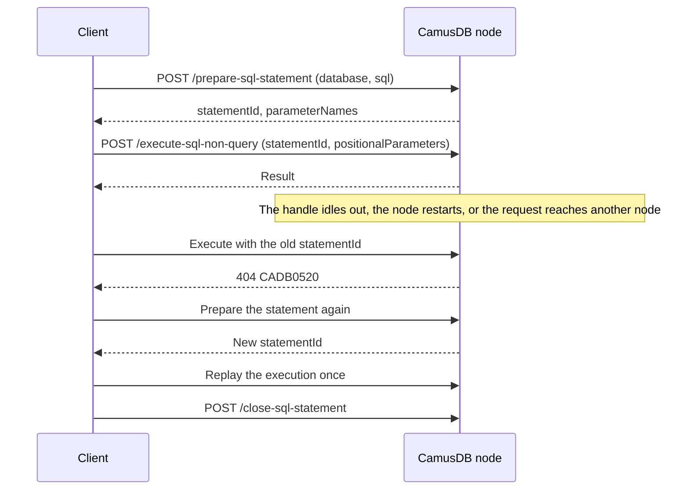
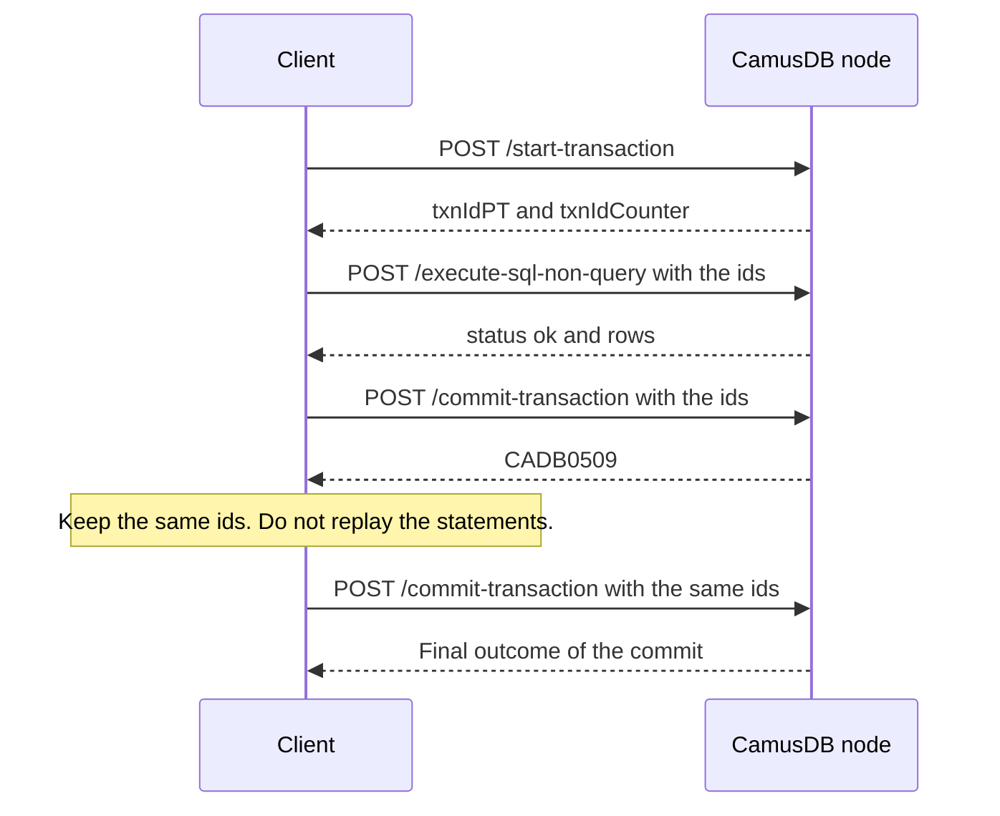

# HTTP/JSON protocol reference

For application code, start with a driver: [.NET](/docs/dotnet-driver),
[TypeScript](/docs/typescript-connector), or [Python](/docs/python-driver).
You bind parameters and read results through the library, and it handles the
wire format and the transaction handles. For repeatable units of work, use its
[retry helpers](/docs/serializable-retries).

This reference is for authors of drivers and integrations, for HTTP clients in
languages that don't have a driver, and for diagnostics at the endpoint level.
You don't need it to use CamusDB. For interactive SQL and scripts, use
[camus-cli](/docs/camus-cli) or the [Web Console](/docs/web-console).

## When to use the HTTP API

Direct requests are useful for health probes, for a test of an endpoint with
curl, or to write a client. A script in a language with a driver should use
the driver, like a service does.

The HTTP API carries JSON on port 5095 by default. It reaches the same engine as
gRPC, with the same SQL and transaction behavior. The .NET and TypeScript
drivers support both transports. The Python driver uses REST. All JSON request
and response properties use camel case.

## Transport

The HTTP API serves JSON over HTTP/1.1 and HTTP/2. The HTTPS port can also serve
HTTP/3 over QUIC when `http3_enabled: true` is set and the node has an HTTPS
certificate. HTTP/3 uses the same endpoints and the same request and response
formats. It changes only the transport between the client and the node. For the
requirements, see [Configuration](/docs/configuration#http3-on-the-https-port).

## Status and errors

A successful response has `"status": "ok"`. A failed response has
`"status": "failed"` and, when one is available, a CamusDB error code:

```json
{
  "status": "failed",
  "code": "CADB0400",
  "message": "error message"
}
```

The HTTP status depends on the error code. For example:

| Error | HTTP status |
| --- | --- |
| `CADB0400` invalid input, such as a malformed JSON body | 400 |
| `CADB0010` the database doesn't exist | 404 |
| `CADB0304` a foreign-key violation | 409 |
| `CADB0557` a statement over `max_statement_bytes` | 413 |
| `CADB0011` a missing table, or `CADB0406` a syntax error | 500 |

Many errors map to HTTP 500, and some administrative endpoints, such as
`/create-db`, use 500 for errors that a SQL endpoint maps to another status.
This means that a client should classify an error by its `code`, and not by
the HTTP status. For the list of codes, see [Error codes](/docs/error-codes).

The SQL endpoints return `CADB0400` for a malformed JSON body, also for an
escaped lone surrogate half. The message gives the JSON path and the byte
position, for example
`The request body is not valid JSON at $.parameters.@a.strValue (line 1, byte 97).`
SQL text and parameters in valid JSON follow the
[engine's validation rules](/docs/data-types#characters-and-valid-unicode).

## Request limits

Inline SQL can be at most 8 MiB of UTF-8 by default (`max_statement_bytes`). A
longer statement returns `CADB0557` and HTTP 413 before it is parsed. Bound
parameter values don't count against that limit.

A buffered `/execute-sql-query` or `/query` response can have at most 1,000,000
rows or 256 MiB of estimated memory by default. A larger result returns
`CADB0556` before the commit, and the statement is rolled back. For large
reads, use `/execute-sql-query-stream` or pagination. Note that a write with
`RETURNING` can buffer its rows before the commit. This means that the
streaming endpoint doesn't always avoid the limit.

These limits are bounds on the resources of a node. They aren't rate limits
for each client. For the settings, see
[Request resource limits](/docs/settings-reference#request-resource-limits).

## Cancellation

If an HTTP client cancels a request or disconnects during a query, CamusDB
cancels the query. Scans and the other operators stop at their next storage
read or operator boundary. If a client stops reading a stream early, the
server cleans up the query. For long reads, you should use the streaming
endpoint when your client can process rows one at a time.

A disconnected client won't start a new write transaction or trigger another
Serializable retry. A write that has started can still commit. The server
records canceled HTTP requests as status 499. A disconnect by itself leaves
the write outcome unknown to the client.

## Authentication

A driver takes credentials in its configuration. A direct HTTP client exchanges
them for a bearer token through `/login`:

```http
POST /login
Content-Type: application/json

{ "user": "admin", "password": "secret" }
```

Successful response:

```json
{
  "status": "ok",
  "token": "camus_<id>.<secret>",
  "expiresAtUnixMs": 1785270000000,
  "expiresInSeconds": 900
}
```

Send the token on later requests:

```http
Authorization: Bearer camus_<id>.<secret>
```

To revoke the current token, call `/logout` with the same header.

`expiresAtUnixMs` is the deadline of the token, in UTC. `expiresInSeconds` is
the same deadline as a duration that the server measured. A client that renews
on a timer can use it, and it doesn't need to trust its local clock.

For the setup, the grants, and the TLS rules, see
[Authentication and authorization](/docs/sql-authentication).

## Column values

Request bodies send values as `ColumnValue` objects, for example in SQL
parameters and in the filters of direct row operations. Result rows use a more
compact form. For that form, see
[`POST /execute-sql-query`](#post-execute-sql-query).

A `ColumnType` is the number of its enum value:

| Value | Type |
| --- | --- |
| `0` | null |
| `1` | id / object id |
| `2` | int64 |
| `3` | string |
| `4` | bool |
| `5` | float64 |
| `6` | float32 |
| `7` | bytes |
| `8` | date |
| `9` | datetime |
| `10` | array |
| `11` | uuid |
| `12` | numeric |
| `13` | jsonb |

```json
{ "type": 3, "strValue": "R2-D2", "longValue": 0, "floatValue": 0, "boolValue": false }
{ "type": 2, "strValue": null, "longValue": 1977, "floatValue": 0, "boolValue": false }
{ "type": 5, "strValue": null, "longValue": 0, "floatValue": 12.5, "boolValue": false }
{ "type": 6, "strValue": null, "longValue": 0, "floatValue": 12.5, "boolValue": false }
{ "type": 4, "strValue": null, "longValue": 0, "floatValue": 0, "boolValue": true }
{ "type": 1, "strValue": "507f1f77bcf86cd799439011", "longValue": 0, "floatValue": 0, "boolValue": false }
{ "type": 7, "bytesValue": "3q2+7w==", "longValue": 0, "floatValue": 0, "boolValue": false }
{ "type": 8, "longValue": 639039456000000000, "isoValue": "2026-03-15" }
{ "type": 9, "longValue": 639039888000000000, "isoValue": "2026-03-15T12:00:00.0000000Z" }
{ "type": 10, "arrayElementType": 2, "arrayValues": [{ "type": 2, "longValue": 42 }] }
{ "type": 11, "strValue": "550e8400-e29b-41d4-a716-446655440000", "longValue": 0, "uuidHigh": 0 }
{ "type": 12, "strValue": "12345678901234567890.123456789" }
{ "type": 13, "strValue": "{\"kind\": \"login\", \"user\": {\"id\": 7}}" }
```

| Type | Rules |
| --- | --- |
| Bytes | SQL literals use hex (`X'...'`). JSON uses base64 in `bytesValue`. |
| Vector | A `BYTES` value with the packed float32 elements, as base64 in `bytesValue`. For example, `[0.0, 1.0]` is `{"type": 7, "bytesValue": "AAAAAAAAgD8="}`. For the byte layout, see [Vector search](/docs/vector-search#how-a-vector-is-stored). |
| Date, datetime | `longValue` has the stored value as UTC ticks. Responses also have an `isoValue`. |
| UUID | In a request, pass the canonical text or 32 hex digits in `strValue`. Responses also have a `uuidValue`. |
| Numeric | In a request, pass decimal text in `strValue`. The value is rounded to nine fractional digits if needed. A value out of range returns `CADB0417`. Responses have the canonical text in `numericValue`. |
| Non-finite float | A JSON string, such as `"NaN"` or `"-Infinity"`. It is used in `floatValue` of a request and in result cells. See [Floating-point values](/docs/data-types#floating-point-values). |

### JSONB values

For a `JSONB` parameter, pass the JSON text in `strValue` with `type` 13:
`{"type": 13, "strValue": "<json text>"}`. A string value written to a `JSONB`
column also works.

In result rows, a `JSONB` column has type `13`. By default, each cell is the
document as native JSON in the row, and numbers have all their digits.

In this default form, a JSON `null` document and a SQL `NULL` cell are both the
token `null`. A client can't tell them apart. If the client writes the value
back, it can store SQL `NULL` in place of the document.

To keep the two values apart, set `"jsonbAsText": true` in the request body.
The option applies to the query endpoints, and to the `RETURNING` rows of
`/execute-sql-non-query`. Each `JSONB` cell is then a
JSON string with the document text. SQL `NULL` is the token `null`.

| Value | Default form | Text form |
| --- | --- | --- |
| SQL `NULL` | `null` | `null` |
| JSON `null` | `null` | `"null"` |
| `"abc"` | `"abc"` | `"\"abc\""` |
| `{"a": 1}` | `{"a": 1}` | `"{\"a\": 1}"` |

The response marks each `JSONB` column that uses the text form:

```json
{"name": "payload", "type": 13, "jsonbAsText": true}
```

Decode a cell as text if its column has this mark. A server that doesn't know
the option ignores it and sends the default form. A string document such as
`"abc"` is valid in both forms. This means that the mark is the one safe test.

For the `JSONB` type and its operators, see [JSON documents](/docs/json).

## Health

### `GET /ping`

Returns the server status and the UTC time. `GET /health` is an alias that
returns the same response. A credential isn't needed for either one.

```json
{
  "status": "ok",
  "dateTime": "2026-05-28T18:30:00.0000000Z"
}
```

## Databases

Create a database before other statements use its name.

### `POST /create-db`

```json
{
  "databaseName": "app",
  "ifNotExists": true
}
```

### `POST /drop-db`

```json
{
  "databaseName": "app"
}
```

This endpoint drops an existing database. For a drop that you can repeat, use
SQL:

```json
{
  "sql": "DROP DATABASE IF EXISTS app"
}
```

SQL can also rename a database, with `RENAME DATABASE` or the same statement as
`ALTER DATABASE ... RENAME TO`:

```json
{
  "sql": "RENAME DATABASE app TO app_prod"
}
```

### `POST /close-db`

```json
{
  "databaseName": "app"
}
```

## Tables

### `POST /create-table`

```json
{
  "databaseName": "app",
  "tableName": "robots",
  "ifNotExists": true,
  "columns": [
    { "name": "id", "type": "id", "primary": true, "notNull": true, "defaultValue": null },
    { "name": "parent_id", "type": "id", "notNull": false, "defaultValue": null },
    { "name": "name", "type": "string", "maxLength": 64, "notNull": true, "defaultValue": null },
    { "name": "payload", "type": "bytes", "notNull": false, "defaultValue": null },
    { "name": "tags", "type": "array", "arrayElementType": "string", "notNull": false, "defaultValue": null },
    {
      "name": "year",
      "type": "int64",
      "notNull": false,
      "defaultValue": {
        "type": 2,
        "strValue": null,
        "longValue": 2024,
        "floatValue": 0,
        "boolValue": false
      }
    }
  ],
  "foreignKeys": [
    {
      "name": "robots_parent_fk",
      "columns": ["parent_id"],
      "referencedTable": "robots",
      "referencedColumns": ["id"],
      "onDelete": "restrict",
      "onUpdate": "no action"
    }
  ]
}
```

| Type name | Aliases |
| --- | --- |
| `id` | |
| `int64` | `int`, `integer` |
| `float64`, `float32` | `real` |
| `bool` | |
| `string` | `char`, `varchar`, `text` |
| `date`, `datetime` | `timestamp` |
| `bytes` | `blob` |
| `uuid` | `guid` |
| `numeric` | `decimal` |
| `jsonb` | |
| `array` | Set the element type in `arrayElementType`. |

Type names aren't case-sensitive. Use `maxLength` to limit `string` and `bytes`
values. For the SQL type names and literal formats, see
[Data types](/docs/data-types).

Use `foreignKeys` to declare table-level foreign keys. An entry needs a `name`
and the child `columns`. It also needs a `referencedTable`. An empty `referencedColumns`
references the primary key of the parent. `onDelete` and `onUpdate` accept
`"no action"` and `"restrict"`. Other actions, such as `cascade`, return
`CADB0533`. See [Foreign keys](/docs/foreign-keys).

## SQL execution

You should use the SQL endpoints when you can. They support all of CamusSQL,
and the direct row operations support a small part of it.

Autocommit SQL requests use Serializable isolation by default. A request that
starts a transaction can have the following optional fields:

| Field | Values |
| --- | --- |
| `isolationLevel` | `"Serializable"` or `"ReadCommitted"` |
| `transactionMode` | `"ReadWrite"` or `"ReadOnly"` |
| `locking` | `"Pessimistic"` or `"Optimistic"`, for a request that writes |
| `priority` | From `"Background"` to `"Critical"`. See [Transaction priority](/docs/transaction-priority). |

These fields are ignored when the request continues an existing transaction
with `txnIdPT` and `txnIdCounter`. A read-only request to `/execute-sql-query`
also ignores `locking`. It doesn't open a write transaction, and it doesn't
check write conflicts.

A statement that changes data or schema, sent with
`"transactionMode": "ReadOnly"`, returns HTTP 400 with `CADB0849`
(`ReadOnlyTransaction`). For example, DDL on `/execute-sql-ddl` or `nextval()`
on `/execute-sql-query` returns this error. The same error is returned in a
transaction that was started read-only. For the full list, see
[Read-only transactions](/docs/sql-transactions#read-only-transactions).

### `POST /execute-sql-ddl`

For SQL that changes the schema:

```json
{
  "databaseName": "app",
  "sql": "CREATE TABLE IF NOT EXISTS robots (id OID PRIMARY KEY NOT NULL, name STRING NOT NULL, year INT64)",
  "parameters": null
}
```

Statements at the server level, such as `CREATE DATABASE`, can omit
`databaseName`:

```json
{
  "sql": "CREATE DATABASE IF NOT EXISTS app",
  "parameters": null
}
```

Operational queries at the server level, such as `SHOW ENGINE STATS`, can also
omit `databaseName`.

Response:

```json
{ "status": "ok", "rows": 2, "warning": null }
```

`rows` is the count of rows that the statement wrote, for example the rows that
`CREATE TABLE ... AS SELECT` copied. It is `0` for DDL that doesn't write rows.
`warning` is `null`, unless there is something to report. For example, a
time-travel copy that reads no rows returns a warning. See
[Copying query results](/docs/insert-select-and-ctas#row-counts-and-empty-copy-warnings).

### `POST /execute-sql-query`

For `SELECT` and `SHOW` statements:

```json
{
  "databaseName": "app",
  "sql": "SELECT id, name FROM robots WHERE year >= @year ORDER BY name ASC",
  "isolationLevel": "Serializable",
  "transactionMode": "ReadOnly",
  "parameters": {
    "@year": {
      "type": 2,
      "strValue": null,
      "longValue": 1970,
      "floatValue": 0,
      "boolValue": false
    }
  }
}
```

Response:

```json
{
  "status": "ok",
  "total": 1,
  "columns": [
    { "name": "id", "type": 1 },
    { "name": "name", "type": 3 }
  ],
  "rows": [
    ["507f1f77bcf86cd799439011", "R2-D2"]
  ],
  "code": null,
  "message": null,
  "causalToken": { "n": 1, "l": 1792500000000, "c": 0 },
  "serverTimeMs": 2.4,
  "cacheStatus": null,
  "cacheBypassReason": null,
  "cachedAtHlc": null,
  "ageMs": null,
  "cacheName": null
}
```

`columns` lists the output columns in order, with the numeric `ColumnType` of
each one. It is present also when `rows` is empty. Each entry in `rows` is an
array by position: `rows[r][c]` is the value of `columns[c]`. The values are
JSON values, and not `ColumnValue` objects:

| Column type | JSON value |
| --- | --- |
| id, string | string |
| int64, float64, float32 | number |
| bool | `true` or `false` |
| bytes | base64 string |
| date, datetime | number of UTC ticks |
| uuid | array of two int64 numbers, `[high, low]` |
| numeric | decimal text, such as `"19.99"` |
| jsonb | the document, or text with `jsonbAsText` |
| array | JSON array of element values. The column also has an `elementType`. |

A SQL `NULL` is JSON `null`. The cache fields are `null` unless the query has a
cache hint. See [Query result cache](/docs/query-result-cache).

`causalToken` is a cluster timestamp, in the parts of a
[hybrid logical clock (HLC)](/docs/concepts#hlc) value. Send it back as
`causalToken` on the next autocommit query or `/start-transaction` request.
The read then sees your earlier writes, also on another node. The floor of an
explicit transaction is fixed when it starts. Tokens on its later statements
don't move it.

You can also send a write with a `RETURNING` list to this endpoint. The response has
the same shape: `columns`, then `rows`.

To get advisory routing metadata, set `routingAcceptVersion: 1` on the request.
An eligible response then has a `routing` object. See
[SQL routing advice](/docs/sql-routing-advice).

This endpoint supports time-travel reads with `AS OF SYSTEM TIME`. The
statement must be a read-only `SELECT` in autocommit mode:

```json
{
  "databaseName": "app",
  "sql": "SELECT id, name FROM robots AS OF SYSTEM TIME '-10s' WHERE year >= @year",
  "transactionMode": "ReadOnly",
  "parameters": {
    "@year": {
      "type": 2,
      "longValue": 1970
    }
  }
}
```

The SQL rules also apply over HTTP. The clause can't be used in an explicit
transaction, and an invalid value returns `CADB0409` `InvalidAsOfSystemTime`.
See [Time-travel reads](/docs/time-travel-reads).

### `POST /execute-sql-query-stream`

For large `SELECT` or `SHOW` results, use the streaming endpoint:

```json
{
  "databaseName": "app",
  "sql": "SELECT id, name FROM robots ORDER BY name",
  "isolationLevel": "Serializable",
  "transactionMode": "ReadOnly",
  "parameters": null
}
```

The request body has the same shape as for `/execute-sql-query`. The response
is one JSON value per line, with the content type `application/x-ndjson`:

```json
{"status":"ok","columns":[{"name":"id","type":1},{"name":"name","type":3}]}
["507f1f77bcf86cd799439011","R2-D2"]
["507f1f77bcf86cd799439012","C-3PO"]
{"status":"ok","total":2,"serverTimeMs":3.1}
```

The first line is the schema header. Each row is an array by position, in the
column order of the header. The last line is a trailer with the final status,
the count of rows, a causal token if there is one, and the server time.

If an error happens before the first line, the response is an ordinary JSON
error with the matching HTTP status. If an error happens after the stream
starts, the HTTP status is already `200`. The error is then in the trailer:

```json
{"status":"failed","total":128,"code":"CADB0502","message":"transaction conflict","serverTimeMs":12.4}
```

An autocommit stream makes one attempt. Rows can already be sent before the
commit. This means that the server can't execute the statement again after a
late Serializable conflict. The buffered endpoint can. Use `/execute-sql-query`
when automatic retries matter more than incremental delivery, or use an
explicit transaction and retry from the client.

### `POST /execute-sql-non-query`

For DML statements and `CANCEL QUERY`:

```json
{
  "databaseName": "app",
  "sql": "UPDATE robots SET name = @name WHERE id = @id",
  "parameters": {
    "@name": { "type": 3, "strValue": "Artoo", "longValue": 0, "floatValue": 0, "boolValue": false },
    "@id": { "type": 1, "strValue": "507f1f77bcf86cd799439011", "longValue": 0, "floatValue": 0, "boolValue": false }
  }
}
```

Response:

```json
{
  "status": "ok",
  "rows": 1
}
```

The response can also have a `warning`, with the same meaning as on
`/execute-sql-ddl`. For example, an `INSERT ... SELECT` time-travel copy that
reads no rows has a warning.

A write with a `RETURNING` list can also use this endpoint. `rows` is the count
of affected rows, and the response adds `columns` and `returningRows`:

```json
{
  "status": "ok",
  "rows": 1,
  "columns": [{ "name": "id", "type": 1 }],
  "returningRows": [["507f1f77bcf86cd799439011"]]
}
```

If you need only the count, set `discardReturningRows: true` in the request
body. The `RETURNING` list and the privileges are checked as before.

To get advisory routing metadata, set `routingAcceptVersion: 1`. See
[SQL routing advice](/docs/sql-routing-advice).

### Locking reads

`SELECT ... FOR UPDATE` uses the query endpoints, but it needs a writable
transaction. An autocommit locking read commits and releases its locks before
it sends the rows. If a later `UPDATE` depends on the lock, use an explicit
transaction. For autocommit `SKIP LOCKED`, pass
`"isolationLevel": "ReadCommitted"`. For the rules and error codes, see
[Locking reads](/docs/sql-queries#for-update).

## Prepared statements

A prepared statement lets a client register SQL once, and then execute it many
times by handle, with different values. It helps with frequent parameterized
statements. You can prepare queries and DML statements.
`/execute-sql-ddl` returns an error for a handle.

### `POST /prepare-sql-statement`

```json
{
  "databaseName": "app",
  "sql": "UPDATE robots SET name = @name, year = @year WHERE id = @id"
}
```

Response:

```json
{
  "status": "ok",
  "statementId": "opaque-node-local-handle",
  "parameterNames": ["@name", "@year", "@id"]
}
```

`parameterNames` lists the distinct placeholder names in binding order, in the
order of their first occurrence. Each name has its leading `@`. A name that
appears more than once uses one slot. The list includes placeholders in
subqueries.

A prepare parses and registers the statement, but it doesn't check privileges.
Authorization happens at execution time, for the principal of that request, as
for an inline statement. This means that a prepare reveals one fact only:
whether the SQL parses. A statement that doesn't parse fails at the prepare.

### Execute a prepared statement

Send `statementId` and `positionalParameters` to an execute endpoint, such as
`/execute-sql-non-query`:

```json
{
  "statementId": "opaque-node-local-handle",
  "positionalParameters": [
    { "type": 3, "strValue": "Artoo" },
    { "type": 2, "longValue": 1977 },
    { "type": 1, "strValue": "507f1f77bcf86cd799439011" }
  ]
}
```

`positionalParameters[i]` binds to `parameterNames[i]` from the prepare
response. The number of values must equal the number of names, or the request
returns `CADB0400`. Each value uses the encoding of the inline `parameters`
map. The names aren't sent. This means that a client that binds by name maps
its arguments to the positions itself.

When you send `statementId`, omit `sql`, `databaseName`, and the named
parameters. The other request fields work as they do inline, for example the transaction ids
and `causalToken`.

### `POST /close-sql-statement`

```json
{ "statementId": "opaque-node-local-handle" }
```

A repeated close is harmless. You can skip the close: the server frees handles
that stay idle. However, a client that prepares an unbounded number of
different statements reaches its cap.

### Handle lifetime

A REST handle is an opaque string. It belongs to the node and to the principal
that prepared it. It is freed by a close, by the idle timeout, or by a
restart. A handle isn't replicated to another node.

HTTP doesn't have a session that the server can trust. Connections are pooled,
and load balancers move them. For this reason, a handle
can't be guessed, the server records its owner at registration, and an idle
timeout frees a handle that a client doesn't close.

### Recover from `CADB0520`

An execution returns `CADB0520` (`UnknownPreparedStatement`, HTTP 404) when the
node doesn't know its handle. This is a normal case: prepare the statement
again, then execute the request again once. The error occurs when:

- The handle was unused for longer than `prepared_statement_idle_timeout_ms`.
- The node restarted.
- A load balancer sent the request to a different node.
- The handle belongs to a different principal. This case returns the same
  error on purpose. A separate error would tell a caller that a handle exists
  that the caller doesn't own.



Behind a load balancer, use sticky sessions. You can also accept one new
prepare per node for each statement. After warm-up, there is one registration per node.

On the streaming endpoint, the handle is resolved before any bytes are sent.
This means that a 404 arrives as a normal JSON error, and not in the middle of
a stream.

For the statements that you can prepare and the limits, see
[Prepared statements](/docs/prepared-statements).

## Direct row operations

Direct endpoints take filters in place of a SQL string. A filter compares a
column with a `ColumnValue`, with an operator such as `>=`. `OrderType` is also a number: `0` is
ascending and `1` is descending.

```json
{
  "columnName": "year",
  "op": ">=",
  "value": {
    "type": 2,
    "strValue": null,
    "longValue": 1970,
    "floatValue": 0,
    "boolValue": false
  }
}
```

The `values` object of `/insert` and `/update` must name each column once. A
repeated key, also with a different case, returns HTTP 400 and `CADB0403`
before anything is written.

### `POST /insert`

```json
{
  "databaseName": "app",
  "tableName": "robots",
  "values": {
    "id": { "type": 1, "strValue": "507f1f77bcf86cd799439011", "longValue": 0, "floatValue": 0, "boolValue": false },
    "name": { "type": 3, "strValue": "R2-D2", "longValue": 0, "floatValue": 0, "boolValue": false },
    "year": { "type": 2, "strValue": null, "longValue": 1977, "floatValue": 0, "boolValue": false }
  }
}
```

### `POST /query`

```json
{
  "databaseName": "app",
  "tableName": "robots",
  "filters": [
    {
      "columnName": "year",
      "op": ">=",
      "value": { "type": 2, "strValue": null, "longValue": 1970, "floatValue": 0, "boolValue": false }
    }
  ],
  "orderBy": [
    { "columnName": "year", "type": 1 }
  ]
}
```

Note that in the current release, a `/query` request with `orderBy` returns
HTTP 500 with an internal error. To sort rows, use SQL with `ORDER BY`.

### `POST /query-by-id`

```json
{
  "databaseName": "app",
  "tableName": "robots",
  "id": "507f1f77bcf86cd799439011"
}
```

`/update` and `/delete` need at least one filter. Missing or empty filters
return HTTP 400 and `CADB0400`, and an explicit transaction is aborted too. To
change all the rows, use SQL with `WHERE TRUE`.

### `POST /update`

```json
{
  "databaseName": "app",
  "tableName": "robots",
  "values": {
    "name": { "type": 3, "strValue": "Artoo", "longValue": 0, "floatValue": 0, "boolValue": false }
  },
  "filters": [
    {
      "columnName": "id",
      "op": "=",
      "value": { "type": 1, "strValue": "507f1f77bcf86cd799439011", "longValue": 0, "floatValue": 0, "boolValue": false }
    }
  ]
}
```

### `POST /delete`

```json
{
  "databaseName": "app",
  "tableName": "robots",
  "filters": [
    {
      "columnName": "year",
      "op": "<",
      "value": { "type": 2, "strValue": null, "longValue": 1970, "floatValue": 0, "boolValue": false }
    }
  ]
}
```

## Explicit transactions

Start a transaction:

### `POST /start-transaction`

```json
{
  "databaseName": "app",
  "isolationLevel": "Serializable",
  "transactionMode": "ReadWrite",
  "locking": "Pessimistic",
  "priority": "Normal"
}
```

All four options are optional. By default, a transaction is Serializable and
read-write, with pessimistic locking and normal priority.

| Option | When to use it |
| --- | --- |
| `"ReadCommitted"` | When you want to step down from the default Serializable isolation. |
| `"ReadOnly"` with `"Serializable"` | For a stable snapshot transaction. Writes and DDL in it return `CADB0849`. |
| `"Optimistic"` | To detect conflicts at commit, in place of explicit locks during the transaction. |
| `priority` | To order admission under a configured concurrency gate. See [Transaction priority](/docs/transaction-priority). |

An unknown locking or priority value returns `CADB0400` (`InvalidInput`).

The optional `causalToken` carries the timestamp of the last commit into
`BEGIN`:

```json
{
  "databaseName": "app",
  "isolationLevel": "ReadCommitted",
  "causalToken": { "n": 1, "l": 1792500000000, "c": 0 }
}
```

Use the token that your last commit returned, with all three fields. The
statement snapshots of a Read Committed transaction are then at least that
timestamp. This means that a read on a node with a slower clock doesn't miss
the earlier commit.

Response:

```json
{
  "status": "ok",
  "txnIdPT": 123,
  "txnIdCounter": 1
}
```

To use the transaction, pass `txnIdPT` and `txnIdCounter` on later SQL or
direct row requests:

```json
{
  "databaseName": "app",
  "txnIdPT": 123,
  "txnIdCounter": 1,
  "sql": "INSERT INTO robots (id, name) VALUES (GEN_ID(), 'K-2SO')"
}
```

Commit or roll back:

### `POST /commit-transaction`

```json
{
  "databaseName": "app",
  "txnIdPT": 123,
  "txnIdCounter": 1
}
```

A successful commit returns its causal token and its commit timestamp:

```json
{
  "status": "ok",
  "causalToken": { "n": 1, "l": 1792500000008, "c": 8 },
  "commitTimestamp": { "n": 1, "l": 1792500000000, "c": 0 }
}
```

- `commitTimestamp` is the HLC timestamp of all the writes of the
  transaction. Two transactions that write the same row are in
  commit-timestamp order. If a transaction reads a value that another
  transaction wrote, the order is certain only with optimistic locking or read
  validation. With the default pessimistic locking, the later commit can have a
  lower timestamp. It is `null` for a transaction that didn't write, or that
  rolled back. Autocommit responses don't have it. A retry of the commit after
  `CADB0509` returns the same value.
- `causalToken` is above the commit timestamp. To see the commit on other
  nodes, send the token on the next `/start-transaction` or autocommit
  `/execute-sql-query` request.

### `POST /rollback-transaction`

```json
{
  "databaseName": "app",
  "txnIdPT": 123,
  "txnIdCounter": 1
}
```

If a commit or a rollback returns `CADB0509` `TransactionFinalizeUnresolved`,
send the same request again with the same transaction ids. Don't start a new
transaction, and don't execute the statements again. The original commit can
already be done on the server.



A rollback is idempotent for each transaction id. If the transaction was
already rolled back and the server no longer tracks it, the rollback succeeds
with no effect. If a commit or a rollback for the same id is in progress, the
request returns `CADB0501` `TransactionAlreadyCompleted`, and the server doesn't
guess the outcome.
