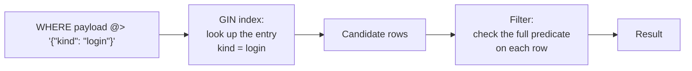

# JSON documents

A `JSONB` column stores each value as a JSON document. You can keep data that
doesn't fit a fixed set of columns next to your relational columns. You can
also query that data with SQL and index it. Typical examples are event payloads
and product attributes that change by category.

`JSONB` follows PostgreSQL. The type name, operators, functions, and GIN indexes
are the same. If your application already uses PostgreSQL `jsonb`, most of its
SQL works on CamusDB unchanged. For the exceptions, see
[Differences from PostgreSQL](#differences-from-postgresql).

## Quick example

```camussql
CREATE TABLE events (
  id INT64 PRIMARY KEY,
  payload JSONB NOT NULL
);

INSERT INTO events (id, payload)
VALUES (1, '{"user": {"id": 7, "tags": ["vip"]}, "kind": "login"}');
```

```camussql
-- Read one field as text
SELECT payload -> 'user' ->> 'id' AS user_id FROM events;
```

```text
┌─────────┐
│ user_id │
├─────────┤
│ 7       │
└─────────┘
1 rows in set (00:00:00.0007401)
```

```camussql
-- Find documents that contain a value
SELECT id FROM events WHERE payload @> '{"kind": "login"}';
```

```text
┌────┐
│ id │
├────┤
│ 1  │
└────┘
1 rows in set (00:00:00.0011844)
```

```camussql
-- Change part of a document, then read it
UPDATE events
SET payload = jsonb_set(payload, '{user,tags}', '["vip", "beta"]')
WHERE id = 1;

SELECT payload FROM events;
```

```text
┌───────────────────────────────────────────────────────────────┐
│ payload                                                       │
├───────────────────────────────────────────────────────────────┤
│ {"kind": "login", "user": {"id": 7, "tags": ["vip", "beta"]}} │
└───────────────────────────────────────────────────────────────┘
1 rows in set (00:00:00.0003869)
```

The output has `kind` before `user`. CamusDB stores keys in a canonical order.
See [What CamusDB stores](#what-camusdb-stores).

```camussql
-- Index all the keys and values in the column
CREATE INDEX events_payload_gin ON events USING GIN (payload);
```

A **document** is one JSON value, for example an object or a string. A `JSONB` cell contains one document or SQL `NULL`. JSON `null` and SQL
`NULL` are different values: `'null'::jsonb IS NULL` is false.

## The JSONB type

`JSONB` is the type, and `JSON` is an alias. You can use both names anywhere
that a type name goes. `SHOW CREATE TABLE` shows `JSONB`. The
two words aren't reserved. This means that a table or a column can have the
name `json` or `jsonb`.

### Write a document

| Form | Example |
| --- | --- |
| Text written to a `JSONB` column | `INSERT INTO t (doc) VALUES ('{"a": 1}')` |
| Typed literal | `JSONB '{"a": 1}'`, `JSON '[1, 2]'` |
| Cast | `'{"a": 1}'::jsonb`, `CAST(@p AS JSONB)` |
| Builder function | `jsonb_build_object('a', 1)`, `to_jsonb(42)` |

Text that isn't valid JSON returns `InvalidJsonText` (`CADB0418`), and the
statement doesn't write the row. The same input is invalid as in PostgreSQL:

- A trailing comma.
- A leading zero, such as `01`.
- `NaN`.
- A lone surrogate escape, or `\u0000` in a string.

A cast converts text only. To make a document from a value of another type, use
`to_jsonb`, for example `to_jsonb(42)` or `to_jsonb(now())`.

### Read a document

- `CAST(doc AS STRING)` and `doc::string` return the document text.
- `->>` and `#>>` return the text of one part of the document.
- A scalar document casts to a number or `BOOL`, as in PostgreSQL:
  `('42'::jsonb)::int64`. A document of the wrong kind returns the PostgreSQL
  message, such as `cannot cast jsonb object to type bigint`. A cast to `INT64`
  rounds half away from zero.

The text form is the same as in PostgreSQL. It has one space after each `:` and
each `,`, and the keys are in the stored order.

```camussql
SELECT '{"b":1,   "a":[1,2]}'::jsonb;
-- {"a": [1, 2], "b": 1}
```

### What CamusDB stores

Like PostgreSQL `jsonb`, CamusDB stores a canonical form of the document, and
not the input text:

- **Key order.** Keys are sorted with shorter keys first (by UTF-8 byte length),
  then by bytes. This is the PostgreSQL order. The input order is lost.
- **Duplicate keys.** The last value wins: `'{"a": 1, "a": 2}'` stores
  `{"a": 2}`.
- **Whitespace** is removed.
- **Numbers are exact.** A number has all its digits and its scale. `1.50`
  reads back as `1.50`, and `123456789012345678901234567890` reads back
  unchanged. Exponent notation becomes digits: `1e3` reads back as `1000`.
- **Strings** have the same characters. Escapes are decoded on input, and the
  output escapes only what JSON requires.

Exact numbers matter for money and identifiers. A document doesn't pass
through a floating-point value when it is written or read.

### Compare, sort, and group

Comparisons on `JSONB` values use the PostgreSQL rules. This includes sorting,
grouping, and joins:

- Kinds sort as `object > array > boolean > number > string > null`.
- An object with more pairs is greater. An array with more elements is greater.
  When the counts are equal, the members compare in stored order.
- Numbers compare by value. This means that `'1.0'::jsonb = '1'::jsonb` is true,
  and the two values are in one group.
- Strings compare by bytes.
- An empty top-level array sorts below all top-level scalars, also `null`. This
  is a PostgreSQL rule, and CamusDB uses it too.

When you compare a document with text, the text is read as a document:
`doc = '{"a": 1}'`. Text that isn't valid JSON is equal to no document.

### Where JSONB can't go

A document doesn't have an ordered key encoding. This means that a `JSONB`
column can't be in a primary key or a `UNIQUE` constraint, or in an ordered
index. It also can't be in a foreign key. To index a `JSONB` column, use a
[GIN index](#gin-indexes).

`ARRAY(JSONB)` isn't a type. An array of documents is a document:
`'[{"a": 1}, {"a": 2}]'::jsonb`.

## Operators

Each operator has the PostgreSQL meaning.

| Operator | Right operand | Result | Example |
| --- | --- | --- | --- |
| `->` | Text key or integer index | `JSONB` | `doc -> 'user'`, `doc -> 0`, `doc -> -1` |
| `->>` | Text key or integer index | `STRING` | `doc ->> 'kind'` |
| `#>` | Path | `JSONB` | `doc #> '{user,tags,0}'` |
| `#>>` | Path | `STRING` | `doc #>> ARRAY['user', 'id']` |
| `@>` | `JSONB` | `BOOL` | `doc @> '{"kind": "login"}'` |
| `<@` | `JSONB` | `BOOL` | `'{"kind": "login"}' <@ doc` |
| `?` | Text | `BOOL` | `doc ? 'kind'` |
| `?\|` | Text array | `BOOL` | `doc ?\| ARRAY['a', 'b']` |
| `?&` | Text array | `BOOL` | `doc ?& '{a,b}'` |
| `\|\|` | `JSONB` | `JSONB` | `doc \|\| '{"seen": true}'` |
| `-` | Text, text array, or integer | `JSONB` | `doc - 'tmp'`, `doc - 0`, `doc - ARRAY['a', 'b']` |
| `#-` | Path | `JSONB` | `doc #- '{user,tags}'` |

Rules:

- A **path** is an array of strings, such as `ARRAY['a', 'b']`. You can also
  write its PostgreSQL text form, such as `'{a,b}'`. An integer step in a path
  selects an array element.
- A **negative index** counts from the end of an array.
- A path that doesn't exist returns SQL `NULL`, and so does a missing key or
  index. It isn't an error.
- `@>` is **containment**: each part of the right document is in the left
  document. An array contains another array when it contains each of its
  elements, in any order. `'[1, 2, 3]'::jsonb @> '[3, 1]'` is true. Below the
  top level, a scalar doesn't contain an array:
  `'{"a": [1]}'::jsonb @> '{"a": 1}'` is false.
- `?` is true when the text is a top-level key of an object, a top-level string
  element of an array, or the top-level string itself.
- A **top-level scalar** acts as a one-element array, for example for `-> 0`
  and `@>`, as in PostgreSQL. `'"a"'::jsonb ? 'a'` is true.
- `||` merges two objects, and the right side wins for a shared key. It joins
  two arrays end to end. A scalar operand becomes a one-element array.
- Text in the place of a document is parsed as a document:
  `doc @> '{"a": 1}'`.

The `orders` and `users` examples on this page use this data:

<details>
<summary>Sample data for the examples on this page</summary>

```camussql
CREATE TABLE orders (
  id INT64 PRIMARY KEY,
  customer_id INT64 NOT NULL,
  total NUMERIC NOT NULL,
  details JSONB NOT NULL
);

INSERT INTO orders (id, customer_id, total, details) VALUES
  (15, 1, 49.90, '{"shipping": {"city": "Berlin"}, "items": [{"sku": "MUG-01", "qty": 2}]}'),
  (16, 2, 120.00, '{"shipping": {"city": "Madrid"}, "items": [{"sku": "LAMP-02", "qty": 1}], "coupon": "WELCOME10"}'),
  (17, 1, 35.50, '{"shipping": {"city": "Berlin"}, "items": [{"sku": "TEA-03", "qty": 3}, {"sku": "MUG-01", "qty": 1}], "draft_note": "Leave at the door"}');

CREATE TABLE users (
  id INT64 PRIMARY KEY,
  name STRING NOT NULL,
  tags ARRAY(STRING)
);

INSERT INTO users (id, name, tags) VALUES
  (1, 'alice', ARRAY['admin', 'beta']),
  (2, 'bob', ARRAY['beta']),
  (3, 'carol', NULL);
```

</details>

These queries use the operators on the `details` column of `orders`:

```camussql
-- Orders shipped to Berlin
SELECT id FROM orders WHERE details @> '{"shipping": {"city": "Berlin"}}';
```

```text
┌────┐
│ id │
├────┤
│ 15 │
│ 17 │
└────┘
2 rows in set (00:00:00.0281239)
```

```camussql
-- Orders that have a coupon field
SELECT id FROM orders WHERE details ? 'coupon';
```

```text
┌────┐
│ id │
├────┤
│ 16 │
└────┘
1 rows in set (00:00:00.0017898)
```

```camussql
-- The first line item of each order
SELECT id, details -> 'items' -> 0 ->> 'sku' AS first_sku FROM orders;
```

```text
┌────┬───────────┐
│ id │ first_sku │
├────┼───────────┤
│ 15 │ MUG-01    │
│ 16 │ LAMP-02   │
│ 17 │ TEA-03    │
└────┴───────────┘
3 rows in set (00:00:00.0008012)
```

```camussql
-- Mark an order as reviewed, and remove a temporary field
UPDATE orders
SET details = (details || '{"reviewed": true}') - 'draft_note'
WHERE id = 17;
```

### Operator precedence

The JSONB operators bind more tightly than comparisons, such as `IS` and `IN`.
This means that these filters work as they read:

```camussql
SELECT id FROM events WHERE payload ->> 'deleted_at' IS NULL;
SELECT id FROM events WHERE payload ->> 'kind' IN ('login', 'logout');
SELECT id FROM events WHERE payload -> 'user' ->> 'id' = '7';
```

As in PostgreSQL, the JSONB operators have the precedence of `||`, and they
group left to right. For example, `'x' || payload ->> 'kind'` means
`('x' || payload) ->> 'kind'`. That expression returns `CADB0418`, because
`'x'` isn't a JSON document. To concatenate extracted text, write
`'x' || (payload ->> 'kind')`. Arithmetic binds more tightly. This means that
`payload -> 0 + 1` selects element 1. For more information, see
[Operator precedence](/docs/sql-expression-syntax#operator-precedence).

### Operators next to placeholders and XOR

- `<@` is the contained-by operator if a placeholder name doesn't follow it
  directly. `x <@p` means `x < @p`. Write `x <@ @p` for the operator.
- `#-` is the delete-path operator, as in PostgreSQL. Note that this changed
  existing SQL: before `JSONB`, `x #-1` meant `x XOR -1`. For XOR, write
  `x # -1`, with a space.
- The `?` operators don't conflict with CamusDB placeholders, which use
  `@name`. However, a client library that uses `?` for parameters can rewrite
  these operators. With such a library, use the functions, such as
  `jsonb_exists(doc, key)`.

## Functions

If PostgreSQL has a `json_*` name for a function, you can use it in CamusDB
too, for example `json_build_object` or `json_agg`. The exception is
`json_array_length`, which is a [text JSON function](/docs/functions-json).
Most functions are strict: a SQL `NULL` argument returns SQL `NULL`. As in
PostgreSQL, the builder functions, such as `jsonb_build_object`, turn a SQL
`NULL` value into JSON `null`. A `NULL` object key is an error.

### Build documents

| Function | Result |
| --- | --- |
| `to_jsonb(value)` (`to_json`) | The value as a document. `INT64` and `NUMERIC` are exact. A float uses its shortest round-trip text, and `NaN` and the infinities become strings. `DATE` becomes `"yyyy-MM-dd"`, and `DATETIME` becomes `"yyyy-MM-ddTHH:mm:ss[.fff]+00:00"`. `BYTES` becomes `"\x…"`. An array becomes a JSON array. A document isn't changed. |
| `jsonb_build_object(k1, v1, …)` (`json_build_object`) | An object from key and value pairs. |
| `jsonb_build_array(v1, …)` (`json_build_array`) | An array of the arguments. |
| `jsonb_object(text_array)`, `jsonb_object(keys, values)` (`json_object`) | An object of string values, from one flat key/value array or from two arrays. |

```camussql
SELECT jsonb_build_object('id', id, 'name', name, 'tags', tags) AS profile FROM users;
```

```text
┌───────────────────────────────────────────────────────┐
│ profile                                               │
├───────────────────────────────────────────────────────┤
│ {"id": 1, "name": "alice", "tags": ["admin", "beta"]} │
│ {"id": 2, "name": "bob", "tags": ["beta"]}            │
│ {"id": 3, "name": "carol", "tags": null}              │
└───────────────────────────────────────────────────────┘
3 rows in set (00:00:00.0265592)
```

The SQL `NULL` in carol's `tags` becomes JSON `null`.

### Inspect documents

| Function | Result |
| --- | --- |
| `jsonb_typeof(doc)` (`json_typeof`) | The kind of the document, such as `object` or `null`. |
| `jsonb_array_length(doc)` | The number of elements. An object or a scalar is an error. The name `json_array_length` belongs to the [text JSON functions](/docs/functions-json). |
| `jsonb_extract_path(doc, step, …)` (`json_extract_path`) | The same as `#>`, with the steps as arguments. |
| `jsonb_extract_path_text(doc, step, …)` (`json_extract_path_text`) | The same as `#>>`. |
| `jsonb_exists(doc, key)` | The same as `?`. |
| `jsonb_exists_any(doc, keys)` | The same as `?\|`. |
| `jsonb_exists_all(doc, keys)` | The same as `?&`. |

### Change documents

| Function | Result |
| --- | --- |
| `jsonb_set(doc, path, value [, create_missing])` | The document with the value at `path` replaced. When `create_missing` is true (the default), a missing last key is added. An array index out of range adds the value at the start or the end. |
| `jsonb_set_lax(doc, path, value [, create_missing [, null_value_treatment]])` | Like `jsonb_set`, with a rule for a SQL `NULL` value: `'raise_exception'`, `'use_json_null'` (the default), `'delete_key'`, or `'return_target'`. |
| `jsonb_insert(doc, path, value [, insert_after])` | The document with the value inserted into an array before the index (or after it), or added at a new key. An existing key is an error. |
| `jsonb_strip_nulls(doc)` (`json_strip_nulls`) | The document with the object fields that are JSON `null` removed, at all levels. |
| `jsonb_pretty(doc)` | The document text with 4-space indents, as PostgreSQL prints it. |

A SQL `NULL` element in the path of a change function is an error, as in
PostgreSQL.

### Expand documents into rows

These set-returning functions go in the `FROM` clause. Each one also has a
`json_*` name, such as `json_each`.

| Function | Columns |
| --- | --- |
| `jsonb_each(doc)` | `key STRING`, `value JSONB` |
| `jsonb_each_text(doc)` | `key STRING`, `value STRING` |
| `jsonb_object_keys(doc)` | One `STRING` column, named after the relation |
| `jsonb_array_elements(doc)` | `value JSONB` |
| `jsonb_array_elements_text(doc)` | `value STRING` |

```camussql
SELECT key, value FROM jsonb_each('{"a": 1, "b": [2]}');
```

```text
┌─────┬───────┐
│ key │ value │
├─────┼───────┤
│ a   │ 1     │
│ b   │ [2]   │
└─────┴───────┘
2 rows in set (00:00:00.0023297)
```

```camussql
SELECT e.value
FROM jsonb_array_elements(@items) AS e
WHERE e.value ->> 'in_stock' = 'true';
```

A column alias list renames the columns from the left:
`jsonb_each(@doc) AS e(k, v)`. Object keys are returned in the stored order. A
document of the wrong kind returns the PostgreSQL message before the first row,
such as `cannot call jsonb_each on a non-object`.

An argument that doesn't reference a column is evaluated once. An argument can
also read the columns of a `FROM` source to its left, as in
`FROM t, jsonb_each(t.doc)`. The function is then called for each left row, as
an implicit `LATERAL`. For more information, see
[LATERAL sources](/docs/joins-and-subqueries#lateral).

`key` is a reserved word in CamusDB (`PRIMARY KEY`). However, you can use it as
a column name in an expression and after a dot, as in `SELECT key` and `e.key`.
This means that you can read the `jsonb_each` columns by name.

### Aggregates

| Aggregate | Result |
| --- | --- |
| `jsonb_agg(value)` (`json_agg`) | An array of the values in the group. A SQL `NULL` value becomes JSON `null`. |
| `jsonb_object_agg(key, value)` (`json_object_agg`) | An object. A `NULL` key is an error. The last value of a repeated key wins. |

A group without rows returns SQL `NULL`. `ORDER BY` in the call, as in
`jsonb_agg(x ORDER BY y)`, isn't supported. The elements are in the order in
which the rows reach the aggregate. The state of these aggregates counts
against `spill_threshold_bytes`, row by row, when the grouping can spill. A
result larger than 268,435,455 bytes returns `CADB0422` (`JsonbValueTooLarge`),
and no partial document.

```camussql
SELECT customer_id, jsonb_agg(jsonb_build_object('id', id, 'total', total)) AS orders
FROM orders
GROUP BY customer_id;
```

```text
┌─────────────┬────────────────────────────────────────────────────────┐
│ customer_id │ orders                                                 │
├─────────────┼────────────────────────────────────────────────────────┤
│ 1           │ [{"id": 15, "total": 49.9}, {"id": 17, "total": 35.5}] │
│ 2           │ [{"id": 16, "total": 120}]                             │
└─────────────┴────────────────────────────────────────────────────────┘
2 rows in set (00:00:00.0056203)
```

### Text JSON functions

The older [JSON functions](/docs/functions-json), such as `json_extract` and
`json_valid`, work as before. They take JSON text in a `STRING` value, and they
use `$.a.b[0]` paths. A `JSONB` argument is read as its text. This means that
each function name has one behavior.

## GIN indexes

With no index, a filter such as `payload @> '{"kind": "login"}'` reads all the
rows of the table. A GIN index (generalized inverted index) solves this. It maps
each key and value in each document to the rows that contain it. This means
that CamusDB reads only the rows that can match.

```camussql
CREATE INDEX events_payload_gin ON events USING GIN (payload);
```

These forms create the same index:

```camussql
CREATE INDEX events_payload_gin ON events USING GIN (payload jsonb_path_ops);
CREATE INVERTED INDEX events_payload_gin ON events (payload);

CREATE TABLE events (
  id INT64 PRIMARY KEY,
  payload JSONB,
  INVERTED INDEX events_payload_gin (payload)
);
```

A GIN index has exactly one column, and the column must be `JSONB`. `INCLUDE`
columns and `DESC` aren't supported. The operator class names `jsonb_ops` and
`jsonb_path_ops` both build the same index. `SHOW INDEXES` shows the index type
`GIN`. `SHOW CREATE TABLE` shows the inline `INVERTED INDEX` form. `DROP INDEX`
removes the index.

### How a GIN scan works



The index stores one entry for each distinct leaf value of a document, with its
path. A query looks up the entries for its predicate, and it gets a set of
candidate rows. The entries don't store array positions. This means that a
candidate can have all the entries and fail the operator. For this reason,
CamusDB checks the full predicate on each candidate. The index can return extra
rows, but it doesn't miss a matching row.

The candidates are limited by `spill_threshold_rows` and
`spill_threshold_bytes`. If they go over either limit, the query continues as a
table scan with the same filter. This also applies when spill to disk is off,
and it needs no temporary files.

### Filters that use a GIN index

The planner uses a GIN index for the following top-level `WHERE` conditions
when the other operand is a constant, such as a literal or a parameter:

| Condition | Index lookup |
| --- | --- |
| `col @> doc`, `doc <@ col` | Each part of `doc` |
| `col ? key` | The key, or the matching string element |
| `col ?\| keys` | Any of the keys |
| `col ?& keys` | All of the keys |
| `col ->> 'k' = text`, `text = col ->> 'k'` | The value at `k` as a string, or as the number or boolean with that text |
| `col -> 'k' = doc` | The same as `col @> {"k": doc}` |

The function forms, such as `jsonb_exists(col, key)`, use the index in the same
way. The planner combines several such conditions on one index with `AND`.

The planner doesn't use a GIN index for:

- A condition under `OR` or `NOT`.
- `col <@ doc`. PostgreSQL GIN doesn't support it either.
- Containment of an empty document or a scalar, such as `col @> '{}'`. These
  match too many rows to narrow the scan.
- `col ->> 'k' = text` when the text starts with `{` or `[`.
- A join. A GIN scan is an access path for one table.

The planner selects a GIN scan if no ordered index narrows the scan. A
`FORCE_INDEX` hint that names a GIN index uses it when the filter can use that
index.

### Check the plan

To confirm that a query uses the index, use [`EXPLAIN`](/docs/explain):

```camussql
EXPLAIN SELECT id FROM events WHERE payload @> '{"kind": "login"}';
```

The plan shows a `gin-scan` node with the detail
`index=<name>, groups=<n>, entries=<m>`, below the `filter` node that checks
each candidate row.

### Write cost

A GIN index makes writes more expensive, and reads faster:

- An `INSERT` writes one index entry for each distinct leaf in the document. A
  `DELETE` removes them. An `UPDATE` writes the changed entries only.
- A `NULL` document doesn't have entries.
- The entries are written in the same transaction as the row. This means that a
  rollback leaves no entries.
- A large document with many leaves needs many entry writes. These writes count
  against the [transaction mutation limit](/docs/transaction-limits). A
  statement over the limit fails. The index doesn't skip entries.

`CREATE INDEX` on an existing table fills the index in batches while writes
continue.

### Locks under serializable isolation

In a Serializable read-write transaction, a GIN scan takes shared locks on its
index ranges and on each row that it fetches, also on candidates that the
recheck discards. The row locks matter also when a concurrent update doesn't
change the indexed JSON: that update must respect the read. The locks last until
the transaction ends, with pessimistic and optimistic locking.

Common entries can cover large ranges and block more writers. Read-only
snapshots don't take these read locks. For more information, see
[Transactions and isolation](/docs/serializable-transactions).

## Storage

CamusDB stores each document in a compact binary form (canonical
[CBOR](https://www.rfc-editor.org/rfc/rfc8949)), and not as text. Numbers are
stored exactly, and they aren't stored as floats. A read of one key doesn't
parse the full document: `->` returns a slice of the stored bytes.

A `JSONB` cell uses the large-value rules of a `STRING` cell. It is compressed
with LZ4 when that saves space, and a large cell is stored outside the row. The
`STORAGE` clause works as it does for `STRING`, and the default is `EXTENDED`.
See [Storage layout](/docs/storage-layout).

The CamusDB team measured the stored size on the simdjson example files, as a
percentage of the minified JSON text:

| Corpus | Minified text | Stored cell | Text + LZ4 | Stored cell + LZ4 |
| --- | --- | --- | --- | --- |
| amazon_cellphones (one row per line) | 283,837 B | 94% | 80% | 79% |
| canada.json (numbers) | 2,251,027 B | 61% | 45% | 42% |
| citm_catalog.json | 501,093 B | 68% | 5% | 4% |
| github_events (one row per event) | 53,924 B | 91% | 46% | 44% |
| twitter.json (one row per tweet) | 570,598 B | 71% | 41% | 34% |

## Client APIs

Use the driver to bind documents and read results. The driver handles the
encoding:

| Driver | Application API |
| --- | --- |
| [.NET](/docs/dotnet-driver#json-documents) | Bind `JsonDocument` or another `System.Text.Json` type, or use `ColumnType.Jsonb` for raw JSON text. Read JSON text or a typed JSON value. A JSON null is `"null"`, and SQL `NULL` is `DBNull`. |
| [TypeScript](/docs/typescript-connector#json-documents) | Bind a JavaScript object or `camus.jsonb(value)`. Results are parsed JavaScript values by default. To keep all decimal digits, and to tell JSON null from SQL `NULL`, use `jsonb: 'text'`. |
| [Python](/docs/python-driver#json-documents) | Bind a dict, or use `Typed` for JSON text or a JSON array document. Results are JSON text. A JSON null is `'null'`, and SQL `NULL` is `None`. |

For details about each driver, see the linked guides. To write your own client,
see the [HTTP API](/docs/http-api#jsonb-values) and
[gRPC API](/docs/grpc-api#value-encoding) references.

## Limits

| Limit | Value |
| --- | --- |
| Nesting depth | 512 levels. A deeper document returns `JsonNestingTooDeep` (`CADB0419`). You can't change this limit. |
| Number size | 131,072 digits before the decimal point and a scale of 16,383, the PostgreSQL `numeric` limits. |
| Built document size | 268,435,455 bytes (2²⁸ − 1). A larger JSON aggregate returns `CADB0422`. Other limits also apply, such as the transaction limits. |

A stored cell that doesn't decode returns `JsonbValueCorrupt` (`CADB0559`).
CamusDB doesn't return part of a document.

## Differences from PostgreSQL

| Topic | PostgreSQL | CamusDB |
| --- | --- | --- |
| `json` type | The input text is stored as written, also its whitespace and key order. | An alias of `JSONB`. The text is canonical. |
| `jsonb_path_ops` | A smaller index that serves `@>` only. | The same index as `jsonb_ops`. It serves all the GIN operators. |
| A text column as a document operand | Not allowed. The operator needs `jsonb`. | Parsed as a document, like a literal. |
| Invalid JSON text compared with a document | The literal returns an error. | Equal to no document. |
| `jsonb_agg(x ORDER BY y)` | Supported. | Not supported. |
| `LATERAL`, as in `FROM t, jsonb_each(t.doc)` | Supported. | Supported. The keyword is optional for table functions. |
| SQL/JSON path (`jsonpath`, `@?`, `@@`, `jsonb_path_query`) | Supported. | Not supported. |
| Subscripts (`doc['key']`) | Supported. | Not supported. |
| `row_to_json`, `jsonb_to_record`, `jsonb_populate_record` | Supported. | Not supported. |
| Expression index on `(doc ->> 'k')` | Supported. | [Supported](/docs/sql-indexes#expression-indexes). |

## Related topics

- [Data types](/docs/data-types)
- [Indexes](/docs/sql-indexes)
- [JSON functions for text](/docs/functions-json)
- [EXPLAIN](/docs/explain)
- [Storage layout](/docs/storage-layout)
- [HTTP API](/docs/http-api) and [gRPC API](/docs/grpc-api)
