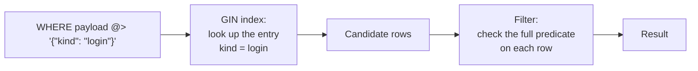

# JSON documents

Some data does not fit a fixed set of columns: event payloads, user settings,
product attributes that change per category, or responses from an external API.
A `JSONB` column stores each value as a JSON document, so you can keep that data
next to your relational columns, query inside it with SQL, and index it.

`JSONB` follows PostgreSQL. It uses the same type name, the same operators, the
same functions, and GIN indexes. If your application already uses PostgreSQL
`jsonb`, most of its SQL runs on CamusDB without changes. The exceptions are in
[Differences from PostgreSQL](#differences-from-postgresql).

## Quick example

```camussql
CREATE TABLE events (
  id INT64 PRIMARY KEY,
  payload JSONB NOT NULL
);

INSERT INTO events (id, payload)
VALUES (1, '{"user": {"id": 7, "tags": ["vip"]}, "kind": "login"}');

-- Read one field as text
SELECT payload -> 'user' ->> 'id' FROM events;

-- Find documents that contain a value
SELECT id FROM events WHERE payload @> '{"kind": "login"}';

-- Change part of a document
UPDATE events
SET payload = jsonb_set(payload, '{user,tags}', '["vip", "beta"]')
WHERE id = 1;

-- Index every key and value in the column
CREATE INDEX events_payload_gin ON events USING GIN (payload);
```

A **document** is one JSON value: an object, an array, a string, a number, a
boolean, or JSON `null`. A `JSONB` cell holds one document or SQL `NULL`. JSON
`null` and SQL `NULL` are different values: `'null'::jsonb IS NULL` is false.

## The JSONB type

`JSONB` is the type, and `JSON` is an alias. Both work in a column definition,
in `ALTER TABLE ... ADD COLUMN`, in a cast, and in a typed literal.
`SHOW CREATE TABLE` shows `JSONB`. The two words are not reserved, so a table or
a column can still be named `json` or `jsonb`.

### Write a document

| Form | Example |
| --- | --- |
| Text written to a `JSONB` column | `INSERT INTO t (doc) VALUES ('{"a": 1}')` |
| Typed literal | `JSONB '{"a": 1}'`, `JSON '[1, 2]'` |
| Cast | `'{"a": 1}'::jsonb`, `CAST(@p AS JSONB)` |
| Builder function | `jsonb_build_object('a', 1)`, `to_jsonb(42)` |

Text that is not valid JSON fails with `InvalidJsonText` (`CADB0418`), and
CamusDB writes nothing. The parser rejects the same input that PostgreSQL
rejects: a trailing comma, a leading zero (`01`), `NaN`, a lone surrogate escape,
and `\u0000` in a string.

Only text converts to a document with a cast. To make a document from a value of
another type, use `to_jsonb`, for example `to_jsonb(42)` or `to_jsonb(now())`.

### Read a document

- `CAST(doc AS STRING)` and `doc::string` return the document text.
- `->>` and `#>>` return the text of one part of the document.
- A scalar document casts to `INT64`, `FLOAT64`, `NUMERIC`, or `BOOL`, as in
  PostgreSQL: `('42'::jsonb)::int64`. A document of the wrong kind fails with
  the PostgreSQL message, such as `cannot cast jsonb object to type bigint`. A
  cast to `INT64` rounds half away from zero.

The text form matches PostgreSQL output: one space after each `:` and each `,`,
keys in the stored order, and no other whitespace.

```camussql
SELECT '{"b":1,   "a":[1,2]}'::jsonb;
-- {"a": [1, 2], "b": 1}
```

### What CamusDB stores

Like PostgreSQL `jsonb`, CamusDB stores a canonical form of the document, not the
input text:

- **Key order.** Keys are sorted, shorter keys first (by UTF-8 byte length), then
  by bytes. This is the PostgreSQL order. The input order is not kept.
- **Duplicate keys.** The last value wins: `'{"a": 1, "a": 2}'` stores
  `{"a": 2}`.
- **Whitespace** is not kept.
- **Numbers are exact.** A number keeps all its digits and its scale. `1.50`
  reads back as `1.50`, and `123456789012345678901234567890` reads back
  unchanged. Exponent notation becomes plain digits: `1e3` reads back as `1000`.
- **Strings** keep their characters. CamusDB decodes escapes on input, and the
  output escapes only what JSON requires.

Exact numbers matter for money, counters, and identifiers. A document never
passes through a floating-point value on its way in or out.

### Compare, sort, and group

`=`, `<>`, `<`, `>`, `ORDER BY`, `GROUP BY`, `DISTINCT`, and joins on `JSONB`
values use the PostgreSQL rules:

- Kinds sort as `object > array > boolean > number > string > null`.
- An object with more pairs is greater. An array with more elements is greater.
  When the counts are equal, the members compare in stored order.
- Numbers compare by value, so `'1.0'::jsonb = '1'::jsonb` is true, and the two
  values fall in one group.
- Strings compare by bytes.
- An empty top-level array sorts below every top-level scalar, `null` included.
  This is a PostgreSQL rule, and CamusDB copies it on purpose.

When you compare a document with text, CamusDB reads the text as a document:
`doc = '{"a": 1}'`. Text that is not valid JSON is equal to no document.

### Where JSONB cannot go

A `JSONB` column cannot be part of a primary key, a `UNIQUE` constraint, an
ordered index, or a foreign key, because a document has no ordered key
encoding. To index a `JSONB` column, use a [GIN index](#gin-indexes).

`ARRAY(JSONB)` is not a type. An array of documents is itself a document:
`'[{"a": 1}, {"a": 2}]'::jsonb`.

## Operators

Each operator has the PostgreSQL meaning.

| Operator | Right operand | Result | Example |
| --- | --- | --- | --- |
| `->` | Text key or integer index | `JSONB` | `doc -> 'user'`, `doc -> 0`, `doc -> -1` |
| `->>` | Text key or integer index | `STRING` | `doc ->> 'kind'` |
| `#>` | Path | `JSONB` | `doc #> '{user,tags,0}'` |
| `#>>` | Path | `STRING` | `doc #>> ARRAY['user', 'id']` |
| `@>` | `JSONB` | `BOOL` | `doc @> '{"kind": "login"}'` |
| `<@` | `JSONB` | `BOOL` | `'{"kind": "login"}' <@ doc` |
| `?` | Text | `BOOL` | `doc ? 'kind'` |
| `?\|` | Text array | `BOOL` | `doc ?\| ARRAY['a', 'b']` |
| `?&` | Text array | `BOOL` | `doc ?& '{a,b}'` |
| `\|\|` | `JSONB` | `JSONB` | `doc \|\| '{"seen": true}'` |
| `-` | Text, text array, or integer | `JSONB` | `doc - 'tmp'`, `doc - 0`, `doc - ARRAY['a', 'b']` |
| `#-` | Path | `JSONB` | `doc #- '{user,tags}'` |

Rules:

- A **path** is an array of strings, such as `ARRAY['a', 'b']`, or its
  PostgreSQL text form, such as `'{a,b}'`. An integer step in a path selects an
  array element.
- A **negative index** counts from the end of an array.
- A missing key, a missing index, or a path that does not exist returns SQL
  `NULL`, not an error.
- `@>` is **containment**: every part of the right document is in the left
  document. An array contains another array when it contains each of its
  elements, in any order. `'[1, 2, 3]'::jsonb @> '[3, 1]'` is true. Below the
  top level, a scalar does not contain an array:
  `'{"a": [1]}'::jsonb @> '{"a": 1}'` is false.
- `?` is true when the text is a top-level key of an object, a top-level string
  element of an array, or the top-level string itself.
- A **top-level scalar** acts as a one-element array for `-> 0`, `?`, and `@>`,
  as in PostgreSQL. `'"a"'::jsonb ? 'a'` is true.
- `||` merges two objects, and the right side wins on a shared key. It joins two
  arrays end to end. A scalar operand becomes a one-element array.
- Text where a document belongs is parsed as a document: `doc @> '{"a": 1}'`.

These queries show the operators on an `orders` table with a `details` column:

```camussql
-- Orders shipped to Berlin
SELECT id FROM orders WHERE details @> '{"shipping": {"city": "Berlin"}}';

-- Orders that have a coupon field
SELECT id FROM orders WHERE details ? 'coupon';

-- The first line item of each order
SELECT id, details -> 'items' -> 0 ->> 'sku' AS first_sku FROM orders;

-- Mark an order as reviewed, and remove a temporary field
UPDATE orders
SET details = (details || '{"reviewed": true}') - 'draft_note'
WHERE id = 17;
```

### Operator precedence

The JSONB operators bind tighter than comparisons, `IS`, and `IN`, and less
tightly than unary minus and `::`. So these filters mean what they look like:

```camussql
SELECT id FROM events WHERE payload ->> 'deleted_at' IS NULL;
SELECT id FROM events WHERE payload ->> 'kind' IN ('login', 'logout');
SELECT id FROM events WHERE payload -> 'user' ->> 'id' = '7';
```

JSONB operators now share the precedence of concatenation, bitwise, and regex
operators, following PostgreSQL. They group left to right:
`'x' || payload ->> 'kind'` means `('x' || payload) ->> 'kind'`.
Use `'x' || (payload ->> 'kind')` to concatenate extracted text. Arithmetic
binds more tightly, so `payload -> 0 + 1` selects element 1. See
[operator precedence](/docs/sql-expression-syntax#operator-precedence) and its
notes on definitions stored by older versions.

### Operators next to placeholders and XOR

- `<@` is the contained-by operator only when no placeholder name follows it
  directly. `x <@p` means `x < @p`. Write `x <@ @p` for the operator.
- `#-` is the delete-path operator, as in PostgreSQL. **This changes existing
  SQL:** before `JSONB`, `x #-1` meant `x XOR -1`. It now deletes a path. For
  XOR, write `x # -1`, with a space.
- `?`, `?|`, and `?&` do not conflict with CamusDB placeholders, which use
  `@name`. A client library that uses `?` for its own parameters can rewrite
  these operators. With such a library, use the functions `jsonb_exists(doc, key)`,
  `jsonb_exists_any(doc, keys)`, and `jsonb_exists_all(doc, keys)`.

## Functions

Where PostgreSQL has a `json_*` name for a function, CamusDB accepts it too,
for example `json_build_object`, `json_each`, and `json_agg`. The exception is
`json_array_length`, which is a [text JSON function](/docs/functions-json).
Every function is strict: a SQL `NULL` argument returns SQL `NULL`.

### Build documents

| Function | Result |
| --- | --- |
| `to_jsonb(value)` (`to_json`) | The value as a document. `INT64` and `NUMERIC` stay exact. A float uses its shortest round-trip text, and `NaN` and the infinities become strings. `DATE` becomes `"yyyy-MM-dd"`, and `DATETIME` becomes `"yyyy-MM-ddTHH:mm:ss[.fff]+00:00"`. `BYTES` becomes `"\x…"`. An array becomes a JSON array. A document stays the same. |
| `jsonb_build_object(k1, v1, …)` (`json_build_object`) | An object from key and value pairs. |
| `jsonb_build_array(v1, …)` (`json_build_array`) | An array of the arguments. |
| `jsonb_object(text_array)`, `jsonb_object(keys, values)` (`json_object`) | An object of string values, from one flat key/value array or from two arrays. |

```camussql
SELECT jsonb_build_object('id', id, 'name', name, 'tags', tags) FROM users;
```

### Inspect documents

| Function | Result |
| --- | --- |
| `jsonb_typeof(doc)` (`json_typeof`) | `object`, `array`, `string`, `number`, `boolean`, or `null`. |
| `jsonb_array_length(doc)` | The number of elements. An object or a scalar is an error. The name `json_array_length` belongs to the [text JSON functions](/docs/functions-json). |
| `jsonb_extract_path(doc, step, …)` (`json_extract_path`) | The same as `#>`, with the steps as arguments. |
| `jsonb_extract_path_text(doc, step, …)` (`json_extract_path_text`) | The same as `#>>`. |
| `jsonb_exists(doc, key)` | The same as `?`. |
| `jsonb_exists_any(doc, keys)` | The same as `?\|`. |
| `jsonb_exists_all(doc, keys)` | The same as `?&`. |

### Change documents

| Function | Result |
| --- | --- |
| `jsonb_set(doc, path, value [, create_missing])` | The document with the value at `path` replaced. When `create_missing` is true (the default), a missing last key is added, and an array index out of range adds the value at the start or the end. |
| `jsonb_set_lax(doc, path, value [, create_missing [, null_value_treatment]])` | Like `jsonb_set`, with a rule for a SQL `NULL` value: `'raise_exception'`, `'use_json_null'` (the default), `'delete_key'`, or `'return_target'`. |
| `jsonb_insert(doc, path, value [, insert_after])` | The document with the value inserted into an array before the index (or after it), or added at a new key. An existing key is an error. |
| `jsonb_strip_nulls(doc)` (`json_strip_nulls`) | The document without object fields whose value is JSON `null`, at every level. |
| `jsonb_pretty(doc)` | The document text with 4-space indents, as PostgreSQL prints it. |

A SQL `NULL` element in the path of a change function is an error, as in
PostgreSQL.

### Expand documents into rows

These set-returning functions go in the `FROM` clause. Each one also has a
`json_*` name, such as `json_each`.

| Function | Columns |
| --- | --- |
| `jsonb_each(doc)` | `key STRING`, `value JSONB` |
| `jsonb_each_text(doc)` | `key STRING`, `value STRING` |
| `jsonb_object_keys(doc)` | One `STRING` column, named after the relation |
| `jsonb_array_elements(doc)` | `value JSONB` |
| `jsonb_array_elements_text(doc)` | `value STRING` |

```camussql
SELECT key, value FROM jsonb_each('{"a": 1, "b": [2]}');

SELECT e.value
FROM jsonb_array_elements(@items) AS e
WHERE e.value ->> 'in_stock' = 'true';
```

A column alias list renames the columns from the left:
`jsonb_each(@doc) AS e(k, v)`. Object keys come out in the stored order. A
document of the wrong kind fails before the first row, with the PostgreSQL
message, such as `cannot call jsonb_each on a non-object`.

CamusDB evaluates the argument once, before the first row. It can be a literal,
a parameter, or an expression without columns. CamusDB does not support
`LATERAL`, so the argument cannot be a column of another table in the same
`FROM`, as in `FROM t, jsonb_each(t.doc)`.

`key` is a reserved word in CamusDB (`PRIMARY KEY`). CamusDB still accepts it as
a column name in an expression and after a dot, as in `SELECT key` and `e.key`,
so you can read the `jsonb_each` columns by name.

### Aggregates

| Aggregate | Result |
| --- | --- |
| `jsonb_agg(value)` (`json_agg`) | An array of the values in the group. A SQL `NULL` value becomes JSON `null`. |
| `jsonb_object_agg(key, value)` (`json_object_agg`) | An object. A `NULL` key is an error. The last value of a repeated key wins. |

A group with no rows returns SQL `NULL`. `ORDER BY` inside the call, as in
`jsonb_agg(x ORDER BY y)`, is not supported. The elements come in the order the
rows reach the aggregate. These aggregates charge retained state growth to
`spill_threshold_bytes` row by row when grouping can spill. A result larger
than 268,435,455 bytes fails with `CADB0422` (`JsonbValueTooLarge`); it does not
produce a partial document.

```camussql
SELECT customer_id, jsonb_agg(jsonb_build_object('id', id, 'total', total)) AS orders
FROM orders
GROUP BY customer_id;
```

### Text JSON functions

The older [JSON functions](/docs/functions-json) (`json_valid`, `json_type`,
`json_extract`, `json_value`, `json_contains`, and `json_array_length`) do not
change. They take JSON text in a `STRING` value and use `$.a.b[0]` paths. A
`JSONB` argument is read as its text, so each function name keeps one behavior.

## GIN indexes

Without an index, a filter such as `payload @> '{"kind": "login"}'` reads every
row in the table. A GIN index (generalized inverted index) solves this. It maps
each key and value in each document to the rows that hold it, so CamusDB reads
only the rows that can match.

```camussql
CREATE INDEX events_payload_gin ON events USING GIN (payload);
```

These forms create the same index:

```camussql
CREATE INDEX events_payload_gin ON events USING GIN (payload jsonb_path_ops);
CREATE INVERTED INDEX events_payload_gin ON events (payload);

CREATE TABLE events (
  id INT64 PRIMARY KEY,
  payload JSONB,
  INVERTED INDEX events_payload_gin (payload)
);
```

A GIN index has exactly one column, and the column must be `JSONB`. It has no
`INCLUDE` columns and no `DESC`. CamusDB accepts the operator class names
`jsonb_ops` and `jsonb_path_ops`, and both build the same index.
`SHOW INDEXES` shows the index type `GIN`. `SHOW CREATE TABLE` shows the inline
`INVERTED INDEX` form. `DROP INDEX` removes the index.

### How a GIN scan works



The index stores one entry for each distinct leaf value of a document, together
with its path. A query looks up the entries for its predicate and gets a set of
candidate rows. The entries do not keep array positions, so a candidate can
hold every entry and still fail the operator. For this reason, CamusDB always
checks the full predicate on each candidate. The index can return extra rows,
but it never misses a matching row.

GIN candidate collection is bounded by `spill_threshold_rows` and
`spill_threshold_bytes`. If candidates exceed either active cap, the query
continues as a table scan with the same filter. This fallback also applies
when spill is disabled and requires no temporary files.

### Filters that use a GIN index

The planner uses a GIN index for these top-level `WHERE` conditions when the
other operand is a constant: a literal, a parameter, or an expression without
columns.

| Condition | Index lookup |
| --- | --- |
| `col @> doc`, `doc <@ col` | Every part of `doc` |
| `col ? key` | The key, or the matching string element |
| `col ?\| keys` | Any of the keys |
| `col ?& keys` | All of the keys |
| `col ->> 'k' = text`, `text = col ->> 'k'` | The value at `k` as a string, or as the number or boolean with that text |
| `col -> 'k' = doc` | The same as `col @> {"k": doc}` |

The function forms, such as `jsonb_exists(col, key)`, use the index the same way.
CamusDB combines several such conditions on one index with `AND`.

The planner does not use a GIN index for:

- A condition under `OR` or `NOT`.
- `col <@ doc`. PostgreSQL GIN does not support it either.
- `col @> '{}'`, `col @> '[]'`, and `col @> <scalar>`, which match too many rows
  to narrow the scan.
- `col ->> 'k' = text` when the text starts with `{` or `[`.
- A join. The GIN scan is a single-table access path.

The planner picks a GIN scan only when no ordered index narrows the scan. A
`FORCE_INDEX` hint that names a GIN index uses it when the filter can use that
index.

### Check the plan

Use [`EXPLAIN`](/docs/explain) to confirm that a query uses the index:

```camussql
EXPLAIN SELECT id FROM events WHERE payload @> '{"kind": "login"}';
```

The plan shows a `gin-scan` node with the detail
`index=<name>, groups=<n>, entries=<m>`, below the `filter` node that checks each
candidate row.

### Write cost

A GIN index makes writes more expensive in exchange for faster reads:

- An `INSERT` writes one index entry for each distinct leaf in the document. A
  `DELETE` removes them. An `UPDATE` writes only the entries that changed.
- A `NULL` document has no entries.
- CamusDB writes the entries in the same transaction as the row, so a rollback
  leaves no entries.
- A large document with many leaves costs many entry writes. These writes count
  against the [transaction mutation limit](/docs/transaction-limits). A
  statement over the limit fails. The index never leaves entries out.

`CREATE INDEX` on an existing table fills the index in batches while writes
continue.

### Locks under serializable isolation

In a Serializable read-write transaction, a GIN scan holds shared locks on
its index ranges and each fetched row, including candidates discarded by the
recheck. Row locks matter even when a concurrent update leaves the indexed
JSON unchanged: that update must still respect the read. Locks last until the
transaction ends, under both pessimistic and optimistic locking.

Common entries can cover large ranges and hold back more writers. Read-only
snapshots do not take these read locks. See
[Transactions and isolation](/docs/serializable-transactions).

## Storage

CamusDB stores each document in a compact binary form (canonical
[CBOR](https://www.rfc-editor.org/rfc/rfc8949)), not as text. Numbers are stored
exactly and never as floats. Reading one key does not parse the whole document:
`->` returns a slice of the stored bytes.

A `JSONB` cell uses the same large-value rules as a `STRING` cell: LZ4
compression when it saves space, and storage outside the row for a large cell.
The `STORAGE` clause works as it does for `STRING`, and the default is
`EXTENDED`. See [Storage layout](/docs/storage-layout).

The CamusDB team measured the stored size on the simdjson example files, as a
percentage of the minified JSON text:

| Corpus | Minified text | Stored cell | Text + LZ4 | Stored cell + LZ4 |
| --- | --- | --- | --- | --- |
| amazon_cellphones (one row per line) | 283,837 B | 94% | 80% | 79% |
| canada.json (numbers) | 2,251,027 B | 61% | 45% | 42% |
| citm_catalog.json | 501,093 B | 68% | 5% | 4% |
| github_events (one row per event) | 53,924 B | 91% | 46% | 44% |
| twitter.json (one row per tweet) | 570,598 B | 71% | 41% | 34% |

## Client APIs

Use the driver to bind documents and read results. The libraries handle the
JSON/HTTP or gRPC representation:

| Driver | Application API |
| --- | --- |
| [.NET](/docs/dotnet-driver#json-documents) | Bind `JsonDocument`, `JsonElement`, or `JsonNode`; use `ColumnType.Jsonb` for raw JSON text. Read JSON text or a typed JSON value. |
| [TypeScript](/docs/typescript-connector#json-documents) | Bind a plain object or `camus.jsonb(value)`. Results default to parsed JavaScript values; choose `jsonb: 'text'` to preserve decimal digits and distinguish JSON null from SQL NULL. |
| [Python](/docs/python-driver#json-documents) | Bind a dict, or use `Typed` for JSON text or a JSON array document. Results are JSON text; JSON null is `'null'`, while SQL NULL is `None`. |

The .NET driver's text result distinguishes JSON null (`"null"`) from SQL
NULL (`DBNull`). Use current driver and server versions for this behavior;
older REST servers can return both as the same null value. JSONB support and
exact numeric decoding vary by driver; the linked guides describe the choices.

<details>
<summary>HTTP and gRPC encoding for client implementers</summary>

The driver handles these fields and decoding rules. They are needed when
implementing a custom client or inspecting raw responses.

| API | Form |
| --- | --- |
| HTTP | By default, the document itself, as native JSON in the row. Numbers keep all their digits. The column type is `13`. A parameter is `{"type": 13, "strValue": "<json text>"}`, or a plain string written to a `JSONB` column. |
| gRPC | `Value.json_value`, which holds the document text. The column type is `COLUMN_TYPE_JSONB`. |

A gRPC client built before `json_value` existed reads every `JSONB` cell as
`NULL`, with no error. Update the client before you read `JSONB` columns over
gRPC.

#### JSON null over HTTP

In the default HTTP form, a JSON `null` document and a SQL `NULL` cell are both
the token `null`. A client cannot tell them apart, and if it writes the value
back, it can store SQL `NULL` in place of the document.

To keep the two values apart, set `"jsonbAsText": true` in the request body. The
option applies to `/execute-sql-query`, `/execute-sql-query-stream`, and the
`RETURNING` rows of `/execute-sql-non-query`. Each `JSONB` cell is then a JSON
string that holds the document text. SQL `NULL` stays the token `null`.

| Value | Default form | Text form |
| --- | --- | --- |
| SQL `NULL` | `null` | `null` |
| JSON `null` | `null` | `"null"` |
| `"abc"` | `"abc"` | `"\"abc\""` |
| `{"a": 1}` | `{"a": 1}` | `"{\"a\": 1}"` |

The response marks each `JSONB` column that uses the text form:

```json
{"name": "payload", "type": 13, "jsonbAsText": true}
```

Decode a cell as text only when its column has this mark. A server that does not
know the option ignores it and sends the default form. A string document such
as `"abc"` is valid in both forms, so the mark is the only safe test.


</details>

## Limits

| Limit | Value |
| --- | --- |
| Nesting depth | 512 levels. A deeper document fails with `JsonNestingTooDeep` (`CADB0419`). The limit is fixed, not a setting. |
| Number size | 131,072 digits before the decimal point and a scale of 16,383, the PostgreSQL `numeric` limits. |
| Built document size | 268,435,455 bytes (2²⁸ − 1). Oversized JSON aggregates fail with `CADB0422`; large-value, transaction, and request limits also apply. |

A stored cell that does not decode fails with `JsonbValueCorrupt` (`CADB0559`).
CamusDB never returns part of a document.

## Differences from PostgreSQL

| Topic | PostgreSQL | CamusDB |
| --- | --- | --- |
| `json` type | Keeps the input text: whitespace, key order, and duplicate keys. | An alias of `JSONB`. The text is canonical. |
| `jsonb_path_ops` | A smaller index that serves only `@>`. | The same index as `jsonb_ops`. It serves every GIN operator. |
| Operator precedence | The JSONB operators are at the level of `\|\|`. | The same. See [Operator precedence](#operator-precedence). |
| `x #-1` | Path delete. | Path delete. Before `JSONB`, it was XOR with `-1`. |
| A text column as a document operand | Rejected. The operator needs `jsonb`. | Parsed as a document, like a literal. |
| Invalid JSON text compared with a document | The literal is rejected. | Equal to no document. |
| `jsonb_agg(x ORDER BY y)` | Supported. | Not supported. |
| `LATERAL`, as in `FROM t, jsonb_each(t.doc)` | Supported. | Not supported. |
| SQL/JSON path (`jsonpath`, `@?`, `@@`, `jsonb_path_query`) | Supported. | Not supported. |
| Subscripts (`doc['key']`) | Supported. | Not supported. |
| `row_to_json`, `jsonb_to_record`, `jsonb_populate_record` | Supported. | Not supported. |
| Expression index on `(doc ->> 'k')` | Supported. | Not supported yet. |

## Related topics

- [Data types](/docs/data-types)
- [Indexes](/docs/sql-indexes)
- [JSON functions for text](/docs/functions-json)
- [EXPLAIN](/docs/explain)
- [Storage layout](/docs/storage-layout)
- [HTTP API](/docs/http-api) and [gRPC API](/docs/grpc-api)
