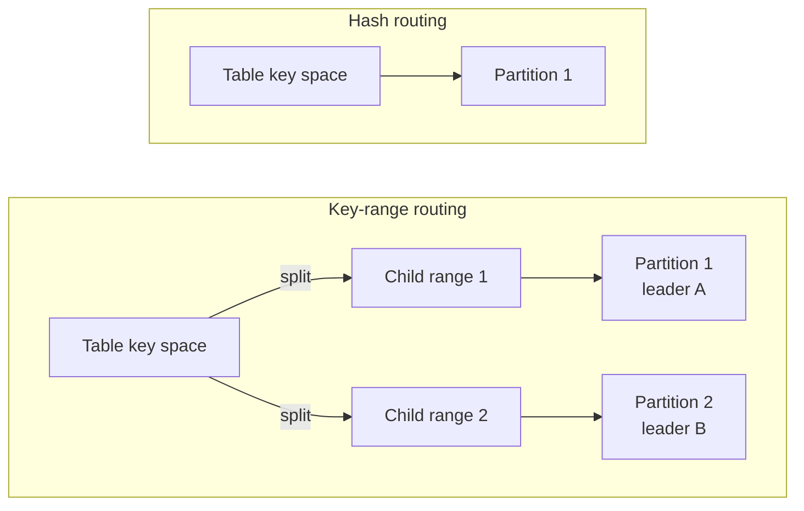

# Key-range sharding

Key-range sharding lets one large or busy table spread across several
[partitions](/docs/concepts#partition) of a [cluster](/docs/cluster). Without
it, each table lives on one partition, so one partition
[leader](/docs/concepts#leader) coordinates every write to that table.

## Why use key-range sharding

CamusDB routes table and index [key spaces](/docs/concepts#key-space) (the
storage keys that hold a table's rows or one index's entries) by hash by
default. With [hash routing](/docs/concepts#hash-and-key-range-routing), a
table's rows and each secondary index live under one key prefix that maps to
one partition. Different tables can live on different partitions, but one table
never spreads across them.

That default is simple, and it suits most tables. It has a limit for a table
that is very large or very busy:

- Every write to the table goes through the same partition leader. When that
  leader is saturated, more nodes in the cluster do not help that table.
- All rows of the table are on the same partition. A large scan of the table
  reads all of its data from that one partition.

Key-range sharding routes those spaces by key order. A space starts as one
[range](/docs/concepts#ranges-and-spans), a contiguous slice of keys. It can
then split into child ranges, and different partitions serve the
child ranges. Writes to different ranges can then be coordinated by different
leaders. CamusDB can split a range automatically when it grows too large or
receives too much load. See [Automatic splits](#automatic-splits).



Turn it on when one of these conditions applies:

- One table, or one index, receives more writes than one partition leader can
  coordinate.
- One table is too large to keep on one partition.
- A scan over a large table must run on several nodes. Use it together with
  [distributed queries](/docs/distributed-queries).

You do not need it for a standalone node, for a small data set, or for a
workload that spreads its writes across many tables. A query returns the same
rows with either routing mode. Only the placement, the concurrency, and the
network cost change. Read [Best practices](/docs/best-practices) before you
design keys for a key-range table.

## Turn it on

Enable it in `config.yml`:

```yaml
key_range_sharding: true
initial_partitions: 4
```

`CAMUS_KEY_RANGE_SHARDING=1` or `CAMUS_KEY_RANGE_SHARDING=true` overrides the
YAML value.

The setting is restart-scoped and cluster-wide. Nodes that disagree route the
same key differently, so change it everywhere and restart.

## What changes

| Area | Hash routing | Key-range routing |
| --- | --- | --- |
| Table rows | One partition | One or more ranges |
| Secondary indexes | The same partition as the table's rows | Independent ranges per eligible index |
| Range locks | Cover the whole key space | Clipped to the ranges touched |
| Scans | One partition answers | All intersecting ranges answer and merge in key order |
| Splitting | Not applicable | Ranges can split on size or load |

Scans stay ordered and complete. A query returns the same rows whether the space
has one range or many. The difference is placement, concurrency, and network
cost.

## Partition count

A standalone node or a cluster with one partition can still use key-range
routing, but it cannot distribute work. Set `initial_partitions: 2` or more for
range splits to move work across partitions.

## Eligible indexes

Every indexable column type has a key encoding that preserves the order. That
includes `STRING`. A secondary index is therefore key-range routed when
key-range sharding is on, whatever the types of its key columns.

An index stays hash-routed only when CamusDB cannot resolve one of its key
columns in the schema. Mixed tables are valid: some key spaces can be ranged
while others remain hashed.

Use [`SHOW RANGES`](/docs/show-ranges) to see the routing mode of a table or
index.

## Automatic splits

Automatic splitting is off unless you set a threshold. Enabling
`key_range_sharding` does not silently enable a rebalancing policy.

The count branch splits a large range:

```yaml
kahuna:
  range_split_threshold: 1000
  range_split_min_range_size: 10
```

`range_split_threshold` must be `0` or at least twice
`range_split_min_range_size`.

The load branch splits hot partitions:

```yaml
kahuna:
  range_split_load_threshold: 500
  range_split_load_min_queue_depth: 8
  range_split_load_min_commit_wait_ms: 0
  range_split_load_window_ms: 15000
  range_split_load_poll_interval_ms: 5000
  range_split_load_imbalance_max: 0.8
  range_split_settle_window_ms: 10000
  range_split_indivisible_cooldown_ms: 300000
  range_move_settle_timeout_ms: 10000
  range_merge_min_size: 10
  enable_load_reports: true
```

The load branch needs:

- `key_range_sharding: true`
- at least two initial partitions
- cluster mode for useful relief
- a load-report source, such as the leader balancer, placement rebalancer,
  replication, or `enable_load_reports`
- `enable_leader_balancer: true` when you want the child leader moved off the
  hot node

`range_move_settle_timeout_ms` is what one split or merge attempt can cost the
workload. Writes to the moving half are refused retryably while CamusDB waits
for that range to drain. `0` means no wait; under sustained writes that usually
makes every attempt fail. The value is clamped by the server.

## Reading split activity

`SHOW ENGINE STATS` exposes range-split counters by key space:

| Counter | Meaning |
| --- | --- |
| `kahuna.range.splits` | Splits committed. |
| `kahuna.range.split.indivisible_refusals` | One hot key held the load, so no split could help. |
| `kahuna.range.split.no_relief_skips` | No peer was available to host the child. |
| `kahuna.range.split.settle_skips` | A fresh child is still inside its settle window. |
| `kahuna.range.merge.warm_skips` | A merge candidate is still too warm. |

`SHOW RANGES` reports the current shape. `SHOW ENGINE STATS` explains what the
splitter attempted.

## Concurrent writes

A write in flight while a range boundary moves is refused as retryable instead
of being routed to the wrong owner:

- `CADB0504` means routing changed or the range was quiesced before the write
  was applied.
- `CADB0502` means the transaction conflicted with a lock, including the
  exclusive lock used while part of a range moves.

Autocommit work retries boundedly. A multi-statement explicit transaction must
restart from `BEGIN`.

## Remote query fragments

With [distributed queries](/docs/distributed-queries) on, a scan over ranges
that other nodes lead runs as remote fragments on those nodes. See
[The traffic between two nodes](/docs/distributed-queries#the-traffic-between-two-nodes)
for the transport, its authentication, and its wire formats.

## Related

- [SHOW RANGES](/docs/show-ranges)
- [Distributed queries](/docs/distributed-queries)
- [Retries and conflicts](/docs/serializable-retries)
- [Configuration](/docs/configuration)
