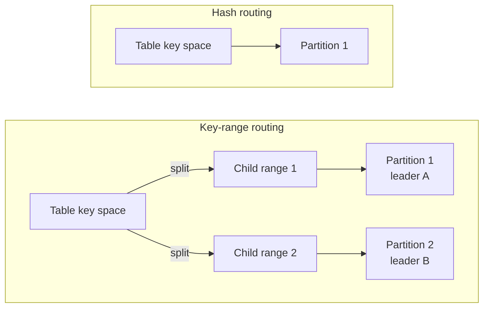

# Key-range sharding

Key-range sharding spreads one large or busy table across several
[partitions](/docs/concepts#partition) of a [cluster](/docs/cluster). By
default, each table is on one partition. This means that one partition
[leader](/docs/concepts#leader) coordinates all the writes to that table.

## Spread one table across partitions

By default, CamusDB places the [key spaces](/docs/concepts#key-space) of tables
and indexes by hash. A key space is the set of storage keys that hold the rows
of a table, or the entries of one index. With
[hash routing](/docs/concepts#hash-and-key-range-routing), the rows of a table,
and each of its secondary indexes, map to one partition. Different tables can be
on different partitions, but one table can't spread across them.

Hash routing is simple, and it suits most tables. However, it has limits for a
very large or very busy table:

- All the writes to the table go through the same partition leader. When that
  leader is saturated, more nodes in the cluster don't help that table.
- All the rows of the table are on one partition. A large scan reads all its
  data from that partition.

Key-range sharding places key spaces by key order. A key space starts as one
[range](/docs/concepts#ranges-and-spans), a contiguous slice of keys. A range
can then split into child ranges on different partitions, and different leaders
coordinate the writes to each range. CamusDB can split a range automatically
when it grows too large or gets too much load. See
[Automatic splits](#automatic-splits).



Turn it on in these cases:

- One table or index gets more writes than one partition leader can coordinate.
- One table is too large for one partition.
- A scan over a large table must execute on several nodes. Use it with
  [distributed queries](/docs/distributed-queries).

You don't need it for a standalone node or a small data set. You also don't need
it for a workload that spreads its writes across many tables. A query returns
the same rows in both routing modes. The placement, the concurrency, and the
network cost are different. Before you design the keys of a key-range table,
read [Best practices](/docs/best-practices).

## Turn it on

Set it in `config.yml`:

```yaml
key_range_sharding: true
initial_partitions: 4
```

The environment variable `CAMUS_KEY_RANGE_SHARDING` (`1`, `true`, `0`, or
`false`) overrides the YAML value.

### The mode is fixed when the cluster is created

A cluster records its routing mode when it starts for the first time. After
that, the following rules apply:

- If `key_range_sharding` isn't set, the node uses the recorded mode.
  `SHOW VARIABLES` shows the value with the source `cluster`.
- If the configured value matches the recorded mode, the node starts normally.
- If the configured value is different, the node doesn't start. It logs
  `Startup failed`, and it exits with code 1.

A restart can't move existing data between hash and key-range placement. To
change the mode, create a new cluster, and
[dump and reimport](/docs/logical-dump-and-reimport) the data.

A cluster that was created before CamusDB recorded the mode gets it from the
range map of the first upgraded node. Start an existing node first. Then the
range map is available before a new node with an empty data directory joins.

## Hash routing compared with key-range routing

| Area | Hash routing | Key-range routing |
| --- | --- | --- |
| Table rows | One partition | One or more ranges. The first range is on the hash-routed partition. |
| Secondary indexes | The partition of the table rows | Separate ranges for each index |
| Serializable read-write scan locks | Cover the complete key space | Cover only the ranges that the scan reads |
| Scans | One partition answers | All the ranges that the scan reads answer, and the results are merged in key order |
| Splitting | Not applicable | Ranges can split on size or load |

A scan is ordered and complete. A query returns the same rows if a key space
has one range or many. Only serializable read-write transactions take scan range
locks. Read Committed scans and autocommit `SELECT` statements don't take them.
In both routing modes, an autocommit read uses one snapshot.

The first range of a table uses the partition that hash routing gives the
table. The other key spaces of the table, such as a new index, are placed on the
same partition until a split. Note that two tables can hash to the same
partition, and another partition can stay empty.

The leader balancer moves leaders. It doesn't move ranges. Only a split or a
range move changes the partition of a range.

## Partition count

A standalone node, or a cluster with one partition, can use key-range routing.
However, it can't distribute the work. For range splits to move work to other
partitions, set `initial_partitions: 2` or more.

## Eligible indexes

All indexable column types, including `STRING`, have an order-preserving key
encoding. When key-range sharding is on, all secondary indexes are key-range
routed.

An index is hash-routed only if one of its key columns can't be resolved in the
schema. A table can have ranged key spaces and hashed key spaces.

To see the routing mode of a table or an index, use
[`SHOW RANGES`](/docs/show-ranges).

## Automatic splits

Automatic splitting is off until you set a threshold. `key_range_sharding: true`
doesn't turn on a rebalancing policy.

The count branch splits a large range:

```yaml
kahuna:
  range_split_threshold: 1000
  range_split_min_range_size: 10
```

`range_split_threshold` must be `0` or at least twice
`range_split_min_range_size`. `0` turns off the count branch.

The load branch splits hot partitions:

```yaml
kahuna:
  range_split_load_threshold: 500
  range_split_load_min_queue_depth: 8
  range_split_load_min_commit_wait_ms: 0
  range_split_load_window_ms: 15000
  range_split_load_poll_interval_ms: 5000
  range_split_load_imbalance_max: 0.8
  range_split_settle_window_ms: 10000
  range_split_indivisible_cooldown_ms: 300000
  range_move_settle_timeout_ms: 10000
  range_merge_min_size: 10
  enable_load_reports: true
```

The load branch needs the following:

- `key_range_sharding: true`.
- Two or more initial partitions.
- Cluster mode. A standalone node doesn't have another node to move load to.
- A source of load reports. For example, the leader balancer or
  `enable_load_reports`.
- `enable_leader_balancer: true`, if you want the leader of the child range to
  move off the hot node.

`range_move_settle_timeout_ms` is the cost of one split or merge attempt to the
workload. While CamusDB waits for the moving range to drain, writes to it return
a retryable error. With `0`, CamusDB doesn't wait. Under continuous writes, this
usually makes all the attempts fail. The server limits the maximum value.

:::caution CamusDB 0.16.3
CamusDB 0.16.3 can lose acknowledged writes when a range moves under write load.
Use CamusDB 0.16.4 or later before you split ranges under writes.
:::

## Split a range manually

To split a range at a controlled time, for example in a recovery test, use
`POST /v1/cluster/split-range`. For growth and load, you should use automatic
splits.

```bash
curl -X POST http://localhost:5095/v1/cluster/split-range \
  -H 'Content-Type: application/json' \
  -d '{"database":"shop","table":"orders","maxKeys":1000000}'
```

The node scans the key space, and it chooses a median key that isn't already a
range start. You can't give the split key. The order of the stored row ids
doesn't follow the column values of your application.

- To split the rows, leave out `index`.
- To split an index, set `index` to its name. `primary` and `<table>_pkey` name
  the primary index.

`maxKeys` is `1000000` by default, and it must be `2` or more. If the key space
has more keys, the split is refused. The node doesn't split from a partial scan.

With authentication on, the caller must be a superuser. With authentication
off, the endpoint accepts only loopback requests.

The response has the following HTTP status codes:

| Status | Meaning |
| --- | --- |
| 200 | The split completed. |
| 400 | The input is invalid, for example `maxKeys` below 2. |
| 409 | The split was refused. `status` and `reason` give the cause. |

For example, `NoRange` means that the key space is hash-routed, or that its range
map isn't available. The split can also be refused when the backend can't divide
the range or place the child.

The response body has these fields:

| Field | Meaning |
| --- | --- |
| `success` | Whether the split completed. |
| `status` | The outcome name, such as `Succeeded`, `NotLeader`, or `NoRange`. |
| `reason` | The cause of a refusal. |
| `keySpace` | The key space that was selected. |
| `splitKey` | The new boundary, as an opaque key. |
| `keysSeen` | The number of keys that the node scanned. |
| `descriptorsBefore` | The number of ranges before the attempt. |
| `newPartitionId` | The partition of the new child range. |
| `leaderHint` | The leader, when the node that got the request can't do the split. |
| `determinate` | `false` when the range map can still change after the response. |

On `NotLeader`, use `leaderHint` to find the leader of the key space. If
`determinate` is `false`, for example after `QuiesceFailed` or
`TransferFailed`, the split can land later. Run `SHOW RANGES` again, and compare
the range count with `descriptorsBefore` before you retry.

## Reading split activity

`SHOW ENGINE STATS` shows the range-split counters for each key space:

| Counter | Meaning |
| --- | --- |
| `kahuna.range.splits` | Committed splits. |
| `kahuna.range.split.indivisible_refusals` | One hot key had the load, and a split couldn't help. |
| `kahuna.range.split.no_relief_skips` | No peer was available for the child range. |
| `kahuna.range.split.settle_skips` | A new child range is in its settle window. |
| `kahuna.range.merge.warm_skips` | A merge candidate has too much load. |

`SHOW RANGES` shows the current ranges. `SHOW ENGINE STATS` shows what the
splitter tried.

## Concurrent writes

A write that is in progress while a range boundary moves gets a retryable
error. The write isn't sent to the wrong owner:

- `CADB0504` means that the routing changed, or that the range was quiesced,
  before the write was applied.
- `CADB0502` means that the transaction conflicted with a lock. This includes
  the exclusive lock of a range move.

Autocommit statements are retried a limited number of times. An explicit
transaction with more than one statement must start again from `BEGIN`. For
more information, see [Retries and conflicts](/docs/serializable-retries).

## Remote query fragments

With [distributed queries](/docs/distributed-queries) on, a scan over ranges
that other nodes lead executes as remote fragments on those nodes. For the
transport, its authentication, and its wire formats, see
[The traffic between two nodes](/docs/distributed-queries#the-traffic-between-two-nodes).

## Related

- [SHOW RANGES](/docs/show-ranges)
- [Distributed queries](/docs/distributed-queries)
- [Retries and conflicts](/docs/serializable-retries)
- [Configuration](/docs/configuration)
