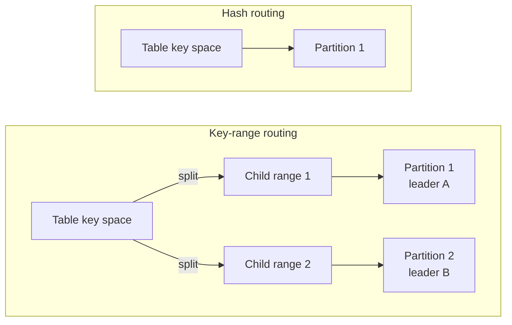

# Key-range sharding

Key-range sharding lets one large or busy table spread across several
[partitions](/docs/concepts#partition) of a [cluster](/docs/cluster). Without
it, each table lives on one partition, so one partition
[leader](/docs/concepts#leader) coordinates every write to that table.

## Why use key-range sharding

CamusDB routes table and index [key spaces](/docs/concepts#key-space) (the
storage keys that hold a table's rows or one index's entries) by hash by
default. With [hash routing](/docs/concepts#hash-and-key-range-routing), a
table's rows and each secondary index live under one key prefix that maps to
one partition. Different tables can live on different partitions, but one table
never spreads across them.

That default is simple and suits most tables, but it has limits for a very
large or very busy table:

- Every write to the table goes through the same partition leader. When that
  leader is saturated, more nodes in the cluster do not help that table.
- All of the table's rows are on the same partition, so a large scan reads all
  of its data from that one partition.

Key-range sharding routes those spaces by key order instead. A space starts as
one [range](/docs/concepts#ranges-and-spans), a contiguous slice of keys, and
can then split into child ranges that different partitions serve. Different
leaders can then coordinate writes to different ranges. CamusDB can split a
range automatically when it grows too large or receives too much load. See
[Automatic splits](#automatic-splits).



Turn it on when:

- One table or index receives more writes than one partition leader can
  coordinate.
- One table is too large to keep on one partition.
- A scan over a large table must run on several nodes. Use it together with
  [distributed queries](/docs/distributed-queries).

You do not need it for a standalone node, a small data set, or a workload that
spreads its writes across many tables. A query returns the same rows with
either routing mode; only placement, concurrency, and network cost change. Read [Best practices](/docs/best-practices) before you
design keys for a key-range table.

## Turn it on

Enable it in `config.yml`:

```yaml
key_range_sharding: true
initial_partitions: 4
```

`CAMUS_KEY_RANGE_SHARDING=1` or `CAMUS_KEY_RANGE_SHARDING=true` overrides the
YAML value.

### The mode is fixed when the cluster is created

A cluster records its routing mode on first boot. An unset
`key_range_sharding` follows that record, reported by `SHOW VARIABLES` with
source `cluster`. An explicitly matching value starts normally; an explicitly
different value refuses startup with exit code 1.

Restarting cannot switch existing data between hash and key-range placement.
To change modes, create a new cluster and
[dump and reimport](/docs/logical-dump-and-reimport).

For clusters predating the stored mode, the first upgraded node infers it from
its local range map and database catalog. Start an existing node first, so it
can restore that map before a new node with an empty data directory joins.

## What changes

| Area | Hash routing | Key-range routing |
| --- | --- | --- |
| Table rows | One partition | One or more ranges; the first starts on the hash-routed partition |
| Secondary indexes | The same partition as the table's rows | Independent ranges per eligible index |
| Serializable read-write scan locks | Cover the whole key space | Clipped to the ranges touched |
| Scans | One partition answers | All intersecting ranges answer and merge in key order |
| Splitting | Not applicable | Ranges can split on size or load |

Scans stay ordered and complete: a query returns the same rows whether the
space has one range or many. Only Serializable read-write transactions take
scan range locks. Read Committed scans and ordinary autocommit `SELECT` statements take
none. Under either isolation default, autocommit reads keep one pinned snapshot in
either routing mode.

With Kahuna 1.14.7 and later, a table's first range uses the partition that
hash routing gives its placement group. New index and large-value spaces join
that table's existing spaces, keeping it on one partition until a split.
Older seeded ranges keep their recorded placements; an upgrade does not move
them. A few tables can still hash to the same partition, leaving another empty.
The leader balancer moves leaders, not ranges; splitting or moving a range
changes its partition. The cluster routing mode remains fixed at creation.

## Partition count

A standalone node or a cluster with one partition can still use key-range
routing, but it cannot distribute work. Set `initial_partitions: 2` or more for
range splits to move work across partitions.

## Eligible indexes

Every indexable column type, including `STRING`, has an order-preserving key
encoding. So when key-range sharding is on, a secondary index is key-range
routed, whatever its key column types.

An index stays hash-routed only when CamusDB cannot resolve one of its key
columns in the schema. Mixed tables are valid: some key spaces can be ranged
while others remain hashed.

Use [`SHOW RANGES`](/docs/show-ranges) to see the routing mode of a table or
index.

## Automatic splits

Automatic splitting is off unless you set a threshold. Enabling
`key_range_sharding` does not silently enable a rebalancing policy.

The count branch splits a large range:

```yaml
kahuna:
  range_split_threshold: 1000
  range_split_min_range_size: 10
```

`range_split_threshold` must be `0` or at least twice
`range_split_min_range_size`.

The load branch splits hot partitions:

```yaml
kahuna:
  range_split_load_threshold: 500
  range_split_load_min_queue_depth: 8
  range_split_load_min_commit_wait_ms: 0
  range_split_load_window_ms: 15000
  range_split_load_poll_interval_ms: 5000
  range_split_load_imbalance_max: 0.8
  range_split_settle_window_ms: 10000
  range_split_indivisible_cooldown_ms: 300000
  range_move_settle_timeout_ms: 10000
  range_merge_min_size: 10
  enable_load_reports: true
```

The load branch needs:

- `key_range_sharding: true`
- at least two initial partitions
- cluster mode for useful relief
- a load-report source, such as the leader balancer, placement rebalancer,
  replication, or `enable_load_reports`
- `enable_leader_balancer: true` when you want the child leader moved off the
  hot node

`range_move_settle_timeout_ms` is what one split or merge attempt can cost the
workload. Writes to the moving half are refused with a retryable error while CamusDB
waits for that range to drain. `0` means no wait; under sustained writes that usually
makes every attempt fail. The value is clamped by the server.

### Version requirement for splits under writes

Use a CamusDB build with Kahuna 1.14.6 or later before running range splits
under write load. Kahuna 1.14.3 and 1.14.5 could lose acknowledged writes if a
range move's write-quiesce TTL expired before cutover. Version 1.14.6 refuses
that expired move instead of switching routing away from those writes.

## Reading split activity

`SHOW ENGINE STATS` exposes range-split counters by key space:

| Counter | Meaning |
| --- | --- |
| `kahuna.range.splits` | Splits committed. |
| `kahuna.range.split.indivisible_refusals` | One hot key held the load, so no split could help. |
| `kahuna.range.split.no_relief_skips` | No peer was available to host the child. |
| `kahuna.range.split.settle_skips` | A fresh child is still inside its settle window. |
| `kahuna.range.merge.warm_skips` | A merge candidate is still too warm. |

`SHOW RANGES` reports the current shape. `SHOW ENGINE STATS` explains what the
splitter attempted.

## Concurrent writes

A write in flight while a range boundary moves is refused as retryable instead
of being routed to the wrong owner:

- `CADB0504` means routing changed or the range was quiesced before the write
  was applied.
- `CADB0502` means the transaction conflicted with a lock, including the
  exclusive lock used while part of a range moves.

Autocommit work retries a bounded number of times. A multi-statement explicit
transaction must restart from `BEGIN`.

## Remote query fragments

With [distributed queries](/docs/distributed-queries) on, a scan over ranges
that other nodes lead runs as remote fragments on those nodes. See
[The traffic between two nodes](/docs/distributed-queries#the-traffic-between-two-nodes)
for the transport, its authentication, and its wire formats.

## Related

- [SHOW RANGES](/docs/show-ranges)
- [Distributed queries](/docs/distributed-queries)
- [Retries and conflicts](/docs/serializable-retries)
- [Configuration](/docs/configuration)
