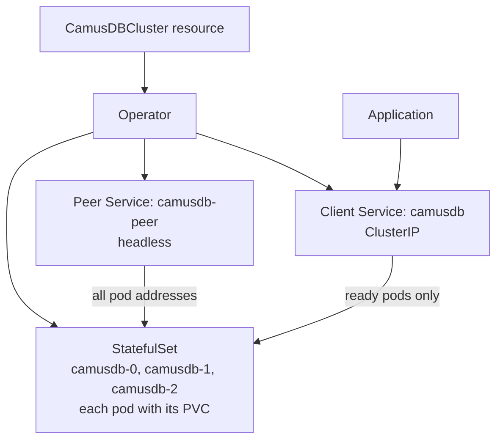
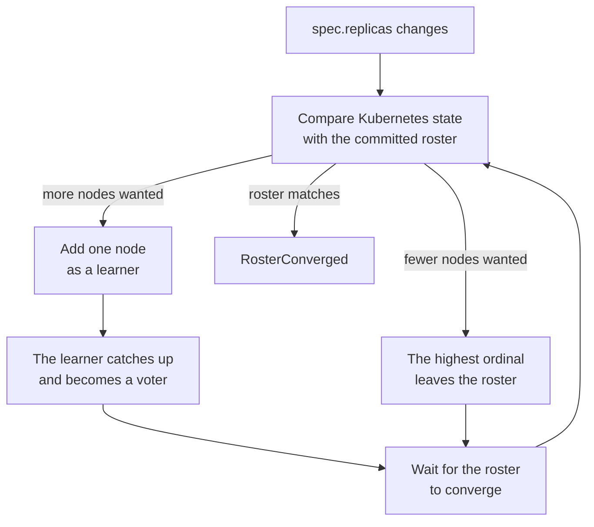

# Kubernetes Operator

The CamusDB Kubernetes Operator is the easiest way to run a self-managed CamusDB
cluster.

[Kubernetes](https://kubernetes.io/) is a platform that runs containers on a
group of machines. It restarts failed containers and moves work off failed
machines. Many teams already use it to run their applications.

An operator is a program that runs inside Kubernetes and manages one kind of
application for you. You describe the cluster you want in one short YAML file.
The operator creates the Kubernetes objects for that cluster, keeps the cluster
in that state, and does the routine work a person would otherwise do by hand.

The [CamusDB Kubernetes Operator](https://github.com/camusdb/camusdb-k8s-operator)
creates and operates CamusDB clusters through the `CamusDBCluster` custom
resource. A custom resource is a new kind of Kubernetes object, which the
operator adds to your Kubernetes cluster.

:::caution Alpha

The operator and the `camusdb.io/v1alpha1` API are alpha. Review the
[current limitations](#current-limitations) before using them for production
data.

:::

## Why use the operator

A database cluster is harder to run than a stateless application. Kubernetes
can start and stop containers, but it does not know CamusDB's cluster rules.

A CamusDB cluster keeps a membership roster. The roster is the list of nodes
that the cluster agreed on through [Raft](/docs/concepts#raft), the protocol
CamusDB nodes use to agree on each change. The cluster must admit a new node
into the roster before that node serves data. A node that leaves must exit the
roster in a controlled way. If you remove two nodes of a three-node cluster at
the same time, the [partitions](/docs/concepts#partition) (the slices of data
that each replicate on their own) lose their [majority](/docs/concepts#majority),
and the cluster stops all commits.

Adding or removing a node is therefore more than changing a replica count in
Kubernetes. The operator knows the roster rules: it compares the state in
Kubernetes with the committed roster and makes one membership change at a time.
As a result:

- One YAML resource creates a complete cluster: the storage, the network
  services, TLS, and the configuration.
- A change to the node count adds or removes one node at a time. The operator
  waits until the cluster accepts each change.
- An upgrade replaces one node at a time, so the cluster stays available.
- Optional autoscaling adds and removes nodes as the traffic changes.

Use the operator when you already run Kubernetes and want to run CamusDB on
your own infrastructure. You do not need it for:

- Local development, a tutorial, or a quick test. Run a standalone node, or the
  Docker Compose cluster in [Cluster mode](/docs/cluster#run-a-local-cluster).
- Servers or virtual machines without Kubernetes. Run each cluster node
  directly, as [Cluster mode](/docs/cluster#run-a-cluster-node-manually)
  describes.

## Before you start

You need:

- A Kubernetes cluster, and `kubectl` access to it.
- [Helm](https://helm.sh/), the package manager for Kubernetes. The operator
  installs from a Helm chart.
- A storage class that can provision persistent volumes. Every CamusDB node
  keeps its data on a persistent volume.
- A TLS certificate source. Use [cert-manager](https://cert-manager.io/), or an
  existing Kubernetes Secret that holds a certificate. TLS is mandatory.

## What the operator manages

In the list below, a StatefulSet runs a set of pods with stable names, so each
CamusDB node keeps the same identity after a restart. A PVC
(PersistentVolumeClaim) is a request for a disk that survives a pod restart.

The operator manages:

- A StatefulSet with stable node identities and one or two PVCs per node.
- A headless peer Service and a client-facing ClusterIP Service.
- The generated CamusDB configuration and startup arguments.
- Cluster bootstrap, node admission, graceful departure, and roster
  convergence.
- One-node-at-a-time rolling upgrades and certificate rollovers.
- TLS through an existing Secret or cert-manager.
- Optional CamusDB authentication and node-to-node mutual TLS.
- An optional PodDisruptionBudget that permits at most one unavailable node.
- Optional traffic-based autoscaling.

## Install the operator

Clone the operator repository and install its Helm chart:

```bash
git clone https://github.com/camusdb/camusdb-k8s-operator.git
cd camusdb-k8s-operator

helm install camusdb-operator \
  ./charts/camusdb-operator \
  --namespace camusdb-system \
  --create-namespace
```

The chart installs the controller, RBAC, and the `CamusDBCluster` CRD. It does
not create a database cluster.

By default, one operator replica watches every namespace. Important chart
settings:

| Value | Default | Description |
| --- | --- | --- |
| `replicaCount` | `1` | Operator replicas. Leader election keeps one reconciler active when this is greater than one. |
| `watchNamespace` | empty | Watches all namespaces when empty, or only the named namespace otherwise. RBAC remains cluster-scoped. |
| `leaderElection.enabled` | `true` | Must remain enabled when several operator replicas run. |
| `metrics.enabled` | `true` | Exposes controller-runtime metrics on port 8443 behind Kubernetes authentication and authorization. |
| `metrics.serviceMonitor.enabled` | `false` | Creates a ServiceMonitor when the Prometheus Operator CRDs are installed. |
| `rbac.create` | `true` | Creates the required ClusterRole and binding. |

## Create a cluster

Every cluster requires persistent storage and TLS. This example asks an
existing cert-manager `Issuer` named `camusdb-ca` to issue the certificate:

```yaml
apiVersion: camusdb.io/v1alpha1
kind: CamusDBCluster
metadata:
  name: camusdb
  namespace: databases
spec:
  replicas: 3
  image: camusdb/camusdb:0.15.2
  partitions: 3
  auth: {}
  storage:
    data:
      size: 100Gi
  tls:
    certManager:
      issuerRef:
        name: camusdb-ca
        kind: Issuer
  resources:
    requests:
      cpu: 250m
      memory: 512Mi
```

```bash
kubectl create namespace databases
kubectl apply -f camusdb-cluster.yaml
kubectl -n databases get camusdbcluster camusdb -w
```

Three [voters](/docs/concepts#learner-and-voter) (members that count toward
the majority) tolerate one unavailable node. The API rejects two replicas,
because a majority of two voters still requires both nodes. One replica is
supported for development, but the operator does not convert a one-node cluster
into a multi-node cluster, or the reverse. Create another `CamusDBCluster` and
migrate the data instead.

The client Service has the same name as the custom resource. Applications in
the cluster can use these default endpoints:

| Protocol | Endpoint |
| --- | --- |
| REST | `http://camusdb.databases.svc:5095` |
| REST with TLS | `https://camusdb.databases.svc:7141` |
| gRPC | `camusdb.databases.svc:5096` |

The client Service routes only to ready pods. The `<name>-peer` headless Service
publishes all pod addresses, including addresses that are not ready, so founding
nodes can discover one another before the first quorum exists.



## TLS

TLS is mandatory. Set exactly one of `spec.tls.certManager` or
`spec.tls.secretRef`. The operator uses that certificate for three listeners:
the internal cluster port (Raft), client gRPC, and HTTPS. Nodes verify the
peer's certificate on internal cluster connections. Mutual TLS between nodes,
where each node also presents its own certificate, is on only when you set
`spec.auth`.

Node-to-node HTTP forwarding (schema changes, cluster settings, and query
fragments) is plaintext: it goes to the peer's HTTP port because the operator
does not set `peer_tls_enabled`. Keep pod-to-pod traffic inside a trusted
network, or restrict it with a NetworkPolicy.

### cert-manager

The chart does not install cert-manager. The referenced `Issuer` or
`ClusterIssuer` must provide a stable CA and must write `ca.crt` into the issued
Secret. Prefer a CA issuer. A self-signed issuer creates a new trust root during
renewal, which prevents old and new nodes from trusting one another during the
rollout.

The operator creates a certificate with names for the client Service and a
wildcard for the peer StatefulSet. It converts the result to an unencrypted
PKCS#12 keystore that CamusDB can open. A certificate renewal causes a rolling
restart, one node at a time.

### Existing Secret

Create a Secret with an unencrypted PKCS#12 keystore and the PEM CA that signed
it:

```bash
kubectl -n databases create secret generic camusdb-tls \
  --from-file=certificate.pfx=/path/to/certificate.pfx \
  --from-file=ca.crt=/path/to/ca.crt
```

```yaml
spec:
  tls:
    secretRef:
      name: camusdb-tls
    keystoreKey: certificate.pfx
    caKey: ca.crt
```

For a self-signed keystore, `ca.crt` is the certificate itself. When
authentication is enabled, nodes also present this keystore as a client
certificate, so it must permit both server and client authentication. When you
update the Secret, the operator rolls the nodes onto the new keystore.

## Authentication

Set `auth: {}` to enable CamusDB authentication and let the operator generate
the credentials it needs:

```yaml
spec:
  auth: {}
```

The operator creates:

- `<name>-admin`, with the generated bootstrap administrator username and
  password.
- `<name>-auth-keys`, with the shared token key and node secret.

Supply an existing administrator Secret instead when credentials are managed
elsewhere. It must contain `username` and `password`:

```yaml
spec:
  auth:
    adminSecretRef:
      name: camusdb-operator-admin
```

The administrator is created as the bootstrap superuser only while the user
catalog is empty. If you later change its password with `ALTER USER`, update the
Secret too. Otherwise the operator cannot read protected metrics or manage
membership.

Authentication enables mutual TLS for internal cluster traffic (Raft and
[Kahuna](/docs/concepts#kahuna), the storage layer) and requires
CamusDB 0.15.2 or later. It also lets the operator ask a departing node to leave
cleanly. Without authentication, the operator cannot call the non-loopback
leave API: it removes the pod and waits about 90 seconds for the failure detector
to evict the member. Autoscaling requires authentication.

## Storage

The data PVC is mounted at `/storage`. CamusDB keeps the key/value store, the
[write-ahead log (WAL)](/docs/concepts#wal), and temporary spill files below
`/storage/data`. The example below keeps both in
[RocksDB](/docs/concepts#rocksdb), the default on-disk storage engine.

The operator's `backend` and `walBackend` fields currently accept `rocksdb`,
`sqlite`, and `memory`. [Solarium](https://solariumdb.github.io/) is available
through [CamusDB server configuration](/docs/configuration#solarium-storage-engine)
but is not yet accepted by these operator fields.

```yaml
spec:
  storage:
    backend: rocksdb
    walBackend: rocksdb
    data:
      size: 100Gi
      storageClassName: fast-data
    wal:
      size: 20Gi
      storageClassName: fast-wal
    syncWrites: true
    pvcRetentionPolicy: Retain
```

The optional WAL PVC is mounted at `/storage/data/wal`. A separate low-latency
volume can reduce write latency because WAL writes are fsync-bound.

`pvcRetentionPolicy` defaults to `Retain` when a node is scaled away. `Delete`
reclaims that node's volumes and local state. Deleting the whole
`CamusDBCluster` retains its PVCs regardless of this field. Changing
`storage.data.size` does not resize existing PVCs.

`spec.partitions`, `spec.storage.backend`, and `spec.storage.walBackend` are
immutable. The Kubernetes API rejects changes to them after creation.

## Configuration and scheduling

The CRD exposes typed fields for common settings:

| Field | Purpose |
| --- | --- |
| `spec.ports` | REST, HTTPS, gRPC, and Raft ports. |
| `spec.raft` | Heartbeat and election timing. |
| `spec.transactions` | Transaction timeouts, admission waits, and session limits. |
| `spec.workers` | Lock, key/value, and background-writer worker counts. |
| `spec.resources` | CamusDB container requests and limits. |
| `spec.nodeSelector`, `tolerations`, `affinity`, `topologySpreadConstraints` | Pod placement. |
| `spec.podAnnotations`, `podLabels` | Additional pod metadata. |
| `spec.env` | Additional environment variables. |
| `spec.extraArgs` | Additional CamusDB command-line arguments. |

Use `spec.config` for another CamusDB setting. Keys use the server's snake-case
YAML names and override generated values:

```yaml
spec:
  config:
    slow_query_log_enabled: true
    kahuna:
      backup_dir: /storage/data/backups
```

Changing the image, generated configuration, or keystore rolls the StatefulSet
one node at a time. Changing the replica count does not restart existing nodes.
An unknown configuration key or command-line flag makes CamusDB reject its
configuration and the pod fail to start.

The default affinity prefers to spread nodes across Kubernetes hosts, but it is
not required affinity. Set explicit affinity or topology spread constraints
when failure-domain separation is mandatory.

## Inspect the cluster

```bash
kubectl -n databases get camusdbcluster
kubectl -n databases get camusdbcluster camusdb -o yaml
kubectl -n databases get pods,pvc,services
kubectl -n databases logs camusdb-0 --tail=100
```

The phase is a short summary: `Pending`, `Bootstrapping`, `Running`,
`ScalingUp`, `ScalingDown`, `Upgrading`, or `Degraded`. Inspect status conditions
for the reason behind that phase:

| Condition | Meaning |
| --- | --- |
| `Available` | A quorum of voters is ready and serving. |
| `Progressing` | Bootstrap, scaling, or an upgrade is in progress. |
| `RosterConverged` | The committed CamusDB roster matches the desired nodes. |
| `KeystoreReady` | The required keystore and CA are available. |
| `Degraded` | The cluster cannot reach or retain its desired state. |
| `AutoscalingLimited` | A bound, missing signal, placement rule, or stuck node prevents the autoscaler from following its recommendation. |

`status.members` joins each committed roster member to its pod and reports its
role as `Voter`, `Learner`, `Leaving`, or `NotMember`. A running pod is not proof
that the node has joined the roster. Use `status.voters`, `status.learners`, and
`RosterConverged` when diagnosing a scale operation.

## Scale manually

Change `spec.replicas` on a fixed-size cluster:

```bash
kubectl -n databases patch camusdbcluster camusdb --type=merge \
  -p '{"spec":{"replicas":5}}'
```

The operator adds or removes one node at a time and waits for the committed
roster to converge before taking another step. New nodes join as
[learners](/docs/concepts#learner-and-voter), which copy data but do not vote,
and become voters after they catch up. On scale-down, the highest ordinal leaves
first. Do not edit the managed StatefulSet or force-delete a live member to make
a stalled scale appear complete.



Without `spec.replication`, every node holds every data partition. Adding nodes
then adds [replicas](/docs/concepts#replica-and-replication-factor) and voters,
but not write capacity. Use partition placement when you scale to distribute
work.

## Autoscale with traffic

The built-in autoscaler can use the Raft log-entry rate, pending client
proposals (writes waiting to enter the replication log), and process CPU. It
requires both `spec.auth` and `spec.replication`:

```yaml
spec:
  replicas: 4
  partitions: 16
  auth: {}
  replication:
    factor: 3
  autoscaling:
    minReplicas: 4
    maxReplicas: 9
    targetLogEntriesPerSecond: 4000
    targetQueueDepth: 32
    targetCPUPercent: 70
    scaleUpStabilizationSeconds: 60
    scaleDownStabilizationSeconds: 300
    tolerancePercent: 10
```

Create the cluster with more nodes than the replication factor. CamusDB applies
placement only to partitions created while the cluster has more nodes than the
factor. A cluster founded with three nodes and factor 3 stays fully replicated;
adding nodes later does not convert those partitions. The operator blocks
growth that placement cannot use.

The operator polls ready nodes every 15 seconds and calculates the worst ratio
of a configured signal to its target. A recommendation must remain outside the
tolerance band for the stabilization window. Even when the recommendation
jumps by several nodes, membership changes one node at a time.

The signals are:

- `targetLogEntriesPerSecond`: average Raft log entries per node. This is not a
  SQL statement count; one transaction can produce several entries.
- `targetQueueDepth`: average pending client proposals across partition
  executors.
- `targetCPUPercent`: average server-process CPU share. This is the only signal
  that reflects read load.

An unreadable configured signal prevents scale-down because the missing node
may carry the load. Inspect `status.autoscaling` and the `AutoscalingLimited`
condition for measurements and decisions. Do not attach a Horizontal Pod
Autoscaler to the managed StatefulSet; it conflicts with operator
reconciliation.

While autoscaling is enabled, edits to `spec.replicas` do not control the
current size. Return to a fixed count explicitly:

```bash
kubectl -n databases patch camusdbcluster camusdb --type=merge \
  -p '{"spec":{"autoscaling":null,"replicas":4}}'
```

## Upgrade

Change `spec.image` to roll CamusDB one node at a time. The operator pauses a
rollout while the roster is unreadable or has not converged. Use an exact image
tag instead of `latest`.

A CamusDB release with a different storage revision cannot open the old store.
Do not roll such a release onto existing PVCs. Follow
[Logical dump and reimport](/docs/logical-dump-and-reimport) to migrate the
data.

Helm installs CRDs on the first installation but does not upgrade files under a
chart's `crds/` directory. Before upgrading the operator across a CRD change,
update the source checkout, apply its CRD, and then upgrade the release:

```bash
git pull
kubectl apply -f charts/camusdb-operator/crds/camusdbclusters.yaml
helm upgrade camusdb-operator \
  ./charts/camusdb-operator \
  --namespace camusdb-system
```

Helm uninstall leaves the CRD and its resources in place. Deleting the CRD
deletes every `CamusDBCluster` resource, so treat that as a destructive action.

## Current limitations

- The client Service is `ClusterIP`; expose it separately when clients run
  outside the Kubernetes cluster.
- Node-to-node Raft and gRPC traffic uses mutual TLS with authentication, but
  node-to-node HTTP is plaintext. Restrict pod traffic with a NetworkPolicy.
- The operator has no backup, scheduled-backup, restore, or automatic
  seed-on-scale custom resources. Configure and run CamusDB backups separately.
- A retained PVC does not guarantee log-only catch-up after a long absence. The
  required WAL prefix may already have been compacted.
- Existing PVCs are not expanded after a storage-size edit.
- The autoscaler has no memory, latency, read-QPS, or external HPA signal.

See [Cluster operation](/docs/cluster),
[Authentication and authorization](/docs/sql-authentication), and
[Backup and restore](/docs/backup-and-restore) for the corresponding CamusDB
behavior below the operator.

