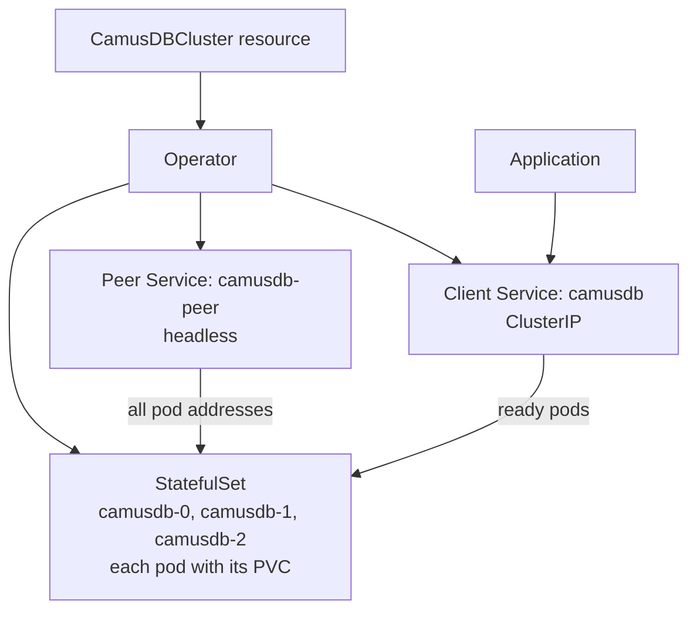
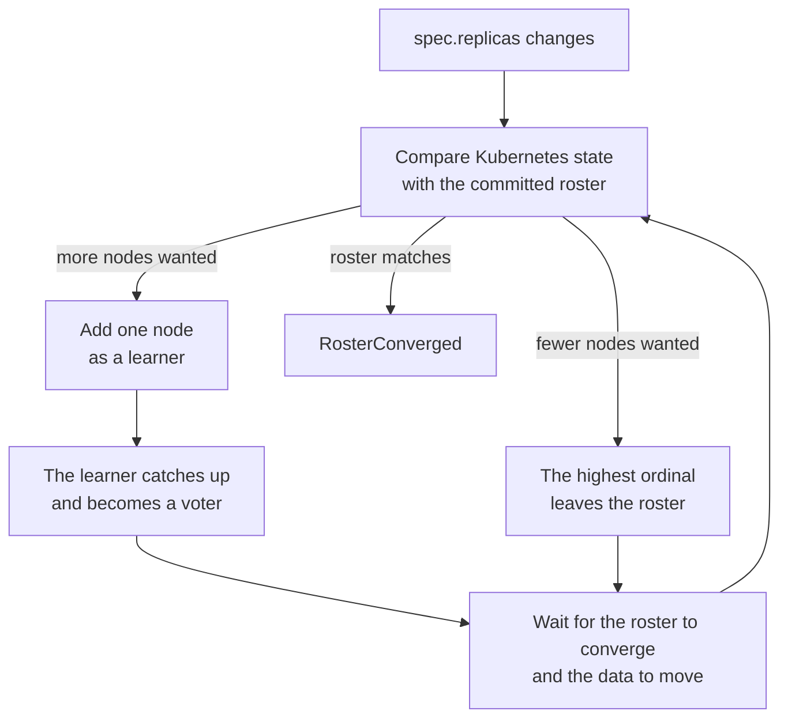

# Kubernetes Operator

With the CamusDB Kubernetes Operator, you can operate your own CamusDB cluster
on Kubernetes. You describe the cluster in one short YAML file. The operator
creates the cluster and maintains that state. It changes nodes one at a time,
and it can take scheduled backups.

[Kubernetes](https://kubernetes.io/) is a platform for containers on a group of
machines. An operator is a program in Kubernetes that manages one kind of
application. The
[CamusDB Kubernetes Operator](https://github.com/camusdb/camusdb-k8s-operator)
adds the `CamusDBCluster` custom resource, a new kind of Kubernetes object that
describes a CamusDB cluster.

:::caution Early stage

The operator and the `camusdb.io/v1alpha1` API are young. Review the
[current limitations](#current-limitations) before you use them for production
data.

:::

## The operator follows CamusDB's membership rules

Kubernetes can start and stop containers, but it doesn't know the cluster rules
of CamusDB.

A CamusDB cluster has a membership roster: the list of nodes that the cluster
agreed on through [Raft](/docs/concepts#raft). The cluster must admit a new node
to the roster before the node serves data. A node that leaves must exit the
roster in a controlled way. If you remove two nodes of a three-node cluster at
the same time, the [partitions](/docs/concepts#partition) lose their
[majority](/docs/concepts#majority), and the cluster can't commit.

This means that a node change needs a roster change as well as a new replica
count in Kubernetes. The operator reads the committed roster, and it makes one
membership change at a time. As a result:

- One YAML resource creates a complete cluster, including storage and TLS.
- A change to the node count adds or removes one node at a time. The operator
  waits until the cluster has applied each change and the data has moved.
- An upgrade replaces one node at a time, and the cluster continues to serve.
- Optional autoscaling adds and removes nodes as the load changes.

Use the operator when you already run Kubernetes and want to run CamusDB on your
own infrastructure. You don't need it in these cases:

- Local development or a quick test. Run a standalone node, or the
  Docker Compose cluster in [Cluster mode](/docs/cluster#run-a-local-cluster).
- Servers or virtual machines that don't use Kubernetes. Run each node directly, as
  [Cluster mode](/docs/cluster#run-a-cluster-node-manually) describes.

## Before you start

You need:

- A Kubernetes cluster, and `kubectl` access to it.
- [Helm](https://helm.sh/), the package manager for Kubernetes. The operator
  installs from a Helm chart.
- A storage class that can provision persistent volumes. Each CamusDB node
  stores its data on a persistent volume.
- A TLS certificate source: [cert-manager](https://cert-manager.io/), or a Kubernetes Secret with a certificate. TLS is mandatory.

## What the operator manages

The operator creates a StatefulSet, which gives each CamusDB node a stable name
and identity. Each node has one or two PVCs (PersistentVolumeClaims), disks that
survive a pod restart. The operator also creates the Services, the CamusDB
configuration, and a PodDisruptionBudget that allows one unavailable node.


## Install the operator

Clone the operator repository and install its Helm chart:

```bash
git clone https://github.com/camusdb/camusdb-k8s-operator.git
cd camusdb-k8s-operator

helm install camusdb-operator \
  ./charts/camusdb-operator \
  --namespace camusdb-system \
  --create-namespace
```

The chart installs the controller and the `CamusDBCluster` CRD, with their RBAC
rules. It doesn't create a database cluster.

By default, one operator replica watches all namespaces. The following chart
values are the most useful:

| Value | Default | Description |
| --- | --- | --- |
| `replicaCount` | `1` | Operator replicas. With more than one, leader election makes one reconciler active. |
| `watchNamespace` | empty | Empty watches all namespaces. A name watches that namespace only. The RBAC rules are cluster-scoped in both cases. |
| `leaderElection.enabled` | `true` | Must stay on when several operator replicas run. |
| `metrics.enabled` | `true` | Exposes the controller metrics on port 8443, behind Kubernetes authentication and authorization. |
| `metrics.serviceMonitor.enabled` | `false` | Creates a ServiceMonitor. Needs the Prometheus Operator CRDs. |
| `rbac.create` | `true` | Creates the ClusterRole and its binding. |

## Create a cluster

Each cluster needs persistent storage and TLS. In this example, an existing
cert-manager `Issuer` named `camusdb-ca` issues the certificate:

```yaml
apiVersion: camusdb.io/v1alpha1
kind: CamusDBCluster
metadata:
  name: camusdb
  namespace: databases
spec:
  replicas: 3
  image: camusdb/camusdb:0.18.3
  partitions: 3
  auth: {}
  storage:
    data:
      size: 100Gi
  tls:
    certManager:
      issuerRef:
        name: camusdb-ca
        kind: Issuer
  resources:
    requests:
      cpu: 250m
      memory: 512Mi
```

```bash
kubectl create namespace databases
kubectl apply -f camusdb-cluster.yaml
kubectl -n databases get camusdbcluster camusdb -w
```

Three [voters](/docs/concepts#learner-and-voter) (members that count toward the
majority) tolerate one unavailable node. The API returns an error for two
replicas: two voters need both nodes for a majority. One replica is supported
for development. However, the operator can't grow a one-node cluster, or shrink
a cluster to one node. Create another `CamusDBCluster`, and move the data.

The client Service has the name of the custom resource. Applications in the
Kubernetes cluster can use the following default endpoints:

| Protocol | Endpoint |
| --- | --- |
| REST | `http://camusdb.databases.svc:5095` |
| REST with TLS | `https://camusdb.databases.svc:7141` |
| gRPC | `camusdb.databases.svc:5096` |

The client Service routes to ready pods. The headless `<name>-peer` Service
publishes all pod addresses, also of pods that aren't ready. This means that
the founding nodes can find each other before the first quorum exists.



## TLS

TLS is mandatory. Set one of `spec.tls.certManager` or `spec.tls.secretRef`. The
certificate is used for the internal cluster port (Raft), client gRPC, and
HTTPS. Nodes verify the certificate of the other node on internal cluster
connections. Mutual TLS between nodes, where each node also presents its
certificate, is on when you set `spec.auth`.

CamusDB forwards some admin requests between nodes, such as schema changes,
over the HTTP port. This traffic isn't encrypted, and it carries a shared secret
in a header. You should keep pod-to-pod traffic in a trusted network, or
restrict it with a NetworkPolicy.

CamusDB reads its certificate at startup. When the certificate changes, the
operator restarts the nodes one at a time.

### cert-manager

The chart doesn't install cert-manager. The `Issuer` or `ClusterIssuer` must
provide a stable CA, and it must write `ca.crt` into the issued Secret. ACME
issuers don't write `ca.crt`. Use a CA issuer. A self-signed issuer creates a
new trust root at each renewal, and old and new nodes then don't trust each
other during the rollout.

The operator creates a certificate with the names of the client Service and a
wildcard for the pods. This means that a scale doesn't issue a new certificate.
The operator converts the result to an unencrypted PKCS#12 keystore, in the
Secret `<name>-keystore`.

### Existing Secret

Create a Secret with an unencrypted PKCS#12 keystore, and the PEM CA that signed
it:

```bash
kubectl -n databases create secret generic camusdb-tls \
  --from-file=certificate.pfx=/path/to/certificate.pfx \
  --from-file=ca.crt=/path/to/ca.crt
```

```yaml
spec:
  tls:
    secretRef:
      name: camusdb-tls
    keystoreKey: certificate.pfx
    caKey: ca.crt
```

For a self-signed keystore, `ca.crt` is the certificate itself. With
authentication, nodes also present this keystore as a client certificate. It
must allow both server and client authentication. The operator detects a change
to the Secret within about a minute.

## Authentication

Set `auth: {}` to turn on CamusDB authentication. The operator generates the
credentials:

```yaml
spec:
  auth: {}
```

The operator creates the following Secrets:

- `<name>-admin`, with the user name and password of the bootstrap
  administrator.
- `<name>-auth-keys`, with the shared token key and node secret.

If you manage the credentials elsewhere, supply an administrator Secret with
`username` and `password`:

```yaml
spec:
  auth:
    adminSecretRef:
      name: camusdb-operator-admin
```

The administrator is created as the bootstrap superuser when the user catalog is
empty, at the first start. If you change its password later with `ALTER USER`,
update the Secret too. Otherwise, the operator can't sign in, and the
`RosterConverged` condition says so.

Authentication turns on mutual TLS for internal cluster traffic. It needs
CamusDB 0.15.2 or later. If authentication is off,
CamusDB takes admin calls from the same machine only. The following features need `spec.auth`:

- A clean leave before a pod is removed. If it is off,
  the cluster removes the node after about 10 minutes, and the data of the node
  isn't moved first.
- [Scheduled backups](#scheduled-backups).
- [Autoscaling](#autoscale-with-load).

If you add `auth` to a running cluster, the nodes restart one at a time. Until all nodes restart,
the nodes that didn't restart yet don't require a sign-in.

## Storage

The data PVC is mounted at `/storage`. The key/value store, the
[write-ahead log (WAL)](/docs/concepts#wal), and temporary spill files are below
`/storage/data`. The following example puts both in
[RocksDB](/docs/concepts#rocksdb), the default storage engine:

```yaml
spec:
  storage:
    backend: rocksdb
    walBackend: rocksdb
    data:
      size: 100Gi
      storageClassName: fast-data
    wal:
      size: 20Gi
      storageClassName: fast-wal
    syncWrites: true
    pvcRetentionPolicy: Retain
```

`backend` and `walBackend` can be `rocksdb` (default), `sqlite`, or `memory`.
[Solarium](https://solariumdb.github.io/) is available through the
[server configuration](/docs/configuration#solarium-storage-engine), but these
operator fields don't accept it yet.

The optional WAL PVC is mounted at `/storage/data/wal`. WAL writes wait for
fsync. This means that a separate low-latency volume can reduce write latency.

`pvcRetentionPolicy` decides when the volumes of a removed node are deleted:

- `Retain` (default): the volumes stay, and you can read them. If a scale-up
  adds that node back, the operator deletes them before the new pod starts. A
  node that left can't rejoin on its old data.
- `Delete`: the volumes are deleted when the node is removed.

When you delete the `CamusDBCluster`, its PVCs are kept. A change to
`storage.data.size` doesn't resize existing PVCs.

`spec.partitions` and the two storage backends can't change after creation. The
Kubernetes API returns an error for a change.

## Configuration and scheduling

The CRD has typed fields for common settings. If you don't set a field, the
server default applies:

| Field | Purpose |
| --- | --- |
| `spec.ports` | The ports of the server. |
| `spec.raft` | Heartbeat and election timing. |
| `spec.transactions` | Transaction timeouts and admission limits. |
| `spec.workers` | Worker pool sizes. |
| `spec.replication` | The number of nodes that hold each data partition. |
| `spec.logLevel` | The server log level. Default `Information`. |
| `spec.resources` | CamusDB container requests and limits. |
| `spec.nodeSelector`, `tolerations`, `affinity`, `topologySpreadConstraints` | Pod placement. |
| `spec.podAnnotations`, `podLabels` | Additional pod metadata. |
| `spec.podDisruptionBudget` | A PodDisruptionBudget that allows one unavailable node. On by default with 3 or more replicas. |
| `spec.env` | Additional environment variables. |
| `spec.extraArgs` | Additional CamusDB command-line arguments. They can't change a flag that the operator sets. |

Use `spec.config` for other CamusDB settings. Keys use the snake-case YAML names
of the server, and they override the generated values:

```yaml
spec:
  config:
    slow_query_log_enabled: true
    kahuna:
      backup_dir: /storage/data/backups
```

A change to the image or the configuration restarts the nodes one at a time. A
new keystore does too. A change to the replica count doesn't restart existing
nodes. An unknown configuration key or command-line flag makes the server stop
at startup, and the pod fails to start.

The default affinity prefers to spread nodes across Kubernetes hosts, but it
doesn't require it. If you need failure-domain separation, set an explicit
affinity or topology spread constraints.

## Inspect the cluster

```bash
kubectl -n databases get camusdbcluster
kubectl -n databases get camusdbcluster camusdb -o yaml
kubectl -n databases get pods,pvc,services
kubectl -n databases logs camusdb-0 --tail=100
```

The phase is a summary, such as `Running` or `ScalingUp`. The status conditions
give the reason:

| Condition | Meaning |
| --- | --- |
| `Available` | A majority of voters is ready and serving. |
| `Progressing` | The operator is changing the nodes, for example in a scale or a rolling restart. While a step waits, the message says why. |
| `RosterConverged` | The committed CamusDB roster matches the requested nodes. If the roster can't be read, the message says why. |
| `KeystoreReady` | The keystore and CA are available. |
| `Degraded` | The cluster can't reach or keep its requested state. |
| `AutoscalingLimited` | Something stops the autoscaler from following its recommendation, such as a limit or a stuck node. |
| `BackupFailing` | The last backup attempt failed. |
| `BackupVolumeReady` | The backup volume is bound, and all nodes can mount it. |

`status.members` joins each committed roster member to its pod, with the role
`Voter`, `Learner`, `Leaving`, or `NotMember`. A running pod isn't always a
member. When you diagnose a scale, use the
`RosterConverged` condition and the voter and learner counts in `status`.

## Scale manually

Change `spec.replicas` on a fixed-size cluster:

```bash
kubectl -n databases patch camusdbcluster camusdb --type=merge \
  -p '{"spec":{"replicas":5}}'
```

The operator adds or removes one node at a time. Before each step, it waits
until the committed roster matches the current size, and no data is moving or
left on a removed node. New nodes join as
[learners](/docs/concepts#learner-and-voter), which copy data but don't vote.
They become voters after they catch up. On scale-down, the node with the highest
ordinal leaves first. Don't edit the managed StatefulSet or force-delete a live
member to finish a stalled scale.



If `spec.replication` isn't set, all nodes hold all data partitions. Then more nodes
add [replicas](/docs/concepts#replica-and-replication-factor) and voters, but
not write capacity. To spread the work when you scale, set a replication factor.

## Scheduled backups

With `spec.backup`, the operator takes full backups on a schedule, and
optionally incremental backups. All nodes write to one shared volume:

```yaml
spec:
  auth: {}
  backup:
    schedule: "0 2 * * *"               # full backups (cron, UTC)
    incrementalSchedule: "*/15 * * * *" # optional
    volume:
      claim:
        size: 100Gi
        storageClassName: filestore     # must support ReadWriteMany
    retention:
      maxChains: 7
```

Backups have the following requirements:

- `spec.auth`. Backup calls need a signed-in administrator.
- A ReadWriteMany volume when the cluster has more than one node. Block storage,
  such as EBS or Persistent Disk, can't do this. Use file storage, such as NFS
  or EFS. You can also name your own claim with `volume.claimName`.
- CamusDB 0.16.0 or later when the cluster can have more nodes than the
  replication factor. The operator doesn't allow
  older versions in that case.

The first full backup starts when the cluster is ready. Later backups follow the
schedules, and the runs that were missed become one run. A backup waits until all nodes are
ready on the current image and configuration. Scaling and upgrades don't wait
for a backup. When you turn on backups, the nodes restart one at a time. The
retention settings delete old backups, and the newest chain is always kept.

`status.backup` shows the last backup and any failures. After a failure, the
operator retries after 1 minute, and then waits longer each time, up to 30
minutes. The `<name>-backup` claim and the `<name>-backup-mac` signing key are
kept when you delete the cluster or remove `backup`. You need the key to restore
a backup. Restore is manual. See [Backup and restore](/docs/backup-and-restore).

## Autoscale with load

The built-in autoscaler uses up to three signals, and it needs both `spec.auth`
and `spec.replication`:

```yaml
spec:
  replicas: 4
  partitions: 16
  auth: {}
  replication:
    factor: 3
  autoscaling:
    minReplicas: 4
    maxReplicas: 9
    targetLogEntriesPerSecond: 4000
    targetQueueDepth: 32
    targetCPUPercent: 70
    scaleUpStabilizationSeconds: 60
    scaleDownStabilizationSeconds: 300
    tolerancePercent: 10
```

At 15-second intervals, the operator reads each ready node, and averages each signal
for each node:

| Target | Signal |
| --- | --- |
| `targetLogEntriesPerSecond` | Key/value write entries (`kahuna.kv.write.entries`). One transaction writes several entries. |
| `targetQueueDepth` | Client requests that wait in the partition executors (`raft.executor.client_queue_depth`). |
| `targetCPUPercent` | The CPU share of the server process. This is the only signal that reflects read load. |

Set at least one target. The values above are examples. You should measure your
workload to choose them. `minReplicas` is at least 3.

The operator computes a size from the highest ratio of a signal to its target.
The recommendation must stay outside the tolerance band for the stabilization
window: by default, 60 seconds to scale up and 300 seconds to scale down. Then
the size changes by one node, and the next step waits until the roster has
converged and the data has moved. If a signal can't be read, the autoscaler
doesn't scale down. The missing node can carry the load.

A partition that was created when the cluster had no more nodes than the
factor is on all nodes. CamusDB 0.16.0 and later reduce such partitions to the
factor within a few minutes. While a data partition is on all nodes, the
autoscaler stops at 3 nodes, and `AutoscalingLimited` says why.

Inspect `status.autoscaling` and the `AutoscalingLimited` condition for the
measurements and decisions. Don't attach a Horizontal Pod Autoscaler to the
managed StatefulSet. It conflicts with the operator.

While autoscaling is on, `spec.replicas` is the starting size only. To return
to a fixed count, remove `autoscaling`:

```bash
kubectl -n databases patch camusdbcluster camusdb --type=merge \
  -p '{"spec":{"autoscaling":null,"replicas":4}}'
```

## Upgrade

Change `spec.image` to roll CamusDB one node at a time. The operator pauses the
rollout while the roster can't be read or doesn't match. Use an exact image tag,
and not `latest`. A stopping pod continues to serve for 5 seconds before CamusDB
stops. In that time, the client Service stops sending it new connections.

Some releases change the storage revision. A server of a new revision starts
with an empty store, and it doesn't read the old one. Don't roll such a release
onto a live cluster. Move the data with a
[logical dump and reimport](/docs/logical-dump-and-reimport).

Helm installs CRDs at the first installation, but it doesn't upgrade the files
under the `crds/` directory of a chart. Before you upgrade the operator across a CRD change, apply the new CRD from an
updated checkout. Then upgrade the release:

```bash
git pull
kubectl apply -f charts/camusdb-operator/crds/camusdbclusters.yaml
helm upgrade camusdb-operator \
  ./charts/camusdb-operator \
  --namespace camusdb-system
```

`helm uninstall` leaves the CRD and its resources in place. If you delete the
CRD, all `CamusDBCluster` resources are deleted.

## Current limitations

- The client Service is a `ClusterIP` Service. Expose it separately for clients
  outside the Kubernetes cluster.
- Admin requests between nodes over HTTP aren't encrypted. Restrict pod traffic
  with a NetworkPolicy.
- Restore isn't available through the operator.
- New nodes copy their data from the cluster. The operator can't start a node
  from a backup yet.
- A retained PVC doesn't guarantee a log-only catch-up after a long absence. The
  cluster can delete the log that the node needs.
- Existing PVCs aren't expanded after a storage-size change.
- The autoscaler uses the three signals above only. For example, it doesn't use
  memory or latency.

## Related pages

- [Cluster operation](/docs/cluster)
- [Authentication and authorization](/docs/sql-authentication)
- [Backup and restore](/docs/backup-and-restore)
