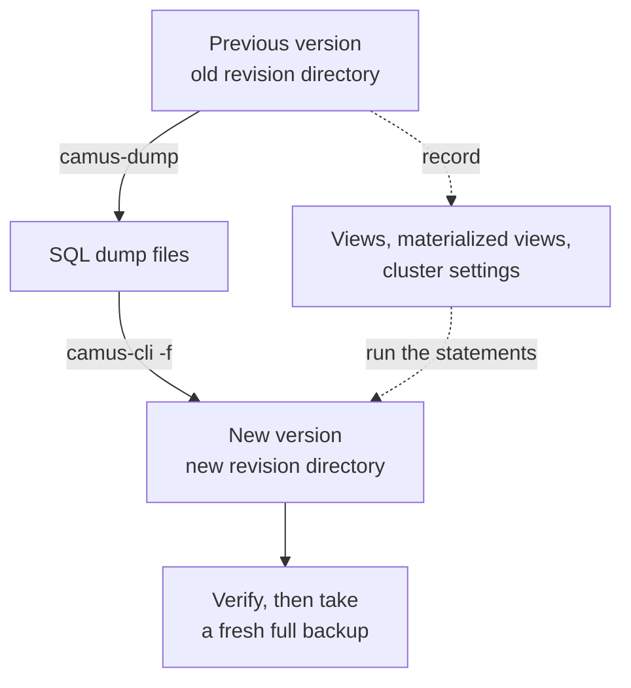

# Logical dump and reimport

Some CamusDB upgrades change the on-disk storage format, and the new server does
not convert the old data. To keep your data across that upgrade, export it as
SQL from the old version and import it into the new one. This is similar to
moving between PostgreSQL major versions with `pg_dump` and `psql`.

You can also use a logical dump to copy a server into a fresh environment
through SQL instead of through a physical backup.

## Why this is needed

CamusDB stores rows, indexes, schema metadata, transaction state, and recovery
state in the storage layer. Some releases can change that physical layout. A
storage revision is the compatibility boundary for those on-disk structures.

CamusDB does not rewrite a previous revision in place. A newer server opens its
own revision directory under `data_dir` and leaves older revision directories
untouched. Move data across revisions with [`camus-dump`](/docs/camus-dump) and
[`camus-cli`](/docs/camus-cli).

## What a dump carries

`camus-dump` writes SQL for databases, installed extensions, tables, indexes,
sequences, and rows. The
table DDL comes from `SHOW CREATE TABLE`, so it carries defaults, check
constraints, foreign keys, comments, covering-index included columns, and
row-level TTL settings. Each sequence keeps its options, its comment, and its
position, which the dump restores with `setval` after the rows.

With `--all-users`, the dump also exports every account and every grant. Use
`--users name1,name2` instead against a server that has no `SHOW USERS`. The
accounts are created without a password, and superuser status is not exported.

Installed extensions are emitted as `CREATE EXTENSION name VERSION 'version'`
before tables, so defaults, checks, and views can resolve their functions.
The dump contains no extension DLLs. Deploy the same builds and dependencies
on the destination nodes, configure their paths, and restart before reimporting.
An unavailable version causes installation to fail. Reading installed
extensions requires a superuser; a dump by another user omits them and reports
that omission. See [C# extensions](/docs/csharp-extensions).

Foreign keys affect load order. A `CREATE TABLE` with a foreign key needs its
parent table to exist, and a child `INSERT` needs its parent row to be loaded.
For a dump with foreign keys, either load parent tables and rows before their
children, or remove the `FOREIGN KEY` clauses from the initial table DDL, load
all rows, and add each constraint afterwards with
`ALTER TABLE ... ADD CONSTRAINT`. The `ADD CONSTRAINT` statement validates the
loaded rows.

Index definitions carry their per-column sort direction and their comment, both
in inline table DDL and in separate `CREATE INDEX` statements. A dump from a
server version that did not report those details cannot recover them later.
Check descending indexes after reimporting from an older dump.

Record and recreate these objects separately:

| Object | Before the move | After the reimport |
| --- | --- | --- |
| Views | `SHOW VIEWS` and `SHOW CREATE VIEW name` | Run the printed `CREATE VIEW`. |
| Materialized views | `SHOW MATERIALIZED VIEWS` and `SHOW CREATE MATERIALIZED VIEW name` | Run the printed statement, then refresh it. |
| Passwords and superuser status | Nothing to record | Set a password for each account with `ALTER USER`. Superuser status comes only from the bootstrap user. |
| Triggers | Keep the original `CREATE TRIGGER` statements; the dump omits them. | Recreate after loading rows so the import does not fire triggers. |
| Cluster settings | `SHOW VARIABLES`, keeping non-default values | Run `SET CLUSTER SETTING`. |
| Table statistics | Nothing to record | Run `ANALYZE` after the load. |
| Physical backups | Nothing to record | Take a fresh full backup after the load. |



A branch is dumped as the full database view that the branch can read. The
reimported copy is an independent database, not a copy-on-write branch of the
original parent.

A storage revision move starts the new server with a fresh user catalog.
Accounts, grants, and sessions live in the same storage revision as the rows, so
export accounts and grants with `camus-dump --all-users` (or `--users`). Passwords
cannot be exported; plan to set a new password for each account after the
reimport.

## Dump

Run the dump before upgrading, or run the previous CamusDB version against the
old revision directory:

```bash
camus-dump -e http://db1.internal:5096 --all-databases --all-users -b 100 \
  --output-directory /backup/camusdb-old/
```

`--all-databases` asks the server for every database. `--all-users` writes
`users.sql` (the `CREATE USER` statements) and `grants.sql` (the `GRANT`
statements) next to the database files, and needs a superuser. `-b` controls
rows per `INSERT`. Start with `-b 100`: it avoids one round trip per row without
making statements too large for wide tables.

With authentication enabled, pass credentials through the environment or an
interactive prompt, not through shell history:

```bash
CAMUSDB_PASSWORD=secret camus-dump -e https://db1.internal:5096 \
  --all-databases --all-users -u admin -b 100 \
  --output-directory /backup/camusdb-old/
```

Keep row counts for verification:

```bash
camus-cli -c "Endpoint=http://db1.internal:5095;Database=shop" \
  -e "SELECT COUNT(*) FROM orders"
```

## Reimport

Start the new CamusDB version on the target `data_dir`. If authentication is
enabled, bootstrap a superuser as described in
[Authentication And Authorization](/docs/sql-authentication), because the user
catalog lives in the old storage revision too.

Import each dump file with `camus-cli`:

```bash
camus-cli -c "Endpoint=http://db1.internal:5095;Database=test" \
  -f /backup/camusdb-old/shop.sql
```

Load supporting objects in this order:

1. Users, from `users.sql`.
2. Databases, tables, indexes, foreign keys, sequences, and rows, from each
   database file.
3. Views and materialized views.
4. Grants, from `grants.sql`.
5. Cluster settings.
6. `ANALYZE` for each table.

If a load fails partway through, fix the cause, drop the partly loaded database,
and run the file again. `CREATE DATABASE IF NOT EXISTS` can be repeated, but
`INSERT` statements are not idempotent.

## Verify

After the load:

```camussql
SHOW DATABASES;
SHOW TABLES;
SHOW INDEXES FROM orders;
SELECT COUNT(*) FROM orders;
```

Compare row counts with the old server. Spot-check important queries and
indexes before directing application traffic to the new server.

Take a fresh full [physical backup](/docs/backup-and-restore) after verification.
Only then remove old revision directories from every node.

## Batch size and deferred indexes

[Shaping the output](/docs/camus-dump#shaping-the-output) explains how `--batch`
and `--defer-indexes` affect a restore. Two hard limits bound the batch size:

- The transaction mutation limit. A row costs at least two mutations, plus one
  for each secondary index entry and one for each out-of-line large value.
- The transport message size. gRPC messages are much smaller than HTTP request
  bodies, so wide rows can hit the gRPC limit before they hit the mutation
  limit.

## Large values

A logical dump writes each value in full into SQL, regardless of whether CamusDB
stored that value inline, compressed, or out of line. A table with 1 MB values
therefore reaches the gRPC message limit at only a few rows per statement.

A reimported row is written under the current large-value rules. If a value is
stored out of line during reload, it also costs one more mutation for that row.
Use a smaller `--batch` for tables with large `STRING`, `BYTES`/`BLOB`, or
`ARRAY` columns, and see [Large Values](/docs/storage-layout) for the storage
rules and mutation impact.
