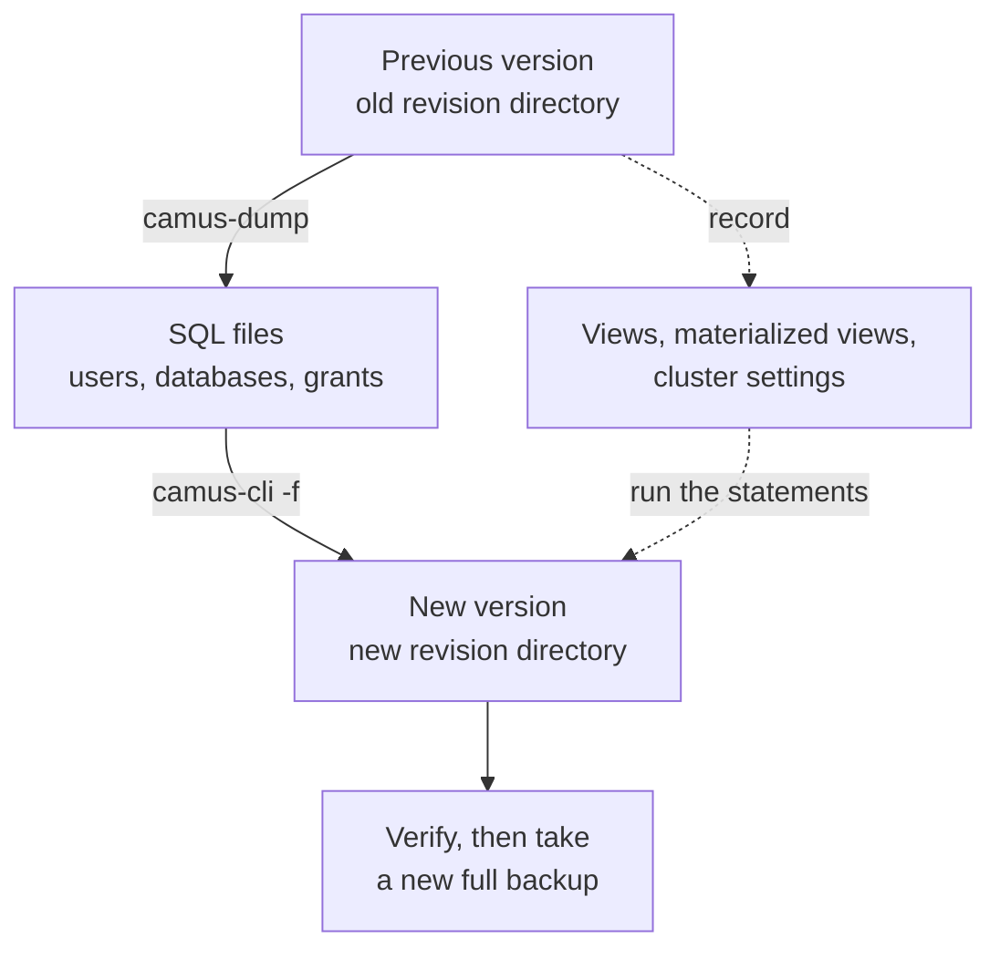

# Logical dump and reimport

A logical dump exports your data as SQL from one CamusDB version. You can then
import it into another version. Use it when an upgrade changes the on-disk storage
format. The new server doesn't convert the old data. This is similar to a move
between PostgreSQL major versions with `pg_dump` and `psql`.

You can also use a logical dump to copy a server to a new environment through
SQL, as an alternative to a [physical backup](/docs/backup-and-restore).

## Storage revisions

Some releases change the layout of the data on disk. A storage revision marks
such a change. A server of a new revision opens a separate revision directory
under `data_dir`. It doesn't read or change the older revision directories.

To move data from one revision to the next, dump it with
[`camus-dump`](/docs/camus-dump) and load it with [`camus-cli`](/docs/camus-cli).
The users, grants, and sessions are in the same storage revision as the rows.
This means that the new server also starts with an empty user catalog.

## What the dump includes

`camus-dump` writes a SQL file for each database, with the following objects in
load order:

1. `CREATE EXTENSION` for each installed extension, before the objects that use
   its functions.
2. Inline C# functions.
3. Sequences, with their options, comments, and current positions (`setval`).
4. Tables. Each table has its DDL, then its secondary indexes, then its rows.
   The table DDL comes from `SHOW CREATE TABLE`, with the defaults,
   constraints, foreign keys, comments, and TTL settings. The indexes keep
   their sort direction, `INCLUDE` columns, and comments. Parent tables come
   before their children.
5. Triggers, after the rows. This means that the load doesn't fire them.

With `--all-users`, the dump also writes `users.sql` with the accounts and
`grants.sql` with the grants. For more information, see
[Users and grants](/docs/camus-dump#users-and-grants) and
[Foreign keys](/docs/camus-dump#foreign-keys).

A branch is dumped as the full data that the branch can read. The reimported
copy is a normal database. It isn't linked to the original parent.

### Recreate what the dump leaves out

| Object | Before the move | After the reimport |
| --- | --- | --- |
| Views | `SHOW VIEWS` and `SHOW CREATE VIEW name` | Run the printed `CREATE VIEW`. |
| Materialized views | `SHOW MATERIALIZED VIEWS` and `SHOW CREATE MATERIALIZED VIEW name` | Run the printed statement, then `REFRESH MATERIALIZED VIEW`. |
| Passwords | No action. They can't be exported. | Set a password for each account with `ALTER USER name IDENTIFIED BY '...'`. |
| Superuser status | No action. | The new bootstrap user is the superuser. Other accounts are ordinary accounts. |
| Cluster settings | `SHOW CLUSTER SETTINGS` | Run `SET CLUSTER SETTING` for each value. |
| Table statistics | No action. | Run `ANALYZE` for each table. |
| Physical backups | No action. | Take a new full backup after the load. |



### Extensions and inline code

The extension DLLs aren't in the dump. Before you load it, install the same
extension builds and their dependencies on each target node. Then configure
their paths and restart the nodes. If a version isn't available,
`CREATE EXTENSION` fails. Only a superuser can read the installed extensions. A
dump by another user leaves them out, and it prints a warning. For more
information, see [C# extensions](/docs/csharp-extensions).

Inline functions and triggers need `inline_functions_enabled: true` and
`inline_triggers_enabled: true` in the configuration of the target server. Both
are off by default, and a change needs a restart. The dump prints a warning
when it includes inline code. A trigger without an owner on the source, for
example one created with authentication off, is owned by the user who loads the
dump.

Note that `camus-dump` includes extensions from version 0.16.0, and inline
functions and triggers from version 0.18.0. With an older version, recreate
them from your own scripts.

## Dump

Run the dump before the upgrade, or run the previous CamusDB version on the old
revision directory:

```bash
camus-dump -e http://db1.internal:5096 --all-databases --all-users -b 100 \
  --output-directory /backup/camusdb-old/
```

- `--all-databases` dumps each database to `<database>.sql` in the output
  directory.
- `--all-users` writes `users.sql` and `grants.sql`, and needs a superuser.
  Against an older server that doesn't support `SHOW USERS`, name the
  accounts with `--users name1,name2`.
- `-b` sets the rows in each `INSERT`. `100` avoids a round trip for each row,
  and it doesn't make the statements too large for wide tables. It's the default
  from `camus-dump` 0.12.1.

With authentication enabled, use `--ask-password` (`-W`) to type the password.
A password in `-p` is visible to other processes:

```bash
camus-dump -e https://db1.internal:5096 -u admin -W \
  --all-databases --all-users -b 100 \
  --output-directory /backup/camusdb-old/
```

You can also set `CAMUSDB_PASSWORD` from a secret store.

Record the row counts for the verification:

```bash
camus-cli -c "Endpoint=http://db1.internal:5095;Database=shop" \
  -e "SELECT COUNT(*) FROM orders"
```

## Reimport

Start the new CamusDB version on the target `data_dir`. If authentication is
enabled, create the bootstrap superuser as described in
[Authentication and authorization](/docs/sql-authentication). If the dump has
inline code, turn on the inline settings first.

Load the files with `camus-cli`. Each database file starts with
`CREATE DATABASE IF NOT EXISTS` and `USE`. This means that the database in the
connection string doesn't need to exist:

```bash
camus-cli -c "Endpoint=http://db1.internal:5095;Database=test" \
  -f /backup/camusdb-old/users.sql
camus-cli -c "Endpoint=http://db1.internal:5095;Database=test" \
  -f /backup/camusdb-old/shop.sql
```

Load the objects in this order:

1. Users, from `users.sql`.
2. Each database file.
3. Views and materialized views.
4. Grants, from `grants.sql`. A grant needs its object to exist.
5. Cluster settings.
6. `ANALYZE` for each table.
7. A password for each account.

`camus-cli -f` stops at the first error. Fix the cause, drop the partly loaded
database, and load the file again. You can repeat `CREATE DATABASE IF NOT EXISTS`.
However, the `INSERT` statements fail on rows that were already loaded.

## Verify

After the load, run the following checks:

```camussql
SHOW DATABASES;
SHOW TABLES;
SHOW INDEXES FROM orders;
SELECT COUNT(*) FROM orders;
```

Compare the row counts with the old server. Test the important queries and
indexes before you send application traffic to the new server.

A dump from an older server version can lack the index sort direction and the
index comments, and they can't be recovered later. After such a reimport, check
the descending indexes in `SHOW INDEXES`.

Take a new full [physical backup](/docs/backup-and-restore) after the
verification. Then remove the old revision directories from all nodes.

## Batch size and large values

For the effect of `--batch` and `--defer-indexes` on a restore, see
[Shaping the output](/docs/camus-dump#shaping-the-output). Two limits apply to
the batch size:

- The transaction mutation limit. A row costs at least two mutations, plus one
  for each secondary index entry and one for each out-of-line large value.
- The transport message size. gRPC messages are much smaller than HTTP request
  bodies. Wide rows can reach the gRPC limit before the mutation limit.

A dump writes each value in full, also if the value was stored compressed or
out of line. For example, a table with 1 MB values reaches the gRPC message
limit at a few rows for each statement.

A reloaded row is stored under the current
[large-value rules](/docs/storage-layout). A value that is stored out of line
costs one more mutation. Use a smaller `--batch` for tables with large `STRING`,
`BYTES`, or `ARRAY` values.
