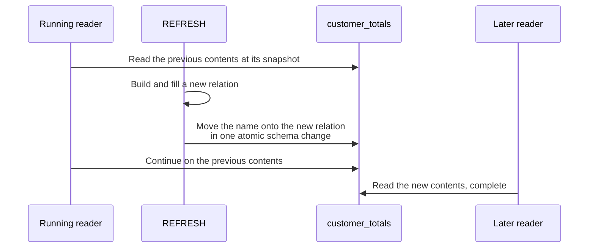

# Materialized views

A materialized view runs its query once, stores the rows, and answers every
read from that stored copy until you refresh it.

A plain [view](/docs/views) trades storage for freshness. A materialized view
trades freshness for speed.

```camussql
CREATE MATERIALIZED VIEW customer_totals AS
  SELECT customer, SUM(total) AS total_spent
  FROM orders
  GROUP BY customer;

SELECT * FROM customer_totals WHERE customer = 'acme';  -- does not touch orders

REFRESH MATERIALIZED VIEW customer_totals;              -- re-runs the query
```

A later insert into `orders` does not change what `customer_totals` returns.
That is the point of the feature, and the one behavior to learn: a materialized
view is a snapshot, and only `REFRESH` moves it forward.
`SHOW MATERIALIZED VIEWS` reports how stale each one is.

A materialized view can also combine queries with `UNION`, `INTERSECT`, or
`EXCEPT`. Both operands contribute dependencies, and their column lists are
fixed at creation. See [set operations in views](/docs/sql-queries#views).

## Why use one

A plain view reruns its query on every read. If that query is a wide join or an
aggregate over a large table, every reader pays that cost every time.

A materialized view pays once, at refresh time, and then serves the answer.

- Read cost stops tracking the base table. A rollup over ten million orders
  answers from the rollup's own rows. As `orders` grows, the refresh takes
  longer, but the dashboard does not get slower.
- You can index, analyze, and cache it. The stored rows are an ordinary
  relation, so an index on the column you filter by turns the read into a
  lookup. A plain view has no rows of its own and cannot offer that.
- A refresh never blocks readers. The rebuild happens alongside the live copy
  and swaps in atomically. Reads are never slow, blocked by a lock, or pointed
  at a half-built result.
- A snapshot is often what a report needs. Every panel that reads the same
  materialized view sees the same instant, and rerunning a query gives the same
  answer until you refresh. Several live queries racing each other make that
  consistency harder to get.

### Worked example

Here is an expensive rollup that a dashboard reads constantly:

```camussql
CREATE MATERIALIZED VIEW customer_totals AS
  SELECT customer, SUM(total) AS total_spent, COUNT(*) AS orders_placed
  FROM orders
  GROUP BY customer;

CREATE INDEX customer_totals_customer ON customer_totals (customer);
```

From then on, every read is a lookup in a small indexed relation, however large
`orders` is:

```camussql
SELECT total_spent FROM customer_totals WHERE customer = 'acme';
```

Move the view forward whenever you choose, from a nightly job, a step after a
bulk load, or by hand:

```camussql
REFRESH MATERIALIZED VIEW customer_totals;
```

### Which one do you want

| | Reads | Freshness | Storage | Indexable |
| --- | --- | --- | --- | --- |
| A [view](/docs/views) | Reruns the query | Always current | None | No. It has no rows. |
| A materialized view | Reads the stored rows | As of the last `REFRESH` | A full copy | Yes |
| A [`CREATE TABLE ... AS SELECT`](/docs/insert-select-and-ctas) | Reads the stored rows | Fixed. Nothing regenerates it. | A full copy | Yes |

Use a plain view when the query is cheap or the answer must be current.

Use a materialized view when the query is expensive and an answer of known age
is acceptable.

Use `CREATE TABLE ... AS SELECT` when you want a one-off copy that nothing will
regenerate. It produces a plain table with no link back to the query that
filled it.

## It is a real relation

CamusDB stores a materialized view as an ordinary relation, so almost
everything that works on a table works on it:

```camussql
CREATE INDEX customer_totals_customer ON customer_totals (customer);
ANALYZE TABLE customer_totals;
COMMENT ON TABLE customer_totals IS 'nightly rollup';
SHOW COLUMNS FROM customer_totals;
```

Indexes survive a refresh. Backup and point-in-time recovery,
[database branching](/docs/database-branching), [TTL](/docs/row-level-ttl), and
planner statistics all treat it as the relation it is. It is cacheable like a
table; a plain view is not.

A refresh carries the row and index entry counts it measured onto the view, so
the planner costs the view correctly right away.

At the same moment, CamusDB drops histograms from any earlier `ANALYZE`,
because they describe the contents the refresh replaced. The view then looks
stale enough for [automatic analyze](/docs/automatic-analyze) to rebuild them.
[`SHOW STATISTICS FOR <view>`](/docs/show-statistics) reports the current
contents at any moment.

The one thing you cannot do is write to a materialized view:

```camussql
INSERT INTO customer_totals (customer, total_spent) VALUES ('acme', 1);
-- 'customer_totals' is a materialized view and cannot be written to directly
```

The next refresh would discard a row you wrote by hand, so CamusDB refuses the
write instead of accepting the row and erasing it later.

## The shape is fixed at creation

CamusDB derives the column list from the query when you create the
materialized view. A refresh reuses that list instead of deriving it again.

So a new base table column does not widen an existing materialized view. Plain
views follow the same rule for the same reason.

As with [`CREATE TABLE ... AS SELECT`](/docs/insert-select-and-ctas), every
output column needs a name. The relation also gets a generated primary key
`id`, because a projection does not guarantee uniqueness on its own.

An explicit column list renames the stored columns:

```camussql
CREATE MATERIALIZED VIEW open_orders (order_id, amount) AS
  SELECT id, total FROM orders WHERE status = 'open';
```

## WITH NO DATA

`WITH NO DATA` creates the materialized view without running the query.

Reading a view that has never held data is an error, not an empty result. An
empty result would make a forgotten `REFRESH` look the same as a correct
answer:

```camussql
CREATE MATERIALIZED VIEW customer_totals AS SELECT ... WITH NO DATA;

SELECT * FROM customer_totals;
-- CADB0531: materialized view 'customer_totals' has not been populated

REFRESH MATERIALIZED VIEW customer_totals;   -- now it reads
```

`REFRESH MATERIALIZED VIEW ... WITH NO DATA` empties a view and returns it to
that state.

## What a refresh does to a reader

Nothing. A refresh builds and fills a completely new relation, then moves the
materialized view's name onto it in one atomic schema change.

A reader that is already running continues on the previous contents at its own
snapshot. A reader that starts after the change sees the complete new contents.
Nobody waits, and nobody ever sees a half-built materialized view, not even
briefly, on any node in the cluster.



That is why CamusDB refuses `REFRESH MATERIALIZED VIEW ... CONCURRENTLY` with
`CADB0533` instead of accepting the keyword as a synonym.

In PostgreSQL, `CONCURRENTLY` exists because the ordinary form takes an
exclusive lock and blocks readers. CamusDB's ordinary form does not.
`CONCURRENTLY` also buys something else: writing only the rows that changed.
That is a real optimization that CamusDB does not implement, so the statement
says so instead of quietly doing something else.

The rebuild reads its source at one pinned snapshot for its whole duration, so
the result is always a state the database actually held, however long the
rebuild takes.

The rebuild writes in fixed-size transactions of
`materialized_view_refresh_chunk_rows` rows. This lets a materialized view grow
beyond the per-transaction mutation limit, which would otherwise cap its size.
See [Transaction Limits](/docs/transaction-limits).

If a refresh fails, CamusDB leaves the materialized view exactly as it was. It
discards the failed rebuild and never publishes part of one.

## One refresh at a time

Only one refresh of a materialized view runs at a time, anywhere in the
cluster. While one is in flight, CamusDB refuses a second with `CADB0532`, no
matter which node receives it.

A refresh can stop without failing, because the process died or the node lost
its [leadership](/docs/concepts#leader) (its role as the coordinating node)
partway through. A background sweep then takes over the refresh and runs it
again from the start. `materialized_view_refresh_takeover_attempts` caps the
number of attempts.

The sweep takes the same cluster-wide fence as `REFRESH`, so exactly one node
finishes the work and no rebuild ever runs twice.

The sweep restarts the refresh rather than resuming it. Continuing a scan that
stopped partway would require the body to return rows in the same order on
every run. That holds for a scan of one relation, but it is not promised for a
join or an aggregate, and resuming one of those could leave the materialized
view with duplicated and missing rows.

The view serves its previous contents until a restart completes. If the
attempts run out, CamusDB leaves the view stale and logs an error naming the
view. You then run `REFRESH` yourself.

## Dependencies and lifecycle

```camussql
ALTER MATERIALIZED VIEW customer_totals RENAME TO totals_by_customer;
DROP MATERIALIZED VIEW customer_totals;
DROP MATERIALIZED VIEW IF EXISTS customer_totals CASCADE;
```

A plain view can read a materialized view. CamusDB then refuses to drop that
materialized view unless you write `CASCADE`. The same rule applies to tables.

A rename is invisible to the views that read the materialized view, because
their bodies refer to it by id. See
[Renames are transparent](/docs/views#a-rename-is-transparent).

Tables, views, and materialized views share one namespace, so a table and a
materialized view cannot have the same name.

Each kind of object has its own drop statement. `DROP TABLE` refuses a
materialized view and names the statement to use instead.

Unlike a plain view, a materialized view is not a security boundary. Its rows
were computed at refresh time, so reading one is an ordinary relation read,
checked against the caller's privileges.

## Truncating a base table

A [`TRUNCATE`](/docs/truncate-table) of a base table leaves a dependent
materialized view stale, like any other write to that table. You cannot
truncate a materialized view itself. See
[TRUNCATE TABLE](/docs/truncate-table#a-dependent-view).

## Introspection

```camussql
SHOW MATERIALIZED VIEWS;              -- name, whether it holds data, and its snapshot
SHOW MATERIALIZED VIEWS LIKE 'cust%';
SHOW CREATE MATERIALIZED VIEW customer_totals;
SHOW COLUMNS FROM customer_totals;
SHOW INDEXES FROM customer_totals;
```

`SHOW TABLES` lists only tables, not views or materialized views.

`SHOW CREATE MATERIALIZED VIEW` prints `WITH NO DATA` for a view without data,
so its output recreates the same object, not a populated object that only
looks the same.

## Configuration

| Setting | Default | Meaning |
| --- | --- | --- |
| `materialized_view_refresh_chunk_rows` | `10000` | Rows CamusDB writes per transaction during a rebuild. Keep it well below `max_mutations_per_transaction`. |
| `materialized_view_refresh_enabled` | `true` | Set to `false` to refuse refreshes on a node that must not run bulk work. `WITH NO DATA` still works. |
| `materialized_view_refresh_takeover_attempts` | `3` | How many times CamusDB restarts a refresh interrupted by a crash or leadership change. With `0`, it restarts none and only reclaims the abandoned storage. |

All three settings appear in [`SHOW VARIABLES`](/docs/show-variables).

## Not implemented yet

- Incremental refresh (`REFRESH MATERIALIZED VIEW ... CONCURRENTLY`). See
  [What a refresh does to a reader](#what-a-refresh-does-to-a-reader).
- Resuming an interrupted refresh from where it stopped. CamusDB restarts it
  from the beginning. See [One refresh at a time](#one-refresh-at-a-time).

## Related pages

- [Views](/docs/views) for plain views and the rules both kinds share.
- [Copying Query Results](/docs/insert-select-and-ctas) for the one-off
  alternative.
- [Error Codes](/docs/error-codes) for the codes above.
