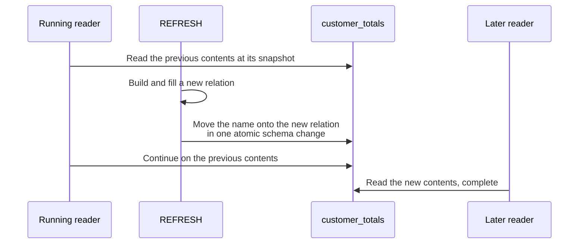

# Materialized views

A materialized view stores the result of a query. Reads use the stored rows, and
you refresh them when you want newer data. Use one when a query is expensive,
such as a large aggregate or a wide join, and readers can accept results as of
the last refresh.

A [view](/docs/views) executes its query on each read and stores no rows. A
materialized view executes the query once per refresh:

- The cost of a read doesn't grow with the base table. As `orders` grows, the
  refresh takes longer, but reads of the materialized view don't get slower.
- You can index and analyze the stored rows like a table.
- A refresh doesn't block readers. They see the old rows until the new ones are
  complete.
- All reads between two refreshes see the same data. This helps dashboards,
  where several panels should agree.

The examples on this page use the following data:

<details>
<summary>Sample data for the examples on this page</summary>

```camussql
CREATE TABLE orders (
  id INT64 PRIMARY KEY NOT NULL,
  customer STRING NOT NULL,
  total FLOAT64 NOT NULL,
  status STRING NOT NULL
);
INSERT INTO orders (id, customer, total, status) VALUES
  (1, 'acme', 1250.00, 'open'),
  (2, 'acme', 300.00, 'open'),
  (3, 'globex', 480.00, 'open'),
  (4, 'globex', 99.00, 'closed'),
  (5, 'initech', 2100.00, 'closed'),
  (6, 'initech', 75.50, 'open');
```

</details>

## Quick example

Create a materialized view with an index, then read it:

```camussql
CREATE MATERIALIZED VIEW customer_totals AS
  SELECT customer, SUM(total) AS total_spent, COUNT(*) AS orders_placed
  FROM orders
  GROUP BY customer;

CREATE INDEX customer_totals_customer ON customer_totals (customer);

SELECT total_spent FROM customer_totals WHERE customer = 'acme';
```

```text
┌─────────────┐
│ total_spent │
├─────────────┤
│ 1550        │
└─────────────┘
1 rows in set (00:00:00.0043153)
```

A new order doesn't change the stored rows:

```camussql
INSERT INTO orders (id, customer, total, status) VALUES (7, 'acme', 200.00, 'open');

SELECT total_spent FROM customer_totals WHERE customer = 'acme';  -- still 1550
```

Refresh the materialized view to read the new data. You can run `REFRESH` from a
scheduled job or after a bulk load:

```camussql
REFRESH MATERIALIZED VIEW customer_totals;

SELECT total_spent FROM customer_totals WHERE customer = 'acme';
```

```text
┌─────────────┐
│ total_spent │
├─────────────┤
│ 1750        │
└─────────────┘
1 rows in set (00:00:00.0292826)
```

A materialized view can also combine queries with `UNION`, `INTERSECT`, or
`EXCEPT`. Both sides count as dependencies, and their columns are fixed at
creation. For more information, see
[set operations in views](/docs/sql-queries#views).

## Choose a view, a materialized view, or a table copy

| | Reads | Freshness | Storage | Indexable |
| --- | --- | --- | --- | --- |
| A [view](/docs/views) | Executes the query | Always current | None | No |
| A materialized view | Reads the stored rows | As of the last `REFRESH` | A full copy | Yes |
| A [`CREATE TABLE ... AS SELECT`](/docs/insert-select-and-ctas) | Reads the stored rows | Fixed when created | A full copy | Yes |

Use a view when the query is cheap or the answer must be current.

Use a materialized view when the query is expensive and an answer of known age
is acceptable.

Use `CREATE TABLE ... AS SELECT` for a one-time copy. The result is a regular
table that isn't linked to the query that filled it.

## Use it like a read-only table

A materialized view is stored as a table. Besides the index from the quick
example, you can analyze it and add a comment. `COMMENT ON TABLE` also works on
a materialized view:

```camussql
ANALYZE TABLE customer_totals;
COMMENT ON MATERIALIZED VIEW customer_totals IS 'nightly rollup';
```

```camussql
SHOW COLUMNS FROM customer_totals;
```

```text
┌───────────────┬─────────┬──────┬─────┬──────────┬───────┐
│ Field         │ Type    │ Null │ Key │ Default  │ Extra │
├───────────────┼─────────┼──────┼─────┼──────────┼───────┤
│ id            │ OID     │ NO   │ PRI │ gen_id() │       │
│ customer      │ STRING  │ YES  │     │ NULL     │       │
│ total_spent   │ FLOAT64 │ YES  │     │ NULL     │       │
│ orders_placed │ INT64   │ YES  │     │ NULL     │       │
└───────────────┴─────────┴──────┴─────┴──────────┴───────┘
4 rows in set (00:00:00.0004396)
```

CamusDB adds the `id` column as a generated primary key. `SELECT *` includes it.

Indexes are kept across refreshes. The following features handle a
materialized view like a table:

- Backup and point-in-time recovery.
- [Database branching](/docs/database-branching).
- [TTL](/docs/row-level-ttl).
- The [query result cache](/docs/query-result-cache).

After a refresh, the planner uses the new row and index entry counts.
Histograms from an earlier `ANALYZE` describe the old rows, and the refresh
drops them. [Automatic analyze](/docs/automatic-analyze) rebuilds them for a
view with at least 624 rows, with the default settings. For a smaller view, run
`ANALYZE TABLE` after the refresh.
[`SHOW STATISTICS FOR <view>`](/docs/show-statistics) shows the statistics for
the current rows.

Writes to a materialized view return an error:

```camussql
INSERT INTO customer_totals (customer, total_spent) VALUES ('acme', 1);
```

```text
CamusException (CADB0525): 'customer_totals' is a materialized view and cannot be written to directly; its contents come from its defining query. Use REFRESH MATERIALIZED VIEW to update them, or write to the underlying table.
```

## Columns are fixed at creation {#the-shape-is-fixed-at-creation}

CamusDB derives the columns from the query when you create the materialized
view. A refresh uses the same columns. A column added to a base table later
doesn't appear in the materialized view. Views follow the same rule.

Each output column needs a name, as with
[`CREATE TABLE ... AS SELECT`](/docs/insert-select-and-ctas). To rename the
stored columns, list them after the view name:

```camussql
CREATE MATERIALIZED VIEW open_orders (order_id, amount) AS
  SELECT id, total FROM orders WHERE status = 'open';
```

The stored columns are `order_id` and `amount`, plus the generated `id`.

Other rules for the body:

- The body can read a view.
- A scalar subquery column has its declared type, even when the subquery returns
  no value.
- The name checks at creation don't execute the query. The query is executed
  when the rows are stored, unless you use `WITH NO DATA`.
- With data, the default, the rows are loaded into storage that other sessions
  can't see. The materialized view appears in one schema change when the load
  finishes. If the load fails, for example on a division by zero, the statement
  returns the error, and the materialized view doesn't exist.

## Create a materialized view before you fill it

`WITH NO DATA` creates the materialized view and doesn't execute the query.
Reads fail until the first refresh. This means that a missed `REFRESH` returns
an error, and readers don't get an empty result by mistake:

```camussql
CREATE MATERIALIZED VIEW customer_totals AS SELECT ... WITH NO DATA;

SELECT * FROM customer_totals;
```

```text
CamusException (CADB0531): Materialized view 'customer_totals' has not been populated. Run REFRESH MATERIALIZED VIEW customer_totals before querying it.
```

```camussql
REFRESH MATERIALIZED VIEW customer_totals;   -- now it reads
```

`REFRESH MATERIALIZED VIEW ... WITH NO DATA` empties a materialized view and
returns it to this state. Use it to empty a materialized view. `TRUNCATE` on a
materialized view returns error `CADB0525`.

## Refreshes don't block readers {#a-refresh-never-blocks-readers}

A refresh builds a new table with the new rows. Then it moves the materialized
view's name to the new table in one atomic schema change:

- A read that started before the switch continues with the old rows.
- A read that starts after the switch sees the complete new rows.

No reader waits, and no reader on any node in the cluster sees a partly built
result.



Other guarantees of a refresh:

- The rebuild reads its source tables at one snapshot. The result matches a
  state that the database held at one moment, however long the rebuild takes.
- The rebuild writes in transactions of `materialized_view_refresh_chunk_rows`
  rows. This lets a materialized view grow beyond the per-transaction mutation
  limit. See [Transaction limits](/docs/transaction-limits).
- If a refresh fails, the materialized view doesn't change. The partial rebuild
  is discarded.

`SHOW ORPHAN TABLES` lists recoverable dropped tables and contents retired by
`TRUNCATE`. Refreshes replace derived rows, which are hidden from that list.

`REFRESH MATERIALIZED VIEW ... CONCURRENTLY` returns error `CADB0533`. In
PostgreSQL, `CONCURRENTLY` lets readers continue during a refresh, and a CamusDB
refresh already works that way. `CONCURRENTLY` in PostgreSQL also writes only
the rows that changed. CamusDB doesn't implement that.

## One refresh at a time

Only one refresh of a materialized view can run at a time in the cluster. A
second `REFRESH` returns error `CADB0532`, on any node.

A refresh can stop partway if the process crashes or the node loses its
[leadership](/docs/concepts#leader) (its role as the coordinating node). A
background process then restarts the refresh from the beginning. Only one node
can take over the refresh, and `materialized_view_refresh_takeover_attempts`
limits the number of restarts.

Readers see the previous rows until a restart completes. If the attempts run
out, the materialized view isn't updated, and CamusDB logs an error that names
it. Run `REFRESH` to try again.

## Dependencies and lifecycle

```camussql
ALTER MATERIALIZED VIEW customer_totals RENAME TO totals_by_customer;
DROP MATERIALIZED VIEW customer_totals;
DROP MATERIALIZED VIEW IF EXISTS customer_totals CASCADE;
```

- A view can read a materialized view. Dropping the materialized view then
  requires `CASCADE`, which also drops the view. Tables are protected in the
  same way. `DROP TABLE` doesn't support `CASCADE`, so drop the dependent views
  first.
- A rename doesn't affect views that read the materialized view. See
  [Rename tables and columns](/docs/views#a-rename-is-transparent).
- Tables and views, including materialized views, share one namespace. A table
  can't have the same name as a materialized view.
- Use `DROP MATERIALIZED VIEW` to drop a materialized view. `DROP TABLE` returns
  an error that names the correct statement.
- A [`TRUNCATE`](/docs/truncate-table) of a base table makes a dependent
  materialized view stale, like any other write to that table. See
  [Dependent views](/docs/truncate-table#a-dependent-view).

A read of a materialized view checks the caller's privileges, as for a table.
This differs from a view, which reads its tables with the privileges of its
owner.

## Inspect materialized views

```camussql
SHOW MATERIALIZED VIEWS;
```

```text
┌────────────────────┬───────────┬────────────────────────┬────────────────┐
│ materialized_views │ populated │ refreshed_at           │ comment        │
├────────────────────┼───────────┼────────────────────────┼────────────────┤
│ customer_totals    │ True      │ HLC(1:1795038630137:7) │ nightly rollup │
└────────────────────┴───────────┴────────────────────────┴────────────────┘
1 rows in set (00:00:00.0011032)
```

`populated` shows whether the materialized view has data. `refreshed_at` shows
the snapshot of the last refresh as a
[hybrid logical clock](/docs/distributed-transactions) (HLC) timestamp. A
materialized view created `WITH NO DATA` shows `False` and an empty
`refreshed_at` until its first refresh.

```camussql
SHOW MATERIALIZED VIEWS LIKE 'cust%';
SHOW CREATE MATERIALIZED VIEW customer_totals;
SHOW COLUMNS FROM customer_totals;
SHOW INDEXES FROM customer_totals;
```

`SHOW TABLES` lists tables only.

`SHOW CREATE MATERIALIZED VIEW` prints `WITH NO DATA` for a materialized view
that isn't populated. Its output recreates the same unpopulated materialized
view.

## In a cluster

In a cluster, you can send materialized-view DDL and `REFRESH MATERIALIZED VIEW`
to any node. The receiving node handles the rebuild. The schema leader publishes
the change. See [Distributed schema](/docs/distributed-schema#how-a-schema-change-flows).

## Configuration

| Setting | Default | Meaning |
| --- | --- | --- |
| `materialized_view_refresh_chunk_rows` | `10000` | Rows CamusDB writes per transaction during a rebuild. Keep it well below `max_mutations_per_transaction`. |
| `materialized_view_refresh_enabled` | `true` | Set to `false` to refuse refreshes on a node that must not run bulk work. `WITH NO DATA` is allowed with either value. |
| `materialized_view_refresh_takeover_attempts` | `3` | How many times CamusDB restarts a refresh interrupted by a crash or leadership change. With `0`, it restarts none and only reclaims the abandoned storage. |
| `materialized_view_refresh_hold_lease_ms` | `300000` | How long a refresh can retain its source snapshot before it must renew the lease. Minimum `5000` ms. |

These settings appear in [`SHOW VARIABLES`](/docs/show-variables).

## Not implemented yet

- Incremental refresh (`REFRESH MATERIALIZED VIEW ... CONCURRENTLY`). See
  [Refreshes don't block readers](#a-refresh-never-blocks-readers).
- Resuming an interrupted refresh from where it stopped. A takeover restarts it
  from the beginning. See [One refresh at a time](#one-refresh-at-a-time).

## Related pages

- [Views](/docs/views) for regular views and the rules both kinds share.
- [Copying query results](/docs/insert-select-and-ctas) for one-time copies.
- [Error codes](/docs/error-codes) for the codes on this page.
