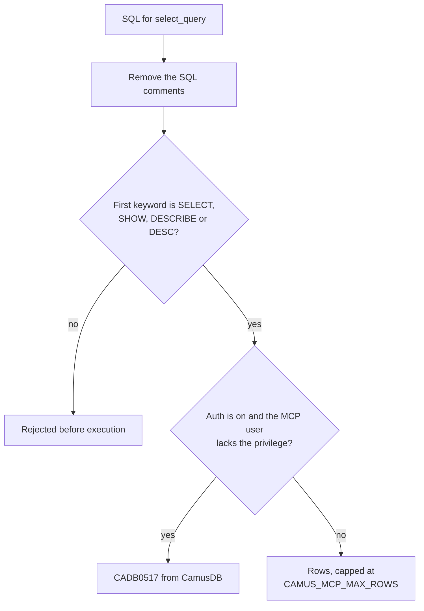

# MCP server

The CamusDB MCP server lets an AI agent inspect and query CamusDB through a
fixed set of typed tools, instead of raw API requests. The agent can list
databases and tables, explain a query, run read-only SQL, and perform a few
controlled setup tasks such as creating a table. With authentication on, it
connects as a CamusDB user you choose, and the server enforces that user's
grants on every call. An agent whose user holds only `SELECT` cannot change
data.

MCP is the Model Context Protocol. Any client that speaks MCP can use the
server, which exposes a CamusDB node or a cluster.

The MCP server speaks MCP over `stdio`, and the MCP client starts it. The
server connects to CamusDB through the published `CamusDB.Client` provider.

<ArchDiagram
  sources={[
    {label: 'Read tools', icon: 'log'},
    {label: 'Query tools', icon: 'log'},
    {label: 'Mutating tools', icon: 'log'},
  ]}
  hub={{label: 'CamusDB MCP server', icon: 'chip'}}
  targets={[{label: 'CamusDB', sub: 'Node or cluster, through CamusDB.Client', icon: 'database'}]}
  title="An AI agent calls the CamusDB MCP server's read, query, and mutating tools. The server sends each call to a CamusDB node or cluster through CamusDB.Client."
/>

The [CamusDB agent skills](/docs/agent-skills) complement the MCP server with
guidance for CamusDB SQL, schema design, transactions, query performance,
troubleshooting, client libraries, migrations, and local development.

## Prerequisites

- A running CamusDB server that the MCP client's machine can reach.
- The .NET 10 SDK, to build the MCP server.
- The `camusdb-mcp` source, from `https://github.com/camusdb/camusdb-mcp`.

The server implementation lives in the `CamusDB.Mcp` project.

## Build

Clone the MCP server repository:

```bash
git clone https://github.com/camusdb/camusdb-mcp
cd camusdb-mcp
```

Build it:

```bash
dotnet build camusdb-mcp.sln
```

The built executable is at:

```text
CamusDB.Mcp/bin/Debug/net10.0/CamusDB.Mcp
```

## Configuration

The server reads its configuration from environment variables.

| Variable | Default | Description |
| --- | --- | --- |
| `CAMUS_MCP_CONNECTION_STRING` | none | A full CamusDB connection string, such as `Endpoint=http://localhost:5095;Database=mydb;Timeout=30`. It takes precedence over `CAMUS_MCP_ENDPOINT`. |
| `CAMUS_MCP_ENDPOINT` | `http://localhost:7141` | The CamusDB endpoint, used when you don't set a full connection string. Separate several endpoints with commas; the client then uses them in turn. |
| `CAMUS_MCP_DEFAULT_DATABASE` | none | The database a tool call uses when it omits its `database` argument. The value can also come from a `Database=...` key in `CAMUS_MCP_CONNECTION_STRING`. |
| `CAMUS_MCP_TIMEOUT_SECONDS` | Client default, currently `10` | The timeout for one command. It applies when the server builds the connection string from `CAMUS_MCP_ENDPOINT`. |
| `CAMUS_MCP_MAX_ROWS` | `1000` | The hard cap on rows that `select_query` returns. |
| `CAMUS_MCP_USER` | none | The CamusDB user to authenticate as. |
| `CAMUS_MCP_PASSWORD` | none | The password for `CAMUS_MCP_USER`. The client exchanges it for a bearer token, so statements don't send the password again. |
| `CAMUS_MCP_ACCESS_TOKEN` | none | A bearer token obtained elsewhere. The server uses it directly instead of logging in with a password. |
| `CAMUS_MCP_TOKEN_LIFETIME_SECONDS` | Client default, currently `600` | The fallback token lifetime when the server reports no expiry. |

Set `CAMUS_MCP_ENDPOINT` (or `CAMUS_MCP_CONNECTION_STRING`) explicitly. The
built-in default sends plain HTTP to port 7141, but a default CamusDB server
serves HTTP on 5095 and HTTPS on 7141. Use `http://localhost:5095` for a local
server, or `https://<host>:7141` for TLS.

A tool's explicit `database` argument wins over `CAMUS_MCP_DEFAULT_DATABASE`.

Statements that need no database context, such as `SHOW DATABASES`, run
without a selected database. Table-scoped statements need one.

You can also supply credentials in `CAMUS_MCP_CONNECTION_STRING` with the
`User=...`, `Password=...`, `AccessToken=...`, and `TokenLifetime=...` keys.

A dedicated `CAMUS_MCP_*` credential variable wins over the matching
connection-string key and over that key's aliases (`Uid`, `UserId`,
`Username`, and `Pwd`).

### Configure an MCP client

Most MCP clients use a JSON configuration block. Point `command` at the built
executable and pass the variables above in `env`:

```json
{
  "mcpServers": {
    "camusdb": {
      "command": "/path/to/camusdb-mcp/CamusDB.Mcp/bin/Debug/net10.0/CamusDB.Mcp",
      "env": {
        "CAMUS_MCP_ENDPOINT": "http://localhost:5095",
        "CAMUS_MCP_DEFAULT_DATABASE": "mydb"
      }
    }
  }
}
```

For a server with authentication enabled, add the credentials as shown in
[Authentication](#authentication).

## Authentication

CamusDB authentication is off by default. Against a server without
authentication, leave the credential variables unset.

If the server starts with `CAMUSDB_AUTH_ENABLED=true`, give the MCP server a
CamusDB user:

```json
{
  "mcpServers": {
    "camusdb": {
      "command": "/path/to/camusdb-mcp/CamusDB.Mcp/bin/Debug/net10.0/CamusDB.Mcp",
      "env": {
        "CAMUS_MCP_ENDPOINT": "https://camus.internal:7141",
        "CAMUS_MCP_DEFAULT_DATABASE": "analytics",
        "CAMUS_MCP_USER": "mcp",
        "CAMUS_MCP_PASSWORD": "app-secret"
      }
    }
  }
}
```

`CamusDB.Client` handles the password flow: it exchanges the password for a
short-lived bearer token, and later tool calls send the token.

Tokens are cached for the whole process, per set of credentials, so the MCP
server doesn't log in again for every short connection a tool call opens.

The client renews tokens and re-authenticates after a token is revoked. Both
need the password to be available.

Use `CAMUS_MCP_ACCESS_TOKEN` when another process has already created a bearer
token:

```json
{
  "mcpServers": {
    "camusdb": {
      "command": "/path/to/camusdb-mcp/CamusDB.Mcp/bin/Debug/net10.0/CamusDB.Mcp",
      "env": {
        "CAMUS_MCP_ENDPOINT": "https://camus.internal:7141",
        "CAMUS_MCP_DEFAULT_DATABASE": "analytics",
        "CAMUS_MCP_ACCESS_TOKEN": "camus_..."
      }
    }
  }
}
```

The server uses an access token as is and cannot renew it. Once the token
expires or is revoked, tool calls fail with `CADB0516`. For long-running MCP
processes, prefer `CAMUS_MCP_USER` with `CAMUS_MCP_PASSWORD`.

### Privileges

Grant the MCP user only the privileges the assistant needs. A grant must cover
every table a statement touches, including tables it reaches through joins and
subqueries:

```camussql
CREATE USER mcp IDENTIFIED BY 'app-secret';
GRANT SELECT ON analytics.* TO mcp;
```

A read-only grant suits an assistant that should inspect a database without
modifying anything.

The MCP server still exposes mutating tools, such as `create_database`,
`create_table`, and `insert_rows`. If the MCP user lacks the required
privilege, CamusDB rejects the operation on the server.

User and grant administration is not an MCP tool. Manage users and grants
elsewhere, over a superuser connection.

`select_query` can run `SHOW GRANTS` like any other `SHOW` statement. Server
authorization still applies.

### Authentication errors

| Code | Meaning |
| --- | --- |
| `CADB0516` | The credentials are missing, wrong, expired, or revoked. Fix the MCP environment and restart, or supply a fresh token. |
| `CADB0517` | The caller is authenticated but lacks a required privilege. Grant the MCP user access to the affected database or table. |
| `CADB0518` | Too many login attempts for that account. Wait for the server's rate-limit window to pass. |
| `CADB0519` | A client sent credentials over plaintext where CamusDB requires TLS. Use an `https://` endpoint, or configure a trusted TLS-terminating proxy. |

### TLS

While authentication is enabled, CamusDB refuses credential-bearing requests
over plaintext, except from loopback. Local development over
`http://localhost` therefore works without a certificate. For deployments
beyond loopback, use `https://`.

If TLS terminates before requests reach CamusDB, keep that plaintext hop inside
your trust boundary. Then configure CamusDB with
`require_tls_when_auth_enabled: false` or
`--require-tls-when-auth-enabled false`.

## Tools

### Read tools

These tools don't modify data:

| Tool | Description |
| --- | --- |
| `list_databases` | Lists the databases in the CamusDB cluster. |
| `list_tables` | Lists the tables in a database. |
| `list_branches` | Lists the branches of a root database. |
| `list_indexes` | Lists a table's readable indexes. It omits indexes that CamusDB is still backfilling. |
| `get_table_schema` | Returns the column schema from `SHOW COLUMNS FROM`: names, types, nullability, keys, and defaults. |
| `list_ancestors` | Lists a branch database's ancestors: its parent, then the parent's parent, up to the root. It returns an empty list for a root database. |
| `list_views` | Lists a database's views and materialized views. Each materialized view reports whether it is populated and when it was last refreshed. |
| `list_sequences` | Lists a database's sequences and their options, from `SHOW SEQUENCES`. |
| `show_create` | Returns the DDL that recreates an object. The `kind` argument accepts `table` (the default), `view`, `materialized_view`, and `sequence`. For a table, `withoutIndexes: true` omits secondary indexes. |
| `get_table_statistics` | Returns a table's optimizer statistics, from `SHOW STATISTICS FOR TABLE`. |

### Query tools

| Tool | Description |
| --- | --- |
| `select_query` | Runs a `SELECT`, `SHOW`, or `DESCRIBE` (`DESC`) statement. It rejects data-modifying SQL before execution. `CAMUS_MCP_MAX_ROWS` caps the result, and the `maxRows` argument can lower that cap. |
| `explain_query` | Runs `EXPLAIN`, prepending the `EXPLAIN` keyword when the input is a bare `SELECT`. The `mode` argument accepts `plan` (the default), `logical`, `physical`, and `analyze`. `analyze` runs the `SELECT` and reports measured statistics for each operator; it fails on joins and on a `SELECT` without `FROM`. |

`select_query` accepts named parameters, which the SQL references as `@name`
placeholders. The tool maps JSON values to CamusDB parameters:

| JSON value | CamusDB type |
| --- | --- |
| string | `STRING` |
| `true` or `false` | `BOOL` |
| integer that fits in 64 bits | `INT64` |
| other number with up to 15 significant digits | `FLOAT64` |
| other number with more digits | `NUMERIC`, from the exact text |
| `null` | `NULL` |
| array of strings, booleans, or numbers | array parameter |

Every non-null element of an array must be the same JSON kind. A numeric array
binds as `INT64` when every element is an integer, and as `FLOAT64` otherwise.
`NUMERIC` values in results come back as their exact decimal text.

### Mutating tools

These tools build SQL from structured inputs and then execute it:

| Tool | Description |
| --- | --- |
| `create_database` | Creates a database. Supports `IF NOT EXISTS`. |
| `create_table` | Creates a table from a list of typed column definitions. |
| `insert_rows` | Inserts one or more rows, passing values as parameters. It splits large batches into statements of 500 rows. |

`create_table` accepts these column types: `oid`, `int64`, `float64`,
`float32`, `numeric`, `string`, `string(N)`, `bool`, `bytes`, `bytes(N)`,
`date`, `datetime`, `uuid`, `array(T)` for a scalar `T`, and `serial` (an
`int64` identity column). It also accepts these aliases: `object_id`; `int`,
`smallint`; `float`, `real`; `decimal`; `varchar`, `char`, `text` (also with a
size); `boolean`; `blob` (also with a size); `timestamp`; `guid`; and
`bigserial`. `numeric` has a fixed precision of 38 and scale of 9, and takes no
`(p, s)` arguments.

## Safety boundary

The MCP server keeps read tools separate from mutating tools.

`select_query` accepts only statements whose first real SQL keyword is
`SELECT`, `SHOW`, `DESCRIBE`, or `DESC`. `explain_query` accepts only `EXPLAIN`
or a bare `SELECT`. Both tools also refuse statements that call `nextval` or
`setval`, because those functions advance a sequence counter.

The server strips SQL comments before it checks the first keyword, so a
statement can't hide a data-modifying command behind a leading comment.



Mutating tools validate database, table, and column names before building the
SQL. Every value goes through a CamusDB parameter; none is placed in the SQL
text.

## Security notes

CamusDB supports server-side authentication and authorization. The MCP server
acts as whichever CamusDB principal its environment configures.

The MCP server is still a local capability that the MCP client starts. Anyone
who can start or reconfigure that process can use its CamusDB access. Treat an
MCP client's configuration file as a secret when it holds
`CAMUS_MCP_PASSWORD` or `CAMUS_MCP_ACCESS_TOKEN`.

For agent workflows:

- Point the MCP server at a database or branch that the agent is allowed to
  inspect or modify.
- Use `CAMUS_MCP_DEFAULT_DATABASE` to keep the agent in the expected database
  by default.
- Prefer a database branch for schema and data experiments.
- Give the MCP user the narrowest useful grants. When an MCP client asks for a
  mutating operation, server-side enforcement is the boundary that holds.
- For long sessions, prefer `CAMUS_MCP_USER` with `CAMUS_MCP_PASSWORD` so the
  client can renew tokens. Use `CAMUS_MCP_ACCESS_TOKEN` for short sessions and
  for sessions that another system manages.

See [Database Branching](/docs/database-branching) for isolated copy-on-write
workspaces, and
[Authentication And Authorization](/docs/sql-authentication) for users, grants,
and bearer tokens.
