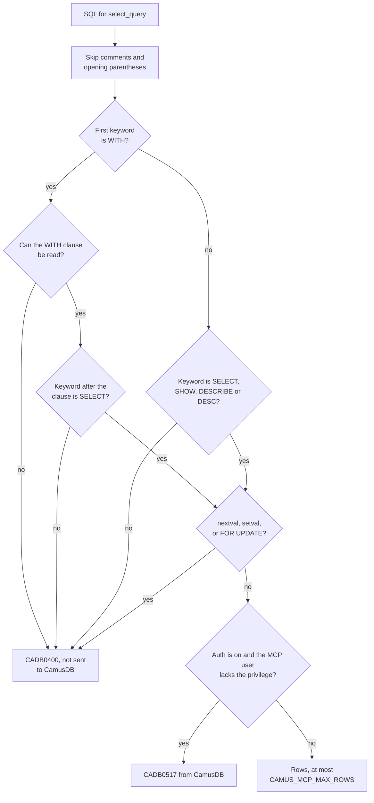

# MCP server

The CamusDB MCP server lets an AI agent inspect and query CamusDB through a set
of typed tools. The agent can run read-only SQL and explain
queries. It can also do a few setup tasks, such as creating a table. With
authentication on, the MCP server connects as a CamusDB user that you choose.
Each call is checked against the grants of that user. This means that an agent
whose user has only `SELECT` can't change data.

MCP is the Model Context Protocol. Any client that supports MCP can use the
server. The MCP client starts the server and talks to it over `stdio`. The
server connects to a CamusDB node or cluster through the `CamusDB.Client`
library.

<ArchDiagram
  sources={[
    {label: 'Schema and diagnostic tools', icon: 'log'},
    {label: 'Query tools', icon: 'log'},
    {label: 'Write tools', icon: 'log'},
  ]}
  hub={{label: 'CamusDB MCP server', icon: 'chip'}}
  targets={[{label: 'CamusDB', sub: 'Node or cluster, through CamusDB.Client', icon: 'database'}]}
  title="An AI agent calls the tools of the CamusDB MCP server. The server sends each call to a CamusDB node or cluster through CamusDB.Client."
/>

The [CamusDB agent skills](/docs/agent-skills) add guidance for CamusDB SQL and
schema design.

## Prerequisites

- A running CamusDB server that the machine of the MCP client can reach.
- The .NET 10 SDK, to build the MCP server.
- The source from `https://github.com/camusdb/camusdb-mcp`.

## Build

Clone the repository and build it:

```bash
git clone https://github.com/camusdb/camusdb-mcp
cd camusdb-mcp
dotnet build camusdb-mcp.sln
```

The executable is at:

```text
CamusDB.Mcp/bin/Debug/net10.0/CamusDB.Mcp
```

## Configuration

The server reads its configuration from environment variables:

| Variable | Default | Description |
| --- | --- | --- |
| `CAMUS_MCP_CONNECTION_STRING` | none | A full connection string, such as `Endpoint=http://localhost:5095;Database=mydb;Timeout=30`. When it's set, `CAMUS_MCP_ENDPOINT` is ignored. |
| `CAMUS_MCP_ENDPOINT` | `http://localhost:5095` | The CamusDB endpoint. To use several nodes, separate the endpoints with commas. |
| `CAMUS_MCP_DEFAULT_DATABASE` | none | The database for a call that omits the `database` argument. A `Database=...` key in the connection string also sets it. |
| `CAMUS_MCP_TIMEOUT_SECONDS` | `10` | The timeout of one statement. It applies only with `CAMUS_MCP_ENDPOINT`. |
| `CAMUS_MCP_MAX_ROWS` | `1000` | The maximum number of rows that a tool returns. |
| `CAMUS_MCP_USER` | none | The CamusDB user to sign in as. |
| `CAMUS_MCP_PASSWORD` | none | The password of `CAMUS_MCP_USER`. |
| `CAMUS_MCP_ACCESS_TOKEN` | none | A bearer token from another source. It's used in place of a user and password. |
| `CAMUS_MCP_TOKEN_LIFETIME_SECONDS` | `600` | The token lifetime, when the CamusDB server doesn't report one. |

The `database` argument is optional on each tool. If a call omits it, or sets it
to an empty value, the tool uses `CAMUS_MCP_DEFAULT_DATABASE`. If no default is
set, a tool that needs a database returns `CADB0400`. `select_query` also runs
without a database, for a statement that needs none, such as `SHOW DATABASES`.

The default database doesn't limit the agent. A call can name any database that
the MCP user can reach. To limit the databases, use grants (see
[Privileges](#privileges)).

You can also put the credentials in the connection string, for example
`User=mcp;Password=...`. The other keys are `AccessToken` and `TokenLifetime`. A `CAMUS_MCP_*` variable
replaces the matching key and its aliases, such as `Uid` and `Pwd`.

### Configure an MCP client

Most MCP clients use a JSON configuration block. Set `command` to the
executable, and pass the variables in `env`:

```json
{
  "mcpServers": {
    "camusdb": {
      "command": "/path/to/camusdb-mcp/CamusDB.Mcp/bin/Debug/net10.0/CamusDB.Mcp",
      "env": {
        "CAMUS_MCP_ENDPOINT": "http://localhost:5095",
        "CAMUS_MCP_DEFAULT_DATABASE": "mydb"
      }
    }
  }
}
```

For a server with authentication enabled, add the credentials as shown in
[Authentication](#authentication).

## Authentication

CamusDB authentication is off by default. If authentication is off on the server,
don't set the credential variables.

If the server starts with `CAMUSDB_AUTH_ENABLED=true`, give the MCP server a
CamusDB user:

```json
{
  "mcpServers": {
    "camusdb": {
      "command": "/path/to/camusdb-mcp/CamusDB.Mcp/bin/Debug/net10.0/CamusDB.Mcp",
      "env": {
        "CAMUS_MCP_ENDPOINT": "https://camus.internal:7141",
        "CAMUS_MCP_DEFAULT_DATABASE": "analytics",
        "CAMUS_MCP_USER": "mcp",
        "CAMUS_MCP_PASSWORD": "app-secret"
      }
    }
  }
}
```

The password is sent once, in exchange for a short-lived bearer token. Later
calls send the token. One token is kept for each set of credentials, for the
life of the process. The token is renewed before it expires.

If another process creates the token, use `CAMUS_MCP_ACCESS_TOKEN`:

```json
{
  "mcpServers": {
    "camusdb": {
      "command": "/path/to/camusdb-mcp/CamusDB.Mcp/bin/Debug/net10.0/CamusDB.Mcp",
      "env": {
        "CAMUS_MCP_ENDPOINT": "https://camus.internal:7141",
        "CAMUS_MCP_DEFAULT_DATABASE": "analytics",
        "CAMUS_MCP_ACCESS_TOKEN": "camus_..."
      }
    }
  }
}
```

An access token can't be renewed. The MCP server needs the password to get a
new token. When the token expires or is revoked, tool calls return `CADB0516`. For a long-lived MCP
server, you should use `CAMUS_MCP_USER` and
`CAMUS_MCP_PASSWORD`.

### Privileges

Grant the MCP user only the privileges that the agent needs. A statement needs
a grant on each table that it reads, including the tables in joins and
subqueries:

```camussql
CREATE USER mcp IDENTIFIED BY 'app-secret';
GRANT SELECT ON analytics.* TO mcp;
```

With this grant, the agent can read `analytics` and can't change data. The
write tools, such as `create_table` and `insert_rows`, are available to the
agent. However, they return `CADB0517` for this user.

No tool creates users or changes grants. Do that from a superuser connection.

### Authentication errors

| Code | Meaning |
| --- | --- |
| `CADB0516` | The credentials are missing, wrong, expired, or revoked. Fix the MCP environment and restart the server, or give a new token. |
| `CADB0517` | The user lacks a privilege on a table that the statement uses. Grant the MCP user access to the database or the table. |
| `CADB0518` | Too many sign-in attempts for the account. Wait for the rate-limit window to end. |
| `CADB0519` | Credentials were sent over plaintext, and CamusDB requires TLS. Use an `https://` endpoint, or a trusted proxy that ends TLS. |

When a tool call fails, the result has `isError: true`, and the agent sees the
error code and the message, for example
`An error occurred invoking 'select_query': CADB0517: ...`. For the codes in
this table, the message ends with `Hint:` and what to do. The MCP server also
writes each failed call to its log on stderr.

### TLS

With authentication enabled, a request with credentials over plaintext returns
`CADB0519`, except from loopback. This means that local development over
`http://localhost` works, and you don't need a certificate. For other hosts, use
`https://`. A default CamusDB node serves HTTP on port 5095, and HTTPS on port
7141 when the node has a certificate.

If TLS ends at a proxy in front of CamusDB, keep the plaintext connection from
the proxy in your trusted network. Then start CamusDB with
`require_tls_when_auth_enabled: false` or `--require-tls-when-auth-enabled false`.

## Tools

Each tool call uses a new connection and autocommit mode. A transaction doesn't
continue from one call to the next.

### Schema tools

These tools only read:

| Tool | Result |
| --- | --- |
| `list_databases` | The databases. |
| `list_tables` | The tables of a database. |
| `list_views` | The views and materialized views of a database. For a materialized view, it also shows whether the view is populated and when it was last refreshed. |
| `list_sequences` | The sequences of a database and their options, from `SHOW SEQUENCES`. |
| `list_branches` | The branches of a database. |
| `list_ancestors` | The parents of a branch, nearest first. The list is empty for a database that isn't a branch. |
| `list_indexes` | The indexes of a table. An index that is being built isn't listed. |
| `get_table_schema` | The columns of a table, from `SHOW COLUMNS`. |
| `list_functions` | The inline C# functions of a database, from `SHOW FUNCTIONS`. |
| `list_triggers` | The triggers of a database, or of one table with the `table` argument. |
| `show_create` | The DDL that creates an object. `kind` is `table` (the default), `view`, `materialized_view`, `sequence`, `function`, or `trigger`. A trigger also needs `table`. For a table, `withoutIndexes: true` leaves out the secondary indexes. |
| `get_table_statistics` | The optimizer statistics of a table, from `SHOW STATISTICS FOR TABLE`. |

### Diagnostic tools

These tools only read. Most of them need a superuser when authentication is on,
and most of them show only the node that answers. Some take a `like` argument,
a SQL `LIKE` pattern that filters the rows.

| Tool | Result |
| --- | --- |
| `get_statement_stats` | [Statement statistics](/docs/statement-stats) for each statement shape. Collection is off by default. |
| `get_slow_queries` | The [slow query log](/docs/slow-query-log), newest first. The log is off by default. |
| `get_index_usage` | The [index usage](/docs/index-usage) counters of a database, or of one table. |
| `list_running_queries` | The running statements. A user who isn't a superuser sees only their own statements. With `cluster: true`, it shows all nodes. |
| `list_connections` | The open connections. With `cluster: true`, it shows all nodes. |
| `get_engine_stats` | The [engine metrics](/docs/engine-stats) of the node. |
| `get_settings` | The `SHOW VARIABLES` output of the node, and the [cluster settings](/docs/runtime-cluster-settings). |
| `list_extensions` | The [C# extensions](/docs/csharp-extensions) that the node loaded. |

For other `SHOW` statements, such as `SHOW GRANTS`, use `select_query`.

### Query tools

| Tool | Description |
| --- | --- |
| `select_query` | Executes a `SELECT`, `SHOW`, or `DESCRIBE` statement, including set operations such as `UNION`, and `WITH` or `WITH RECURSIVE` queries. A statement that can change data, also after a `WITH` clause, returns `CADB0400` and isn't sent to CamusDB. The result has at most `CAMUS_MCP_MAX_ROWS` rows. The `maxRows` argument can lower this limit. `truncated: true` means that more rows exist. |
| `explain_query` | Executes `EXPLAIN`. If the SQL doesn't start with `EXPLAIN`, the keyword is added. The SQL can be a `SELECT` with a `WITH` clause. `mode` is `plan` (the default), `logical`, `physical`, or `analyze`. `analyze` executes the query and shows the measured values for each operator. |

`select_query` takes named parameters. The SQL refers to them as `@name`. The
JSON type of each value sets the CamusDB type:

| JSON value | CamusDB type |
| --- | --- |
| string | `STRING` |
| `true` or `false` | `BOOL` |
| integer that fits in 64 bits | `INT64` |
| other number with up to 15 significant digits | `FLOAT64` |
| other number with more digits | `NUMERIC`, from the exact text |
| `null` | `NULL` |
| array of values of one JSON type | array, for example for `WHERE id = ANY(@ids)` |

A numeric array binds as `INT64` if all its elements are integers. Otherwise, it
binds as `FLOAT64`. A `NUMERIC` value in a result is returned as exact decimal
text.

### Write tools

These tools build the SQL from structured arguments, and then run it:

| Tool | Description |
| --- | --- |
| `create_database` | Creates a database. `ifNotExists: true` doesn't return an error if the database exists. |
| `create_table` | Creates a table from a list of typed columns. |
| `insert_rows` | Inserts rows. Each row is an object of column names and values. The values are sent as parameters. |

In `create_table`, each column has a `name` and a `type`, and these optional
flags:

- `primary`: the column is part of the primary key.
- `notNull`: the column doesn't accept `NULL`.
- `index`: an index named `ix_<table>_<column>` is created on the column.
- `unique`: two rows can't have the same value in the column.
- `default`: a SQL expression for the default value, for example `0` or
  `'hello'`.

The following types are accepted:

| Type | Aliases |
| --- | --- |
| `oid` | `object_id` |
| `int64` | `int`, `smallint` |
| `float64`, `float32` | `float`, `real` |
| `numeric` (fixed precision 38 and scale 9) | `decimal` |
| `string`, `string(N)` | `varchar`, `char`, `text` |
| `bool` | `boolean` |
| `bytes`, `bytes(N)` | `blob` |
| `date`, `datetime` | `timestamp` |
| `uuid` | `guid` |
| `array(T)`, for a scalar type `T` | |
| `serial` (an `int64` identity column) | `bigserial` |

`insert_rows` sends the rows in chunks of 500. Each chunk commits separately.
This means that if one chunk fails, the chunks before it stay committed. The
tool also takes the following options:

- `onConflict`: `error` (the default) fails the chunk when a key exists.
  `do_nothing` skips the row. `upsert` updates the stored row, and needs the
  `UPDATE` privilege.
- `conflictColumns`: the unique key that `upsert` compares. The default is the
  primary key.
- `returning`: the columns to read back from each written row, or `["*"]`. Use
  it to get generated values such as IDs.

The result counts the inserted and the updated rows. Skipped rows aren't
counted.

## Safety boundary

`select_query` and `explain_query` take SQL text from the agent. Before the SQL
is sent to CamusDB, the MCP server checks it. A statement that can change data
returns `CADB0400`. The check has the following steps:

1. The SQL comments and the opening parentheses before the first keyword are
   skipped. This means that a comment can't hide the first keyword, as in
   `/* SELECT */ DELETE ...`.
2. If the first keyword is `WITH`, the check skips the `WITH` clause and reads
   the keyword after it. The named queries in the clause can only read, because
   CamusDB accepts only a query there. However, the statement after the clause
   can write, as in `WITH s AS (...) DELETE ...`. The check reads string
   literals, quoted names, dollar-quoted text, and comments as the CamusDB lexer
   does. This means that a `)` in a string can't end the clause early. If the
   check can't read the clause, it returns the error.
3. The keyword must be on an allowed list. For `select_query`, the list is
   `SELECT`, `SHOW`, `DESCRIBE`, and `DESC`. For `explain_query`, it's `EXPLAIN`
   and `SELECT`. After a `WITH` clause, only `SELECT` is allowed.
4. A call to `nextval` or `setval` returns the error. These functions change a
   sequence.
5. A row-locking read, such as `SELECT ... FOR UPDATE`, returns the error. Each
   tool call commits at once. This means that the lock can only block writers.
   With `explain_query`, it's allowed in all modes except `analyze`.



The write tools accept only names that match `^[a-zA-Z_][a-zA-Z0-9_]*`. All
values are sent as CamusDB parameters, and no value is put in the SQL text.

## Security notes

The MCP server can do anything that its CamusDB user can do. With
authentication off, anyone who can start the server and reach CamusDB has full
access.

The MCP client starts the server. Anyone who can start or change that process
can use its CamusDB access. If the configuration file of the MCP client
contains `CAMUS_MCP_PASSWORD` or `CAMUS_MCP_ACCESS_TOKEN`, keep the file secret.

For agent workflows, you should:

- Connect the MCP server to a database or branch that the agent is allowed to
  inspect or change.
- Use a [database branch](/docs/database-branching) for schema and data
  experiments.
- Give the MCP user the smallest grants that work. If the MCP server has a bug,
  the CamusDB grants continue to limit what it can do.
- For long sessions, use `CAMUS_MCP_USER` and `CAMUS_MCP_PASSWORD`. This lets
  the client renew the tokens. Use `CAMUS_MCP_ACCESS_TOKEN` for short sessions, or
  for sessions that another system manages.

For users and grants, see
[Authentication and authorization](/docs/sql-authentication).
