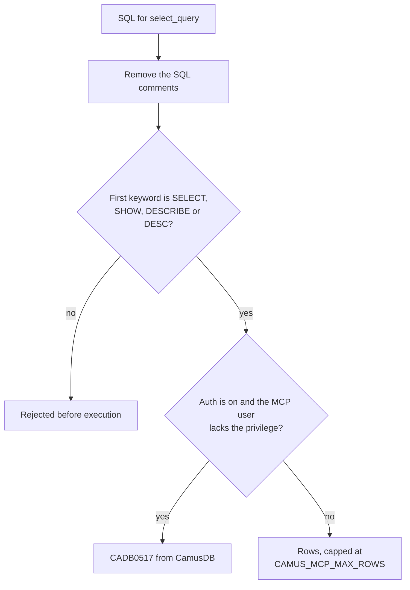

# MCP server

The CamusDB MCP server lets an AI agent inspect and query CamusDB through a
fixed set of typed tools, instead of raw API requests. The agent can list
databases and tables, explain a query, run read-only SQL, and perform a few
controlled setup tasks such as creating a table. With authentication on, it
connects as a CamusDB user you choose, and the server enforces that user's
grants on every call. An agent whose user holds only `SELECT` cannot change
data.

MCP is the Model Context Protocol. Any client that speaks MCP can use the
server, which exposes a CamusDB node or a cluster.

The MCP server speaks MCP over `stdio`. The MCP client starts it. The server
connects to CamusDB through the published provider `CamusDB.Client`.

<ArchDiagram
  sources={[
    {label: 'Read tools', icon: 'log'},
    {label: 'Query tools', icon: 'log'},
    {label: 'Mutating tools', icon: 'log'},
  ]}
  hub={{label: 'CamusDB MCP server', icon: 'chip'}}
  targets={[{label: 'CamusDB', sub: 'Node or cluster, through CamusDB.Client', icon: 'database'}]}
  title="An AI agent calls the read tools, the query tools, and the mutating tools of the CamusDB MCP server. The server sends each call to a CamusDB node or cluster through CamusDB.Client."
/>

The [CamusDB agent skills](/docs/agent-skills) complement the MCP server with
guidance for CamusDB SQL, schema design, transactions, query performance,
troubleshooting, client libraries, migrations, and local development.

## Prerequisites

- A CamusDB server that runs, and that the machine of the MCP client can reach.
- The SDK of .NET 10, for a build of the MCP server.
- The source of `camusdb-mcp`, from
  `https://github.com/camusdb/camusdb-mcp`.

The project `CamusDB.Mcp` holds the implementation of the server.

## Build

Clone the repository of the MCP server:

```bash
git clone https://github.com/camusdb/camusdb-mcp
cd camusdb-mcp
```

Build it:

```bash
dotnet build camusdb-mcp.sln
```

The built executable is at this path:

```text
CamusDB.Mcp/bin/Debug/net10.0/CamusDB.Mcp
```

## Configuration

The server reads its configuration from the environment variables.

| Variable | Default | Description |
| --- | --- | --- |
| `CAMUS_MCP_CONNECTION_STRING` | none | The full connection string of CamusDB, such as `Endpoint=http://localhost:5095;Database=mydb;Timeout=30`. It takes precedence over `CAMUS_MCP_ENDPOINT`. |
| `CAMUS_MCP_ENDPOINT` | `http://localhost:7141` | The endpoint of CamusDB, when you use no full connection string. Separate several endpoints with a comma. The client then uses them in turn. |
| `CAMUS_MCP_DEFAULT_DATABASE` | none | The database that a call of a tool uses, when that call omits its `database` argument. CamusDB also takes the value from a `CAMUS_MCP_CONNECTION_STRING` that holds a `Database=...`. |
| `CAMUS_MCP_TIMEOUT_SECONDS` | The default of the client, at present `10` | The timeout of one command. It applies when the server builds a connection string from `CAMUS_MCP_ENDPOINT`. |
| `CAMUS_MCP_MAX_ROWS` | `1000` | The hard cap of the rows that a `select_query` returns. |
| `CAMUS_MCP_USER` | none | The CamusDB user of the authentication. |
| `CAMUS_MCP_PASSWORD` | none | The password of the `CAMUS_MCP_USER`. The client exchanges it for a bearer token. A statement does not send the password again. |
| `CAMUS_MCP_ACCESS_TOKEN` | none | A bearer token from another source. The server uses it directly, instead of a login with a password. |
| `CAMUS_MCP_TOKEN_LIFETIME_SECONDS` | The default of the client, at present `600` | The fallback lifetime of a token, when the server reports no expiry. |

Set `CAMUS_MCP_ENDPOINT` (or `CAMUS_MCP_CONNECTION_STRING`) explicitly. The
built-in default sends plain HTTP to port 7141, but a default CamusDB server
serves HTTP on 5095 and HTTPS on 7141. Use `http://localhost:5095` for a local
server, or `https://<host>:7141` for TLS.

An explicit `database` argument of a tool wins over
`CAMUS_MCP_DEFAULT_DATABASE`.

A statement without a context can run without a selected database. `SHOW
DATABASES` is one example. A statement with the scope of a table needs a
database.

You can also supply a credential through `CAMUS_MCP_CONNECTION_STRING`. Use the
keys `User=...`, `Password=...`, `AccessToken=...`, and `TokenLifetime=...`.

A dedicated variable `CAMUS_MCP_*` for a credential wins over a key of a
credential of the connection string. It also wins over an alias of such a key.
Four aliases are `Uid`, `UserId`, `Username`, and `Pwd`.

### Configure an MCP client

Most MCP clients use a block of a configuration in JSON. Point the `command` at
the built executable, and pass the variables above in `env`:

```json
{
  "mcpServers": {
    "camusdb": {
      "command": "/path/to/camusdb-mcp/CamusDB.Mcp/bin/Debug/net10.0/CamusDB.Mcp",
      "env": {
        "CAMUS_MCP_ENDPOINT": "http://localhost:5095",
        "CAMUS_MCP_DEFAULT_DATABASE": "mydb"
      }
    }
  }
}
```

For a server with authentication enabled, add the credentials as shown in
[Authentication](#authentication).

## Authentication

The authentication of CamusDB is off by default. Leave the variables of the
credentials unset, against a server without authentication.

A server can start with `CAMUSDB_AUTH_ENABLED=true`. Give the MCP server a user
of CamusDB in that case:

```json
{
  "mcpServers": {
    "camusdb": {
      "command": "/path/to/camusdb-mcp/CamusDB.Mcp/bin/Debug/net10.0/CamusDB.Mcp",
      "env": {
        "CAMUS_MCP_ENDPOINT": "https://camus.internal:7141",
        "CAMUS_MCP_DEFAULT_DATABASE": "analytics",
        "CAMUS_MCP_USER": "mcp",
        "CAMUS_MCP_PASSWORD": "app-secret"
      }
    }
  }
}
```

`CamusDB.Client` handles the flow of the password. It exchanges the password for
a bearer token with a short life. A later call of a tool sends the token.

The cache of the tokens covers the whole process, for each set of credentials.
The MCP server therefore does not log in again for every short connection that a
call of a tool opens.

The client handles the renewal of a token. It also authenticates again after a
revoked token. Both actions need an available password.

Use `CAMUS_MCP_ACCESS_TOKEN` when another process created a bearer token
already:

```json
{
  "mcpServers": {
    "camusdb": {
      "command": "/path/to/camusdb-mcp/CamusDB.Mcp/bin/Debug/net10.0/CamusDB.Mcp",
      "env": {
        "CAMUS_MCP_ENDPOINT": "https://camus.internal:7141",
        "CAMUS_MCP_DEFAULT_DATABASE": "analytics",
        "CAMUS_MCP_ACCESS_TOKEN": "camus_..."
      }
    }
  }
}
```

The server uses an access token verbatim. It cannot renew that token. The call
of a tool fails with `CADB0516` after the token expires, and after somebody
revokes it. Prefer a `CAMUS_MCP_USER` with a `CAMUS_MCP_PASSWORD`, for a long
process of MCP.

### Privileges

Grant the user of MCP the privileges of the assistant only. A grant must cover
every table that a statement touches. That rule includes a table that the
statement reaches through a join, and through a subquery:

```camussql
CREATE USER mcp IDENTIFIED BY 'app-secret';
GRANT SELECT ON analytics.* TO mcp;
```

A read-only grant suits an assistant that must inspect a database, and must
modify nothing.

The MCP server still exposes a tool that mutates data. Three examples are
`create_database`, `create_table`, and `insert_rows`. CamusDB nevertheless
rejects such an operation on the server, when the user of MCP lacks the
necessary privilege.

The administration of a user and of a grant is not an MCP tool. Manage a user
and a grant elsewhere, with a connection of a superuser.

`select_query` can read a `SHOW GRANTS`, like any other `SHOW` statement. The
authorization on the server still applies.

### The errors of the authentication

| Code | Meaning |
| --- | --- |
| `CADB0516` | The credentials are absent, wrong, expired, or revoked. Correct the environment of MCP, and restart. You can also supply a fresh token. |
| `CADB0517` | The caller is authenticated. It lacks a necessary privilege. Grant the user of MCP an access to the affected database, or to the affected table. |
| `CADB0518` | There are too many attempts of a login, for that account. Wait for the window of the rate limit of the server. |
| `CADB0519` | A client sent a credential over plaintext, where CamusDB requires TLS. Use an endpoint with `https://`. You can also configure a trusted proxy that terminates TLS. |

### TLS

While authentication is enabled, CamusDB refuses a request with a credential
over plaintext. A request from loopback is the exception. A local development
over `http://localhost` therefore works without a certificate. For a deployment
outside loopback, use `https://`.

TLS can terminate before a request reaches CamusDB. Keep that plaintext hop
inside the boundary of your trust. Then configure CamusDB with
`require_tls_when_auth_enabled: false`, or with
`--require-tls-when-auth-enabled false`.

## The tools

### The tools of a read

These tools mutate no data:

| Tool | Description |
| --- | --- |
| `list_databases` | It lists the databases of the CamusDB cluster. |
| `list_tables` | It lists the tables of a database. |
| `list_branches` | It lists the branches of a root database. |
| `list_indexes` | It lists the readable indexes of a table. It omits an index that CamusDB still backfills. |
| `get_table_schema` | It returns the schema of the columns, from a `SHOW COLUMNS FROM`. The result holds the names, the types, the ability to hold a null, the keys, and the defaults. |
| `list_ancestors` | It lists the ancestors of a branch database: its parent, then the parent's parent, up to the root. It returns an empty list for a root database. |
| `list_views` | It lists the views and the materialized views of a database. Each materialized view reports whether it is populated and when it was last refreshed. |
| `list_sequences` | It lists the sequences of a database with their options, from a `SHOW SEQUENCES`. |
| `show_create` | It returns the DDL that recreates an object. The argument `kind` accepts `table` (the default), `view`, `materialized_view`, and `sequence`. For a table, `withoutIndexes: true` omits the secondary indexes. |
| `get_table_statistics` | It returns the optimizer statistics of a table, from a `SHOW STATISTICS FOR TABLE`. |

### The tools of a query

| Tool | Description |
| --- | --- |
| `select_query` | It runs a `SELECT`, `SHOW`, or `DESCRIBE` (`DESC`) statement. It rejects SQL that mutates data, before the execution. `CAMUS_MCP_MAX_ROWS` caps the result, and the argument `maxRows` can lower that cap. |
| `explain_query` | It runs an `EXPLAIN`. It adds the word `EXPLAIN` at the start, when the input is a bare `SELECT`. The argument `mode` accepts `plan` (the default), `logical`, `physical`, and `analyze`. `analyze` runs the `SELECT` and reports measured statistics for each operator. It fails on a join and on a `SELECT` without `FROM`. |

`select_query` accepts named parameters. The SQL references each one as an
`@name` placeholder. The tool maps JSON values to CamusDB parameters:

| JSON value | CamusDB type |
| --- | --- |
| string | `STRING` |
| `true` or `false` | `BOOL` |
| integer that fits in 64 bits | `INT64` |
| other number with up to 15 significant digits | `FLOAT64` |
| other number with more digits | `NUMERIC`, from the exact text |
| `null` | `NULL` |
| array of strings, booleans, or numbers | array parameter |

Every non-null element of an array must have the same JSON kind. An array of
numbers binds as `INT64` when every element is an integer, and as `FLOAT64`
otherwise. A `NUMERIC` value in a result comes back as its exact decimal text.

### The tools that mutate data

These tools build SQL from structured inputs. They then execute that SQL:

| Tool | Description |
| --- | --- |
| `create_database` | It creates a database. It supports an `IF NOT EXISTS`. |
| `create_table` | It creates a table, from a list of the definitions of the typed columns. |
| `insert_rows` | It inserts one row or more, with values in parameters. It divides a large batch into statements of 500 rows. |

`create_table` accepts these types of a column: `oid`, `int64`, `float64`,
`float32`, `numeric`, `string`, `string(N)`, `bool`, `bytes`, `bytes(N)`,
`date`, `datetime`, `uuid`, `array(T)` for a scalar `T`, and `serial` (an
`int64` identity column). It also accepts these aliases: `object_id`; `int`,
`smallint`; `float`, `real`; `decimal`; `varchar`, `char`, `text` (also with a
size); `boolean`; `blob` (also with a size); `timestamp`; `guid`; and
`bigserial`. `numeric` has a fixed precision of 38 and scale of 9, and takes no
`(p, s)` arguments.

## The boundary of the safety

The MCP server separates the tools of a read from the tools that mutate data.

`select_query` accepts a statement whose first true keyword of SQL is `SELECT`,
`SHOW`, `DESCRIBE`, or `DESC`. It accepts no other statement. `explain_query`
accepts an `EXPLAIN` only, or a bare `SELECT`. Both tools also refuse a
statement that calls `nextval` or `setval`, because those functions move a
sequence counter.

The server removes the comments of the SQL before it checks the first keyword. A
statement therefore cannot hide a command that mutates data, behind a comment at
its start.



A tool that mutates data validates the names of the database, of the table, and
of the columns, before it builds the SQL. It passes each value through a
parameter of CamusDB. It puts no value inside the text of the SQL.

## Notes on the security

CamusDB supports authentication and authorization on the server. The MCP server
acts as the CamusDB principal of its own environment.

The MCP server is nevertheless a local capability, and an MCP client starts it.
Any person who can start that process, or reconfigure it, can use the access to
CamusDB that the process holds. Treat the file of the configuration of an MCP
client as a secret, while it holds a `CAMUS_MCP_PASSWORD` or a
`CAMUS_MCP_ACCESS_TOKEN`.

For a workflow of an agent, follow five rules:

- Point the MCP server at a database, or at a branch, that the agent may inspect
  or modify.
- Use `CAMUS_MCP_DEFAULT_DATABASE` to keep the agent inside the expected
  database, by default.
- Prefer a branch of a database for an experiment with a schema, and for an
  experiment with the data.
- Give the user of MCP the narrowest useful grants. The enforcement on the
  server is the durable boundary, after an MCP client asks for an operation that
  mutates data.
- Prefer a `CAMUS_MCP_USER` with a `CAMUS_MCP_PASSWORD` for a long session. The
  client can then renew a token. Use a `CAMUS_MCP_ACCESS_TOKEN` for a short
  session, and for a session that another system manages.

See [Database Branching](/docs/database-branching) for an isolated workspace
with a copy at the first write. See
[Authentication And Authorization](/docs/sql-authentication) for the users, the
grants, and the bearer tokens.
