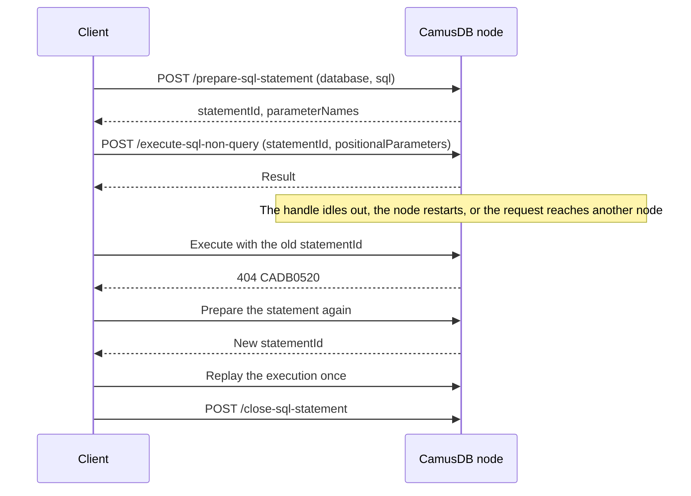

# Parameters and prepared statements

You register a prepared statement once, then execute it many times with
different values. Neither the SQL text nor the parameter names travel again on
each execution. The bigger benefit is elsewhere: the server stops parsing the
statement on every request, a parse it did only to decide the route.

Both transports support prepared statements: gRPC over the duplex
`BatchExecute` stream, and REST over `/prepare-sql-statement` alongside the
normal SQL endpoints.

## What it saves

Every inline request pays two costs before the engine starts any work:

1. Sending and deserializing the statement again. Over gRPC, that covers the
   `sql` and `database` strings, plus one .NET string for each parameter key,
   all of which the protobuf runtime allocates again on every request. Over
   REST, it is the same text inside the JSON body.
2. Parsing the SQL at the transport layer. Both transports parse the statement
   to answer a routing question. Is the statement a `SHOW DATABASES`? Is it a
   database-scoped statement that must open no transaction? That parse does not
   use the executor's parser cache, so each request pays it in full.

A prepared statement records the parsed root node and the exact string
instances once, so an execution does neither.

These are the measurements for an `INSERT` with 5 parameterized columns (see
`CamusDB.MicroBenchmarks/BENCH-RESULTS.md`):

| | Inline | Prepared |
|---|---:|---:|
| Bytes on the wire, per execution | 198 B | 43 B |
| Transport prologue (message parse plus routing parse) | 9,040.5 ns / 6152 B | 134.5 ns / 856 B |

From that point on, execution is identical. A prepared execution builds the
same ticket and takes the same path through the engine. Isolation, retries,
and cache hint behavior are all the same.

## Handle lifetimes

|  | gRPC | REST |
|---|---|---|
| A handle belongs to | One `BatchExecute` stream | This node, and the principal that prepared the statement |
| Handle type | `int32` | An opaque string |
| CamusDB frees it at | The end of the stream, whether normal, cancelled, or faulted | An explicit close, an idle timeout, or process exit |
| An unknown handle means | The client rebuilt the stream. Prepare the statement again. | The handle expired, or it belongs to another node or another principal. Prepare the statement again. |

The difference is not a design preference. A gRPC stream already answers two
questions: who owns a handle, and when that handle ends. Nothing else is
needed.

HTTP has no session the server can trust. Connections are pooled, multiplexed
by HTTP/2, and moved by load balancers. So REST answers those questions
explicitly: with a handle nobody can guess, an owner that CamusDB records at
registration, and an idle timeout. That timeout is the backstop for a client
that never closes what it prepared.

On both transports, a handle belongs to one node. CamusDB never replicates
handles, and a handle is never valid on any node except the one that created
it.

## Parameters bind by position

`PREPARE` replies with the statement's distinct placeholder names in binding
order, first occurrence first. Each name is verbatim and keeps its leading `@`.

An execution sends the values by ordinal: the value at index i binds to the
name at index i.

```camussql
UPDATE robots SET name = @name, year = @year WHERE id = @id
-- parameterNames: ["@name", "@year", "@id"]
```

A name that appears more than once in a statement occupies exactly one slot,
and every occurrence resolves to that one value. The list includes
placeholders inside subqueries. The number of values you send must exactly
equal the declared number.

The names do not travel on the wire, by design: removing them is much of the
point of the feature. A client that prefers binding by name maps its own
arguments onto the ordinals locally, using the published names.

The .NET and TypeScript connectors do that work for you. You bind values by
name, with or without the leading `@`, and the connector sends the ordinals.

A property that matches no parameter is an error, and so is a parameter with no
property. Neither one silently becomes `NULL`, because a spelling mistake must
not silently become a wrong answer.

## What you can prepare

You can prepare `SELECT`, `INSERT`, `UPDATE`, `DELETE`, and `SHOW` statements.
This includes [SELECT FOR UPDATE](/docs/sql-queries#for-update): preparing it
takes no row lock; executing it uses the locking-read transaction rules.
That covers every `SHOW` statement in the grammar, including the node-scoped
ones that run against no database at all, such as `SHOW ENGINE STATS`,
`SHOW VARIABLES`, and `SHOW CLUSTER SETTINGS`.

You cannot prepare schema, database, or user administration statements. These
run once, several of them return no database descriptor, and none of them
gains anything from a handle.

`/execute-sql-ddl` and the unary gRPC RPCs reject a handle outright rather than
ignoring it.

## gRPC

Prepared statements live only on the duplex `BatchExecute` stream. A unary
call has no stream to hold a handle.

```text
PREPARE (database, sql)  -> PrepareReply { statement_id, parameter_names[] }
QUERY | NON_QUERY (statement_id, positional_parameters[])
CLOSE (statement_id)     -> CloseReply
```

Wait for the `PrepareReply` before you send anything that references the id.
`START` has the same contract. Operations on a stream run concurrently, so an
execution sent before its registration is acknowledged may legitimately arrive
first.

An execution that names a handle must not also carry a `sql` field, a
`database` field, or a named `parameters` map. CamusDB refuses a request with
both, rather than resolving them with a precedence rule.

Repeating `CLOSE` is harmless. Closing an unknown id succeeds, and so does
closing an id you already closed.

You can safely skip the close, because the stream frees everything when it
ends. However, a long stream that prepares many different statements must
close what it no longer needs to stay under
`grpc_max_prepared_statements_per_stream`.

### The .NET client

The client hides handles and streams completely:

```csharp
await using CamusConnection connection = CamusConnection.Connect("https://localhost:5001");

await using CamusPreparedStatement insert = await connection.PrepareAsync(
    "productiondb", "INSERT INTO robots (id, name, year) VALUES (gen_id(), @name, @year)");

await insert.ExecuteNonQueryAsync(["optimus", 1984L]);          // by ordinal
await insert.ExecuteNonQueryAsync(new { name = "wall-e", year = 2008L });   // or by name

await using CamusPreparedStatement select = await connection.PrepareAsync(
    "productiondb", "SELECT name FROM robots WHERE year = @year");
QueryResult result = await select.ExecuteQueryAsync([2008L]);

// Inside a transaction: the statement registers itself on the session's pinned stream.
CamusTransactionSession txn = await connection.BeginTransactionAsync("productiondb");
await txn.ExecuteNonQueryAsync(insert, ["bumblebee", 1985L]);
await txn.CommitAsync();
```

A `CamusPreparedStatement` represents the statement, not a single server-side
handle. The client multiplexes autocommit work across a pool of streams, so
the statement registers itself lazily on whichever stream an execution
reaches.

A stream can fault and the client can rebuild it, and the stream's handles die
with it. The client notices this by comparing the registration's transport
identity immediately before a write, then registers the statement again
without your help. You never see an unknown statement error.

### The TypeScript connector

The TypeScript connector also hides prepared handles. It prepares repeated
statements automatically and lets you prepare a hot statement explicitly:

```ts
await client.prepare('SELECT * FROM robots WHERE year = @year');

client.isPrepared('SELECT * FROM robots WHERE year = @year');
client.preparedStatementCount;
```

Parameters still bind by name:

```ts
await client.query('SELECT * FROM robots WHERE year = @year', { year: 1977 });
```

Set `maxAutoPrepare: 0`, or `MaxAutoPrepare=0` in a connection string, to turn
automatic preparation off.

## REST

### Prepare

```http
POST /prepare-sql-statement
{ "databaseName": "productiondb",
  "sql": "INSERT INTO robots (id, name, year) VALUES (gen_id(), @name, @year)" }

200 { "status": "ok", "statementId": "a1b2c3.9f8e…", "parameterNames": ["@name", "@year"] }
```

Preparing a statement parses and registers it, but checks no privileges.
Authorization runs at execution time, against the principal of that request,
just as it does for an inline statement.

So a prepare reveals only one fact: whether the SQL parses. A statement that
does not parse fails here, not at some later execution.

### Execute

Three endpoints accept a `statementId` and a `positionalParameters` array:
`/execute-sql-query`, `/execute-sql-query-stream`, and
`/execute-sql-non-query`:

```http
POST /execute-sql-non-query
{ "statementId": "a1b2c3.9f8e…",
  "positionalParameters": [
    { "type": 3, "strValue": "optimus" },
    { "type": 2, "longValue": 1984 }
  ] }
```

Each value uses the same encoding as in the inline `parameters` map, so
existing clients reuse their serialization unchanged.

Every other request field behaves exactly as it does inline, including
`txnIdPT`, `txnIdCounter`, `isolationLevel`, `transactionMode`, `locking`, and
`causalToken`.

The `sql`, `databaseName`, and `parameters` fields must be absent.

### Close

```http
POST /close-sql-statement
{ "statementId": "a1b2c3.9f8e…" }        ->  200 { "status": "ok" }
```

Repeating a close is harmless. You can safely skip the close, because the idle
handle reaper collects abandoned handles. Still, a client that prepares an
unbounded number of different statements will reach its cap.

### How to handle CADB0520

`CADB0520` is normal, not a bug.

An execution fails with `CADB0520` (`UnknownPreparedStatement`, HTTP 404) when
the node does not know its handle.

Treat it as routine: prepare the statement again, then replay the execution
once. The error occurs when:

- The handle stayed unused past `prepared_statement_idle_timeout_ms`.
- The node restarted.
- A load balancer sent the request to a different node.
- The handle belongs to a different principal. CamusDB reports this case
  identically by design, because an ownership-specific error would confirm to
  a caller that a handle exists which that caller does not own.



Behind a load balancer, use sticky sessions, or accept one new prepare per
node per statement. Either way, the steady state after warm-up is one
registration per node.

On the streaming endpoint, CamusDB resolves the handle before it writes any
bytes, so a 404 arrives as a normal JSON error, not in the middle of a stream.

## Limits

Every limit is a `config.yml` key (see [Configuration](/docs/configuration)).
CamusDB validates each one at startup, and a negative value is a startup error.
It never becomes an unbounded limit.

| Key | Default | Meaning |
|---|---:|---|
| `grpc_max_prepared_statements_per_stream` | 512 | Live statements on one `BatchExecute` stream. `0` means no bound. |
| `rest_max_prepared_statements_per_principal` | 512 | Live REST statements for one principal, on one node. |
| `rest_max_prepared_statements` | 8192 | Live REST statements on one node, across all principals. |
| `max_prepared_statement_bytes` | 65536 | The largest single statement, on either transport. The size counts the database, the SQL, and the parameter names, in UTF-16. |
| `grpc_max_prepared_statement_bytes_per_stream` | 8 MiB | Statement text kept by one `BatchExecute` stream. |
| `rest_max_prepared_statement_bytes_per_principal` | 8 MiB | Statement text kept by one REST principal. |
| `rest_max_prepared_statement_bytes` | 64 MiB | Statement text kept by one node. |
| `prepared_statement_idle_timeout_ms` | 600000 | How long an unused REST statement lives. `0` disables the reaper. |
| `prepared_statement_sweep_interval_ms` | 60000 | How often the reaper sweeps. The value must be above 0. |

You need both count limits and byte limits. A count cap alone does not bound
memory: 512 statements permit 512 times the size of the largest accepted
request.

Inline SQL is also checked against
[max_statement_bytes](/docs/configuration#request-resource-limits) in UTF-8
before parsing, including PREPARE. This does not replace the smaller retained
prepared-statement limit or its UTF-16 accounting.

The per-statement limit bounds each term and the budgets bound the total, so
together they are meaningful.

CamusDB rejects a statement above `max_prepared_statement_bytes` as invalid
input, not as a quota failure, because no number of closed statements would
make it fit.

A registration past a cap or budget fails with `CADB0521`
(`PreparedStatementLimitExceeded`, HTTP 429).

CamusDB never evicts a live handle to make room. Silently dropping the least
recently used handle would make a correct client fail at an unpredictable
later moment. Instead, the server refuses the new statement and asks the
caller to close what it no longer needs.

CamusDB reclaims expired REST entries first, so a caller hits a limit only when
all of its statements are truly in use. Admission is atomic, so two concurrent
registrations cannot both take the last free slot.

A `BatchExecute` stream also has a finite id space of 2^31 registrations.
CamusDB tells a stream that uses them all to open a new stream, rather than
handing out an id that would wrap to an unusable value, and eventually to one
that collides.

## Related

- [gRPC API](/docs/grpc-api) for the wire protocol, including `BatchExecute`
  frames and retry classes.
- [.NET Driver](/docs/dotnet-driver) for the .NET client API.
- [TypeScript](/docs/typescript-connector) for the Node.js client.
