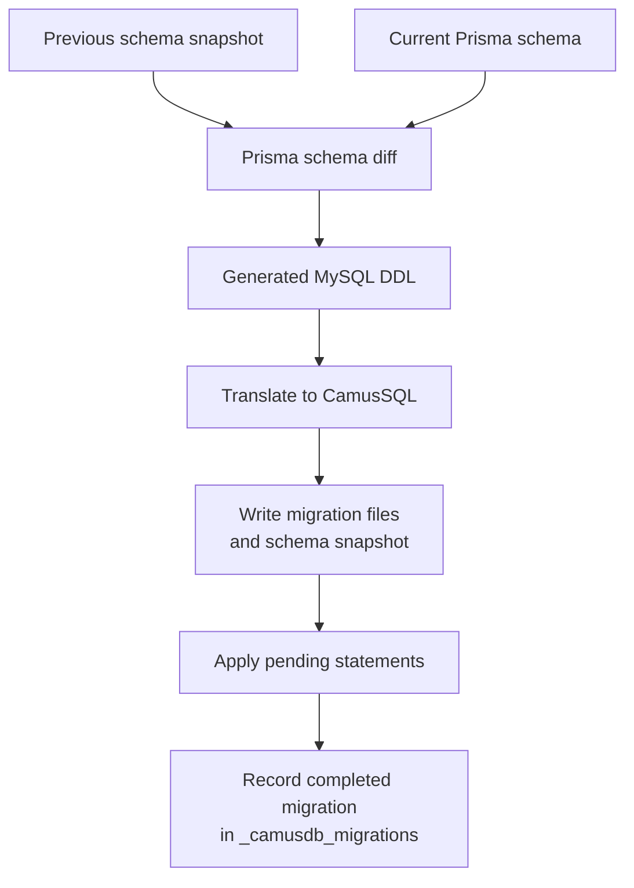

# Prisma

`@camusdb/prisma-adapter` lets a TypeScript application use
[Prisma](https://www.prisma.io/typescript) Client with CamusDB. You define models in a Prisma schema, and you use the
generated typed client over REST or gRPC. The package also has `camusdb-prisma`, a CLI
that translates and applies schema migrations, with a recorded history.

Use it if you want the model-based API of Prisma. For direct SQL or database
administration, use the [TypeScript connector](/docs/typescript-connector) that
the adapter is built on. The source and an example application are in
[camusdb-prisma](https://github.com/camusdb/camusdb-prisma). This page
describes version 0.2.0 of the adapter.

## Install

The adapter needs Prisma 7.10 or later (7.x or 8.x), the `camusdb` driver
0.15.0 or later, and Node.js `^20.19.0 || >=22.12.0`. The repository tests it
against CamusDB 0.16.

```bash
npm install @camusdb/prisma-adapter camusdb @prisma/client
npm install --save-dev prisma
```

Keep `prisma` and `@prisma/client` on the same version. To start a server, see
the [installation guide](/docs/intro). The examples use REST at
`http://localhost:5095`.

## Define and generate a client

Create `prisma/schema.prisma`:

```text title="prisma/schema.prisma"
generator client {
  provider = "prisma-client"
  output   = "../generated/prisma"
}

datasource db {
  provider     = "mysql"
  relationMode = "prisma"
}

model User {
  id    String  @id @default(uuid())
  email String  @unique
  name  String?
  posts Post[]
}

model Post {
  id        String  @id @default(uuid())
  title     String
  published Boolean @default(false)
  authorId  String
  author    User    @relation(fields: [authorId], references: [id])

  @@index([authorId])
}
```

`provider = "mysql"` selects the SQL dialect that Prisma generates. The adapter
rewrites the parts that differ in CamusDB, and it sends the statements through
the CamusDB driver. CamusDB doesn't have a MySQL wire endpoint.

With `relationMode = "prisma"`, Prisma handles relations, and the database
doesn't have foreign keys. Keep indexes on the referencing columns, as on `authorId`
above. Before you choose a mode, see
[Choose relation enforcement](#choose-relation-enforcement).

Add the Prisma CLI configuration:

```ts title="prisma.config.ts"
import { defineConfig } from 'prisma/config';

export default defineConfig({
  schema: './prisma/schema.prisma',
  datasource: { url: 'mysql://camusdb@localhost:5095/camusdb' },
});
```

`prisma migrate diff` needs this MySQL URL, but it doesn't open it. The CamusDB
connection is configured separately.

Generate the client and apply the first migration:

```bash
npx prisma generate
export CAMUSDB_URL="Endpoint=http://localhost:5095;Database=app"
npx camusdb-prisma migrate dev --name init
```

The CLI creates the database if it doesn't exist. If you manage database
creation separately, pass `--no-create-database`.

## Query your models

In an ESM application at the project root:

```ts
import { PrismaCamusDb } from '@camusdb/prisma-adapter';
import { PrismaClient } from './generated/prisma/client.js';

const adapter = new PrismaCamusDb({
  endpoint: 'http://localhost:5095',
  database: 'app',
});
const prisma = new PrismaClient({ adapter });

try {
  const user = await prisma.user.create({
    data: { email: 'ada@example.com', name: 'Ada' },
  });
  await prisma.post.create({
    data: { title: 'First post', published: true, authorId: user.id },
  });

  const authors = await prisma.user.findMany({
    where: { posts: { some: { published: true } } },
    include: { posts: true },
  });
  console.log(authors);
} finally {
  await prisma.$disconnect();
}
```

`PrismaCamusDb` also takes a connection string, for example from the
environment variable above:

```ts
const connectionString = process.env.CAMUSDB_URL;
if (!connectionString) throw new Error('Set CAMUSDB_URL');
const adapter = new PrismaCamusDb(connectionString);
```

The options object takes the connection settings of `CamusClient`, also
authentication and `protocol: 'grpc'`. For gRPC, use the gRPC endpoint (port
5096 by default), and install the optional gRPC dependencies of the connector.
See [connection options](/docs/typescript-connector#connection-options).

Prisma reads included relations with separate statements. The relation-join strategy of Prisma is off. It needs MySQL JSON aggregation
functions.

Relation filters, such as `some` and `none`, work in `findMany` and in `count`:

```ts
const publishedAuthors = await prisma.user.count({
  where: { posts: { some: { published: true } } },
});
```

## Choose relation enforcement

| Mode | Behavior | Considerations |
| --- | --- | --- |
| `relationMode = "prisma"` | Prisma handles relations and referential actions. | Prisma executes actions such as `Cascade`. Raw SQL and other writers don't get foreign-key checks. |
| `relationMode = "foreignKeys"` (default) | CamusDB checks foreign keys at the end of each statement. | Only `Restrict` and `NoAction` are supported. |

By default, Prisma uses `onUpdate: Cascade`. An optional relation also gets
`onDelete: SetNull`. In foreign-key mode, the translator replaces the unsupported
actions with `NO ACTION`, and it shows a warning. Prisma then leaves the check to
the database, and it doesn't run the replaced action. This means that a parent
delete or key update can fail with `P2003`.

To make the database check explicit, declare supported actions:

```text
author User @relation(fields: [authorId], references: [id], onDelete: Restrict, onUpdate: Restrict)
```

A cycle across two or more tables returns `CADB0416`. A table can reference
itself. See [Foreign keys](/docs/foreign-keys).

## Migrations

Use `camusdb-prisma` for schema changes. The standard `prisma migrate dev` needs
a MySQL wire connection, and it can't connect to CamusDB.

The CLI compares schema files with `prisma migrate diff`, translates the MySQL
DDL to CamusSQL, and applies it through the CamusDB driver:



```bash
export CAMUSDB_URL="Endpoint=http://localhost:5095;Database=app"

npx camusdb-prisma migrate dev --name add_posts
npx camusdb-prisma migrate deploy
npx camusdb-prisma migrate status
npx camusdb-prisma db push
```

| Command | Purpose |
| --- | --- |
| `migrate dev --name label` | Writes a migration from the last snapshot, and applies the pending migrations. |
| `migrate deploy` | Applies the pending migration directories, in name order. |
| `migrate status` | Shows the state of each migration, such as applied or pending. |
| `db push` | Applies the schema change and updates the snapshot. It doesn't write a migration. Use it for disposable development databases. |

For the connection and path flags, run `npx camusdb-prisma --help`. To see the
CamusSQL translation of a MySQL DDL file, run
`npx camusdb-prisma translate migration.sql`.

### Keep the snapshot and read the warnings

Commit the full `prisma/migrations` directory. It has these files:

- `.snapshot.prisma`: the schema that the next diff starts from.
- `<timestamp>_<label>/migration.sql`: the CamusSQL statements that are applied.
- `<timestamp>_<label>/migration.mysql.sql`: the original MySQL DDL, for
  reference.

The CLI starts each diff from the snapshot, and it doesn't use a shadow
database. If the snapshot is missing, the next diff starts from an empty schema.
The CLI doesn't inspect the live database for drift.

`_camusdb_migrations` records the name and checksum of each completed migration,
with its time and statement count. `migrate status` detects applied files that
were changed or removed, and `migrate deploy` skips migrations that are applied.

The statements of a migration execute one after another, and no transaction
covers the migration. If a statement fails, the earlier changes can stay, and
the migration isn't recorded. Resolve that state before you run the migration
again.

Read the translation warnings. For example, unsupported referential actions can
make the applied schema differ from your model. CamusDB can't change the type or
length of a column in place. The translator applies changes to nullability, and
it warns about the others. For a type change, use a new column:
add it and copy the values. Then drop the old column, and rename the new one.

## Type mapping

| Prisma field | CamusDB storage |
| --- | --- |
| `String` | `VARCHAR(191)` by default. `@db.Text` maps to `TEXT`. |
| `Int`, `BigInt` | `INT64`. |
| `Int @default(autoincrement())` | `INT64 GENERATED BY DEFAULT AS IDENTITY`. |
| `Float` | `FLOAT64`. |
| `Boolean` | `BOOL`. |
| `DateTime` | `DATETIME`. |
| `Bytes` | `BYTES`. |
| `Decimal` | `NUMERIC`, with 38 digits and 9 fractional digits. |
| `Json` | `STRING`. It is returned as text, and JSON path filters don't work. |
| Enum | `STRING`. The database doesn't limit the values to the enum. |

Integer and decimal values aren't converted to JavaScript numbers. For values in
the full 64-bit range, use `BigInt` in the model. A decimal with more than 9
fractional digits is rounded, and one with more than 29 integer digits returns
`P2020`. `@db.Decimal(p, s)` maps to the fixed precision and scale of CamusDB.
Decimal list parameters are sent as `FLOAT64`, and they aren't exact.

You should let the database generate identity keys. An explicit key doesn't
advance the sequence. This means that a later generated value can collide with
it (`P2002`). The adapter finds identity columns with `DESCRIBE`, and it uses
`RETURNING` to give the generated keys to Prisma.

MySQL types that CamusDB doesn't have, such as `@db.Time`, return an error in
the translator.

## Transactions and errors

`prisma.$transaction` uses CamusDB transactions. For example, with the models
above:

```ts
await prisma.$transaction(async (tx) => {
  await tx.post.updateMany({
    where: { authorId: userId },
    data: { published: true },
  });
  await tx.user.update({ where: { id: userId }, data: { name: 'Ada Lovelace' } });
}, { isolationLevel: 'Serializable' });
```

`Serializable` and `ReadCommitted` are supported. If you don't set the option, the server default
applies. Other isolation levels return an error. Savepoints aren't
supported.

The adapter maps database errors to Prisma error kinds:

| CamusDB code | Prisma result |
| --- | --- |
| `CADB0300` | `P2002`: unique constraint violation. |
| `CADB0301` | `P2011`: null constraint violation. |
| `CADB0304`, `CADB0305`, `CADB0306` | `P2003`: foreign-key violation. |
| `CADB0417` | `P2020`: value out of range. |
| `CADB0011` | `P2021`: the table doesn't exist. |
| `CADB0404` | `P2022`: the column doesn't exist. |
| `CADB0502`, `CADB0504` | `TransactionWriteConflict`. |
| `CADB0516` | `P1000`: authentication failed. |

Other CamusDB errors stay raw database errors. The error payloads of the adapter
have `originalCode` and `originalMessage`. See
[Transactions](/docs/sql-transactions) and [Error codes](/docs/error-codes).

## Raw SQL and C# extensions

`$queryRaw` and `$executeRaw` take CamusSQL. Raw statements aren't translated
from MySQL. Quote table and column names with backticks, especially reserved
words such as `User`:

```ts
const rows = await prisma.$queryRaw<{ email: string }[]>`
  SELECT \`email\` FROM \`User\` WHERE \`email\` = ${'ada@example.com'}
`;
```

To call an installed C# procedure, use `$executeRaw`. For an extension function,
use `$queryRaw`. A procedure joins the open Prisma transaction, and it returns
its count of changed rows. See [C# extensions](/docs/csharp-extensions).

For triggers and other objects that Prisma doesn't model, write a `migration.sql`
by hand. Put it in a directory whose name sorts after the existing migrations,
and run `migrate deploy`. The file must contain CamusSQL, and it isn't
translated. Schema diffs don't track these objects.

## Query limitations

- JSON fields return text. Filters in JSON documents don't work.
- Database foreign keys support only `Restrict` and `NoAction`. For cascading
  actions, use the Prisma relation mode.

To see the generated and rewritten statements during development:

```bash
DEBUG='prisma:driver-adapter:camusdb' node your-app.js
```

The [example application](https://github.com/camusdb/camusdb-prisma/tree/main/example)
of the repository shows the adapter in a full application.
