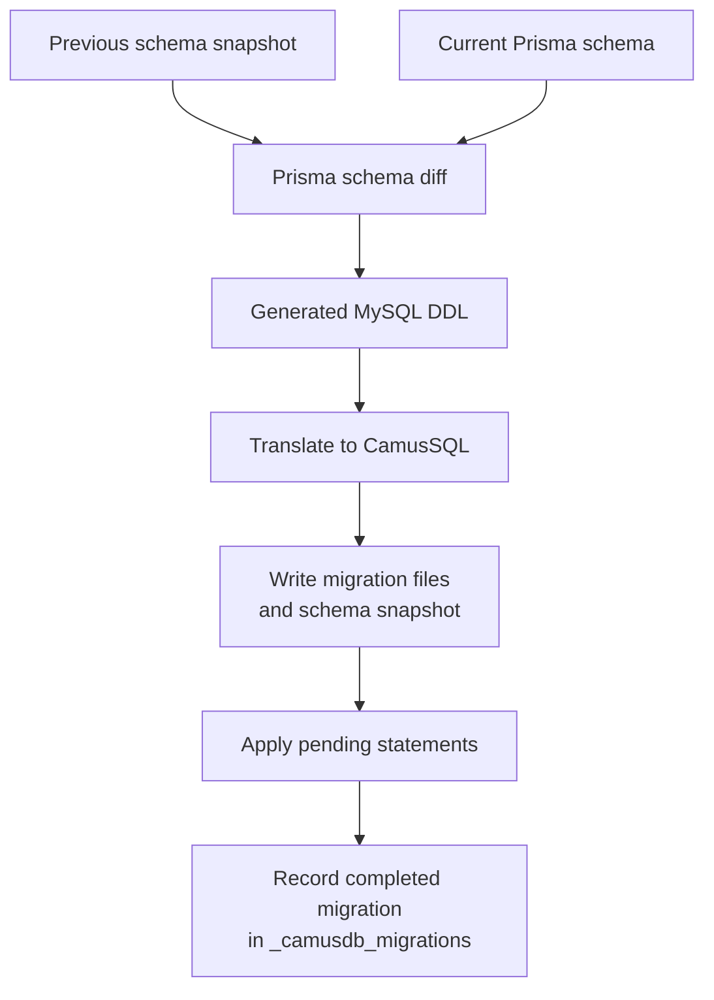

# Prisma

`@camusdb/prisma-adapter` lets a TypeScript application use [Prisma](https://www.prisma.io/typescript) Client with
CamusDB. Define models in a Prisma schema, generate a typed client, and use
Prisma queries, relations, and transactions against CamusDB over REST or gRPC.
The package also includes `camusdb-prisma`, a CLI for translating and applying
schema migrations with a recorded history.

Use it when you want Prisma's model-based API. For direct SQL or access to the
full database administration API, use the
[TypeScript connector](/docs/typescript-connector) underneath the adapter.
Source and a runnable application are in
[camusdb-prisma](https://github.com/camusdb/camusdb-prisma).

## Install

Use Prisma 7.10 or later within the 7.x or 8.x lines, and the `camusdb` driver
0.8.x. Supported Node.js versions are `^20.19.0 || >=22.12.0`. The repository
reports testing against CamusDB 0.16; choose a server with the SQL features your
models use.

```bash
npm install @camusdb/prisma-adapter camusdb @prisma/client
npm install --save-dev prisma
```

Keep `prisma` and `@prisma/client` on matching versions within the supported
range. Start a CamusDB server using the [installation guide](/docs/intro).
The examples use REST at `http://localhost:5095`.

## Define and generate a client

Create `prisma/schema.prisma`:

```text title="prisma/schema.prisma"
generator client {
  provider = "prisma-client"
  output   = "../generated/prisma"
}

datasource db {
  provider     = "mysql"
  relationMode = "prisma"
}

model User {
  id    String  @id @default(uuid())
  email String  @unique
  name  String?
  posts Post[]
}

model Post {
  id        String  @id @default(uuid())
  title     String
  published Boolean @default(false)
  authorId  String
  author    User    @relation(fields: [authorId], references: [id])

  @@index([authorId])
}
```

`provider = "mysql"` selects the SQL dialect Prisma generates. The adapter
rewrites the differences CamusDB needs, then sends statements through the
CamusDB driver. CamusDB itself serves REST and gRPC, without a MySQL wire
endpoint.

`relationMode = "prisma"` uses Prisma's relation handling without database
foreign keys. Keep indexes on referencing columns, as with `authorId` above.
See [relation enforcement](#choose-relation-enforcement) before choosing a mode.

Add the Prisma CLI configuration:

```ts title="prisma.config.ts"
import { defineConfig } from 'prisma/config';

export default defineConfig({
  schema: './prisma/schema.prisma',
  datasource: { url: 'mysql://camusdb@localhost:5095/camusdb' },
});
```

This MySQL URL is a placeholder required by the file-based `prisma migrate diff`
workflow. That comparison does not open it. The real CamusDB connection is
configured separately below.

Generate the client and apply the initial migration:

```bash
npx prisma generate
export CAMUSDB_URL="Endpoint=http://localhost:5095;Database=app"
npx camusdb-prisma migrate dev --name init
```

The CLI creates the target database if absent. Pass `--no-create-database`
when database creation is managed separately.

## Query your models

In an ESM application at the project root:

```ts
import { PrismaCamusDb } from '@camusdb/prisma-adapter';
import { PrismaClient } from './generated/prisma/client.js';

const adapter = new PrismaCamusDb({
  endpoint: 'http://localhost:5095',
  database: 'app',
});
const prisma = new PrismaClient({ adapter });

try {
  const user = await prisma.user.create({
    data: { email: 'ada@example.com', name: 'Ada' },
  });
  await prisma.post.create({
    data: { title: 'First post', published: true, authorId: user.id },
  });

  const authors = await prisma.user.findMany({
    where: { posts: { some: { published: true } } },
    include: { posts: true },
  });
  console.log(authors);
} finally {
  await prisma.$disconnect();
}
```

`PrismaCamusDb` also accepts a CamusDB connection string. To use the environment
variable set earlier, check it before constructing the adapter:

```ts
const connectionString = process.env.CAMUSDB_URL;
if (!connectionString) throw new Error('Set CAMUSDB_URL');
const adapter = new PrismaCamusDb(connectionString);
```

The options object accepts the same connection settings as `CamusClient`,
including authentication and `protocol: 'grpc'`. For gRPC, use its endpoint
(normally port 5096) and install the connector's optional gRPC dependencies.
See [connection options](/docs/typescript-connector#connection-options).

Prisma reads included relations with separate statements. The adapter disables
Prisma's relation-join strategy because it depends on MySQL JSON aggregation
functions CamusDB does not provide.

## Choose relation enforcement

| Mode | Behavior | Considerations |
| --- | --- | --- |
| `relationMode = "prisma"` | Prisma handles relations and referential actions. | Supports actions such as `Cascade` and `SetNull` through Prisma. Raw SQL and other writers do not gain database foreign-key enforcement. |
| `relationMode = "foreignKeys"` (default) | CamusDB enforces foreign keys at the end of each statement. | Only `Restrict` and `NoAction` actions are supported. |

Prisma defaults to `onUpdate: Cascade`, and optional relations default to
`onDelete: SetNull`. In foreign-key mode the translator replaces unsupported
`CASCADE`, `SET NULL`, and `SET DEFAULT` actions with `NO ACTION` and reports
warnings. Prisma then leaves enforcement to the database; it does not perform
the replaced action. A parent delete or key update can fail with `P2003`.

To make database enforcement explicit, declare supported actions:

```text
author User @relation(fields: [authorId], references: [id], onDelete: Restrict, onUpdate: Restrict)
```

Cycles across two or more tables are refused with `CADB0416`; self-references
are accepted. See [foreign keys](/docs/foreign-keys) for database behavior.

## Migrations

Use `camusdb-prisma` for schema changes. Standard `prisma migrate dev` attempts
a MySQL wire connection through Prisma's schema engine, so it cannot connect
to CamusDB through this adapter.

The CLI compares schema files with `prisma migrate diff`, translates the MySQL
DDL to CamusSQL, and applies it through the CamusDB driver:



```bash
export CAMUSDB_URL="Endpoint=http://localhost:5095;Database=app"

npx camusdb-prisma migrate dev --name add_posts
npx camusdb-prisma migrate deploy
npx camusdb-prisma migrate status
npx camusdb-prisma db push
```

| Command | Purpose |
| --- | --- |
| `migrate dev --name label` | Generates a migration from the last snapshot and applies pending migrations. |
| `migrate deploy` | Applies pending migration directories in name order. |
| `migrate status` | Reports applied, pending, changed, and missing migration files. |
| `db push` | Applies the schema difference and updates the snapshot without writing a migration history entry. Use for disposable development databases. |

Run `npx camusdb-prisma --help` for connection and path flags. Use
`npx camusdb-prisma translate -- migration.sql` to inspect the CamusSQL
translation of a MySQL DDL file without applying it.

### Keep the snapshot and review warnings

Commit the entire `prisma/migrations` directory, including:

- `.snapshot.prisma`: the schema used as the starting point of the next diff.
- `<timestamp>_<label>/migration.sql`: the CamusSQL statements that are applied.
- `<timestamp>_<label>/migration.mysql.sql`: the original DDL for reference.

The CLI uses the snapshot instead of replaying history into a shadow database.
A missing snapshot makes the next diff start from an empty schema. It does not
inspect the live database for drift.

`_camusdb_migrations` records each completed migration's name, checksum,
application time, and statement count. `migrate status` detects edited or missing
applied files; deployment skips names already recorded as applied.

Statements run sequentially, without a transaction around the migration.
If a later statement fails, earlier changes can remain while the migration is
still unrecorded. Inspect and resolve that partial state before rerunning it.

Read translation warnings: unsupported referential actions, decimal precision,
and in-place type changes can make the applied schema differ from your model.
CamusDB cannot change a column's type or length in place; the translator applies
nullable changes and warns about the rest. For a type change, add a replacement
column, copy values, drop the old column, and rename the replacement.

## Type mapping

| Prisma field | CamusDB storage |
| --- | --- |
| `String` | `VARCHAR(191)` by default; `@db.Text` maps to `TEXT`. |
| `Int`, `BigInt` | `INT64`. |
| `Int @default(autoincrement())` | `INT64 GENERATED BY DEFAULT AS IDENTITY`. |
| `Float` | `FLOAT64`. |
| `Boolean` | `BOOL`. |
| `DateTime` | `DATETIME`. |
| `Bytes` | `BYTES`. |
| `Decimal` | `NUMERIC`, with 38 digits total and 9 fractional digits. |
| `Json` | `STRING`; returned as text, without JSON-path filtering. |
| Enum | `STRING`; the database does not restrict values to enum members. |

Integer and scalar decimal values travel through the adapter without conversion
to JavaScript floating-point numbers. Use `BigInt` in your Prisma model when
application values need the 64-bit integer range. Decimal values beyond 9
fractional digits are rounded; more than 29 integer digits are refused with
`P2020`. `@db.Decimal(p, s)` still maps to CamusDB's fixed precision and scale.
Decimal list parameters use `FLOAT64` because the connector has no NUMERIC
array mapping; they do not have the same exactness as scalar decimal parameters.

Let the database generate identity keys. Explicitly inserting a key does not
advance its sequence, so a later generated value can collide with it (`P2002`).
The adapter discovers identity columns with `DESCRIBE` and uses `RETURNING`
to report generated keys to Prisma.

Native MySQL types without a mapping, including `@db.Time`, `@db.Year`,
`@db.Bit`, and spatial types, are refused by the translator.

## Transactions and errors

`prisma.$transaction` uses CamusDB transaction handles. For example, using the
models above:

```ts
await prisma.$transaction(async (tx) => {
  await tx.post.updateMany({
    where: { authorId: userId },
    data: { published: true },
  });
  await tx.user.update({ where: { id: userId }, data: { name: 'Ada Lovelace' } });
}, { isolationLevel: 'Serializable' });
```

`Serializable` and `ReadCommitted` are supported. Leave the option unset to use
the server default. `RepeatableRead`, `ReadUncommitted`, and `Snapshot` are
rejected. Savepoints are not supported.

The adapter maps matching database errors to Prisma error kinds:

| CamusDB code | Prisma result |
| --- | --- |
| `CADB0300` | `P2002`: unique constraint violation. |
| `CADB0301` | `P2011`: null constraint violation. |
| `CADB0304`, `CADB0305`, `CADB0306` | `P2003`: foreign-key violation. |
| `CADB0417` | `P2020`: value out of range. |
| `CADB0011` | `P2021`: table does not exist. |
| `CADB0404` | `P2022`: column not found. |
| `CADB0502`, `CADB0504` | `TransactionWriteConflict`. |
| `CADB0516` | `P1000`: authentication failed. |

Other CamusDB errors remain raw database errors. Adapter error payloads retain
`originalCode` and `originalMessage` for CamusDB failures. See
[transaction isolation](/docs/sql-transactions) and [error codes](/docs/error-codes).

## Raw SQL and C# extensions

Write CamusSQL in `$queryRaw` and `$executeRaw`; raw statements are not a general
MySQL-to-CamusSQL translation path. Quote table and column identifiers with
backticks, especially names such as `User` that are reserved words:

```ts
const rows = await prisma.$queryRaw<{ email: string }[]>`
  SELECT \`email\` FROM \`User\` WHERE \`email\` = ${'ada@example.com'}
`;
```

Use `$executeRaw` for an installed C# procedure, or `$queryRaw` for an extension
function. A procedure joins the enclosing Prisma transaction and reports its
changed-row count. See [C# extensions](/docs/csharp-extensions) for deployment
and `CREATE EXTENSION` installation requirements.

For triggers or other objects Prisma does not model, add a manually written
`migration.sql` in a directory whose name sorts after existing migrations, then
run `migrate deploy`. This file must contain CamusSQL; deployment runs it
without translation. Schema diffs do not track these manually managed objects.

## Count rows matching a relation

Relation filters such as `some`, `none`, and `every` work in both `findMany`
and `count` on a server with nested-subquery binding support:

```ts
const publishedAuthors = await prisma.user.count({
  where: { posts: { some: { published: true } } },
});
```

Prisma can place this filter inside a derived table under `COUNT(*)`. Older
server builds rejected that shape with `CADB0099`; upgrade the server rather
than fetching matching rows just to count them.

## Query limitations

- Scalar subqueries in a projection are unsupported, including in raw SQL.
- JSON fields return text, and filters inside JSON documents are unsupported.
- Database foreign keys support only `Restrict` and `NoAction`; use Prisma
  relation mode when application-managed cascading is required.

To inspect generated and rewritten statements during development:

```bash
DEBUG='prisma:driver-adapter:camusdb' node your-app.js
```

The repository's [example application](https://github.com/camusdb/camusdb-prisma/tree/main/example)
shows models, relation queries, grouping, transactions, and raw SQL together.
