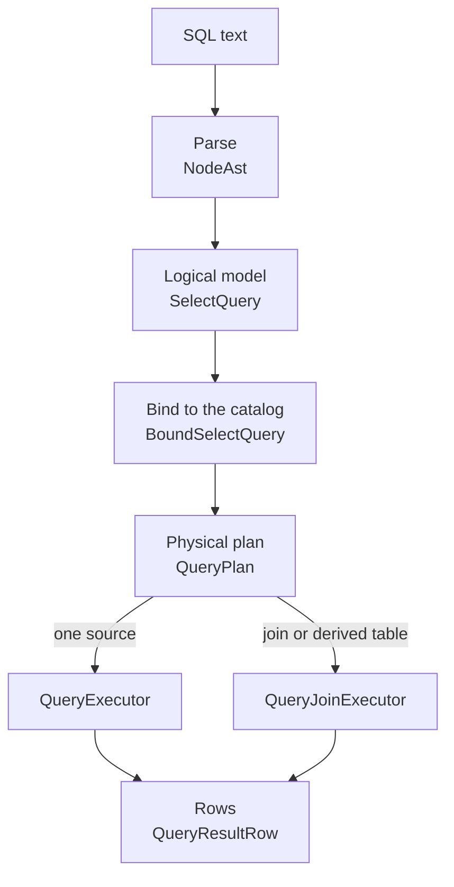
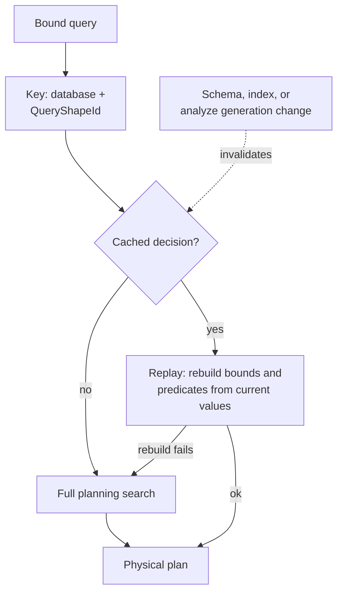

# Query planner internals

This page describes how CamusDB turns SQL text into a physical plan, and how it
executes the plan against the KV layer, the ordered key/value store of the rows
and index entries.

Start with [Query planning](/docs/query-planning) for SQL examples and tuning,
and [EXPLAIN](/docs/explain) to read a plan. This page follows the same concepts
into the implementation.

## What the planner decides

The planner is between the SQL layer and the transactional KV store that
[Kahuna](/docs/concepts#kahuna) provides in each node. It answers these
questions:

1. Which scan does the query use?
2. Which conditions can become bounds of that scan?
3. Can the plan skip a sort?
4. Which join algorithm suits the query?
5. Where do the later stages go, such as aggregation and `DISTINCT`?

CamusDB has a rule-based planner and cost-based optimizers. The cost model
annotates each plan, and it drives some decisions in all cases. While their
flags are on, it also drives the access-path and join-order searches. The flags
are on by default.

The optimizer has these levels:

1. Table statistics, from live DML and from `ANALYZE`.
2. Cardinality estimates, from row counts and histograms.
3. A weighted cost model. See [Statistics and cost](#statistics-and-cost).
4. A search over access paths and join orders.

## The pipeline

Each `SELECT` follows this pipeline:

1. CamusDB parses the SQL text into a `NodeAst`.
2. It builds a typed logical model of the query.
3. It binds the names of the query to the catalog.
4. It produces a physical plan tree.
5. It executes the plan, on the single-table path or the join path.



| Stage | Main type | Purpose |
| --- | --- | --- |
| Parse | `NodeAst` | The raw syntax tree. |
| Logical model | `SelectQuery` | A structured form of the query, such as its filters. |
| Bound model | `BoundSelectQuery` | The logical query, with the resolved tables and aliases. |
| Physical plan | `QueryPlan` and `PhysicalPlanNode` | The chosen operator tree, and a flat list of steps for the single-table path. |
| Results | `QueryResultRow` | The output rows. |

## Logical plans and physical plans

The logical model records what the query asks for. The physical plan records
how CamusDB gets the result. For example:

- The logical form is "the rows of `robots` where `year = 2024`".
- The physical form is "a range scan of `year_idx`, from `2024` to the next key
  boundary".

Expressions stay AST subtrees until execution. The structured models mostly
describe the shape of the query and the relations between its sources.

## Two execution paths

| Path | Use | Main executor |
| --- | --- | --- |
| The linear single-table path | The query has one source. | `QueryExecutor` |
| The tree path | The query has a join or a derived table. | `QueryJoinExecutor` |

The two paths must agree on all visible behavior. The tree path walks the plan
recursively, and then it uses the shared post-scan pipeline for the later
stages.

## Parse and build

The parser supports these forms:

- `SELECT [DISTINCT]`, `WHERE`, `GROUP BY`, and `HAVING`.
- `ORDER BY`, `LIMIT`, and `OFFSET`.
- Joins and derived tables.
- Subqueries, and value lists with `IN (...)` and `NOT IN (...)`.
- `EXPLAIN (LOGICAL|PHYSICAL|ANALYZE)`.

`SelectQueryCreator` turns the parsed tree into a `SelectQuery` record. The
record has a field for each clause, such as `Where`, and an `IsDistinct` flag.

## Binding

`QueryBinder` does the following:

- It resolves the source names and opens the table descriptors.
- It detects alias collisions.
- It builds the row-name resolver. The resolver decides whether a column
  reference is valid, or whether it needs a qualifier.
- It validates the column references, and the agreement between `GROUP BY` and
  the projections.
- It prepares `EXISTS` subqueries in the subquery registry for execution.

## Single-table planning

The single-table planner works in phases.

### 1. Scan selection

The planner analyzes the condition, and it picks one of these scans:

- A full table scan.
- A forced index scan.
- A point lookup on a unique index.
- A range scan on an index.
- An index scan over an `IN` list, when repeated probes are cheaper than a wider
  scan.

`PredicateAnalyzer` splits the conditions into three groups:

- Comparisons that an index can serve.
- Column-to-column comparisons.
- Residual conjuncts.

`IndexScanSelector` has two modes. The heuristic mode scores each usable index
with rules such as these:

- A full equality on a unique index is better than all other candidates.
- An equality on a non-unique index, or an equality prefix, is a strong
  candidate.
- An equality prefix with a range on the next column can drive a composite
  range scan.
- An `ORDER BY` prefix match can win, also if the query doesn't filter.
- An `IN (...)` list on an indexed column can compete with a range scan and a
  full scan.

The cost-based mode is on by default (`cost_based_access_path_enabled`). It
applies when the table has a positive row-count estimate and analyzed
statistics. A row count from DML alone isn't enough. It compares the index
candidates with a full scan, and it uses the cheapest estimate. Ordering and
`DISTINCT` rules can also change the final scan.

The scans that find rows for `UPDATE` and `DELETE` use the heuristic mode. This
prevents unexpected growth of exclusive lock ranges.

### 2. Filter absorption

The planner chooses the scan bounds first. Then it removes from the runtime
filter each comparison that the bounds already imply. The remaining comparisons
are the residual filter.

### 3. Sort elision

If the scan already gives rows in the requested order, the planner sets
`OutputOrdering`. It doesn't add a `SortNode`.

Index order has a direction. A scan over `(year ASC)` serves `ORDER BY year ASC`,
and a scan over `(year DESC)` serves `ORDER BY year DESC`. A different direction
needs a `SortNode`. A forward index scan isn't inverted.

### 4. DISTINCT strategy

For `SELECT DISTINCT`, the planner chooses one of these:

- A streaming `DistinctNode`. The projected columns must be
  simple `NOT NULL` identifiers in the scan order.
- A hash `DistinctNode`, when streaming isn't possible.

A streaming distinct can also give a matching `ORDER BY`. Then the plan doesn't
need a `SortNode`.

### 5. Limit pushdown

When the query is simple, the planner pushes the row limit into the scan, and
the KV read can stop early.

### 6. Building the operator chain

The planner builds a chain of operators from the leaf to the root:

| Query shape | Operator chain |
| --- | --- |
| A simple select | `Scan -> [Filter] -> [Sort] -> [Aggregate] -> [Having] -> [Project] -> [Limit]` |
| A grouped query | `Scan -> [Filter] -> Aggregate -> [Having] -> [Sort] -> [Project] -> [Limit]` |
| A distinct query | `Scan -> [Filter] -> [Aggregate] -> [Having] -> [Project] -> Distinct -> [Sort] -> [Limit]` |

### Reading fewer columns

`ProjectionPushdownPlanner` and `RequiredColumnAnalyzer` find the columns that
execution needs. The set includes the columns that later stages use, such as join keys, in
addition to the select list. The scan then doesn't decode
the other columns.

This is different from index-only execution. Partial decoding saves work on a
fetched row, and a covering index avoids the row fetch. Both must keep the
columns that later stages need, also if those columns aren't in the result.

## Join planning

`JoinQueryPlanner` plans queries with several sources:

- It can change the join order.
- It pushes down the conditions that belong to one source.
- It separates post-join conditions from scan conditions.
- It builds the join nodes. See [Physical plan nodes](#physical-plan-nodes).
- It builds a `SemiJoinNode` for an eligible indexed `IN` or `NOT IN` subquery.
- It represents a derived table as a `DerivedTableScanNode`.

For an inner equi-join, the planner extracts the join key pairs, also when no
index is available. This means that hash and merge joins are possible, in
addition to indexed nested-loop joins.

The main selection rules are:

- An `IndexNestedLoopJoinNode`, when the join key of the right side has a good
  index, and the estimate makes repeated probes cheaper.
- A `MergeJoinNode`, when both sides can be read in join-key order, and the
  outer side is large enough.
- A `HashJoinNode`, when a hash table is cheaper for an equi-join, or the right
  side doesn't have a usable index on the join key.
- A `NestedLoopJoinNode`, for other joins.

An inner hash join builds a hash table from the smaller side, and it probes the
table with the other side. A left hash join builds the right side, and the
preserved left input is the probe side. Unmatched left rows get `NULL` values
for the right columns. A merge join reads two ordered inputs, and it buffers the
current run of equal keys.

## The join predicate graph

Before it chooses an order, the planner must know which conditions connect
which sources. `JoinPredicatePushdown` separates single-source `WHERE` filters
from the conditions that must execute after sources are combined. `JoinGraph`
then builds a graph from the remaining eligible conditions and the `ON`
clauses.

The planner reads the conditions joined by `AND` one at a time. Each condition
is a **conjunct**. Eligible cross-table conditions from `WHERE` can connect
tables as conditions from `ON` do.

A graph leaf is a table or derived table, identified by its alias. Each leaf has
one bit in a mask. A conjunct stores the mask of the sources that it references.
For example, `a.id = b.a_id` names `{a,b}`.
`a.x + b.x = c.x` names `{a,b,c}`. The second can connect `c` to `{a,b}`. It
can't connect `a` to `b` alone. It needs `c`.

The graph splits top-level `AND`s, and not other Boolean expressions. An `OR`
expression is one conjunct. A literal `TRUE` doesn't connect sources. This means
that the `ON TRUE` of a normalized comma join doesn't force a cross product.

### Moving a condition to the earliest eligible join

For each proposed source order, `JoinGraph.BuildTree` attaches a movable
conjunct at the join where its last referenced source enters the tree. A
constant, or a condition on the first source only, goes on the first join.
Conditions keep their pool order. The `ON` conjuncts come before the adopted
`WHERE` conjuncts. The builder checks that it attached each conjunct once.

```camussql
SELECT a.id, b.id, c.id
FROM a
JOIN b ON a.x = b.x
JOIN c ON b.y = c.y AND a.z = b.z
WHERE c.kind = 'active' AND c.code = a.code;
```

For the order `a, b, c`, the placement is:

| Location | Conditions |
| --- | --- |
| Input `c` | `c.kind = 'active'`, if it can be pushed to the scan. |
| Join `a` with `b` | `a.x = b.x` and `a.z = b.z`. The second moved from the later `ON`. |
| Join the result with `c` | `b.y = c.y` and `c.code = a.code`. The second moved from `WHERE`. |

The example shows placement. It doesn't mean that the optimizer chooses this
order. Another order attaches the same conditions at different joins.
`JoinOrderChoice` carries the rebuilt tree **with** its remaining post-join
filter. This means that a condition taken from `WHERE` isn't evaluated again
there.

### Conditions that restrict movement

A cross-table `WHERE` conjunct enters the graph if all these conditions are
true:

- Its column references resolve.
- It doesn't contain a subquery.
- `FragmentFilterShippability.IsShippable` allows it.

The last check protects [broadcast joins](/docs/distributed-queries): a moved condition must
not add a condition that a peer can't execute.

A `WHERE` conjunct that can't be shipped executes after the joins. An `ON`
conjunct that can't be shipped is pinned, and it doesn't add a connection:

- A volatile condition, such as one with `random()`, is pinned to its original
  join scope. All the sources in that scope must join before a source outside it
  enters. This preserves the row combinations that the condition sees.
- Other conditions that can't be shipped, such as parameterized expressions,
  stay with the source requirements of their `ON` clause. They continue to block
  broadcast at that join.

If an `ON` has a subquery, or a column reference that doesn't resolve to one
source, the graph declines the tree, and the planner uses the whole-predicate
path. The graph also declines outer-join trees, and trees with more than 64
leaves. The cost-based search has a limit of 12 leaves.

Predicate movement doesn't guarantee an evaluation order. A cast or a division
can execute before a later join removes a row, and it can raise an error on that
row. Single-table scan pushdown has the same effect. Don't use the order of SQL
conditions to guard an unsafe expression.

## Join-order search

There are two ways to select an order. Both keep the order of outer joins after
normalization. A `RIGHT JOIN` is already a left join with swapped inputs.

### Heuristic order and cross-product repair

`JoinOrderOptimizer` gives each leaf a score:

| Score | Filter opportunity |
| --- | --- |
| 0 | An equality on a unique index. |
| 1 | Another indexed condition. |
| 2 | No indexed condition that can be pushed. |

It tries lower scores first. On ties, the declared order wins. It
rebuilds a left-deep tree from the full `ON` conditions, if it can. A volatile
`ON` condition prevents this reordering.

`Choose` then checks for an avoidable cross product. If the heuristic tree has a join that no conjunct connects, and the graph allows a connected order, it
rebuilds the tree through `JoinGraph`. The repair tries sources in score order,
and it adds a source when it connects to the current set. If the tree doesn't have an avoidable cross product, the whole-predicate plan
applies. A query that needs a
cross product uses the heuristic order.

This repair doesn't need statistics. It is available with the cost-based flag
off, before row counts load, above the 12-source limit, and when the dynamic
program doesn't find a full plan.

### Dynamic programming over subsets

`JoinEnumerator` uses a bottom-up dynamic program, in the style of System R. It
stores the cheapest plan for each subset of sources, and it doesn't search each
permutation again. Its candidates are left-deep: `((A join B) join C) join D`.

```text
best[{A}] = cost of scanning A as the first input

For increasing subset sizes:
    choose a source R in subset S
    L = S without R
    require a usable best[L]
    require R to connect to L
    require the subset to respect volatile-expression boundaries
    candidate = best[L] + cost of joining R to the result of L
    keep the candidate if it is strictly cheaper
```

The search starts when `cost_based_join_order_enabled` is true, a statistics
manager is available, and each base table has a loaded row count. It considers
at most 12 leaves, and it doesn't enumerate cross products. If no connected
order is available, the heuristic handles the query.

The candidates for a subset are tried from the last declared source backward.
The strict cost comparison makes ties deterministic. A declared order that ties
for the best cost wins. The winning order is rebuilt through the
graph. This means that order search and cache replay use the same attachment
rule.

### Costing one join step

Let `L` be the estimated rows of the current left result, `R` the right rows
after the pushed filter, and `S` the cost of scanning the right table. The
`CostEstimator` step costs are relative work estimates:

| Candidate | Incremental cost | Eligibility |
| --- | --- | --- |
| Index nested loop | `0.65 × L + P × (w + m)` | A usable index on a right join key. |
| Hash join | `S + L + 0.1 × min(L, R)` | A usable equality key. |
| Nested loop | `S + max(1, L) × max(1, R) × 0.1` | The fallback when there is no equality key. |

In the index nested-loop cost, `0.65` is the cost of a memo hit for each left
row. `P` is the expected number of distinct probe keys in the left rows that
have a key, `m` is the matches for each probe (at least 1), and `w` is the probe
weight: 3 for a unique index, and 16 for a range probe. If the probed rows don't
fit in the memo, each keyed left row counts as a probe.

The index lookup wins unless the hash join is strictly cheaper. Eligibility uses
the same key analyzers as the physical builder. For a composite condition such
as `a.x = b.x AND a.y = b.y`, an index on `b.x` can give the probe, and the full
condition checks both comparisons.

`R` and `S` can be very different. A pushed filter can reduce the right table
to ten rows, and the scan can read a million rows. For the scan-based right
inputs, `S` is the unfiltered row count. An index on the filter doesn't reduce
the right scan cost. The first input can use a filtered range or `IN`-list index
leaf, and its scan cost follows the choice of the builder.

The `L` term makes hash-only join orders different. Each later join processes
the intermediate result. If that charge were omitted, many orders would tie,
because they read the same base tables.

For example, take a step with `L = 100` and `R = 10`. `S` is `100000`, and the
unique index has 100 distinct keys. The indexed probes cost about `65 + 100 × (3 + 1) = 465`,
and the hash join costs `100101`. Pricing the scan as ten rows would make the
hash join look cheaper. These are model units, and not timings.

`JoinEnumerator.EstimateSteps` passes the estimates of each winning step to
`JoinQueryPlanner`. The builder uses them to compare indexed probes with a hash
join, to choose the build side, and to apply the merge threshold. The builder
can prefer a merge join when both inputs have a usable order and the left
estimate is above 100 rows. **The dynamic program doesn't cost merge joins.**
This means that the final operator isn't always the operator that the search
priced.

### One cardinality estimate per subset

A cached best plan for `{A,B,C}` needs one row estimate, for any join tree of
those sources. `EstimateSubsetRows` derives it from the set of tables and
conditions:

```text
rows[subset] = product of filtered leaf row counts
             × selectivity factors for predicate groups in the subset
             × factors for classes of equal columns
```

For an equality between two keys, the selectivity is about
`1 / max(NDV_left, NDV_right)`. **NDV** is the number of distinct values. A
known unique key uses the row count of its table as its NDV, and a composite key
can use a composite NDV. If neither side has a count, the fallback selectivity
is `0.1`. Other conditions, such as non-equalities and expressions, also use a
fallback.

With 1,000 orders and 100 customers, joined through the unique customer key,
the estimate is `1000 × 100 / 100 = 1000` rows. If a filter passes ten
customers, the estimate is 100 rows. This assumes a distribution. It doesn't
prove that each customer has ten orders.

Equalities can be redundant:

```text
a.key = b.key AND b.key = c.key AND a.key = c.key
```

The third condition adds no restriction. Three independent selectivities would
underestimate the result. The estimator groups these columns into an
equivalence class, and for `k` tables it uses `k - 1` factors. It omits the
smallest distinct count from the denominators. Two-column classes between the same tables are grouped. Then composite-key
statistics can account for their correlation.

These classes improve estimates, and they don't add join edges.
`a.key = b.key AND b.key = c.key` doesn't connect `a` and `c` directly for the
search.

## Plan cache

`PlanCache` is an LRU cache in each process, and it is thread-safe. It is off by
default, with a capacity of 512 entries when it is on. The key combines the
database identity with the literal-independent `QueryShapeId`.

The cache stores **decisions**, and not an executable tree with old values:

| Query kind | Cached decision | Work on a hit |
| --- | --- | --- |
| Single table | The index name and scan kind, or a table scan. | Rebuild the bounds from the current values, or restore an ordering or full-index scan after the index is validated. |
| Join | The alias order and the `JoinBuildMode`. | Rebuild the source tree and its conditions from the current bound query. |

There are three join build modes:

- `WholePredicate` replays the heuristic order through `ReorderByAliases`.
- `Conjunct` rebuilds the repaired order through `JoinGraph`.
- `CostBased` rebuilds through the graph, and it computes the step estimates
  again for operator selection. It doesn't search for a new order.

The mode is necessary also when the alias order didn't change. A condition can
have moved to an earlier join in the same order, and a replay of the aliases
alone would lose that decision. A rebuild from the current query also takes the
literals in `ON` from this execution.

A cached decision depends on these values:

- The table identity.
- The schema version.
- The index-set generation.
- The analyze generation.

A schema or index change, or new
histograms and NDVs, invalidate the decision. DML row-count changes don't change
the analyze generation. These rules are different from the freshness rules of
the [query result cache](/docs/query-result-cache).

A failed replay causes a full replan. Internally, `ReplayFailures` counts hits
that couldn't be rebuilt. This means that `Hits` alone doesn't prove that the
search was skipped. A join replay validates the graph and the alias order. It also
checks the estimates that the mode needs.



A literal-independent cache trades planning time for sensitivity to skew. A
cached index choice or join order can be valid, but less efficient for another
value. New statistics invalidate the entry, but different literals don't.

## Physical plan nodes

| Node | Meaning |
| --- | --- |
| `TableScanNode` | A full table scan, or a forced index scan. |
| `IndexLookupNode` | A point lookup on a unique index. |
| `IndexRangeScanNode` | An index range. The bounds are optional. |
| `IndexInListScanNode` | Seeks for a literal `IN` list, with duplicate values removed. |
| `FilterNode` | A residual condition. |
| `AggregateNode` | The aggregation and grouping stage. |
| `HavingFilterNode` | A filter after aggregation. |
| `SortNode` | A sort, which can spill. A bounded sort renders as `topk`, and it stores the best `OFFSET + LIMIT` rows. |
| `ProjectNode` | The projection and the aliases. |
| `DistinctNode` | Duplicate removal. |
| `LimitNode` | The limit and offset stage. |
| `SemiJoinNode` | The rewrite of an indexed `IN` or `NOT IN` subquery. |
| `NestedLoopJoinNode` | A join that doesn't probe an index on the right side. |
| `IndexNestedLoopJoinNode` | A join with an indexed probe on the right side. |
| `HashJoinNode` | An inner or left equi-join with a hash table, which can spill. |
| `MergeJoinNode` | An inner or left equi-join over ordered inputs. |
| `DerivedTableScanNode` | A scan of a derived table. |

`QueryPlan` also has a flat `Steps` view for the linear executor. The tree and
the list reference the same node instances.

## Execution

### Single-table path

`QueryExecutor` walks the flat list of steps, and it chains
`IAsyncEnumerable<QueryResultRow>` operators. A scan reads rows from `KvTableStore`, and it decodes them with `RowEncoder`.
Then it applies the inline filters and the scan row limits. The later stages
are these operators:

- `QuerySorter`
- `QueryAggregator`
- `QueryFilterer`, for `HAVING`
- `QueryProjector`
- `QueryDistincter`
- `QueryLimiter`

### Join path

`QueryJoinExecutor` walks the plan tree recursively:

- A table scan reads a source, with the filter that the planner pushed down.
- A derived table materializes the inner query once.
- A nested-loop join combines left and right rows, and then evaluates the `ON`
  condition.
- An indexed nested loop probes the index of the right side for the keys of the
  left rows.
- A hash join loads the build side into a hash table on the equi-join columns,
  and then it reads the other side and probes the table. If the build side is
  above the spill row or byte threshold and spill is on, `GraceHashJoinAsync`
  partitions both inputs into spill files by key hash. It then joins one pair of
  files at a time. With spill off, the join executes as a nested loop when the
  build is above `HashJoinMaxBuildRows` or `HashJoinMaxBuildBytes`.
- A merge join reads the ordered inputs together. `MergeJoinNode` records
  `LeftIsOrdered` and `RightIsOrdered`. When both are true, the executor streams
  both sides, and it buffers the current run of equal keys on the right side.
  Otherwise, it materializes and sorts the unordered side first. The planner always sets `LeftIsOrdered`. The left input has index order or
  a `SortNode`.

The result then goes through the shared post-scan pipeline.

## EXPLAIN internals

`PlanRenderer` is the renderer for planner diagnostics. It gives the node names,
the detail of each node, and a depth-first walk of the nodes for `EXPLAIN`. It
can also add distributed-plan metadata. `ExplainExecutor` returns one row for
each plan node.

`EXPLAIN (ANALYZE)` also collects runtime statistics. It executes the query, and it fills counters, such as `actual_rows` and
`rows_read`. The root node has `actual_time_ms`.

Join plans use the same path. A join node records the work of its right side.
The right side is named in the join detail, and it doesn't have a separate row.
The detail can also show runtime facts, such as `ran=grace-hash`, and the
join-order estimate of the search.

### Rendering distributed plan properties

`PlanRenderer.Render(plan, includeDistributedProperties: true)` adds
distributed-plan metadata to the line of each node:

```text
table-scan(table=robots) order=[year ASC] decomposable=true dist=partitioned(id)
```

| Suffix            | Meaning |
|-------------------|---------|
| `order=[...]`     | The order that the node guarantees on its output, such as an index scan that serves an `ORDER BY`. Absent when the order isn't defined. |
| `decomposable=true/false` | Whether the work can split into a local computation for each [partition](/docs/concepts#partition) and a merge on the coordinator. Sort and limit nodes are `false`. An `aggregate` is `true` for `COUNT`, `SUM`, `MIN`, and `MAX`, and `AVG` is `false`. |
| `dist=...`        | How the output rows are distributed: `gathered` on one node (a point lookup, or [key-range sharding](/docs/concepts#hash-and-key-range-routing) off), `partitioned(col1,col2)` for a scan sharded by ranges of those columns, or `replicated`. Only scan leaves have this suffix. |

Internal tools and tests use this mode. The SQL `EXPLAIN` statement doesn't show
it.

## Statistics and cost

`StatisticsManager` stores advisory table statistics in Kahuna:

- The row count of each table, and the entry count of each index.
- Running minimum and maximum bounds of indexed columns.
- Equi-depth histograms, from manual and automatic `ANALYZE`.
- Distinct-value counts for columns and composite index prefixes, from manual
  and automatic `ANALYZE`.

`ANALYZE TABLE <name>` scans the table, or samples a configured number of rows
of a large table. Then it rebuilds the histograms and distinct-value counts in
one pass.

The statistics that DML maintains, such as the row count, are advisory. A missing statistic uses a default, and it doesn't
make a query fail.

Automatic analyze uses the same publication path. It executes from a background
scheduler, against a read-only snapshot that doesn't take locks. It finds stale
tables from the mutation count since the last analyze. It limits memory with a
reservoir sketch and a HyperLogLog sketch, and it throttles the scan rate. It
publishes the new statistics atomically after it confirms cluster ownership.

`CostEstimator` annotates each plan node with an estimated cardinality and cost,
which `EXPLAIN` shows. The planner uses them to choose between an index range and
a full scan, to choose between `IN (...)` seeks and a wider scan, and to choose
the join algorithm. The cost-based searches use them too.

The cost is a weighted sum of:

1. KV point lookups.
2. Range entries.
3. Row fetches after an index hit.
4. In-memory rows.
5. The `NetworkFactor`.

The `NetworkFactor` comes from the estimated size of the remote rows and the
partition count. It is zero for a single-node plan, and for a plan that isn't
sharded.

### Skewed join keys {#skewed-join-keys}

A distinct-value estimate assumes that all keys are equally common. This can
badly underestimate a join when both tables have many rows for the same common
values, such as customers and stores in the same cities.

For a one-column equi-join that isn't unique on either side, the estimator uses
both histograms when they are available. `JoinKeyDistribution` takes the heavy
values from the most common values that `ANALYZE` stores with each histogram.
For an older histogram that doesn't have that list, it uses the values that fill a
complete equi-depth bucket. It treats the other rows as a uniform remainder,
and it sums the matching frequencies. If there are no heavy values, or a histogram is missing,
the distinct-value model applies.

`stats_top_values` limits the list of most common values (default `100`; `0`
turns it off). When the distinct values of a column are within the limit, its distribution is
exact.

The estimate also excludes the measured fraction of `NULL` join keys. A `NULL` key doesn't match a row, and it doesn't cause an index probe. Older
statistics that don't record this fraction assume that each row has a key.

`ANALYZE` covers the leading column of each index. Then it covers other eligible
columns in declaration order, up to `stats_analyze_max_columns`. For a skewed
join, both tables need fresh statistics. Histograms can't describe all
cross-column correlations. When you tune a difficult join, compare the estimate
with `actual_rows` from `EXPLAIN (ANALYZE)`.

### Plan-time lookup of a small dimension table {#plan-time-lookup}

Statistics can say how common each key is in a fact table. However, they can't
identify the key that a filter on another table selects. A filter such as
`types.name = 'release dates'` can select one dimension row whose key is very
common in the fact table.

`PlanTimeLeafLookup` reads that key, and it doesn't guess. Before the join
search, it scans a qualifying dimension table with the transaction and snapshot
of the query, and it evaluates the filter of the leaf. The search then prices a probe through each kept key at the share of that
key in the fact column. The share comes from the column histogram. `EXPLAIN` does the same lookup.
This means that it shows the plan that the query would use. The rows read count
toward the rows read of the statement.

A leaf qualifies when all of these conditions are true:

- Its table has a one-column unique key.
- Its row-count estimate is at most `stats_plan_time_lookup_max_rows` (default
  `2000`; `0` turns off the lookup).
- Its filter has an equality or an `IN (...)` list on constants.

The lookup gives no result for a leaf, and the search uses its statistics, when
the scan finds more than twice the row limit (a stale row count hid a larger
table), or when the filter passes more than 64 rows.

### Estimate traces and distinct lookup keys

`EXPLAIN (ANALYZE)` shows `estimate_trace`, a JSON explanation of the row
estimate of each node. It records the rules and statistics that
contributed. This helps you separate stale statistics from an estimation
assumption. Traces are collected for analyzed plans only.

The join search estimates index-lookup probes from the expected distinct keys in
the filtered left input, and not from each keyed row. The estimate is
`d × (1 − (1 − r / N)^(N / d))`, at most `min(r, d)`. Here `N` is the row count
and `d` is the distinct count. `r` is the number of kept keyed rows. If the row
count is missing, the estimate is the bound. If the distinct count is missing,
each keyed row counts as a probe. The formula assumes evenly spread values, and skew can change the actual
number of probes. When the probed rows are more than the memo can hold, the
model charges a probe for each keyed row.

## Cost model boundaries

The cost model is an approximation with separate uses. `PlanCost.Total` gives a weight of 1.0 to each storage
operation, such as a range entry, and 0.1 to each in-memory row. Then it adds `NetworkFactor`. These units compare alternatives.
They aren't milliseconds or measured I/O.

A non-covering secondary scan usually pays twice for each match: once for its
index entry, and once for the row. This explains why a range scan and a table
scan break even near half the table. Covering candidates don't pay the row
fetch. The selectivity and the planner rules also decide the final choice.

`CostEstimator.AnnotatePlan` fills the fields of `EXPLAIN` after planning. These
annotations are separate from the subset estimates of the join-order search, and
they can be different. For a join over a join, the annotation resolves the base
table of a left key through its alias, and it uses its distinct count. It
doesn't assume that a key that is unique in its table is unique after an earlier
join duplicated its rows.

The two search flags are true by default. If you turn them off, the heuristic
paths apply. The cost annotations and the cross-product repair stay.

## Metadata and distributed execution

Physical nodes also have metadata, such as `OutputOrdering` and
`CanDecomposeToLocalPlusMerge`. The metadata describes the order and the
estimated work of a node, and whether the work can split into local work and a
merge. They don't mean that each operator executes remotely.

With distributed execution on, eligible table scans can become fragments that
execute on the [leader](/docs/concepts#leader) of each key
[span](/docs/concepts#ranges-and-spans). The coordinator gathers the rows, and
supported filters and partial aggregates are pushed down. Eligible inner hash
joins can send a limited build side for remote probes. Outer joins don't use
this path. See [Distributed queries](/docs/distributed-queries) and
[Spill to disk](/docs/spill-to-disk).

## Current gaps

| Boundary | Effect |
| --- | --- |
| Connected left-deep search, at most 12 sources | Wider queries, and queries that need a cross product, use the heuristic. There is no bushy search. |
| No alternatives for order or distribution in each subset | A more expensive intermediate plan that could avoid a later sort or exchange isn't kept. |
| Merge join is outside the search cost comparison | The builder can choose a merge join after the order is selected. |
| Index-lookup cost from estimates | The probe count and the matches for each probe come from distinct counts that assume an even spread. Skew can change the actual fan-out. |
| Incomplete selectivity model | Missing statistics or correlated columns can give poor row estimates. |
| An outer join in the tree | The join-order search is skipped for the full tree. |
| Heuristic and repaired trees use the estimates of the builder | A joined input can get the fixed 10,000-row fallback, and not a subset estimate. |
| Separate `EXPLAIN` annotation | The join cardinalities that `EXPLAIN` shows aren't a trace of the search costs. |
| `LOGICAL` renders the physical tree | It doesn't show separate rewrite stages. |
| Forward index order | An index scan can't be reversed for the opposite direction. |

## Finding the implementation

In the engine repository, the query controllers below are in
`CamusDB.Core/Commands/Executor/Controllers/Queries/`, unless another path is
given. Read the implementation with its tests. Comments that describe older
planner stages can be out of date.

| Area | Starting points |
| --- | --- |
| Parse and logical query | `SQLParser/` and `Controllers/DML/SelectQueryCreator.cs`, in the core project and the command executor. |
| Bind and resolve | `QueryBinder.cs`, `Models/Queries/BoundSelectQuery.cs`. |
| Single-table scan selection | `QueryPlanner.cs`, `PredicateAnalyzer.cs`, `IndexScanSelector.cs`. |
| Predicate movement | `CommaJoinNormalizer.cs`, `JoinPredicatePushdown.cs`, `JoinGraph.cs`. |
| Join search | `JoinOrderOptimizer.cs`, `JoinEnumerator.cs`, `JoinOrderChoice.cs`. |
| Statistics and costing | `CardinalityEstimator.cs`<br/>`CostEstimator.cs`<br/>core `Statistics/`<br/>executor `Models/Plans/PlanCost.cs` |
| Physical join selection | `JoinQueryPlanner.cs`, `JoinEquiJoinAnalyzer.cs`. |
| Cache decisions | `QueryShapeComputer.cs`<br/>`PlanCache.cs`<br/>the replay methods in both planners |
| Execution | `QueryJoinExecutor.cs`<br/>`QueryScanner.cs`<br/>`QueryPostScanPipeline.cs`<br/>the parent `QueryExecutor.cs` |
| Explain | `PlanRenderer.cs` and `ExplainExecutor.cs`. |
| Distributed planning | `BroadcastJoinPlanner.cs`, `FragmentFilterShippability.cs`, `PlacementReader.cs`. |

`CamusDB.Tests/CommandsExecutor/TestJoinOrderConjunctGraph.cs` covers condition
attachment and cache replay, among other cases. The other planner tests, such as
`TestJoinQueryPlanner.cs`, cover the other planning contracts.
`CamusDB.Cluster.Tests/TestClusterBroadcastJoin.cs` tests the distributed join
path. Start with these tests before you change the planner.

## Related pages

- [Query planning](/docs/query-planning) for the visible capabilities.
- [EXPLAIN](/docs/explain) to inspect a plan.
- [Architecture](/docs/architecture) for the system layout.
