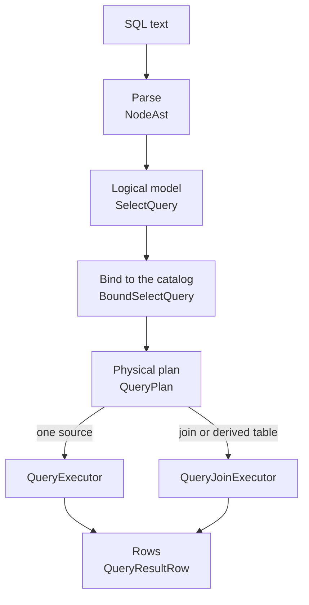
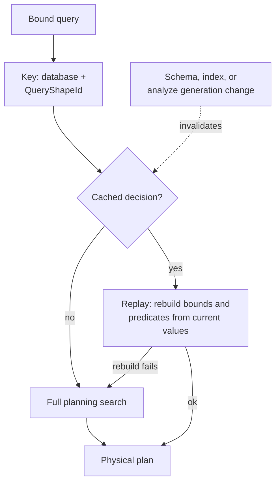

# Query planner internals

This page describes how CamusDB turns SQL text into a physical plan, then
executes that plan against the KV layer, the ordered key/value store that holds
every row and index entry.

Start with [Query Planning](/docs/query-planning) for SQL examples and tuning,
and [EXPLAIN](/docs/explain) for reading a plan. This page follows the same
concepts into the implementation: representations, rewrite safety, search,
costing, cache replay, and execution.

## The mental model

The CamusDB planner sits between the SQL layer and the ordered transactional KV
store. [Kahuna](/docs/concepts#kahuna), the key/value layer embedded in every
CamusDB node, provides that store.

The planner turns a declarative SQL query into a concrete execution plan by
answering these questions:

1. Which scan does the query use?
2. Which predicates can become bounds of that scan?
3. Can the plan skip a sort?
4. Which join algorithm suits the query?
5. Where do the aggregation, `HAVING`, projection, `DISTINCT`, and limit stages
   belong?

CamusDB has a rule-based planner and a stack of cost-based optimizers. The cost
model annotates every plan and always drives some decisions. While the matching
configuration flags are on, it also takes over the broader access-path and
join-order searches. Those cost-based flags are on by default.

The optimizer stack has these levels:

1. Table statistics, from live DML and from `ANALYZE`.
2. Cardinality estimates, from row counts, histograms, distinct-value counts,
   and minimum and maximum bounds.
3. A weighted cost model covering KV lookups, range entries, primary-row
   fetches, in-memory work, and network cost.
4. A plan search over access paths and join order, controlled by the cost-based
   flags, which are on by default.

## The pipeline

At a high level, every `SELECT` follows this pipeline:

1. CamusDB parses the SQL text into a `NodeAst`.
2. It builds a typed logical model of the query.
3. It binds names, sources, and aliases against the catalog.
4. It produces a physical plan tree.
5. It executes the plan, using either the single-table executor or the join
   path.



These are the important data structures:

| Stage | Main type | Purpose |
| --- | --- | --- |
| Parse | `NodeAst` | The raw syntax tree. |
| Logical model | `SelectQuery` | A structured form of the source, projections, filters, grouping, ordering, limit, offset, and distinct flag. |
| Bound model | `BoundSelectQuery` | The logical query, plus the resolved tables, aliases, and name resolution rules. |
| Physical plan | `QueryPlan` and `PhysicalPlanNode` | The chosen operator tree, plus a flat list of steps for the older single-table path. |
| Results | `QueryResultRow` | The output rows for the caller. |

## Logical plans and physical plans

A query's logical model records what the query asks for. The physical plan
records how CamusDB gets that result. For example:

- The logical form is "the rows of `robots` where `year = 2024`".
- The physical form is "a range scan of `year_idx`, from `2024` to the next
  key boundary".

CamusDB keeps expressions, both predicates and projection expressions, as AST
subtrees deep into execution. The structured models mostly describe the shape
of the query and the relations between its sources.

## Two execution paths

CamusDB has two execution paths today:

| Path | CamusDB uses it when | Main executor |
| --- | --- | --- |
| The linear single-table path | The query has exactly one source | `QueryExecutor` |
| The tree path for several sources | The query has a join or a derived table | `QueryJoinExecutor` |

The two paths must agree on every user-visible behavior. The multi-source path
walks a tree recursively, then uses the shared post-scan pipeline for
aggregation, sorting, projection, `DISTINCT`, and the limit.

## Parse and build

The parser accepts these forms:

- `SELECT [DISTINCT]`
- `WHERE`
- `GROUP BY`
- `HAVING`
- `ORDER BY`
- `LIMIT` and `OFFSET`
- `JOIN` and comma joins
- Derived tables
- Scalar subqueries, and `IN`, `NOT IN`, and `EXISTS` subqueries
- Value-list membership, with `IN (...)` and `NOT IN (...)`
- `EXPLAIN (LOGICAL|PHYSICAL|ANALYZE)`

`SelectQueryCreator` turns the parsed tree into a `SelectQuery` record with
these fields:

- `Source`
- `Projections`
- `Where`
- `GroupBy`
- `Having`
- `OrderBy`
- `Limit`
- `Offset`
- `IsDistinct`

## Binding

`QueryBinder` resolves source names, opens the table descriptors, detects alias
collisions, and builds the row-name resolver, which decides whether a column
reference is valid, ambiguous, or needs a qualifier.

The binder also validates:

- Projection references.
- Agreement between `GROUP BY` and the projections.
- `ORDER BY` references.
- Join `ON` predicates.

It also prepares `EXISTS` support through the subquery registry, which execution
then uses.

## Single-table planning

The single-table planner runs in broad phases.

### 1. Scan selection

The planner analyzes the predicate, then tries to pick one of these scans:

- A full table scan.
- A forced index scan.
- A point lookup on a unique index.
- A range scan on an index.
- An index scan over an `IN` list, when repeated probes beat a wider scan.

`PredicateAnalyzer` splits the predicates into comparisons an index can serve,
column-to-column comparisons, and residual conjuncts.

`IndexScanSelector` has two modes. The heuristic mode scores each usable index
with rules such as:

- A full equality on a unique index beats every other candidate.
- An equality on a non-unique index, or an equality-prefix match, is a strong
  candidate.
- An equality prefix plus a range on the next column can drive a composite
  range scan.
- An `ORDER BY` prefix match can win, even without a filtering predicate.
- An `IN (...)` list on an indexed column can compete with a range scan and with
  a full scan.

`cost_based_access_path_enabled` defaults to `true`, so the planner uses
cost-based selection of predicate-driven access paths when the table has a
positive row-count estimate and analyzed statistics. A DML-maintained count
alone does not enable this single-table enumeration pass. It compares viable
index candidates with a full-scan baseline and keeps the cheapest estimate.
Ordering and DISTINCT rules can further affect the final scan.

The scans that locate rows for `UPDATE` and `DELETE` keep the heuristic path,
which prevents exclusive lock ranges from growing unexpectedly.

### 2. Filter absorption

The planner chooses the scan bounds first, then removes from the runtime filter
every comparison those bounds already imply. What remains becomes the residual
filter at execution.

### 3. Sort elision

If the chosen scan already produces rows in the requested order, the planner
sets `OutputOrdering` and leaves out the explicit `SortNode`.

Index order has a direction. A scan over `(year ASC)` can satisfy
`ORDER BY year ASC`, and a scan over `(year DESC)` can satisfy
`ORDER BY year DESC`. A direction mismatch keeps the `SortNode`: CamusDB does
not invert a forward index scan into the opposite order.

### 4. DISTINCT strategy

For `SELECT DISTINCT`, the planner chooses between:

- A streaming `DistinctNode`, which requires that the projected columns are
  simple identifiers, all `NOT NULL`, and covered by the scan order.
- A hash `DistinctNode`, used when streaming mode is unsafe or impossible.

A streaming distinct can also satisfy a matching `ORDER BY`, so the plan needs
no separate `SortNode`.

### 5. Limit pushdown

When the query shape is simple enough, the planner pushes the row limit into the
scan so the KV read can stop early.

### 6. Building the operator chain

The planner builds a chain of operators from leaf to root. Typical patterns:

| Query shape | Operator chain |
| --- | --- |
| A plain select | `Scan -> [Filter] -> [Sort] -> [Aggregate] -> [Having] -> [Project] -> [Limit]` |
| A grouped query | `Scan -> [Filter] -> Aggregate -> [Having] -> [Sort] -> [Project] -> [Limit]` |
| A distinct query | `Scan -> [Filter] -> [Aggregate] -> [Having] -> [Project] -> Distinct -> [Sort] -> [Limit]` |

### Reading fewer columns

`ProjectionPushdownPlanner` and `RequiredColumnAnalyzer` determine which
columns execution still needs. The set includes columns used by predicates,
join keys, ordering, and aggregation, not just the final SELECT list. Scan-time
decoding can then avoid building values for unrelated columns.

This is distinct from index-only execution: partial decoding saves work on a
row that was fetched, while a covering index can avoid fetching that primary
row altogether. Both optimizations must retain columns needed by later stages,
even if those columns never appear in the result.

## Join planning

`JoinQueryPlanner` handles queries with several sources. Its work includes:

- Optionally changing the join order.
- Pushing down predicates that belong to one source.
- Separating post-join predicates from scan-local predicates.
- Building a `NestedLoopJoinNode`, `IndexNestedLoopJoinNode`, `HashJoinNode`,
  or `MergeJoinNode`.
- Building a `SemiJoinNode` variant for an eligible indexed `IN` or `NOT IN`
  subquery.
- Representing a derived table as a `DerivedTableScanNode`.

For an inner equi-join, the planner extracts the join key pairs even when no
index is available, so hash and merge joins become possible alongside indexed
nested-loop joins.

The main selection rules are:

- Use an `IndexNestedLoopJoinNode` when the right side's join key has a good
  index and the estimate makes repeated probes cheaper.
- Use a `MergeJoinNode` when CamusDB can read both sides in join-key order and
  the outer side is large enough.
- Use a `HashJoinNode` when building and probing is cheaper for an equi-join,
  or when the right side has no usable index on the join key.
- Use a `NestedLoopJoinNode` when the join fits none of those shapes.

An inner hash join builds a hash table from the side estimated to be smaller
and probes it with the other side. A left outer hash join always builds the
right side, leaving the preserved left input as the probe side. Unmatched
left rows receive NULL values for right-side columns.

A merge join streams two ordered inputs. It buffers only the current run of
equal keys, while both sides are ordered.

## The join predicate graph

Before choosing an order, the planner must understand which conditions connect
which sources. `JoinPredicatePushdown` separates single-source `WHERE` filters
from conditions that must run after combining sources. `JoinGraph` then builds
a graph from the remaining eligible conditions and the `ON` clauses.

The planner reads conditions joined by `AND` one at a time. Each such condition
is a **conjunct**. Eligible cross-table conditions from `WHERE` can connect
tables just like conditions from `ON`.

A graph leaf is a table or derived table identified by its bound alias. Each
leaf occupies one bit in a mask. A conjunct stores the mask of the sources it
references. For example, `a.id = b.a_id` names `{a,b}`, while
`a.x + b.x = c.x` names `{a,b,c}`. The latter can connect `c` to `{a,b}`, but
cannot connect `a` to `b` by itself: `c` is still needed to evaluate it.

The graph splits top-level `AND`s, not arbitrary Boolean expressions. An `OR`
expression remains one conjunct. Literal `TRUE` contributes no connection.
Thus, an `ON TRUE` introduced when normalizing a comma join is an initial
syntax representation, not a commitment to executing a cross product.

### Moving a condition to the earliest eligible join

For each proposed source order, `JoinGraph.BuildTree` attaches a movable
conjunct where its last referenced source enters the tree. A constant or a
condition referring only to the first source goes on the first join. Conditions
keep their pool order: original `ON` conjuncts first, then adopted `WHERE`
conjuncts. The builder checks that it attached every pooled conjunct once.

```camussql
SELECT a.id, b.id, c.id
FROM a
JOIN b ON a.x = b.x
JOIN c ON b.y = c.y AND a.z = b.z
WHERE c.kind = 'active' AND c.code = a.code;
```

For the order `a, b, c`, predicate placement is conceptually:

| Location | Conditions |
| --- | --- |
| Input `c` | `c.kind = 'active'`, when eligible for scan pushdown. |
| Join `a` with `b` | `a.x = b.x` and `a.z = b.z`. The second condition moved from the later `ON`. |
| Join the result with `c` | `b.y = c.y` and `c.code = a.code`. The second condition moved from `WHERE`. |

This example illustrates placement, not a promise that the optimizer chooses
that order. A different order attaches the same movable conditions at different
joins. `JoinOrderChoice` carries the rebuilt tree **together with** its remaining
post-join filter, so a condition taken from `WHERE` is not evaluated again there.

### Conditions that restrict movement

A cross-table `WHERE` conjunct enters the graph only if all of its column
references resolve, it contains no subquery, and
`FragmentFilterShippability.IsShippable` accepts it. This last check preserves
eligibility for [broadcast joins](/docs/distributed-queries): moving a condition
must not silently introduce a predicate that a peer cannot execute.

An unshippable `WHERE` conjunct stays after the joins. An unshippable `ON`
conjunct is pinned and contributes no connection of its own:

- A volatile condition, such as one involving `random()`, retains its original
  join scope. All sources in that scope must join before a source outside it
  enters. This preserves the combinations of rows on which the condition runs.
- Other unshippable conditions, including parameterized expressions, remain
  attached with their original `ON` clause's source requirements. They continue
  to block broadcast at that join instead of moving that restriction elsewhere.

If an `ON` contains a subquery or a column reference that cannot resolve to one
source, the graph declines the tree and the planner uses the whole-predicate
path. It also declines outer-join trees and trees with more than 64 leaves.
The cost-based search has a tighter limit of 12 leaves.

Predicate movement is not an evaluation-order guarantee. A deterministic cast
or division can execute before a later join removes a row, and therefore can
raise an error on that row. Single-table scan pushdown has the same implication.
Do not rely on the textual order of SQL conditions to guard an unsafe expression.

## Join-order search

There are two order-selection paths. Both preserve outer-join order after
normalization; `RIGHT JOIN` has already become a left join with swapped inputs.

### Heuristic order and cross-product repair

`JoinOrderOptimizer` assigns each leaf a simple score:

| Score | Filter opportunity |
| --- | --- |
| 0 | Equality on a unique index. |
| 1 | Another indexed predicate. |
| 2 | No pushable indexed predicate. |

It tries lower scores first, keeping declared order on ties, and rebuilds a
left-deep tree from whole `ON` predicates when feasible. A volatile `ON`
predicate prevents this heuristic reordering.

`Choose` then checks for an avoidable cross product. If the heuristic tree has
a join without a connecting conjunct, but the graph admits a connected order,
it rebuilds through `JoinGraph`. The repair tries sources in heuristic score
order and adds a remaining source only when it connects to the current set.
A tree without an avoidable cross product keeps the whole-predicate plan.
A query requiring a cross product retains the heuristic fallback.

This repair does not need statistics. It remains available with the cost-based
flag off, before row counts load, above the 12-source search limit, and when
the dynamic program finds no eligible full plan.

### Dynamic programming over subsets

`JoinEnumerator` performs a bottom-up dynamic program, in the style of System R.
It remembers the cheapest plan for each subset of sources, instead of repeatedly
searching every permutation from scratch. Its candidates are left-deep:
`((A join B) join C) join D`.

```text
best[{A}] = cost of scanning A as the first input

For increasing subset sizes:
    choose a source R in subset S
    L = S without R
    require a usable best[L]
    require R to connect to L
    require the subset to respect volatile-expression boundaries
    candidate = best[L] + cost of joining R to the result of L
    retain the candidate only if it is strictly cheaper
```

The search starts when `cost_based_join_order_enabled` is true, a statistics
manager is available, and every base table has a loaded row-count estimate.
It considers at most 12 leaves. It never enumerates a cross product. If no full
connected order is available, the heuristic handles the query.

Candidates for a subset are tried from the last declared source backward.
Strict cost comparison makes ties deterministic and preserves a feasible
declared order when it ties for the best cost. The winning order is rebuilt
through the graph, so order search and cache replay use the same attachment rule.

### Costing one join step

Let `L` be the estimated rows from the current left result, `R` the right rows
after its pushed filter, and `S` the cost of scanning the right table.
`CostEstimator.JoinStepCost` uses these relative work estimates:

| Candidate | Incremental cost | Eligibility |
| --- | --- | --- |
| Index nested loop | `2 × L` | A usable index on a right-side join key. |
| Hash join | `S + L + 0.1 × min(L, R)` | A usable equality key. |
| Nested loop | `max(1, L) × S` | Fallback without an equality key. |

An available index lookup wins unless hash is strictly cheaper. Eligibility is
checked with the same key analyzers as the physical builder. For a composite
condition such as `a.x = b.x AND a.y = b.y`, an index on `b.x` can provide the
probe while the full predicate still checks both comparisons.

The distinction between `R` and `S` matters. A pushed filter can reduce the
right table to ten output rows while still requiring a scan of a million rows.
For the scan-based right-input alternatives, `S` is the unfiltered table row
count. An index on that filter does not automatically reduce the right scan's
read cost. The first input can instead use an eligible filtered range or
`IN`-list index leaf; its initial scan cost reflects the builder's actual choice.

The `L` term makes hash-only join orders meaningfully different. Every later
join processes the intermediate result produced so far. Without charging for
that result, many orders would tie merely because they read the same base tables.

For an illustrative step with `L = 100`, `R = 10`, and `S = 100000`, indexed
probes cost `200`, while hash costs `100101`. Pricing the scan as only ten rows
would incorrectly make hash appear cheaper. These are model units, not timings.

`JoinEnumerator.EstimateSteps` passes each winning step's estimates to
`JoinQueryPlanner`. The builder uses them to compare indexed probes with hash,
choose the hash build side, and apply the merge-size threshold. The builder can
still prefer merge when both inputs have usable ordering and the left estimate
exceeds 100 rows. **Merge is not costed by the dynamic program**, so the final
operator is not always the operator priced during the search.

### One cardinality estimate per subset

A cached best plan for `{A,B,C}` needs a consistent row estimate regardless of
how those sources were joined. `EstimateSubsetRows` therefore derives its
estimate from the set of tables and predicates, rather than a particular tree:

```text
rows[subset] = product of filtered leaf row counts
             × selectivity factors for predicate groups in the subset
             × factors for classes of equal columns
```

For a simple equality between two keys, the selectivity is approximately
`1 / max(NDV_left, NDV_right)`. **NDV** means number of distinct values.
A recognized unique key uses its base table's row count as its distinct count;
a composite key can use composite NDV. If neither side has a count, the
fallback selectivity is `0.1`. Other edges, including non-equalities and
expressions, also use a fallback rather than a detailed distribution model.

With 1,000 orders and 100 customers joined through the unique customer key,
matching distinct counts of 100 predict `1000 × 100 / 100 = 1000` rows.
If a filter retains ten customers, the same assumptions predict 100 rows.
This assumes a distribution; it does not establish that each customer actually
has ten orders.

Equalities can also be redundant:

```text
a.key = b.key AND b.key = c.key AND a.key = c.key
```

The third condition adds no new restriction. Multiplying three independent
selectivities would underestimate the result. The estimator groups these
columns into an equivalence class and, over `k` participating tables, uses
`k - 1` factors. It omits the smallest distinct count from the denominators.
Two-column classes between the same table pair are grouped so composite-key
statistics can account for their correlation.

These classes improve estimates; they do not synthesize new join edges.
Writing only `a.key = b.key AND b.key = c.key` does not make `a` and `c`
directly connected for enumeration. Estimates remain doubles during the search;
conversion to bounded integer row counts happens where required.

## Plan cache

`PlanCache` is a per-process, thread-safe LRU cache. It defaults to disabled,
with a default capacity of 512 entries when enabled. The key combines database
identity with the literal-independent `QueryShapeId`.

The cache stores **decisions**, not an executable tree containing old values:

| Query kind | Cached decision | Work on a hit |
| --- | --- | --- |
| Single table | Index name and scan kind, or a primary-row scan. | Rebuild predicate bounds from current values, or restore an ordering/full-index scan after validating the index. |
| Join | Alias order and `JoinBuildMode`. | Rebuild the source tree and its predicates from the current bound query. |

There are three join build modes:

- `WholePredicate` replays the heuristic order through `ReorderByAliases`.
- `Conjunct` rebuilds the repaired order through `JoinGraph`.
- `CostBased` rebuilds through the graph and recomputes the step estimates for
  physical operator selection, while skipping the search for a new order.

Recording the mode is necessary even when the alias order did not change:
a condition may have moved to an earlier join within that same order. Replaying
only the aliases would lose that decision. Rebuilding from the current query
also ensures that literals in `ON` come from this execution.

Dependencies include table identity, schema version, index-set generation, and
analyze generation. A schema or index change, or publication of refreshed
histograms/NDV, invalidates the corresponding cached decision. DML row-count
changes alone are not an analyze-generation change. This is distinct from the
freshness rules of the [query result cache](/docs/query-result-cache).

A failed replay triggers a full replan. Internally, `ReplayFailures` counts
hits that could not be rebuilt; `Hits` alone is not evidence that enumeration
was skipped. Join replay validates the graph, the alias permutation, connectivity,
and the availability of estimates needed by the recorded mode.



Literal-independent reuse trades planning time for sensitivity to skew. A
cached index choice or join order can remain valid while being less efficient
for another value. New analyzed statistics invalidate the entry, but different
literals alone do not force a fresh search.

## Physical plan nodes

The common node types are:

| Node | Meaning |
| --- | --- |
| `TableScanNode` | A full table scan, or a forced index scan. |
| `IndexLookupNode` | A point lookup on a unique index. |
| `IndexRangeScanNode` | An index range, with or without bounds. |
| `IndexInListScanNode` | Multiple seeks for a literal IN list, with duplicate values removed. |
| `FilterNode` | A residual predicate. |
| `AggregateNode` | The aggregation and grouping stage. |
| `HavingFilterNode` | A filter after aggregation. |
| `SortNode` | A sort, with eligible spill support; a bounded variant renders as `topk` and retains offset + limit candidates. |
| `ProjectNode` | The projection and alias shaping. |
| `DistinctNode` | Duplicate removal. |
| `LimitNode` | The limit and offset stage. |
| `SemiJoinNode` | The rewrite of an indexed `IN` or `NOT IN` subquery. |
| `NestedLoopJoinNode` | A join without an indexed probe on the right side. |
| `IndexNestedLoopJoinNode` | A join with an indexed probe on the right side. |
| `HashJoinNode` | An inner or left outer equi-join using a hash table, with eligible spill support. |
| `MergeJoinNode` | An inner or left outer equi-join over ordered inputs. |
| `DerivedTableScanNode` | A scan of a derived table as a source. |

`QueryPlan` also carries a flat `Steps` view for the linear executor. The tree
and the linear list reference the same node instances.

## Execution

### Single-table path

`QueryExecutor` walks the flat list of steps, chaining
`IAsyncEnumerable<QueryResultRow>` operators.

A scan operator reads from `KvTableStore`, decodes each row with `RowEncoder`,
applies the inline filters, and respects scan row limits.

The other stages are:

- `QuerySorter`
- `QueryAggregator`
- `QueryFilterer`, for the `HAVING`
- `QueryProjector`
- `QueryDistincter`
- `QueryLimiter`

### Join path

`QueryJoinExecutor` walks the plan tree recursively:

- A table scan reads a source, with any filter the planner pushed down.
- A derived table materializes the inner query once.
- A nested loop join merges left and right rows, then evaluates the `ON`
  predicate.
- An indexed nested loop probes the right side's index once per outer row.
- A hash join materializes the build side into an in-memory hash table keyed by
  the equi-join columns, then streams the other side and probes the table. If
  the build side exceeds `HashJoinMaxBuildRows` while spill is enabled,
  `GraceHashJoinAsync` partitions both inputs into spill files by key hash and
  joins one pair of spill files at a time. While spill is disabled, that query
  falls back to nested-loop behavior.
- A merge join advances the ordered left input and the ordered right input
  together. `MergeJoinNode` records `LeftIsOrdered` and `RightIsOrdered`. When
  both are true, the executor streams both sides and buffers only the current
  run of equal keys on the right side. Otherwise it materializes the unordered
  side and sorts it first. The planner always sets `LeftIsOrdered`, because the
  left input either has index order already or carries a `SortNode`.

The merged result then passes through the shared post-scan pipeline.

## EXPLAIN internals

`PlanRenderer` is the single canonical renderer for planner diagnostics. It
supplies:

- Stable node names.
- Each node's detail string.
- A depth-first walk of the nodes, which the SQL `EXPLAIN` statement uses.
- Optional distributed-plan metadata, such as `OutputOrdering` and whether a
  node can be decomposed.

`ExplainExecutor` uses the planned tree and returns one row per plan node.

`EXPLAIN (ANALYZE)` also enables runtime statistics collection. It executes the
query and fills counters such as:

- `actual_rows`
- `rows_read`
- `kv_lookups`
- `kv_scan_entries`
- `actual_time_ms`, on the root node

Join plans use the same path. A join node records the work of its right side,
because the right side is named in the join detail rather than rendered as a
separate row. The detail can also add runtime facts such as `ran=grace-hash`,
`ran=nested-loop-fallback`, `ran=broadcast`, and the join-order estimate used by
the search.

### Rendering distributed plan properties

`PlanRenderer.Render(plan, includeDistributedProperties: true)` adds
distributed-plan metadata to each node's line:

```text
table-scan(table=robots) order=[year ASC] decomposable=true dist=partitioned(id)
```

| Suffix            | Meaning |
|-------------------|---------|
| `order=[...]`     | The order this node guarantees on its output, such as an index scan that satisfies an `ORDER BY`. Absent when the order is undefined. |
| `decomposable=true/false` | Whether CamusDB can split the node's work into a local computation per [partition](/docs/concepts#partition) plus a merge on the coordinator. Always `false` for sort and limit nodes. An `aggregate` is `true` only for `COUNT`, `SUM`, `MIN`, and `MAX`; `AVG` is `false`. |
| `dist=...`        | How the node's output rows are distributed across the cluster: `gathered` on one node, for a point lookup, and while [key-range sharding](/docs/concepts#hash-and-key-range-routing) is off; `partitioned(col1,col2)` for a scan sharded by ranges of those key columns; or `replicated`. Only scan leaves carry this suffix. |

Internal tools and tests use this mode. The SQL `EXPLAIN` statement does not
expose it.

## Statistics and cost

`StatisticsManager` keeps advisory table statistics in Kahuna:

- Each table's row count.
- Each index's entry count.
- Running minimum and maximum bounds for indexed columns.
- Equi-depth histograms, built by manual and automatic `ANALYZE`.
- Distinct-value counts for columns and composite index prefixes, built by
  manual and automatic `ANALYZE`.

`ANALYZE TABLE <name>` scans the table, or for a larger table samples the
configured number of rows, then rebuilds the histograms and distinct-value
counts in one pass.

The statistics DML maintains (the row count, index entry counts, and minimum and
maximum bounds) stay advisory. A missing statistic falls back to a default; it
does not make a query fail.

Automatic analyze uses the same publication path, but runs from a background
scheduler against a read-only snapshot that takes no locks. It detects stale
tables from the mutation count since the last analyze, bounds memory with a
reservoir sketch and a HyperLogLog sketch, throttles the scan rate, and
publishes the refreshed statistics atomically after confirming cluster
ownership.

`CostEstimator` annotates each plan node with an estimated cardinality and an
estimated cost, which `EXPLAIN` exposes. The planner uses them for:

- A broad choice between an index range and a full scan.
- Choosing between seeks for an indexed `IN (...)` and a wider scan.
- Choosing the join algorithm: indexed nested loop, hash join, or merge join.
- Cost-based access-path enumeration, while `cost_based_access_path_enabled` is
  on.
- Cost-based join-order enumeration, while `cost_based_join_order_enabled` is
  on.

The cost is a weighted sum of:

1. KV point lookups.
2. Range entries.
3. Row fetches after an index hit.
4. In-memory rows.
5. The `NetworkFactor`.

The `NetworkFactor` is computed from the estimated remote rows, the row width,
and the configured number of partitions in the cluster. It is zero for a
single-node plan and for a plan without shards.

### Skewed join keys {#skewed-join-keys}

A plain distinct-value estimate assumes every key is equally common. That can
badly underestimate a join when both tables hold many rows for the same popular
values, such as customers and stores concentrated in the same cities.

For a single-column equi-join that is unique on neither side, the estimator uses
both histograms when they are available. `JoinKeyDistribution` takes the heavy
values from the most common values that `ANALYZE` keeps with each histogram.
For a histogram built before that list existed, it falls back to the values
that fill a complete equi-depth bucket. It treats the other rows as a uniform
residual, then sums the matching frequencies. Without heavy values, or without
both histograms, estimation falls back to the distinct-value model.

`stats_top_values` limits the most-common-value list and defaults to `100`; `0`
disables the list. When a column has no more distinct values than the limit,
its value distribution is exact.

The estimate also excludes the measured fraction of `NULL` join keys. A `NULL`
key matches nothing and causes no index probe. Statistics built before this
fraction was recorded conservatively assume that every row has a key.

`ANALYZE` always covers the leading column of every index. It then covers other
eligible columns in declaration order, up to `stats_analyze_max_columns`. For a
skewed join, both tables need fresh statistics. Histograms cannot describe
every cross-column correlation, so compare the estimate with `actual_rows` from
`EXPLAIN (ANALYZE)` when tuning a difficult join.

### Plan-time lookup of a small dimension table {#plan-time-lookup}

Statistics can say how common each key is in a fact table, but they cannot
identify the key that a filter on another table selects. A filter such as
`types.name = 'release dates'` can select one dimension row whose key is
unusually common in the fact table.

`PlanTimeLeafLookup` reads that key instead of guessing. Before the join search
runs, it scans a qualifying dimension table through the query's own
transaction and snapshot, evaluating the leaf filter as the leaf scan would.
The search then prices a probe through each kept key at that key's own share of
the fact column, read from the column histogram, instead of at the average key.
Plain `EXPLAIN` performs the same lookup, so it shows the plan the query would
run. The rows read count toward the statement's rows read.

A leaf qualifies when all of these hold:

- Its table has a single-column unique key.
- Its row-count estimate is at most `stats_plan_time_lookup_max_rows`
  (default `2000`; `0` disables the lookup).
- Its filter has an equality or an `IN (...)` list on constants.

The lookup yields nothing for a leaf, and the search keeps its statistics,
when the scan meets more than twice the row cap (a stale row count hid a larger
table) or the filter keeps more than 64 rows.

### Estimate traces and distinct lookup keys

`EXPLAIN (ANALYZE)` exposes `estimate_trace`, a JSON explanation of each node's
row estimate. It records contributing rules, factors, and statistics, helping
you distinguish stale data statistics from an estimation assumption. Traces
are collected for analyzed plans; ordinary execution and plain `EXPLAIN` do
not collect them.

The join search estimates index-lookup probes from expected distinct keys in
the filtered left input, rather than treating every keyed row as a distinct
probe. With row count `N`, distinct count `d`, and `r` retained keyed rows, the
estimate is `d × (1 − (1 − r / N)^(N / d))`, bounded by `min(r, d)`. Without a
row count it uses that bound; without a distinct count it assumes each keyed
row probes. The formula assumes values are evenly spread, so skew can still
change the actual number of probes. When results exceed the memo's capacity,
the model charges probes per keyed row instead.

## Cost model boundaries

The cost model is implemented, but it is an approximation with separate uses.
`PlanCost.Total` weights KV point lookups, range entries, and primary-row
fetches at 1.0 each, in-memory rows at 0.1 each, then adds `NetworkFactor`.
These units compare alternatives; they are not milliseconds or measured I/O.

A non-covering secondary scan usually pays twice per match: once for its index
entry and once for the primary row. This explains the range-versus-table-scan
breakeven near half the table. Covering access-path candidates remove the
primary-row fetch charge. Selectivity, ordering requirements, and applicable
planner rules still determine the final choice.

`CostEstimator.AnnotatePlan` fills the fields shown by `EXPLAIN` after planning.
Those annotations are separate from the subset estimates used by join-order
search and need not match them. For a join over a join, annotation resolves a
left key's base table through its alias and uses its distinct count. It does
not assume that a key unique in the base table is still unique after an earlier
join has duplicated its rows.

The two search flags default to true. Turning them off selects the heuristic
paths; it does not remove cost annotations, all cost-informed operator choices,
or the heuristic's cross-product repair.

## Metadata and distributed execution

Physical nodes carry `OutputOrdering`, `EstimatedCardinality`, `Cost`,
`DataDistribution`, and `CanDecomposeToLocalPlusMerge`. These describe ordering,
estimated work, and whether computation can split into local work plus a merge.
They do not imply that every operator executes remotely.

With distributed execution enabled, eligible primary-row scans can become
fragments that run on the [leader](/docs/concepts#leader) of each key
[span](/docs/concepts#ranges-and-spans), with coordinator gathering and supported filter or
partial-aggregate pushdown. Eligible inner hash joins can broadcast a bounded
build side for remote probing. Outer joins do not use that broadcast path.
See [Distributed Queries](/docs/distributed-queries) for exact eligibility,
fallbacks, and configuration, and [Spill to Disk](/docs/spill-to-disk) for
execution-time memory limits.

## Current gaps

| Boundary | Practical consequence |
| --- | --- |
| Connected left-deep enumeration, at most 12 sources | Wider queries and queries requiring a cross product use the heuristic; there is no bushy or component-by-component search. |
| No interesting-order or distribution alternatives per subset | A more expensive intermediate plan that could avoid a later sort or exchange is not retained for that benefit. |
| Merge join is outside the DP cost comparison | The physical builder can choose a merge operator after order selection. |
| Simplified index-lookup cost | `2 × leftRows` assumes one match per probe; non-unique indexes can have much higher fan-out. |
| Incomplete selectivity modeling | Missing statistics, correlations, and expression predicates can make row estimates poor. |
| Outer join anywhere in the tree | The join-order DP is skipped for the whole tree. |
| Heuristic/repaired trees use the builder's own estimates | A joined input can still receive the fixed 10,000-row fallback instead of a subset estimate. |
| Separate EXPLAIN annotation | Displayed join cardinalities are not a trace of the DP's candidate costs. |
| LOGICAL renders the physical tree | It is not a separate view of rewrite stages. |
| Forward index ordering | An opposite requested direction cannot simply reverse an index scan. |

## Finding the implementation

In the engine repository, query controllers below are under
`CamusDB.Core/Commands/Executor/Controllers/Queries/` unless another path is given.
Read the implementation alongside its tests; comments describing older planner
stages may predate a newer behavior.

| Area | Starting points |
| --- | --- |
| Parse and logical query | `SQLParser/` and `Controllers/DML/SelectQueryCreator.cs`, under the core project and command executor respectively. |
| Bind and resolve | `QueryBinder.cs`, `Models/Queries/BoundSelectQuery.cs`. |
| Single-table scan selection | `QueryPlanner.cs`, `PredicateAnalyzer.cs`, `IndexScanSelector.cs`. |
| Predicate movement | `CommaJoinNormalizer.cs`, `JoinPredicatePushdown.cs`, `JoinGraph.cs`. |
| Join search | `JoinOrderOptimizer.cs`, `JoinEnumerator.cs`, `JoinOrderChoice.cs`. |
| Statistics and costing | `CardinalityEstimator.cs`, `CostEstimator.cs`, core `Statistics/`, and executor `Models/Plans/PlanCost.cs`. |
| Physical join selection | `JoinQueryPlanner.cs`, `JoinEquiJoinAnalyzer.cs`. |
| Cache decisions | `QueryShapeComputer.cs`, `PlanCache.cs`, replay methods in both planners. |
| Execution | `QueryJoinExecutor.cs`, `QueryScanner.cs`, `QueryPostScanPipeline.cs`, and parent `QueryExecutor.cs`. |
| Explain | `PlanRenderer.cs` and `ExplainExecutor.cs`. |
| Distributed planning | `BroadcastJoinPlanner.cs`, `FragmentFilterShippability.cs`, `PlacementReader.cs`. |

`CamusDB.Tests/CommandsExecutor/TestJoinOrderConjunctGraph.cs` covers condition
attachment, comma joins, cross-table WHERE predicates, redundant equalities,
volatile boundaries, cache replay, and agreement between costed and built
operators. `TestQueryPlanner.cs`, `TestJoinQueryPlanner.cs`, and
`TestLeftOuterJoinPlanner.cs` cover the surrounding planning contracts.
`CamusDB.Cluster.Tests/TestClusterBroadcastJoin.cs` exercises the distributed
join path. These are useful starting points for understanding a behavior before
changing the planner.

## Related pages

See [Query Planning](/docs/query-planning) for user-visible capabilities,
[EXPLAIN](/docs/explain) for inspecting a plan, and
[Architecture](/docs/architecture) for the wider system layout.
