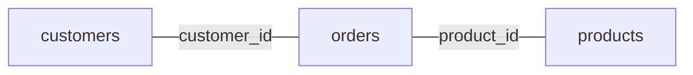

# Query planning

SQL states what you want. It does not state how CamusDB gets it. The planner
decides the method. It selects between a scan of a table and a probe of an
index. It selects between a sort in memory and a read in the order of an index.
It selects the algorithm of a join.

This page covers the abilities of the planner. It also covers your help toward a
good choice. For the internal pipeline, see
[Query Planner Internals](/docs/query-planner-internals). To see the choice for
one query, use [EXPLAIN](/docs/explain).

## Start with a small example

Suppose `orders` has a million rows and an index on `customer_id`:

```camussql
SELECT customer_id, total
FROM orders
WHERE customer_id = 42
ORDER BY total DESC
LIMIT 10;
```

The planner has several separate decisions to make. It can scan every order or
seek the customer index. After finding the customer's orders, it still needs
to order them by `total`: an index on `customer_id` alone does not provide that
order. Finally, it returns at most ten rows. A small result does not necessarily
mean a small amount of work; the engine may need to inspect many candidates
before it knows which ten to return.

Three terms help when reading a plan:

| Term | Meaning |
| --- | --- |
| Access path | How rows enter the query: a table scan, an index range, or a point lookup. |
| Cardinality | The number of rows an operator is expected to produce. |
| Selectivity | The fraction of input rows expected to pass a condition. A filter that keeps 100 of 10,000 rows has selectivity 0.01. |

The optimizer compares **estimated work**, not measured execution time. A lower
cost is a prediction. Statistics, data skew, and the limits of the model can
make another plan faster in practice.

## What the planner can do

CamusDB can plan these shapes today:

- A full scan of a table.
- A point lookup on a unique index, such as an equality on a primary key.
- A scan of a range on a non-unique index, for an equality, an inequality, and a
  `BETWEEN`.
- A scan of a covering secondary index. It can return the projected columns from
  the index, and it fetches no primary row.
- Repeated probes of an index, for an indexed `IN (...)` list of values.
- A residual filter above a scan, when an index covers only part of the
  predicate.
- The omission of a sort, when an index already produces the necessary order.
- A pushdown of a `LIMIT` and an `OFFSET`, when a scan can stop early and stay
  safe.
- An aggregate, both grouped and global.
- A streaming `DISTINCT`, on a compatible indexed projection of `NOT NULL`
  columns.
- An inner join, a left outer join, a right outer join, a cross join, and a join
  with a comma.
- A hash join for an equi-join. That includes an equi-join without a usable
  index on the right side. A left outer join can use a hash join when the right
  side is the build side, the input loaded into the in-memory hash table.
- A merge join, when CamusDB can read both sides in the order of the join key.
- An indexed nested-loop join, when an index covers the join key of the right
  side.
- A rewrite to a semi-join (keep each outer row that has a match) or an
  anti-join (keep each outer row that has no match), for an eligible indexed
  `IN` or `NOT IN` subquery.
- An indexed seek, for an eligible correlated `EXISTS` subquery.
- A derived table, a scalar subquery, an `IN`, a `NOT IN`, and an `EXISTS`.
- An explicit force of an index, with `@{FORCE_INDEX=...}`.
- An opt-in cache of a result, for an eligible repeated read of one table, with
  `{cache=...}`.

CamusDB has a cost-based optimizer with statistics, on top of the planner with
rules. `EXPLAIN` always exposes the estimates of the cost. Some choices use the
cost automatically. Two of those are a broad veto of a scan of a range, and the
selection of the algorithm of a join.

Two broad passes of a search are on by default:

- `cost_based_access_path_enabled` enumerates the viable access paths of each
  table, over an index and over the table. It then selects the cheapest one.
- `cost_based_join_order_enabled` enumerates the orders of a join. It then
  selects the cheapest connected plan. See
  [The order of a join by cost](#the-order-of-a-join-by-cost).

Both flags default to `true`. With the statistics available, one SQL statement
can change its choice in four ways. It can select a different index, a full
scan, a different algorithm of a join, or a different order of a join. The
optimizer found a plan of a lower estimated cost.

CamusDB keeps the matching heuristic choice when you turn either flag off.

## How CamusDB selects a scan

CamusDB tries to turn a predicate into an ordered read of the key/value
storage layer, at every opportunity.

### An equality on a unique index

An equality on a unique index becomes a point lookup:

```camussql
SELECT *
FROM robots
WHERE id = "507f1f77bcf86cd799439011";
```

That is the best shape of a lookup. A unique primary key, and a `UNIQUE` index,
let the planner fetch at most one row directly.

### An equality on a non-unique index

An equality on a non-unique index becomes a bounded scan of a range. It does not
become one lookup:

```camussql
SELECT *
FROM robots
WHERE year = 2024;
```

`year` can be non-unique. CamusDB then scans the range that holds every matching
entry for `2024`.

### A predicate of a range

A predicate of a range can also drive a scan of an index:

```camussql
SELECT *
FROM robots
WHERE year >= 2020 AND year < 2025;

SELECT *
FROM robots
WHERE year BETWEEN 2020 AND 2024;
```

### A list of values in an IN clause

CamusDB can plan an indexed `IN (...)` predicate as repeated probes of the
index:

```camussql
SELECT *
FROM robots
WHERE id IN ("id1", "id2", "id3");

SELECT *
FROM robots
WHERE year IN (2020, 2022, 2024);
```

That plan helps most when an index covers the target column, and when the list
of the values is small or of a moderate size.

### Type matching for index predicates

The planner compares index predicates using the type of the target column. A
numeric literal is normalized to the column type before CamusDB decides whether
an index can serve the predicate. Text literals are also converted for `OID` and
`UUID` columns when the literal is valid for that type.

This matters most for prepared or generated SQL, where the same comparison can
arrive with a literal shape that differs from the stored type. A query over an
`INT64` column can still use the `INT64` index when the literal was parsed from
SQL text, and an `OID` or `UUID` predicate can use its native index when the
literal is valid text for that value.

`NULL` remains a SQL value with three-valued logic. A range predicate whose bound
is `NULL` cannot drive a normal ordered seek, and the planner keeps the
remaining condition as a filter when that is what SQL semantics require.

### A residual filter

An index can cover part of a predicate only. CamusDB then scans with the index.
It applies the remaining filter after that:

```camussql
SELECT *
FROM robots
WHERE year >= 2020 AND name = "R2";
```

An index on `year` narrows the scan. `name = "R2"` stays a residual filter.

A predicate of a pattern is also a residual filter. That set covers `LIKE`,
`ILIKE`, and the operators `~`, `~*`, `!~`, and `!~*`. Such a predicate can
still combine with an indexable predicate on another column:

```camussql
SELECT *
FROM robots
WHERE year >= 2020 AND name ~* "^r";
```

A residual predicate still contributes to the cost estimate. After `ANALYZE`,
CamusDB estimates `LIKE`, `ILIKE`, and their negated forms from the histogram of
the column. A fixed prefix such as `name LIKE "Rob%"` is priced as a range. A
pattern with a wildcard at the beginning is estimated from the sampled
histogram bounds. An `OR` chain of patterns on the same column is considered
together, rather than charging the same fixed fraction for every pattern.

Regular-expression predicates remain residual predicates, but they use the
fallback selectivity rather than the histogram pattern estimate.

### A covering index

An index with an `INCLUDE (...)` can answer a query without a fetch of the
primary row. Every necessary column must be a key column, or an included
column:

```camussql
CREATE INDEX orders_customer_idx
ON orders (customer_id)
INCLUDE (status, total);

SELECT customer_id, status, total
FROM orders
WHERE customer_id = 42;
```

The key column `customer_id` drives the lookup. CamusDB stores the included
columns `status` and `total` in the entry of the index. It can return them
directly.

A query can project or filter on a column that is neither a key column nor an
included column. CamusDB can then still use the index. It must nevertheless
fetch the primary row. See [Indexes](/docs/sql-indexes#covering-indexes).

## The behavior of a composite index

A composite index helps most when the predicates of a query follow the order of
the columns of the index, from left to right.

Here is an index on `(kind, year)`:

```camussql
SELECT *
FROM robots
WHERE kind = "service" AND year >= 2020;
```

CamusDB can use the prefix of the equality on `kind`, and the range on `year`.

A query can skip the leftmost column of the index. The planner may then be
unable to use that composite index well:

```camussql
SELECT *
FROM robots
WHERE year >= 2020;
```

A unique composite index is a point lookup only when the predicate fixes all key
columns that are needed to guarantee one row. If trailing key columns can be
`NULL`, CamusDB does not treat an incomplete prefix as unique. The planner then
chooses a bounded scan or a different path instead of making a one-row promise
that nullable SQL values do not support.

## The statistics, and the cost-based optimizer

CamusDB keeps light advisory statistics from a live write. It keeps richer
statistics from an `ANALYZE`. The planner can use these values:

- The row count of a table.
- The count of the entries of each index.
- The bounds of the minimum and the maximum of each indexed column.
- The histogram of a column.
- The count of the distinct values, for a column and for a prefix of a composite
  index.
- The most common values and their observed frequencies.
- The fraction of each analyzed column that is `NULL`.

You can read all of them from a SQL prompt, with
[`SHOW STATISTICS FOR <table>`](/docs/show-statistics). That statement also
reports the time of the last analyze of the table, and the amount of the change
since then.

Run `ANALYZE` after a bulk load or a major change in the distribution of the
data, when you need fresh estimates of selectivity and join cardinality
immediately:

```camussql
ANALYZE TABLE robots;
```

CamusDB also runs an automatic analyze by default. It refreshes a stale
statistic of a table in the background. It counts the mutations of the
rows since the last analyze. It can rebuild the statistics after enough rows
change. See [Automatic Analyze](/docs/automatic-analyze) for the threshold of
the staleness, for the limits on the resources, and for the settings.

The cost model uses these estimates to fill `estimated_rows` and
`estimated_cost` in an `EXPLAIN`. It also feeds these decisions:

- The choice between a scan of a range and a full scan of a table.
- The choice between a plan of probes for an indexed `IN (...)` and a wider
  scan.
- The selection of the algorithm of a join, among an indexed nested loop, a hash
  join, and a merge join.
- The access-path and join-order searches, while their flags are on.

The optimizer degrades safely. An absent statistic and a stale statistic do not
make a query incorrect. CamusDB falls back to a default. It also falls back to
the planner with rules, when it cannot cost a plan reliably.

### An access path by cost

With `cost_based_access_path_enabled: true`, the single-table planner compares
viable predicate-driven index candidates against a full scan when the table has
a positive row-count estimate and analyzed statistics. A table that has never
been analyzed keeps the heuristic selection for this pass. The scans used to
locate rows for `UPDATE` and `DELETE` also keep the heuristic path, to avoid
widening exclusive lock ranges.

The flag also enables eligible filtered index leaves in join plans; that path
has its own selection rules. It does not mean every input of a join gets an
independently optimized index scan.

That behavior matters when more than one index could satisfy a predicate. A
planner with rules can prefer the longest prefix of an equality. The planner
with a cost can prefer a different index. It can even prefer a full scan, when
the statistics show a smaller amount of data in total.

### The order of a join by cost

For an eligible inner join, CamusDB searches connected **left-deep** orders:
join two sources, add a third to their result, then add a fourth. Each step
joins the result so far with one more table, never with another join. This
matters because an intermediate result becomes the input of the next join.
Reducing it early can save more work than reducing the final result late.

With `cost_based_join_order_enabled: true` and loaded row-count estimates for
all base tables, the search considers up to **12 sources**. It uses table
sizes, filter selectivity, distinct-value counts, and join algorithm costs.
Histograms and distinct counts from `ANALYZE` improve these estimates, but a
loaded row count is enough to enter this join-order search.

The search only joins tables that a condition connects. Conditions from `WHERE`
connect tables just like conditions from `ON`. Consider three tables:

```camussql
SELECT c.name, p.title
FROM customers c, products p, orders o
WHERE c.id = o.customer_id
  AND p.id = o.product_id;
```

There is no direct condition between `customers` and `products`. Joining them
first could produce every customer/product pair before checking `orders`.
CamusDB can instead join `customers` to `orders`, then add `products`:



The planner attaches each condition to the earliest join where all its tables
are available. An `ON` condition can therefore run earlier than its position in
the SQL text, and a `WHERE` condition can become part of a join. When the
cost-based search is off or unavailable, CamusDB still repairs an avoidable
cross product like this one, without statistics. If the query actually asks for
an unconnected Cartesian product, the planner keeps it.

Two refinements improve join estimates:

- **Skewed keys.** `ANALYZE` keeps the most common values of a column and their
  frequencies (`stats_top_values`, default `100`). CamusDB then does not assume
  that every join key is equally common. Run `ANALYZE` on both tables when a
  skewed join matters.
- **Filtered dimension tables.** For a small table with a single-column unique
  key and a constant equality or `IN (...)` filter, CamusDB can read the
  matching keys while it plans and price the join with those actual keys
  (`stats_plan_time_lookup_max_rows`, default `2000`; `0` disables it).

See the planner internals for
[join-order search](/docs/query-planner-internals#join-order-search),
[predicate movement](/docs/query-planner-internals#the-join-predicate-graph),
[skewed join keys](/docs/query-planner-internals#skewed-join-keys), and
[plan-time lookups](/docs/query-planner-internals#plan-time-lookup).

## The order of the rows, and the omission of a sort

An index can already yield the rows in the order that an `ORDER BY` needs.
CamusDB can then omit a separate sort in memory.

```camussql
SELECT *
FROM robots
ORDER BY year;
```

With a compatible index on `year`, CamusDB can scan directly in that order. The
direction of the index must match the direction of the query. An index on
`(year ASC)` can satisfy `ORDER BY year ASC`. An index on `(year DESC)` can
satisfy `ORDER BY year DESC`.

A composite index can also satisfy an order. The list of the `ORDER BY` must
match a prefix of the index, from left to right, and it must match the
direction. For example, `(kind ASC, year DESC)` can satisfy `ORDER BY kind ASC,
year DESC`.

Three cases usually need a real sort:

- An `ORDER BY` on a column without a compatible index.
- An order that does not match the prefix of the index.
- A difference of the direction, such as an `ORDER BY year ASC` when only
  `(year DESC)` is available.

### A bounded sort with LIMIT

When an eligible sort feeds a `LIMIT`, CamusDB can keep only the best
`OFFSET + LIMIT` candidates. `EXPLAIN` calls this operator `topk`. It reduces
the sort's memory requirement, but still examines the qualifying input to find
the best rows. It is different from stopping an already ordered scan early.

The bound must fit the implementation's limits. With spill enabled, a bound
above the effective spill threshold keeps the ordinary sort so it can spill.
A large offset increases the number of retained candidates even when the
requested page is small.

## The pushdown of a LIMIT

The shape of a query can be simple enough. CamusDB can then stop the scan below
it early. It does not read the whole input first.

```camussql
SELECT *
FROM robots
ORDER BY year
LIMIT 10;
```

That behavior works best under three conditions:

- The scan already satisfies the requested order.
- No extra filter must run after the scan.
- No group, no `HAVING`, and no `DISTINCT` prevents an early stop.

## A parallel scan, and a distributed scan

A full scan of a table can use more than one thread, on one node. Set
`max_query_parallelism` above `1`. The scan then streams one time, and the rows
decode in chunks on the thread pool:

```camussql
SET CLUSTER SETTING max_query_parallelism = 4;
```

The consumer takes the chunks in the order of their dispatch. A query therefore
returns the same rows, in the same order, as it returns with the default of `1`.

`SET CLUSTER SETTING` applies the value on every node, and it overrides
`config.yml`. It takes effect at the next query. Nodes can run different values
only through `config.yml`, while no cluster override exists. The setting buys
throughput of the decode on a wide row. It costs one buffer for each worker, and
more concurrent reads of the storage.

In a cluster, an eligible full scan can go further. It can run one fragment for
each [partition](/docs/concepts#partition), a slice of the table's data, on the
node that owns those rows. It then applies the filters and
the aggregates before anything crosses the network. That behavior is off by
default. See [Distributed Queries](/docs/distributed-queries).

## Joins

CamusDB supports `JOIN`, `INNER JOIN`, `LEFT JOIN`, `RIGHT JOIN`, `CROSS JOIN`,
and a join with a comma. The planner first normalizes the syntax:

- `JOIN` and `INNER JOIN` are the same inner join.
- `RIGHT JOIN` is executed as a left join with the operands swapped.
- `CROSS JOIN` has no `ON` predicate. It produces the Cartesian product. When
  the whole `FROM` clause is cross joins or comma joins, CamusDB can still lift
  an equality from the `WHERE` clause and plan it as a join predicate.

For an inner equi-join, and for an eligible left outer equi-join, the planner can
select among several physical algorithms:

| Plan of a join | When it is useful |
| --- | --- |
| `index-nested-loop-join` | The right side has an index on the join key. The left side is also small enough for a probe of the index at each row. For a left outer join, the left side is the preserved side and unmatched rows are padded after the failed probe. |
| `hash-join` | The join is an equality. A scan and a build of a hash table is cheaper than repeated probes of the right side. The right side can also have no usable index on the join key. For a left outer join, the build side must be the right side. |
| `merge-join` | CamusDB can read both sides in the order of the join key, usually through two compatible indexes. It can therefore stream both sides together. For a left outer join, unmatched left runs are padded. |
| `nested-loop-join` | The fallback, for a join that is eligible for none of the indexed, hash, and merge forms. |

```camussql
SELECT u.email, p.title
FROM app_users u
JOIN posts p ON p.user_id = u.id;
```

The right side can have an index on the join key. CamusDB can then use an
indexed nested-loop join. It does not scan the whole right side for each left
row. An index that suits the join therefore matters: here, an index on
`posts(user_id)` is far more useful than an unrelated index on `posts(title)`.

For a larger join of an equality, the planner may select a hash join or a merge
join instead. It does that when the estimates show a cheaper shape.

When more than one equality in an `ON` clause could drive an indexed nested
loop, CamusDB prefers a unique index over a non-unique index regardless of the
order of those equalities in the SQL. A unique probe can return at most one row;
a popular value in a non-unique index can return thousands.

An indexed nested-loop join collects a page of left rows and probes the distinct
keys of that page in batches. This applies to unique and non-unique indexes.
Repeated keys share the probe and are retained in a bounded memo for later left
rows. A non-unique key whose matches exceed one probe page is streamed
separately, page by page. Batching reduces calls to the storage layer without
changing left-row order or outer-join padding.

A hash join materializes one side into a hash table in memory. For an inner
join, the planner usually builds the side that the estimate calls smaller. It
then streams the other side, the probe side, and looks up each row in the hash
table. For a left outer join, the preserved side
must stay as the probe side, so the hash build side is always the right table.

In a cluster with [distributed queries](/docs/distributed-queries) enabled, an
inner hash join can broadcast a small build side to the
[leaders](/docs/concepts#leader) of the probe table's
[ranges](/docs/concepts#ranges-and-spans), the nodes that currently serve
those key ranges. That keeps the larger probe scan near the data while preserving
the same result as a local probe. A left outer join does not use that broadcast
shape, because a remote probe can return matches but cannot emit padded rows for
unmatched preserved rows.

The build side can exceed the configured limit of a hash join. CamusDB can then
use [spill to disk](/docs/spill-to-disk). It divides the join, and it keeps the
memory bounded. With the spill disabled, the execution of that query falls back
to the behavior of a nested loop.

A merge join needs join keys of an equality. CamusDB can produce both inputs in
the order of the join key. It then advances both streams together, and it
buffers only the current run of equal keys. That plan helps most in a larger
join, where both tables have a compatible index on the columns of the join.

Outer joins also affect predicate placement. A filter on the preserved side can
push down to that input. A filter on the null-extended side stays above the join,
because pushing it below the join would filter before padding and change the
meaning of the query.

## The rewrite of an IN and of a NOT IN subquery

For an eligible subquery without a correlation, CamusDB can perform two
rewrites:

- `x IN (SELECT key FROM t)` becomes a semi-join.
- `x NOT IN (SELECT key FROM t)` becomes an anti-join.

Both rewrites need a usable index on the inner side. They also need a simple
enough shape of the subquery. The rewrite avoids a scan of more data than
necessary. It also avoids the materialization of that data.

CamusDB falls back when the inner side does not suit a rewrite. It materializes
the result of the subquery. It then applies the outer predicate normally.

`NOT IN` keeps the null semantics of SQL. An inner value that accepts a `NULL`
can force a more conservative path, such as an anti-join that knows about a
null. It can also force a fallback strategy.

## The plan of a DISTINCT

`SELECT DISTINCT` has two shapes of an execution:

- A streaming distinct. It needs two conditions: every projected column of the
  distinct is `NOT NULL`, and the rows arrive in a compatible order of an index.
- A hash distinct. CamusDB tracks the rows it has seen, with eligible
  [spill to disk](/docs/spill-to-disk) when the in-memory working set grows.

A streaming distinct is the better path for a repeated read. It can use constant
memory. It can also avoid a separate node of a `sort`, when the `ORDER BY`
matches the order of the index.

A `SELECT DISTINCT *` falls back to a hash distinct. A `SELECT DISTINCT` over a
column without an index, and over a column that accepts a `NULL`, also falls
back.

## A derived table, and a subquery

CamusDB can plan four forms:

- A derived table in a `FROM` clause.
- A scalar subquery.
- An `IN` and a `NOT IN` subquery.
- An `EXISTS` subquery.

Here are two examples:

```camussql
SELECT u.email, d.post_count
FROM app_users u
JOIN (
  SELECT user_id, COUNT(*) AS post_count
  FROM posts
  GROUP BY user_id
) d ON d.user_id = u.id;

SELECT id
FROM robots
WHERE year = (SELECT MAX(year) FROM robots);
```

For a subquery without a correlation, CamusDB can evaluate the inner query one
time. It then plans the outer predicate around that result.

For a correlated `EXISTS`, CamusDB can avoid a full scan of the inner table. The
inner table needs an index whose leading key columns a predicate of an equality
fixes. The key of the seek can come from a column of the outer row, from a
literal, or from a parameter.

CamusDB still evaluates the full inner predicate on the rows that the seek
returns. The optimization therefore changes the amount of the work. It does not
change which rows match.

```camussql
CREATE INDEX posts_user_idx ON posts (user_id);

SELECT email
FROM app_users
WHERE EXISTS (
  SELECT *
  FROM posts
  WHERE posts.user_id = app_users.id
    AND posts.published = true
);
```

The executor falls back to the full inner scan when no suitable index exists.

Under a Serializable transaction, CamusDB protects the range of the indexed
seek. A concurrent insert into that range therefore cannot create a phantom that
the query misses.

## Force an index

You can force a specific index when you know that CamusDB must use it:

```camussql
SELECT id, name
FROM robots@{FORCE_INDEX=robots_year_idx}
WHERE year >= 1980;
```

Use that hint with care. It is a tool for debugging and for tuning. It does not
replace a good design of a schema. CamusDB honors the hint even when the forced
index makes the query slower.

## Reusing a plan

The optional plan cache saves optimization decisions for repeated query shapes.
It is off by default:

```yaml
plan_cache_enabled: false
plan_cache_max_entries: 512
```

A query shape describes the structure of the SQL without its literal values.
For example, two lookups with different `customer_id` values can share a scan
decision. The cache rebuilds bounds and predicates from the current query; it
does not reuse the first query's values or result rows. Schema changes, index
changes, and newly published `ANALYZE` statistics invalidate affected entries.

The tradeoff is planning time versus sensitivity to individual values. One
customer may have ten orders and another may have a million. Reusing a decision
can be correct for both while being less efficient for one. See
[plan cache internals](/docs/query-planner-internals#plan-cache) for what is
cached and how it is replayed, and [Configuration](/docs/configuration) for
settings.

## A hint for the result cache

For a repeated read of one table, a `SELECT` can opt into the result cache of
the node:

```camussql
SELECT id, total
FROM orders {cache=recent_orders, ttl=30s}
WHERE status = "paid";
```

The result cache stores a fully materialized result in memory, after a
successful read in autocommit mode.

It is separate from the plan cache. The plan cache reuses a decision of the
optimizer. The result cache skips a read of the storage, and it returns the
cached rows.

Four behaviors of the plan matter:

- Only a `SELECT` over one table, in autocommit mode, is eligible for the cache.
- A join bypasses the result cache, even with a hint present.
- An explicit transaction reads the live storage.
- `EXPLAIN` adds an informational row `cache` when a hint of the cache is
  present.

See [Query Result Cache](/docs/query-result-cache) for the syntax, for the
guarantees of the freshness, for the manual eviction, and for the settings.

## What helps the planner

Do these things for a consistently better plan:

- Index the columns of an equality, the columns of a range, and the keys of a
  join.
- Put the most selective column first in a composite index, when your queries
  follow that shape from left to right.
- Index both keys of a join for a large equi-join, when you want a merge join to
  be available.
- Add an index that matches a common prefix of an `ORDER BY`. Match the
  direction of `ASC` and `DESC` as well, when a sorted read matters.
- Add an `INCLUDE` column for a hot lookup that returns a small set of columns
  outside the key.
- Keep statistics fresh, as described in
  [The statistics, and the cost-based optimizer](#the-statistics-and-the-cost-based-optimizer).
- Leave both cost-based flags at their default of `true`.
- Add a `{cache=...}` only to a repeated read of one table, with many reads, and
  with a result small enough for the memory.
- Add an index on the correlated inner columns of an `EXISTS` predicate.
- Use a qualified name in a join. A predicate is then unambiguous.
- Use `EXPLAIN` to confirm the choice of CamusDB: a scan of a table, a lookup on
  an index, a scan of a range, a scan for a join, or an extra sort.

## The current limits

The planner improves over time. Important limits nevertheless remain:

- Statistics are estimates. Skewed values, correlated columns, and missing
  statistics can lead to a poor choice even with both cost-based passes enabled.
- `EXPLAIN (LOGICAL)` currently labels the same physical tree. It renders no
  separate view of a logical plan.
- An index provides the `ORDER BY` order only when the keys match its columns
  left to right, each in the direction the index declares. A column fixed by
  an equality filter can be skipped. There is no backward scan, so
  `ORDER BY a DESC` cannot use an ascending index on `a`. A `DESC` index column
  is allowed only for fixed-width types, not for `STRING`, `BYTES`, or arrays.
- Join-order search covers only the connected left-deep orders described in
  [The order of a join by cost](#the-order-of-a-join-by-cost). It does not
  search bushy plans, where both inputs of a join are themselves joins. It does
  not compare the later value of a row order that a more expensive
  intermediate plan supplies. A query with more sources than the search limit uses the heuristic order.
- A query that contains an outer join keeps its declared join order. CamusDB
  does not reorder an outer-join tree by cost.
- `FULL [OUTER] JOIN`, `NATURAL JOIN`, and `JOIN ... USING (...)` are not
  supported yet.
- A `RIGHT JOIN` whose left operand is itself a join is not supported. Rewrite it
  as a left join with the preserved table on the left, often through a derived
  table.
- A `NOT IN (...)` list of values stays driven by a filter. It uses no dedicated
  shape of a plan with probes of an index.
- CamusDB does not support `COUNT(DISTINCT ...)`.

Unsupported SQL forms are rejected. For supported queries, an optimization
fallback changes the execution strategy while preserving the query's semantics.

## A practical investigation workflow

1. Use plain `EXPLAIN` to identify the scan, join order, and any explicit sort.
   Treat example plans as illustrations: statistics and indexes affect the choice.
2. Inspect `SHOW STATISTICS FOR orders` for each important source, and run
   `ANALYZE TABLE orders` if the statistics are missing or stale.
3. Check the access requirements. Does the index start with the filtered
   columns? Does its direction match `ORDER BY`? Does it cover every required
   column, including those used only in filters?
4. Use `EXPLAIN (ANALYZE)` to compare estimated rows with actual rows and
   storage work. On a join, the join row reports the work for its right side,
   and may also show the join-order estimate that selected the order.
5. If repeated queries behave differently from a fresh plan, consider whether
   the optional plan cache is reusing a choice made for a different literal.
   Disabling it bypasses decision reuse. Change one optimizer setting at a time
   when comparing plans, and keep the data and statistics comparable.

## Inspect a plan

Use `EXPLAIN` to see the choice of the planner:

```camussql
EXPLAIN SELECT * FROM robots WHERE year = 2024;
EXPLAIN (ANALYZE) SELECT * FROM robots WHERE year = 2024 LIMIT 5;
```

See [EXPLAIN](/docs/explain) for the format of the output, and for some
examples. See [Query Planner Internals](/docs/query-planner-internals) for the
pipeline of the execution, and for the architecture of the planner.
