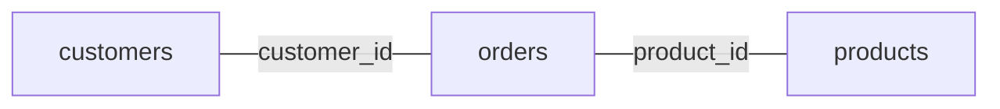

# Query planning

The query planner decides how CamusDB executes your SQL. For example, it
decides whether to scan a table or read an index, whether to sort in memory or
read in index order, and which join algorithm to use.

This page describes what the planner can do and how you can help it choose
well. For the internal pipeline, see
[Query planner internals](/docs/query-planner-internals). To see the choice for
one query, use [EXPLAIN](/docs/explain).

## Start with a small example

Suppose `orders` has a million rows and an index on `customer_id`:

```camussql
SELECT customer_id, total
FROM orders
WHERE customer_id = 17
ORDER BY total DESC
LIMIT 10;
```

The planner makes several decisions. It can scan all the orders, or it can read
the customer index. Then it must order the rows by `total`. An index on
`customer_id` doesn't give that order. Last, it returns at most ten rows. A
small result doesn't always mean little work. The engine can need to read many
rows before it knows which ten to return.

These terms help when you read a plan:

| Term | Meaning |
| --- | --- |
| Access path | How rows enter the query, for example a table scan or a point lookup. |
| Cardinality | The number of rows that an operator is expected to produce. |
| Selectivity | The fraction of input rows that is expected to pass a condition. A filter that passes 100 of 10,000 rows has selectivity 0.01. |

The optimizer compares **estimated work**. A lower cost is a prediction.
Statistics and data skew can make another plan faster in
practice.

## What the planner can do

The planner supports the following access paths:

- A full table scan.
- A point lookup on a unique index, such as an equality on a primary key.
- A range scan on a non-unique index, for equalities and ranges.
- A covering index scan, which returns the columns from the index, and doesn't
  fetch the row.
- Repeated index probes for an indexed `IN (...)` list.
- A filter on the rows of a scan, when an index covers part of the condition.

It also supports the following operations:

- No sort, when an index gives the required order.
- An early stop of a scan for `LIMIT` and `OFFSET`.
- Grouped and global aggregates.
- Streaming `DISTINCT` on an indexed projection of `NOT NULL` columns.
- Inner, outer, and cross joins.
- Hash joins for equi-joins, also when the right side doesn't have a usable
  index. A left join can use a hash join with the right side as the build side
  (the input that is loaded into the in-memory hash table).
- Merge joins, when both sides can be read in join-key order.
- Indexed nested-loop joins, when an index covers the join key of the right
  side.
- An indexed `IN` or `NOT IN` subquery rewritten as a semi-join (keep each outer
  row that has a match) or an anti-join (keep each outer row that doesn't have a
  match).
- An index seek for an eligible correlated `EXISTS` subquery.
- Derived tables and subqueries.
- A forced index, with `@{FORCE_INDEX=...}`.
- An opt-in result cache for repeated single-table reads, with `{cache=...}`.

The planner has rules, and a cost-based optimizer that uses statistics.
`EXPLAIN` always shows the cost estimates. Two cost-based searches are on by
default:

- `cost_based_access_path_enabled` compares the access paths of each table, over
  its indexes and over the table, and picks the cheapest.
- `cost_based_join_order_enabled` compares join orders, and picks the cheapest
  connected plan. See [Join order by cost](#the-order-of-a-join-by-cost).

This means that the plan of a statement can change when the statistics show a
cheaper plan. If you turn
off a flag, the planner uses its rule for that choice.

## How CamusDB chooses a scan

If it can, CamusDB turns a condition into an ordered read of the key/value
storage layer.

### Equality on a unique index

An equality on a unique index becomes a point lookup:

```camussql
SELECT *
FROM robots
WHERE id = '507f1f77bcf86cd799439011';
```

This is the best lookup. A unique primary key or a `UNIQUE` index lets the
planner fetch at most one row.

### Equality on a non-unique index

An equality on a non-unique index becomes a bounded range scan:

```camussql
SELECT *
FROM robots
WHERE year = 2024;
```

If `year` isn't unique, CamusDB scans the range of the entries for `2024`.

### Range predicates

A range can also drive an index scan:

```camussql
SELECT *
FROM robots
WHERE year >= 2020 AND year < 2025;

SELECT *
FROM robots
WHERE year BETWEEN 2020 AND 2024;
```

### IN lists

An indexed `IN (...)` condition can be planned as repeated index probes:

```camussql
SELECT *
FROM robots
WHERE year IN (2020, 2022, 2024);
```

This plan helps most when an index covers the column and the list is small or
moderate. A `NOT IN (...)` list is a filter, and it doesn't have an index-probe
plan.

### Type matching for index predicates

The planner compares an index condition with the type of the column. A numeric
literal is converted to the column type before the planner decides whether an
index can serve the condition. A text literal is also converted for an `OID` or
`UUID` column, if the text is a valid value. This means that generated SQL can
use the index when the literal has a different form from the stored type.

A range whose bound is `NULL` can't drive an ordered seek. The condition
is applied as a filter, as SQL semantics require.

### Residual filters

When an index covers part of a condition, CamusDB scans with the index, and it
applies the rest as a filter:

```camussql
SELECT *
FROM robots
WHERE year >= 2020 AND name = 'R2';
```

An index on `year` narrows the scan, and `name = 'R2'` is applied as a filter.

Pattern conditions, such as `LIKE` and `~`, are also filters. They can combine
with an indexable condition on another column:

```camussql
SELECT *
FROM robots
WHERE year >= 2020 AND name ~* '^r';
```

A filter counts in the cost estimate. After `ANALYZE`, `LIKE` and `ILIKE` are
estimated from the column histogram. A fixed prefix, such as
`name LIKE 'Rob%'`, is priced as a range. An `OR` chain of patterns on the same
column is estimated as one condition. Regular-expression conditions use a fixed
fallback selectivity.

### Covering indexes

An index with `INCLUDE (...)` can answer a query, and the row isn't fetched, if
each needed column is a key column or an included column:

```camussql
CREATE INDEX orders_customer_idx
ON orders (customer_id)
INCLUDE (status, total);

SELECT customer_id, status, total
FROM orders
WHERE customer_id = 17;
```

If a query uses a column that isn't in the index, CamusDB can use the
index, but it must fetch each row. See
[Indexes](/docs/sql-indexes#covering-indexes).

## Composite indexes

A composite index helps most when the conditions of the query follow the index
columns from left to right. Given an index on `(kind, year)`:

```camussql
SELECT *
FROM robots
WHERE kind = 'service' AND year >= 2020;
```

CamusDB can use the equality on `kind` and the range on `year`. The cost model
prices the equality columns with distinct-value counts, and the range from its
histogram. This means that an equality-plus-range candidate can be compared
with indexes that have the same equality prefix. When candidates have the same
cost, the planner prefers a covering index, then more bound key columns, then
the index name.

If a query doesn't use the leftmost column of a composite index, the planner can
be unable to use that index well:

```camussql
SELECT *
FROM robots
WHERE year >= 2020;
```

A unique composite index gives a point lookup if the condition fixes all its key
columns. If a trailing key column can be `NULL`, a prefix isn't treated
as unique.

## Statistics and the cost-based optimizer {#the-statistics-and-the-cost-based-optimizer}

CamusDB collects light statistics from live writes, and more complete statistics
from `ANALYZE`. The planner can use:

- The row count of each table, and the entry count of each index.
- The minimum and maximum of each indexed column.
- Column histograms.
- Distinct-value counts, for columns and for composite index prefixes.
- The most common values, and their frequencies.
- The fraction of `NULL` values in each analyzed column.

To read them, use [`SHOW STATISTICS FOR <table>`](/docs/show-statistics). It
also shows when the table was last analyzed, and how much has changed since.

After a bulk load or a large change in the data, run `ANALYZE` to get fresh
estimates at once:

```camussql
ANALYZE TABLE robots;
```

CamusDB also refreshes stale statistics in the background, by default. It
counts the row changes since the last analyze, and it rebuilds the statistics
when enough rows change. See [Automatic analyze](/docs/automatic-analyze).

The cost model fills `estimated_rows` and `estimated_cost` in `EXPLAIN`. The
estimates also decide whether to scan a range or the full table, and which join
algorithm to use. They also feed the two cost-based searches.

Missing or stale statistics don't make a query incorrect. The planner uses a
default estimate. If it can't cost a plan reliably, it uses its rules.

### Access path by cost

With `cost_based_access_path_enabled: true`, the planner compares the index
candidates of a table with a full scan, if the table has a positive row count
and analyzed statistics. A table without analyzed statistics uses the rules. The
scans that find rows for `UPDATE` and `DELETE` also use the rules. Their exclusive lock
ranges then stay narrow.

The flag also applies to some filtered index scans in join plans, with their own
selection rules.

This matters when more than one index can serve a condition. The rules can
prefer the longest equality prefix. The cost-based search can prefer a different
index, or a full scan, when the statistics show less data to read.

### Join order by cost {#the-order-of-a-join-by-cost}

For an eligible inner join, CamusDB searches connected **left-deep** orders. It
joins two sources, then adds a third to the result, then a fourth. Each step
joins the result with one more table. This matters because an intermediate
result is the input of the next join. A smaller result early can save more work
than a smaller result late.

With `cost_based_join_order_enabled: true` and row counts for all base tables,
the search considers up to **12 sources**. It uses the table sizes and the filter selectivity, with the costs of the join
algorithms.
Statistics from `ANALYZE` improve the estimates. However, a row count is enough
to use the search.

The search joins only tables that a condition connects. A condition in `WHERE`
connects tables as a condition in `ON` does. Consider three tables:

```camussql
SELECT c.name, p.title
FROM customers c, products p, orders o
WHERE c.id = o.customer_id
  AND p.id = o.product_id;
```

No condition connects `customers` and `products` directly. A join of the two
first could produce all the customer and product pairs. CamusDB can join
`customers` to `orders` first, and then add `products`:



The planner puts each condition on the earliest join where all its tables are
available. This means that an `ON` condition can execute earlier than its
position in the SQL, and a `WHERE` condition can become part of a join. If the cost-based search is off, CamusDB also avoids an unneeded cross product
like this one. A cross product that the query asks for is executed.

Two refinements improve join estimates:

- **Skewed keys.** `ANALYZE` records the most common values of a column and their
  frequencies (`stats_top_values`, default `100`). The planner then doesn't
  assume that all join keys are equally common. For a skewed join, analyze both
  tables.
- **Filtered dimension tables.** For a small table with a one-column unique key
  and a constant equality or `IN (...)` filter, CamusDB can read the matching
  keys during planning, and price the join with them
  (`stats_plan_time_lookup_max_rows`, default `2000`; `0` turns it off).

For the details, see the planner internals:

- [Join-order search](/docs/query-planner-internals#join-order-search)
- [Predicate movement](/docs/query-planner-internals#the-join-predicate-graph)
- [Skewed join keys](/docs/query-planner-internals#skewed-join-keys)
- [Plan-time lookups](/docs/query-planner-internals#plan-time-lookup)

## Row order and skipping the sort

When an index gives rows in the order that an `ORDER BY` needs, CamusDB doesn't
need a separate sort:

```camussql
SELECT *
FROM robots
ORDER BY year;
```

With an index on `year`, CamusDB scans in that order. The direction of the index
must match the query: `(year ASC)` serves `ORDER BY year ASC`, and `(year DESC)`
serves `ORDER BY year DESC`. CamusDB doesn't scan an index backward.

A composite index can also give an order, if the `ORDER BY` list matches a
prefix of the index, left to right, in the same directions. A column that an
equality filter fixes can be skipped. For example, `(kind ASC, year DESC)`
serves `ORDER BY kind ASC, year DESC`.

The query needs a sort when no index has the order, when the order doesn't match
an index prefix, or when the direction is different.

### A bounded sort with LIMIT

When a sort feeds a `LIMIT`, CamusDB can keep only the best `OFFSET + LIMIT`
rows. `EXPLAIN` calls this operator `topk`. It uses less memory than a full
sort, but it reads all the qualifying input to find the best rows. This is
different from an early stop of an ordered scan.

The bound must fit the limits of the operator. With spill on, a bound above the
spill threshold uses the ordinary sort, which can spill. A large offset
increases the number of kept rows, also when the page is small.

## LIMIT pushdown

When a query is simple, CamusDB can stop the scan early:

```camussql
SELECT *
FROM robots
ORDER BY year
LIMIT 10;
```

This works best when the scan already gives the requested order, and no filter
executes after the scan. Grouping and `DISTINCT` also prevent an early stop.

## Parallel and distributed scans

A full table scan can use more than one thread on a node, when you set
`max_query_parallelism` above `1`. The scan reads the storage once, and the rows
are decoded in chunks on the thread pool:

```camussql
SET CLUSTER SETTING max_query_parallelism = 4;
```

The chunks are used in the order they were sent. This means that a query
returns the same rows, in the same order, as with the default of `1`. The
setting has node scope, and `SET CLUSTER SETTING` applies it to all nodes. It
improves decode throughput on wide rows, at the cost of one buffer for each
worker and more concurrent storage reads.

In a cluster, an eligible full scan can execute one fragment for each
[partition](/docs/concepts#partition), on the node that has those rows. Filters
and aggregates are applied before rows cross the network. This is off by
default. See [Distributed queries](/docs/distributed-queries).

## Joins

The planner normalizes the join syntax:

- `JOIN` and `INNER JOIN` are the same inner join.
- `RIGHT JOIN` executes as a left join with the operands swapped.
- `CROSS JOIN` doesn't have an `ON` condition, and it produces the Cartesian
  product. When the `FROM` clause has only cross or comma joins, an equality in
  `WHERE` can become a join condition.

For inner equi-joins and eligible left equi-joins, the planner chooses one of
these algorithms:

| Join plan | When it is useful |
| --- | --- |
| `index-nested-loop-join` | The right side has an index on the join key, and the left side is small enough to read the index once for each row. In a left join, unmatched left rows are padded after the probe. |
| `hash-join` | The join is an equality, and a hash table is cheaper than repeated probes, or the right side doesn't have a usable index. In a left join, the right side is the build side. |
| `merge-join` | Both sides can be read in join-key order, usually through two indexes. In a left join, unmatched left rows are padded. |
| `nested-loop-join` | The fallback for a join that can't use the other forms. |

```camussql
SELECT u.email, p.title
FROM app_users u
JOIN posts p ON p.user_id = u.id;
```

If the right side has an index on the join key, CamusDB can use an indexed
nested-loop join, and it doesn't scan the right side for each left row. This is
why an index on `posts(user_id)` helps this query, and an index on
`posts(title)` doesn't. For a larger join, the planner can choose a hash join or
a merge join, when the estimates show a cheaper plan.

When more than one equality in an `ON` clause can drive an indexed nested loop,
CamusDB prefers a unique index, in any order in the SQL. A unique probe returns
at most one row. A common value in a non-unique index can return thousands.

An indexed nested-loop join reads a page of left rows, and it probes the
distinct keys of the page in batches. Repeated keys share a probe, and a limited memo stores them for later left
rows. A key with more matches than one
page is read page by page. Batching reduces storage calls, and it doesn't change
the row order or the outer-join padding.

A hash join loads one side into an in-memory hash table. For an inner join, the
planner usually builds the smaller side, and it reads the other side (the probe
side) against the table. For a left join, the preserved side must be the probe
side. This means that the build side is the right table.

In a cluster with [distributed queries](/docs/distributed-queries), an inner
hash join can send a small build side to the
[leaders](/docs/concepts#leader) of the
[ranges](/docs/concepts#ranges-and-spans) of the probe table. The larger probe scan then executes near the data. A left join doesn't use this
form. A remote probe can't pad unmatched rows.

If the build side is larger than the hash join limit, CamusDB can
[spill to disk](/docs/spill-to-disk). With spill off, the join executes as a
nested loop.

A merge join needs equality keys that both inputs can give in key order. It reads both streams together, and only the current run of equal keys is in
memory. It helps most in larger joins where both tables have an index on the
join columns.

Outer joins also affect where filters go. A filter on the preserved side can
move down to that input. A filter on the padded side remains above the join.
Below the join, it would filter before the padding and change the result.

## IN and NOT IN subquery rewrites

For an eligible uncorrelated subquery, CamusDB can rewrite
`x IN (SELECT key FROM t)` as a semi-join, and `x NOT IN (SELECT key FROM t)` as
an anti-join. Both rewrites need a usable index on the inner side and a simple
subquery. `EXPLAIN` shows `semi-join` or `anti-join`, with the index.

If the inner side doesn't suit a rewrite, CamusDB materializes the subquery
result, and it applies the outer condition normally. `NOT IN` follows the SQL rules for `NULL`. A nullable inner value can need a more conservative plan, such
as a null-aware anti-join.

## DISTINCT plans

`SELECT DISTINCT` executes in one of two ways:

- Streaming distinct, when all the projected columns are `NOT NULL` and the rows
  come in a compatible index order.
- Hash distinct, which stores the rows that it has seen, and can
  [spill to disk](/docs/spill-to-disk) when the working set grows.

Streaming distinct uses constant memory. It can also avoid a separate sort when
the `ORDER BY` matches the index order. `SELECT DISTINCT *` uses hash distinct,
and so does `SELECT DISTINCT` on a column that isn't indexed or can be `NULL`.

## Correlated subqueries

A correlated subquery is prepared once for the outer query, and evaluated with
the values of each outer row. A simple indexed `EXISTS` can use a seek. More
complex bodies use the full query pipeline, also with joins and aggregation.

In one statement, a limited cache can reuse a subquery result when the same
outer values repeat. It isn't shared across executions. Volatile bodies, some
references through enclosing query levels, and the indexed `EXISTS` seek don't
use this cache. You should index the inner conditions, and check the plan. See
[supported forms](/docs/joins-and-subqueries#subqueries-in-where).

## Derived tables and subqueries

CamusDB can plan derived tables in `FROM`, and subqueries of all supported
kinds:

```camussql
SELECT u.email, d.post_count
FROM app_users u
JOIN (
  SELECT user_id, COUNT(*) AS post_count
  FROM posts
  GROUP BY user_id
) d ON d.user_id = u.id;

SELECT id
FROM robots
WHERE year = (SELECT MAX(year) FROM robots);
```

An uncorrelated subquery can be evaluated once, and the outer condition is
planned around its result.

For a correlated `EXISTS`, CamusDB can avoid a full scan of the inner table, if
an index has leading key columns that equality conditions fix. The seek key can come from an outer column or a parameter. The full inner
condition is evaluated on the rows that the seek returns. This means that the seek
changes the amount of work, and it doesn't change the result:

```camussql
CREATE INDEX posts_user_idx ON posts (user_id);

SELECT email
FROM app_users
WHERE EXISTS (
  SELECT *
  FROM posts
  WHERE posts.user_id = app_users.id
    AND posts.published = true
);
```

If no suitable index exists, the inner table is scanned. In a Serializable
transaction, CamusDB protects the range of the seek. This means that a
concurrent insert into that range can't create a phantom that the query misses.

## Force an index

To force an index, add a hint to the table:

```camussql
SELECT id, name
FROM robots@{FORCE_INDEX=robots_year_idx}
WHERE year >= 1980;
```

If the index can bound the condition, CamusDB uses that bounded scan, and costs
aren't compared. If it can't, the automatic access-path selection applies, and a full scan of the named index is the fallback. A name that isn't
an index of the table returns `CADB0405`.

Use the hint for debugging and tuning, and check the access path with
`EXPLAIN`. A hinted statement and an unhinted statement have different
plan-cache shapes.

## Reusing a plan

The optional plan cache saves optimizer decisions for repeated query shapes. It
is off by default:

```yaml
plan_cache_enabled: false
plan_cache_max_entries: 512
```

A query shape is the structure of the SQL, with the literal values removed. For
example, two lookups with different `customer_id` values can share a scan
decision. The cache rebuilds the bounds and conditions from the current query,
and it doesn't reuse the values or rows of the first query. Schema changes and new `ANALYZE` statistics invalidate the affected entries.

The tradeoff is planning time against the effect of individual values. One
customer can have ten orders, and another can have a million. One decision can
be correct for both, but less efficient for one. See
[plan cache internals](/docs/query-planner-internals#plan-cache).

## Result cache hint

A repeated single-table `SELECT` can opt into the result cache of the node:

```camussql
SELECT id, total
FROM orders {cache=recent_orders, ttl=30s}
WHERE status = 'paid';
```

The result cache stores the full result in memory after a successful
autocommit read. The plan cache reuses an optimizer decision. The result cache
returns the stored rows, and it doesn't read storage.

- Only a single-table `SELECT` in autocommit mode can use the cache. A join
  doesn't use it, also with a hint.
- An explicit transaction reads storage.
- With a hint, `EXPLAIN` adds a `cache` row.

See [Query result cache](/docs/query-result-cache).

## Help the planner choose well

- Index the columns of equality and range conditions, and the join keys.
- In a composite index, put first the column that your queries filter on most
  selectively, if the queries follow that order.
- For a merge join on a large equi-join, index both join keys.
- When a sorted read matters, add an index that matches the `ORDER BY` prefix and
  its directions.
- For a frequent lookup that returns a few other columns, add `INCLUDE` columns.
- Keep statistics fresh. See
  [Statistics and the cost-based optimizer](#the-statistics-and-the-cost-based-optimizer).
- Leave both cost-based flags on.
- Add `{cache=...}` only to a frequent single-table read with a small result.
- Index the correlated inner columns of an `EXISTS` condition.
- Use qualified names in joins. Then the conditions are unambiguous.
- Use `EXPLAIN` to confirm what CamusDB chose.

## Current limits

- Skewed values or missing statistics can lead to a poor choice, also with both
  cost-based searches on.
- `EXPLAIN (LOGICAL)` labels the same physical tree. It doesn't show a separate
  logical plan.
- Join-order search covers the connected left-deep orders. It doesn't search
  bushy plans, where both inputs of a join are joins. It doesn't consider the
  later value of a row order. A query with more than 12 sources uses the rule
  order.
- A query with an outer join uses its declared join order.
- The `FULL OUTER JOIN`, `NATURAL JOIN`, and `JOIN ... USING` forms return a
  syntax error.
- A `RIGHT JOIN` whose left operand is a join returns `CADB0533`. Write it as a
  left join with the preserved table on the left.
- `COUNT(DISTINCT ...)` isn't supported.

Unsupported SQL forms return an error. For supported queries, a fallback changes
the execution strategy, and it doesn't change the result.

## Investigate a slow plan

1. Use `EXPLAIN` to see the scans and the join order. Plans depend on
   statistics and indexes. Treat example plans as illustrations.
2. Check `SHOW STATISTICS FOR orders` for each important table. If the
   statistics are missing or stale, run `ANALYZE TABLE orders`.
3. Check the index requirements. Does the index start with the filtered columns?
   Does its direction match `ORDER BY`? Does it have all the required columns,
   also the columns used only in filters?
4. Use `EXPLAIN (ANALYZE)` to compare the estimated and actual rows, and the
   storage work. On a join, the join row shows the work of its right side, and
   it can show the estimate that selected the join order.
5. If repeated queries behave differently from a new plan, the plan cache can
   reuse a choice made for a different value. Turn it off to compare. Change
   one optimizer setting at a time, and keep the data and statistics
   comparable.

## Related pages

- [EXPLAIN](/docs/explain) for the output format and examples.
- [Query planner internals](/docs/query-planner-internals) for the pipeline and
  the architecture of the planner.
