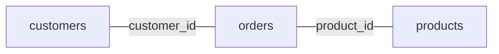

# Query planning

SQL says what you want, not how CamusDB should get it. The planner decides the
how: whether to scan a table or probe an index, whether to sort in memory or
read in index order, and which join algorithm to use.

This page covers what the planner can do and how you can help it choose well.
For the internal pipeline, see
[Query Planner Internals](/docs/query-planner-internals). To see the choice for
one query, use [EXPLAIN](/docs/explain).

## Start with a small example

Suppose `orders` has a million rows and an index on `customer_id`:

```camussql
SELECT customer_id, total
FROM orders
WHERE customer_id = 42
ORDER BY total DESC
LIMIT 10;
```

The planner has several separate decisions to make. It can scan every order or
seek the customer index. After finding the customer's orders, it still needs
to order them by `total`: an index on `customer_id` alone does not provide that
order. Finally, it returns at most ten rows. A small result does not necessarily
mean a small amount of work; the engine may need to inspect many candidates
before it knows which ten to return.

These terms help when reading a plan:

| Term | Meaning |
| --- | --- |
| Access path | How rows enter the query: a table scan, an index range, or a point lookup. |
| Cardinality | The number of rows an operator is expected to produce. |
| Selectivity | The fraction of input rows expected to pass a condition. A filter that keeps 100 of 10,000 rows has selectivity 0.01. |

The optimizer compares **estimated work**, not measured execution time. A lower
cost is a prediction: statistics, data skew, and the limits of the model can
make another plan faster in practice.

## What the planner can do

CamusDB can plan these shapes today:

- A full table scan.
- A point lookup on a unique index, such as an equality on a primary key.
- A range scan on a non-unique index, for equalities, inequalities, and
  `BETWEEN`.
- A covering secondary index scan, which returns the projected columns from the
  index without fetching the primary row.
- Repeated index probes for an indexed `IN (...)` list of values.
- A residual filter above a scan, when an index covers only part of the
  predicate.
- Skipping the sort when an index already produces the needed order.
- `LIMIT` and `OFFSET` pushdown, when a scan can safely stop early.
- Grouped and global aggregates.
- Streaming `DISTINCT` on a compatible indexed projection of `NOT NULL`
  columns.
- Inner, left outer, right outer, cross, and comma joins.
- Hash joins for equi-joins, including equi-joins with no usable index on the
  right side. A left outer join can use a hash join when the right side is the
  build side, the input loaded into the in-memory hash table.
- Merge joins, when CamusDB can read both sides in join-key order.
- Indexed nested-loop joins, when an index covers the right side's join key.
- Rewriting an eligible indexed `IN` or `NOT IN` subquery into a semi-join (keep
  each outer row that has a match) or an anti-join (keep each outer row that has
  no match).
- An indexed seek for an eligible correlated `EXISTS` subquery.
- Derived tables, scalar subqueries, and `IN`, `NOT IN`, and `EXISTS`
  subqueries.
- Forcing an index with `@{FORCE_INDEX=...}`.
- An opt-in result cache for eligible repeated single-table reads, with
  `{cache=...}`.

On top of its rule-based planner, CamusDB has a cost-based optimizer that uses
statistics. `EXPLAIN` always shows the cost estimates, and some choices use cost
automatically, such as a broad veto of a range scan and the choice of join
algorithm.

Two broader searches are on by default:

- `cost_based_access_path_enabled` enumerates each table's viable access paths,
  over its indexes and over the table itself, and picks the cheapest one.
- `cost_based_join_order_enabled` enumerates join orders and picks the cheapest
  connected plan. See [Join order by cost](#the-order-of-a-join-by-cost).

Both flags default to `true`. With statistics available, the same SQL statement
can switch to a different index, a full scan, a different join algorithm, or a
different join order when the optimizer finds a plan with a lower estimated
cost.

If you turn either flag off, CamusDB keeps the matching heuristic choice.

## How CamusDB chooses a scan

Whenever it can, CamusDB turns a predicate into an ordered read of the key/value
storage layer.

### Equality on a unique index

An equality on a unique index becomes a point lookup:

```camussql
SELECT *
FROM robots
WHERE id = '507f1f77bcf86cd799439011';
```

This is the best lookup shape. A unique primary key or a `UNIQUE` index lets the
planner fetch at most one row directly.

### Equality on a non-unique index

An equality on a non-unique index becomes a bounded range scan, not a single
lookup:

```camussql
SELECT *
FROM robots
WHERE year = 2024;
```

If `year` is non-unique, CamusDB scans the range that holds every matching
entry for `2024`.

### Range predicates

A range predicate can also drive an index scan:

```camussql
SELECT *
FROM robots
WHERE year >= 2020 AND year < 2025;

SELECT *
FROM robots
WHERE year BETWEEN 2020 AND 2024;
```

### IN lists

CamusDB can plan an indexed `IN (...)` predicate as repeated index probes:

```camussql
SELECT *
FROM robots
WHERE id IN ('id1', 'id2', 'id3');

SELECT *
FROM robots
WHERE year IN (2020, 2022, 2024);
```

This plan helps most when an index covers the target column and the list is
small or moderate in size.

### Type matching for index predicates

The planner compares index predicates using the type of the target column. A
numeric literal is normalized to the column type before CamusDB decides whether
an index can serve the predicate. Text literals are also converted for `OID` and
`UUID` columns when the literal is valid for that type.

This matters most for prepared or generated SQL, where the same comparison can
arrive with a literal shape that differs from the stored type. A query over an
`INT64` column can still use the `INT64` index when the literal was parsed from
SQL text, and an `OID` or `UUID` predicate can use its native index when the
literal is valid text for that value.

`NULL` remains a SQL value with three-valued logic. A range predicate whose bound
is `NULL` cannot drive a normal ordered seek, and the planner keeps the
remaining condition as a filter when that is what SQL semantics require.

### Residual filters

When an index covers only part of a predicate, CamusDB scans with the index and
applies the rest as a filter afterward:

```camussql
SELECT *
FROM robots
WHERE year >= 2020 AND name = 'R2';
```

An index on `year` narrows the scan, and `name = 'R2'` stays a residual filter.

Pattern predicates are also residual filters: `LIKE`, `ILIKE`, and the `~`,
`~*`, `!~`, and `!~*` operators. They can still combine with an indexable
predicate on another column:

```camussql
SELECT *
FROM robots
WHERE year >= 2020 AND name ~* '^r';
```

A residual predicate still counts toward the cost estimate. After `ANALYZE`,
CamusDB estimates `LIKE`, `ILIKE`, and their negated forms from the column's
histogram. A fixed prefix such as `name LIKE 'Rob%'` is priced as a range. A
pattern that starts with a wildcard is estimated from the sampled histogram
bounds. An `OR` chain of patterns on the same column is estimated as a whole,
instead of charging the same fixed fraction for every pattern.

Regular-expression predicates remain residual predicates, but they use the
fallback selectivity rather than the histogram pattern estimate.

### Covering indexes

An index with `INCLUDE (...)` can answer a query without fetching the primary
row, as long as every needed column is a key column or an included column:

```camussql
CREATE INDEX orders_customer_idx
ON orders (customer_id)
INCLUDE (status, total);

SELECT customer_id, status, total
FROM orders
WHERE customer_id = 42;
```

The key column `customer_id` drives the lookup. CamusDB stores the included
columns `status` and `total` in the index entry, so it can return them directly.

If a query projects or filters on a column that is neither a key column nor an
included column, CamusDB can still use the index, but it must fetch the primary
row. See [Indexes](/docs/sql-indexes#covering-indexes).

## Composite indexes

A composite index helps most when the query's predicates follow the index
columns from left to right.

Given an index on `(kind, year)`:

```camussql
SELECT *
FROM robots
WHERE kind = 'service' AND year >= 2020;
```

CamusDB can use the equality prefix on `kind` and the range on `year`.
The cost model prices the equality-bound columns using distinct-value counts,
then estimates the following range from its histogram or fallback statistics.
This keeps an equality-plus-range candidate comparable with indexes that bind
only the same equality prefix.

Equal-cost candidates prefer covering access, then bounds covering more key
columns, then index name for a deterministic tie-break.

If a query skips the index's leftmost column, the planner may not be able to use
that composite index well:

```camussql
SELECT *
FROM robots
WHERE year >= 2020;
```

A unique composite index is a point lookup only when the predicate fixes all key
columns that are needed to guarantee one row. If trailing key columns can be
`NULL`, CamusDB does not treat an incomplete prefix as unique. The planner then
chooses a bounded scan or a different path instead of making a one-row promise
that nullable SQL values do not support.

## Statistics and the cost-based optimizer {#the-statistics-and-the-cost-based-optimizer}

CamusDB keeps light advisory statistics from live writes, and richer statistics
from `ANALYZE`. The planner can use:

- Each table's row count.
- Each index's entry count.
- The minimum and maximum bounds of each indexed column.
- Column histograms.
- Distinct-value counts, for columns and for composite index prefixes.
- The most common values and their observed frequencies.
- The fraction of each analyzed column that is `NULL`.

You can read all of them from a SQL prompt with
[`SHOW STATISTICS FOR <table>`](/docs/show-statistics), which also reports when
the table was last analyzed and how much has changed since.

Run `ANALYZE` after a bulk load or a major change in data distribution, when you
need fresh selectivity and join cardinality estimates right away:

```camussql
ANALYZE TABLE robots;
```

CamusDB also runs automatic analyze by default, refreshing stale table
statistics in the background. It counts row mutations since the last analyze
and can rebuild the statistics once enough rows change. See
[Automatic Analyze](/docs/automatic-analyze) for the staleness threshold,
resource limits, and settings.

The cost model uses these estimates to fill `estimated_rows` and
`estimated_cost` in `EXPLAIN`. They also feed these decisions:

- Range scan versus full table scan.
- Probing an indexed `IN (...)` list versus a wider scan.
- The join algorithm: indexed nested loop, hash join, or merge join.
- The access-path and join-order searches, while their flags are on.

The optimizer degrades safely. Missing or stale statistics do not make a query
incorrect. CamusDB falls back to a default, and it falls back to the rule-based
planner when it cannot cost a plan reliably.

### Access path by cost

With `cost_based_access_path_enabled: true`, the single-table planner compares
viable predicate-driven index candidates against a full scan when the table has
a positive row-count estimate and analyzed statistics. A table that has never
been analyzed keeps the heuristic selection for this pass. The scans that locate
rows for `UPDATE` and `DELETE` also keep the heuristic path, to avoid widening
exclusive lock ranges.

The flag also enables eligible filtered index leaves in join plans; that path
has its own selection rules. It does not mean every input of a join gets an
independently optimized index scan.

This matters when more than one index could satisfy a predicate. The rule-based
planner can prefer the longest equality prefix. The cost-based planner can
prefer a different index, or even a full scan when the statistics show less
data to read in total.

### Join order by cost {#the-order-of-a-join-by-cost}

For an eligible inner join, CamusDB searches connected **left-deep** orders:
join two sources, add a third to their result, then add a fourth. Each step
joins the result so far with one more table, never with another join. This
matters because an intermediate result becomes the input of the next join.
Reducing it early can save more work than reducing the final result late.

With `cost_based_join_order_enabled: true` and loaded row-count estimates for
all base tables, the search considers up to **12 sources**. It uses table
sizes, filter selectivity, distinct-value counts, and join algorithm costs.
Histograms and distinct counts from `ANALYZE` improve these estimates, but a
loaded row count is enough to enter this join-order search.

The search only joins tables that a condition connects. Conditions from `WHERE`
connect tables just like conditions from `ON`. Consider three tables:

```camussql
SELECT c.name, p.title
FROM customers c, products p, orders o
WHERE c.id = o.customer_id
  AND p.id = o.product_id;
```

There is no direct condition between `customers` and `products`. Joining them
first could produce every customer/product pair before checking `orders`.
CamusDB can instead join `customers` to `orders`, then add `products`:



The planner attaches each condition to the earliest join where all its tables
are available. An `ON` condition can therefore run earlier than its position in
the SQL text, and a `WHERE` condition can become part of a join. When the
cost-based search is off or unavailable, CamusDB still repairs an avoidable
cross product like this one, without statistics. If the query actually asks for
an unconnected Cartesian product, the planner keeps it.

Two refinements improve join estimates:

- **Skewed keys.** `ANALYZE` keeps the most common values of a column and their
  frequencies (`stats_top_values`, default `100`). CamusDB then does not assume
  that every join key is equally common. Run `ANALYZE` on both tables when a
  skewed join matters.
- **Filtered dimension tables.** For a small table with a single-column unique
  key and a constant equality or `IN (...)` filter, CamusDB can read the
  matching keys while it plans and price the join with those actual keys
  (`stats_plan_time_lookup_max_rows`, default `2000`; `0` disables it).

See the planner internals for
[join-order search](/docs/query-planner-internals#join-order-search),
[predicate movement](/docs/query-planner-internals#the-join-predicate-graph),
[skewed join keys](/docs/query-planner-internals#skewed-join-keys), and
[plan-time lookups](/docs/query-planner-internals#plan-time-lookup).

## Row order and skipping the sort

When an index already yields rows in the order an `ORDER BY` needs, CamusDB can
skip the separate in-memory sort.

```camussql
SELECT *
FROM robots
ORDER BY year;
```

With a compatible index on `year`, CamusDB can scan directly in that order. The
index direction must match the query's direction: an index on `(year ASC)` can
satisfy `ORDER BY year ASC`, and an index on `(year DESC)` can satisfy
`ORDER BY year DESC`.

A composite index can also satisfy an order, as long as the `ORDER BY` list
matches a prefix of the index, left to right, in the same directions. For
example, `(kind ASC, year DESC)` can satisfy `ORDER BY kind ASC, year DESC`.

Three cases usually need a real sort:

- An `ORDER BY` on a column without a compatible index.
- An order that does not match the index prefix.
- A direction mismatch, such as `ORDER BY year ASC` when only `(year DESC)` is
  available.

### A bounded sort with LIMIT

When an eligible sort feeds a `LIMIT`, CamusDB can keep only the best
`OFFSET + LIMIT` candidates. `EXPLAIN` calls this operator `topk`. It reduces
the sort's memory requirement, but still examines the qualifying input to find
the best rows. It is different from stopping an already ordered scan early.

The bound must fit the implementation's limits. With spill enabled, a bound
above the effective spill threshold keeps the ordinary sort so it can spill.
A large offset increases the number of retained candidates even when the
requested page is small.

## LIMIT pushdown

When a query is simple enough, CamusDB can stop the underlying scan early
instead of reading the whole input first.

```camussql
SELECT *
FROM robots
ORDER BY year
LIMIT 10;
```

This works best when:

- The scan already produces the requested order.
- No extra filter has to run after the scan.
- No grouping, `HAVING`, or `DISTINCT` prevents an early stop.

## Parallel and distributed scans

A full table scan can use more than one thread on a single node when you set
`max_query_parallelism` above `1`. The scan still streams once, and the rows are
decoded in chunks on the thread pool:

```camussql
SET CLUSTER SETTING max_query_parallelism = 4;
```

The consumer takes the chunks in the order they were dispatched, so a query
returns the same rows, in the same order, as with the default of `1`.

`SET CLUSTER SETTING` applies the value on every node, overrides `config.yml`,
and takes effect on the next query. Nodes can run different values only through
`config.yml`, while no cluster override exists. The setting improves decode
throughput on wide rows, at the cost of one buffer per worker and more
concurrent storage reads.

In a cluster, an eligible full scan can go further: it can run one fragment per
[partition](/docs/concepts#partition) (a slice of the table's data) on the node
that owns those rows, applying filters and aggregates before anything crosses
the network. This is off by default. See
[Distributed Queries](/docs/distributed-queries).

## Joins

CamusDB supports `JOIN`, `INNER JOIN`, `LEFT JOIN`, `RIGHT JOIN`, `CROSS JOIN`,
and comma joins. The planner first normalizes the syntax:

- `JOIN` and `INNER JOIN` are the same inner join.
- `RIGHT JOIN` is executed as a left join with the operands swapped.
- `CROSS JOIN` has no `ON` predicate. It produces the Cartesian product. When
  the whole `FROM` clause is cross joins or comma joins, CamusDB can still lift
  an equality from the `WHERE` clause and plan it as a join predicate.

For inner equi-joins and eligible left outer equi-joins, the planner can choose
among several physical algorithms:

| Join plan | When it is useful |
| --- | --- |
| `index-nested-loop-join` | The right side has an index on the join key, and the left side is small enough to probe the index once per row. For a left outer join, the left side is the preserved side and unmatched rows are padded after the failed probe. |
| `hash-join` | The join is an equality, and scanning plus building a hash table is cheaper than repeatedly probing the right side, or the right side has no usable index on the join key. For a left outer join, the build side must be the right side. |
| `merge-join` | CamusDB can read both sides in join-key order, usually through two compatible indexes, so it can stream both sides together. For a left outer join, unmatched left runs are padded. |
| `nested-loop-join` | The fallback for a join that is not eligible for the indexed, hash, or merge forms. |

```camussql
SELECT u.email, p.title
FROM app_users u
JOIN posts p ON p.user_id = u.id;
```

If the right side has an index on the join key, CamusDB can use an indexed
nested-loop join instead of scanning the whole right side for each left row.
That is why an index that suits the join matters: here, an index on
`posts(user_id)` is far more useful than an unrelated index on `posts(title)`.

For a larger equality join, the planner may choose a hash join or a merge join
instead, when the estimates show a cheaper shape.

When more than one equality in an `ON` clause could drive an indexed nested
loop, CamusDB prefers a unique index over a non-unique index regardless of the
order of those equalities in the SQL. A unique probe can return at most one row;
a popular value in a non-unique index can return thousands.

An indexed nested-loop join collects a page of left rows and probes the distinct
keys of that page in batches. This applies to unique and non-unique indexes.
Repeated keys share the probe and are retained in a bounded memo for later left
rows. A non-unique key whose matches exceed one probe page is streamed
separately, page by page. Batching reduces calls to the storage layer without
changing left-row order or outer-join padding.

A hash join materializes one side into an in-memory hash table. For an inner
join, the planner usually builds the side the estimate calls smaller, then
streams the other side (the probe side) and looks up each row in the hash table.
For a left outer join, the preserved side must stay the probe side, so the build
side is always the right table.

In a cluster with [distributed queries](/docs/distributed-queries) enabled, an
inner hash join can broadcast a small build side to the
[leaders](/docs/concepts#leader) of the probe table's
[ranges](/docs/concepts#ranges-and-spans), the nodes that currently serve
those key ranges. That keeps the larger probe scan near the data while preserving
the same result as a local probe. A left outer join does not use that broadcast
shape, because a remote probe can return matches but cannot emit padded rows for
unmatched preserved rows.

If the build side exceeds the configured hash join limit, CamusDB can
[spill to disk](/docs/spill-to-disk), partitioning the join to keep memory
bounded. With spill disabled, that query falls back to nested-loop behavior.

A merge join needs equality join keys that CamusDB can produce in join-key order
on both inputs. It advances both streams together and buffers only the current
run of equal keys. It helps most in larger joins where both tables have a
compatible index on the join columns.

Outer joins also affect predicate placement. A filter on the preserved side can
push down to that input. A filter on the null-extended side stays above the join,
because pushing it below the join would filter before padding and change the
meaning of the query.

## IN and NOT IN subquery rewrites

For an eligible uncorrelated subquery, CamusDB can rewrite:

- `x IN (SELECT key FROM t)` into a semi-join.
- `x NOT IN (SELECT key FROM t)` into an anti-join.

Both rewrites need a usable index on the inner side and a simple enough subquery
shape. The rewrite avoids scanning and materializing more data than necessary.

When the inner side does not suit a rewrite, CamusDB falls back: it materializes
the subquery result and applies the outer predicate normally.

`NOT IN` keeps SQL null semantics. A nullable inner value can force a more
conservative path, such as a null-aware anti-join, or a fallback strategy.

## DISTINCT plans

`SELECT DISTINCT` runs in one of two ways:

- Streaming distinct, which needs every projected column to be `NOT NULL` and
  the rows to arrive in a compatible index order.
- Hash distinct, where CamusDB tracks the rows it has seen, with eligible
  [spill to disk](/docs/spill-to-disk) when the in-memory working set grows.

Streaming distinct is the better path for repeated reads. It can use constant
memory, and it can avoid a separate `sort` node when the `ORDER BY` matches the
index order.

`SELECT DISTINCT *` falls back to hash distinct, as does `SELECT DISTINCT` over
an unindexed or nullable column.

## Derived tables and subqueries

CamusDB can plan:

- Derived tables in a `FROM` clause.
- Scalar subqueries.
- `IN` and `NOT IN` subqueries.
- `EXISTS` subqueries.

For example:

```camussql
SELECT u.email, d.post_count
FROM app_users u
JOIN (
  SELECT user_id, COUNT(*) AS post_count
  FROM posts
  GROUP BY user_id
) d ON d.user_id = u.id;

SELECT id
FROM robots
WHERE year = (SELECT MAX(year) FROM robots);
```

For an uncorrelated subquery, CamusDB can evaluate the inner query once and plan
the outer predicate around the result.

For a correlated `EXISTS`, CamusDB can avoid a full scan of the inner table when
the inner table has an index whose leading key columns are fixed by equality
predicates. The seek key can come from an outer-row column, a literal, or a
parameter.

CamusDB still evaluates the full inner predicate on the rows the seek returns,
so the optimization changes how much work is done, not which rows match.

```camussql
CREATE INDEX posts_user_idx ON posts (user_id);

SELECT email
FROM app_users
WHERE EXISTS (
  SELECT *
  FROM posts
  WHERE posts.user_id = app_users.id
    AND posts.published = true
);
```

The executor falls back to the full inner scan when no suitable index exists.

Under a Serializable transaction, CamusDB protects the range of the indexed
seek, so a concurrent insert into that range cannot create a phantom that the
query misses.

## Force an index

You can force a specific index when you know CamusDB must use it:

```camussql
SELECT id, name
FROM robots@{FORCE_INDEX=robots_year_idx}
WHERE year >= 1980;
```

If the named index can bound the predicate, CamusDB uses that bounded scan
without cost competition or the range-versus-full-scan veto. If it cannot,
automatic access-path selection still runs; a full scan of the named index is
the fallback when no automatic scan is selected. A name that is not a readable
index of the table is an error.

Use this hint as a debugging and tuning tool, and inspect `EXPLAIN` to confirm
the access path. Hinted and unhinted statements have different plan-cache shapes.

## Reusing a plan

The optional plan cache saves optimization decisions for repeated query shapes.
It is off by default:

```yaml
plan_cache_enabled: false
plan_cache_max_entries: 512
```

A query shape describes the structure of the SQL without its literal values.
For example, two lookups with different `customer_id` values can share a scan
decision. The cache rebuilds bounds and predicates from the current query; it
does not reuse the first query's values or result rows. Schema changes, index
changes, and newly published `ANALYZE` statistics invalidate affected entries.

The tradeoff is planning time versus sensitivity to individual values. One
customer may have ten orders and another may have a million. Reusing a decision
can be correct for both while being less efficient for one. See
[plan cache internals](/docs/query-planner-internals#plan-cache) for what is
cached and how it is replayed, and [Configuration](/docs/configuration) for
settings.

## Result cache hint

A repeated single-table `SELECT` can opt into the node's result cache:

```camussql
SELECT id, total
FROM orders {cache=recent_orders, ttl=30s}
WHERE status = 'paid';
```

The result cache stores a fully materialized result in memory after a
successful read in autocommit mode.

It is separate from the plan cache. The plan cache reuses an optimizer
decision; the result cache skips the storage read and returns the cached rows.

How it interacts with planning:

- Only a single-table `SELECT` in autocommit mode is eligible for the cache.
- A join bypasses the result cache, even when a hint is present.
- An explicit transaction reads live storage.
- `EXPLAIN` adds an informational `cache` row when a cache hint is present.

See [Query Result Cache](/docs/query-result-cache) for the syntax, freshness
guarantees, manual eviction, and settings.

## What helps the planner

For consistently better plans:

- Index equality columns, range columns, and join keys.
- Put the most selective column first in a composite index, when your queries
  follow that shape from left to right.
- Index both join keys of a large equi-join if you want a merge join to be
  available.
- Add an index that matches a common `ORDER BY` prefix, including its `ASC` and
  `DESC` directions, when a sorted read matters.
- Add `INCLUDE` columns for a hot lookup that returns a few columns outside the
  key.
- Keep statistics fresh, as described in
  [Statistics and the cost-based optimizer](#the-statistics-and-the-cost-based-optimizer).
- Leave both cost-based flags at their default of `true`.
- Add `{cache=...}` only to a frequently repeated single-table read whose result
  is small enough to keep in memory.
- Index the correlated inner columns of an `EXISTS` predicate.
- Use qualified names in joins so predicates are unambiguous.
- Use `EXPLAIN` to confirm what CamusDB chose: a table scan, an index lookup, a
  range scan, a join scan, or an extra sort.

## Current limits

The planner improves over time, but important limits remain:

- Skewed values, correlated columns, and missing statistics can lead to a poor
  choice, even with both cost-based passes enabled.
- `EXPLAIN (LOGICAL)` currently labels the same physical tree. It renders no
  separate logical plan view.
- An index provides the `ORDER BY` order only when the keys match its columns
  left to right, each in the direction the index declares. A column fixed by
  an equality filter can be skipped. There is no backward scan, so
  `ORDER BY a DESC` cannot use an ascending index on `a`. A `DESC` index column
  is allowed only for fixed-width types, not for `STRING`, `BYTES`, or arrays.
- Join-order search covers only the connected left-deep orders described in
  [Join order by cost](#the-order-of-a-join-by-cost). It does not search bushy
  plans, where both inputs of a join are themselves joins. It does not weigh the
  later value of a row order that a more expensive intermediate plan supplies.
  A query with more sources than the search limit uses the heuristic order.
- A query that contains an outer join keeps its declared join order. CamusDB
  does not reorder an outer-join tree by cost.
- `FULL [OUTER] JOIN`, `NATURAL JOIN`, and `JOIN ... USING (...)` are not
  supported yet.
- A `RIGHT JOIN` whose left operand is itself a join is not supported. Rewrite it
  as a left join with the preserved table on the left, often through a derived
  table.
- A `NOT IN (...)` list of values stays filter-driven. It has no dedicated
  index-probe plan.
- CamusDB does not support `COUNT(DISTINCT ...)`.

Unsupported SQL forms are rejected. For supported queries, an optimization
fallback changes the execution strategy while preserving the query's semantics.

## A practical investigation workflow

1. Use plain `EXPLAIN` to identify the scan, join order, and any explicit sort.
   Treat example plans as illustrations: statistics and indexes affect the choice.
2. Inspect `SHOW STATISTICS FOR orders` for each important source, and run
   `ANALYZE TABLE orders` if the statistics are missing or stale.
3. Check the access requirements. Does the index start with the filtered
   columns? Does its direction match `ORDER BY`? Does it cover every required
   column, including those used only in filters?
4. Use `EXPLAIN (ANALYZE)` to compare estimated rows with actual rows and
   storage work. On a join, the join row reports the work for its right side,
   and may also show the join-order estimate that selected the order.
5. If repeated queries behave differently from a fresh plan, consider whether
   the optional plan cache is reusing a choice made for a different literal.
   Disabling it bypasses decision reuse. Change one optimizer setting at a time
   when comparing plans, and keep the data and statistics comparable.

## Inspect a plan

Use `EXPLAIN` to see what the planner chose:

```camussql
EXPLAIN SELECT * FROM robots WHERE year = 2024;
EXPLAIN (ANALYZE) SELECT * FROM robots WHERE year = 2024 LIMIT 5;
```

See [EXPLAIN](/docs/explain) for the output format and examples. See
[Query Planner Internals](/docs/query-planner-internals) for the execution
pipeline and the planner's architecture.
