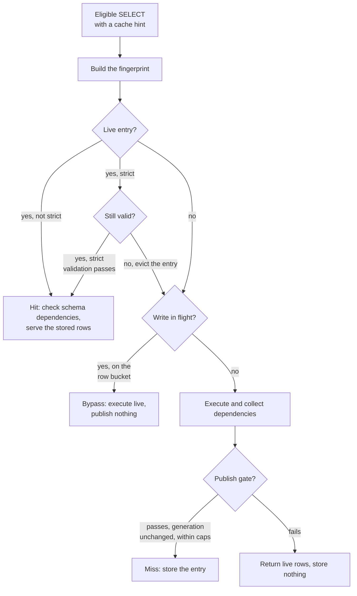
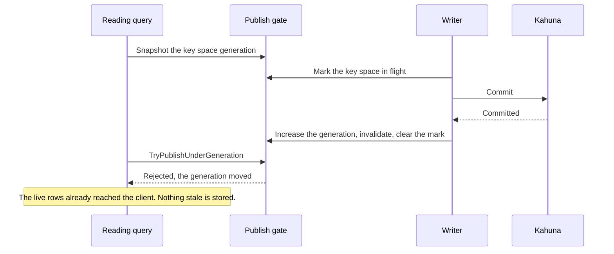

# Query result cache internals

This page is for engineers who maintain or extend the result cache, or who want
to audit why it never serves stale data on the node that took a write. It
covers the read path, dependency capture, commit invalidation, the publish gate
that orders publishes against commits, strict validation, and the fingerprint.
To use or tune the cache, read [Query result cache](/docs/query-result-cache)
instead. This page assumes you know the terms defined there: family,
fingerprint, dependency set, and bucket.

The page also uses these terms:

- The publish gate is a small concurrency primitive that makes commits and
  publishes safe together. For each [key space](/docs/concepts#key-space) (all
  the keys that share one prefix), it holds a generation counter that only
  increases, plus a set of marks for writes in flight. See
  [The publish gate](#the-publish-gate).
- `T_cache` is the [HLC](/docs/concepts#hlc) snapshot timestamp at which
  CamusDB computed a strict entry. Strict validation compares each
  dependency's `LastModified` against it.

## The read path

For an eligible query, `QueryExecutor` runs this sequence (see
`QueryWithCache`):

1. It builds the fingerprint. The entry key comes from the plan shape id, the
   bound parameters, the schema dependencies, and the cache options.
2. It probes the cache by looking up the fingerprint. A live entry (one that
   has not expired) is a hit candidate.
   For a non-strict hit, CamusDB checks that the entry's schema dependencies
   are still current, then yields the stored rows.
   For a strict hit, CamusDB validates the entry against live storage (see
   [TTL and strict validation](#ttl-and-strict-validation)) and yields the
   stored rows if the entry is valid. Otherwise it evicts the entry, records
   the revalidation, and falls through to live execution. The final status
   then becomes `stale-revalidated`.
3. It guards strict entries that have no snapshot. A strict entry means
   something only when `T_cache` is a real HLC snapshot. Two reads have one: an
   autocommit read under the serializable default without
   [key-range sharding](/docs/key-range-sharding), and an `AS OF SYSTEM TIME`
   read. For any other read, CamusDB serves live rows and publishes nothing.
4. It snapshots the generation. Before executing, it records the current
   generation counter of the table's row bucket. If a write is already in
   flight for that bucket, CamusDB serves live rows without publishing, with
   the reason `in-flight-write`, so it never races a write that is about to
   commit.
5. It executes the query and collects dependencies. It runs the real plan
   through the dependency collector (see
   [Dependency capture](#dependency-capture)) and materializes the rows as they
   stream to the client.
6. It publishes the entry. After the stream fully drains, CamusDB tries to
   store the entry, and only through the publish gate. The gate checks the
   generation again and rejects the store if a write committed into the bucket
   during execution (see [The publish gate](#the-publish-gate)). The row, byte,
   and dependency caps also gate the store at this point.

A cancelled or faulted enumeration never publishes. The runner marks the drain
complete only after the last row, and CamusDB skips the publish otherwise. This
is the no-partial-publish invariant.

Between step 3 and step 4, several requests for the same fingerprint collapse
onto one execution. This is the single-flight behavior: the first caller
becomes the owner and runs the sequence above, and the other callers wait.

The wait slot carries only a completion signal, never rows. When the owner
reports its publish, each waiter runs step 2 for itself. It serves the entry
only if its own probe still finds and validates that entry, and executes live
otherwise.

This indirection matters because a write can commit and evict the entry
between the owner's publish and the moment a waiter wakes. Such a waiter is a
query that began after that invalidation. Handing it the owner's materialized
rows would serve a state older than a committed write, and would also skip the
schema and strict checks that every other reader performs.

A waiter that times out, or whose owner failed, executes on its own.

Why does CamusDB snapshot only the table's row bucket, even for an index scan?
Every `INSERT`, `UPDATE`, and `DELETE` on a table writes the row key, so the
row bucket's generation increases on any write to that table. The row bucket
fence therefore covers index scans too.

That is exactly why a join must not take this path. A join touches the buckets
of more than one table, and fencing one bucket would not cover the others.

## Dependency capture

Scan and join operators feed a per-request collector, the
`QueryDependencyCollector`, as they read. CamusDB attaches the collector only
on the cache path, and every call that records a dependency is guarded, so
queries that don't use the cache pay nothing.

The rules depend on the scan shape:

- A full table scan records three things: the row bucket as a range
  dependency, the table's schema version as a schema dependency, and each
  fetched row's key as a point dependency.
- An index scan, a lookup, a range, and an `IN` list each record the index
  bucket as a range dependency, the schema version, and each fetched row's key
  as a point dependency. Both parts matter. The index range catches phantom
  inserts and membership changes. The row point catches updates to projected
  columns that the index does not hold.
- CamusDB also records rows that a residual filter later rejects. A row that
  does not match today could match after an update, so it is a real
  dependency.

Two caps can truncate the set. The first caps the point dependencies per
entry. CamusDB drops point dependencies past that cap and relies on the range
dependency for coverage. That is safe for a non-strict entry, because
same-node invalidation matches on the range.

The second caps the total number of dependencies. When the set passes that
cap, CamusDB marks the collector and does not publish the entry at all: it
bypasses the store rather than storing an incomplete set. Coverage that misses
something is never acceptable. Coverage that is too wide is.

## Same-node invalidation

Invalidation is driven by the transaction boundary, not spread across the
individual write methods, so batch writes and single-point writes get the same
coverage.

For row and index writes, `KvTransactionsManager.CommitAsync` collects the
transaction's modified keys and derives their key space buckets.

After a successful commit through [Kahuna](/docs/concepts#kahuna), the
transactional storage layer, it asks the cache to drop every entry whose
dependency set overlaps a modified key or a modified bucket.

A modified row key matches two things: a row bucket range dependency (through
its bucket) and a row point dependency (exactly).

All of this happens through the publish gate, so it is atomic against a
concurrent publish (see [The publish gate](#the-publish-gate)). A transaction
that rolls back invalidates nothing.

Schema and catalog changes need a separate mechanism, because a DDL statement
does not touch row or index keys in the same way.

After a DDL statement commits successfully, the executor evicts every entry
with a schema dependency on the affected table, through `InvalidateByTableId`.
Dropping a table evicts by table id. Dropping a whole database evicts by
database.

The fingerprint already includes the schema versions, so a query after a
schema change computes a different fingerprint. It can never collide with an
entry from before the change.

The dependency index, `DependencyIndex`, maps three kinds of key to the ids of
the entries that depend on them: buckets, point keys, and database and table
schema keys. The cost of an invalidation therefore follows the key spaces a
write touched and the entries that overlap them, not the total number of
cached entries.

## The publish gate

The dangerous race goes like this: a query misses, executes, and publishes an
entry at the same moment a write commits into the same key space. If the
publish landed after the write's invalidation, the stale entry would survive.

`CachePublishGate` closes that window. For each key space it holds:

- A generation counter. Every committed write increases it, and it never
  decreases.
- A count of in-flight write marks. CamusDB raises the count before a commit
  and clears it after that commit.

The protocol has two halves.

On the write path, inside `CommitAsync`, CamusDB marks the modified key spaces
as in flight before committing through Kahuna. It then resolves the mark based
on the finalize result. The question is not "did this write commit?" but
"could this write be visible?"

| Finalize result | What it means | Gate action |
| --- | --- | --- |
| `Committed` | A final success | Increases the generations, invalidates inside the gate lock, and clears the marks. |
| `MustRetry` past the retry bound, `Errored`, or a cancellation or exception after a commit request left the node | The outcome is unknown. The coordinator can apply a commit and still lose the response, so the rows may already be readable here. | Same as `Committed`: increases, invalidates, and clears. |
| `Aborted`, a confirmed rollback, or any failure before the first commit request | The commit definitely did not happen | Clears the marks only. |

Fencing a write that never landed costs one re-execution. Skipping the fence
for a write that did land serves rows older than a committed write, which is
the one thing the [mental model](/docs/query-result-cache#the-mental-model)
promises cannot happen on this node.

So CamusDB resolves the unknown case conservatively. If the caller later
retries the same handle and resolves it, the second fence has no further
effect: generations only move forward, and the entries are already gone.

On the read path, CamusDB snapshots the key space generations before executing
and bypasses the cache if a key space is already in flight.

After executing, CamusDB publishes only through `TryPublishUnderGeneration`.
That method takes the same lock as the commit path, checks the generation
again, and inserts the entry only if the generation has not moved.

Either the publish lands entirely before the write's invalidation, which then
removes it, or CamusDB rejects the publish because the generation advanced.
No other interleaving is possible.

CamusDB holds the lock only across in-memory bookkeeping, never across a
Kahuna commit, so the lock stays cheap.

A false rejection is acceptable: it makes a query execute again because an
unrelated row in the same bucket changed. A stale entry that survives a
committed write is not acceptable.

## TTL and strict validation

The guarantees above say nothing about writes on other nodes. Another node's
commit never touches this node's in-memory index. Two mechanisms bound the
resulting staleness.

The first is the TTL. Every entry expires, using the `ttl` from its hint or the
configured default. CamusDB checks expiry on each probe, and an expired entry
misses and is removed. A background sweep also drops expired entries
periodically, so they do not linger in memory.

The second is strict validation. CamusDB validates a `strict` entry against
live storage on every hit, before serving its rows. The `StrictValidator` runs
three steps, in this order:

1. It checks schema dependencies. The entry is stale if a table it depends on
   is gone, or now has a different schema version.
2. It checks point dependencies by probing each row key for its latest
   committed value. The entry is stale if a key is absent (a delete) or has a
   `LastModified` newer than `T_cache` (an update).
3. It checks range dependencies by scanning each bucket. A key with a
   `LastModified` newer than `T_cache` means a phantom insert or a change that
   CamusDB did not track.

Every validation read runs outside a transaction and reads the latest committed
value.

A limit on probe keys bounds the validation, and validation fails closed. If
the validation would pass the limit, CamusDB treats the entry as stale and
executes the query again instead of trusting the entry.

A failed validation evicts the entry, so the next probe does not validate an
entry that CamusDB already knows is stale.

Correctness also depends on these details:

- A physical delete needs a point dependency. A deleted row's key is gone, so a
  range scan cannot see it, and only the row's point dependency catches the
  delete. That is why CamusDB never stores a strict entry whose point
  dependencies the cap truncated. Without complete point dependencies, the
  entry could not detect a delete, so CamusDB bypasses the publish.
- Strict mode needs a snapshot. Only two reads pin an HLC snapshot: an
  autocommit read under the serializable default without key-range sharding,
  and an `AS OF SYSTEM TIME` read. For any other read, `T_cache` would be
  meaningless and every `LastModified` comparison would fail, so CamusDB does
  not publish the strict entry. It serves live rows instead.

Strict validation can cost as much as a range scan. It is an opt-in
correctness mode for reads across several nodes, not a general performance
path.

## The fingerprint

The fingerprint must never let two logically different queries share an entry.

It is a 128-bit, non-cryptographic hash: XxHash128 over an injective canonical
string. The fingerprint is not a security boundary. It only has to avoid
accidental collisions, so a fast hash over an unambiguous encoding is the right
tool.

The canonical form contains:

1. The database id.
2. The family name.
3. The query shape id.
4. Every bound parameter, ordered by name.
5. The schema dependencies with their versions, ordered by table name.
6. The cache options.

The encoding handles these details:

- Each value carries its type, so the integer `1`, the string `'1'`, `NULL`,
  and an object id never encode the same way.
- Every variable-length value carries a length prefix, so a value that contains
  a structural delimiter cannot look like a different set of values. Floats use
  a culture-invariant format, so a node's locale cannot change a fingerprint.

The query shape id is a separate 64-bit hash of the query's structure, with a
placeholder in place of each literal. The plan cache shares this id, which
identifies queries that differ only in their constants.

A result fingerprint always folds the literal values back in. The plan cache
ignores them by design, but the result cache must not.

## Related pages

- [Query result cache](/docs/query-result-cache)
- [Transactions and isolation](/docs/serializable-transactions)
- [Time travel reads](/docs/time-travel-reads)
