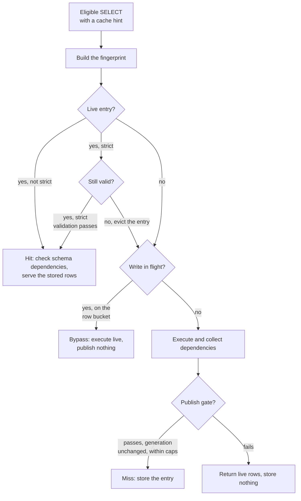
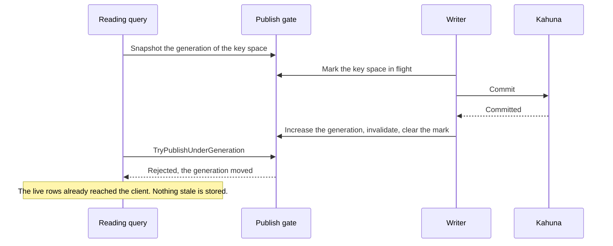

# Query result cache internals

This page is for engineers who maintain or extend the result cache, or who want
to audit why it never serves stale data on the node that took a write. It
describes the read path, how dependencies are captured, how a commit
invalidates entries, the publish gate that orders a publish against a commit,
the strict validation, and the fingerprint. To use or tune the cache, read
[Query result cache](/docs/query-result-cache) instead. This page assumes you
know the terms defined there: family, fingerprint, dependency set, and bucket.

Two more terms appear on this page:

- The publish gate is the small concurrency primitive that makes a commit and a
  publish safe together. It holds a generation counter for each
  [key space](/docs/concepts#key-space) (all the keys that share one prefix),
  which only increases, and a set of marks for the writes in flight. See
  [The publish gate](#the-publish-gate).
- `T_cache` is the [HLC](/docs/concepts#hlc) snapshot timestamp at which
  CamusDB computed a strict entry. The strict validation compares the
  `LastModified` of each dependency against it.

## The path of a read

For an eligible query, `QueryExecutor` runs this sequence. See
`QueryWithCache`:

1. It builds the fingerprint. The key of the entry comes from the id of the
   shape of the plan, the bound parameters, the dependencies of the schema, and
   the options of the cache.
2. It probes the cache. It looks the fingerprint up. A live entry, which is an
   entry that did not expire, is a candidate for a hit.
   For a hit without the strict mode, CamusDB checks that the schema
   dependencies of the entry are still current. It then yields the stored rows.
   For a strict hit, CamusDB validates the entry against the live storage. See
   [The TTL and the strict validation](#the-ttl-and-the-strict-validation). It
   yields the stored rows when the entry is valid. Otherwise it evicts the
   entry, records the revalidation, and continues to a live execution. The final
   status then becomes `stale-revalidated`.
3. It guards a strict entry without a snapshot. A strict entry has a meaning
   only when `T_cache` is a real HLC snapshot. Two reads have one: an autocommit
   read under the serializable default, without
   [key-range sharding](/docs/key-range-sharding), and an `AS OF SYSTEM TIME`
   read. For any other read, CamusDB serves live rows, and it publishes nothing.
4. It takes a snapshot of the generation. It records the current counter of the
   generation of the row bucket of the table, before the execution. A write can
   already be in flight for that bucket. CamusDB then serves live rows without a
   publish, with the reason `in-flight-write`. It therefore does not race a
   write that is about to commit.
5. It executes the query, and it collects the dependencies. It runs the real
   plan through the collector of the dependencies. See
   [The capture of a dependency](#the-capture-of-a-dependency). It materializes
   the rows as they stream to the client.
6. It publishes the entry. After the stream drains completely, CamusDB tries to
   store the entry. It stores the entry through the publish gate only. That gate
   checks the generation again. It rejects the store when a write committed into
   the bucket during the execution. See [The publish gate](#the-publish-gate).
   The caps of the rows, of the bytes, and of the dependencies also gate the
   store at that point.

An enumeration that a caller cancels, and one that faults, never publishes. The
runner marks the drain complete after the last row only. CamusDB skips the
publish otherwise. That rule is the invariant of no partial publish.

Between step 3 and step 4, several requests for the same fingerprint collapse
onto one execution. This is the single-flight behavior. The first caller becomes
the owner, and it runs the sequence above. The other callers wait.

The slot of that wait carries a signal of the completion only. It never carries
a row. The owner reports its publish. Each waiter then runs step 2 for itself.
It serves the entry only when its own probe still finds that entry, and
validates it. It executes live otherwise.

That indirection has a purpose. A write can commit, and it can evict the entry,
between the publish of the owner and the moment when a waiter wakes. A waiter is
a query that began after that invalidation. A hand of the materialized rows of
the owner to that waiter would serve a state older than a committed write. It
would also skip the checks of the schema and of the strict mode that every other
reader performs.

A waiter that reaches its timeout executes on its own. A waiter whose owner
failed also executes on its own.

Why does CamusDB take a snapshot of the row bucket of the table only, even for a
scan of an index? Every `INSERT`, `UPDATE`, and `DELETE` on a table writes the
key of the row. The generation of the row bucket therefore increases on any
write to that table. The fence of the row bucket covers a scan of an index as
well.

That is exactly the reason why a join must not take this path. A join touches
the buckets of more than one table. The fence of one bucket would not cover the
others.

## The capture of a dependency

The operators of a scan and of a join feed a collector of each request, which is
the `QueryDependencyCollector`, as they read. CamusDB attaches the collector on
the path of the cache only. Every call that records a dependency has a guard. A
query without a cache therefore pays nothing.

The rules follow the shape of the scan:

- A full scan of a table records three things: the row bucket as a range
  dependency, the schema version of the table as a schema dependency, and the
  key of each fetched row as a point dependency.
- A scan of an index, a lookup, a range, and an `IN` list each record three
  things: the bucket of the index as a range dependency, the schema version, and
  the key of each fetched row as a point dependency. Both parts matter. The
  range of the index catches a phantom insert, and a change of the membership.
  The point of the row catches an update of a projected column that the index
  does not hold.
- CamusDB also records a row that a residual filter rejects later. A row that
  does not match today could match after an update. It is therefore a real
  dependency.

Two caps apply, and they can truncate the set. CamusDB caps the point
dependencies of each entry. It drops a point dependency past that cap, and the
range dependency then gives the coverage. That behavior is safe for an entry
without the strict mode, because an invalidation on the same node matches on the
range.

There is also a cap on the total number of the dependencies. CamusDB marks the
collector when the set passes that cap. It then does not publish the entry at
all. It bypasses the store, instead of a store of an incomplete set. A coverage
that misses something is never acceptable. A coverage that is too wide is.

## The invalidation on the same node

The boundary of a transaction drives the invalidation. The invalidation is not
spread across the methods of the writes. A write of a batch and a write of one
point therefore have the same coverage.

For a write of a row and of an index, `KvTransactionsManager.CommitAsync`
collects the modified keys of the transaction. It derives the buckets of the key
space of those keys.

After a successful commit through [Kahuna](/docs/concepts#kahuna), the
transactional storage layer, it asks the cache to drop entries. It drops every
entry whose set of dependencies overlaps a modified key, and every entry whose
set overlaps a modified bucket.

A modified key of a row matches two things: a range dependency of a row bucket,
through its bucket, and a point dependency of a row, exactly.

All of that happens through the publish gate. It is therefore atomic against a
concurrent publish. See [The publish gate](#the-publish-gate). A transaction
that rolls back invalidates nothing.

A change of the schema and of the catalog needs a separate mechanism. A DDL
statement does not touch the keys of a row or of an index in the same way.

After a successful commit of a DDL statement, the executor evicts every entry
with a schema dependency on the affected table, through `InvalidateByTableId`. A
drop of a table evicts by the id of the table. A drop of a whole database evicts
by the database.

The fingerprint already holds the schema versions. A query after a change of the
schema therefore computes a different fingerprint. It cannot collide with an
entry from before the change, in any case.

The index of the dependencies, `DependencyIndex`, maps three things to the ids
of the entries that depend on them: a bucket, a point key, and a schema key of a
database and a table. The cost of an invalidation therefore follows the key
spaces that a write touched, and the entries that overlap. It does not follow the
total number of the cached entries.

## The publish gate

The dangerous race is this. A query misses, executes, and publishes an entry, at
the same moment when a write commits into the same key space. The stale entry
would survive, if the publish landed after the invalidation of the write.

`CachePublishGate` closes that window. It holds two structures for each key
space:

- A counter of the generation. Every committed write increases it. It never
  decreases.
- A count of the marks of the writes in flight. CamusDB raises the count before
  a commit. It clears the count after that commit.

The protocol has two halves.

On the path of a write, inside `CommitAsync`, CamusDB marks the modified key
spaces as in flight, before the commit through Kahuna. It then resolves that
mark by the result of the finalize. The question is not "did this write commit?"
The question is "could this write be visible?"

| Result of the finalize | What it means | Action of the gate |
| --- | --- | --- |
| `Committed` | A final success | It increases the generations, invalidates inside the lock of the gate, and clears the marks. |
| A `MustRetry` past the bound of the retries, an `Errored`, or a cancellation or an exception after a request of a commit left the node | The outcome is unknown. The coordinator can apply a commit and still lose the response. The rows may therefore be readable here already. | The same as a `Committed`. It increases, invalidates, and clears. |
| An `Aborted`, a confirmed rollback, or any failure before the first request of a commit | A definite absence of a commit | It clears the marks only. |

A fence around a write that never landed costs one execution again. A skipped
fence around a write that did land serves rows older than a committed write.
That result is the one thing that the
[mental model](/docs/query-result-cache#the-mental-model) promises cannot happen
on this node.

CamusDB therefore resolves the unknown case conservatively. The caller can later
retry the same handle, and resolve it. The second fence then has no further
effect. A generation only moves forward, and the entries are gone already.

On the path of a read, CamusDB takes a snapshot of the generations of the key
spaces before the execution. It bypasses the cache when a key space is in flight
already.

After the execution, CamusDB publishes through `TryPublishUnderGeneration` only.
That method holds the same lock as the path of the commit. It checks the
generation again. It inserts the entry only when the generation did not move.

A publish therefore lands entirely before the invalidation of a write, and the
invalidation then removes it. Or CamusDB rejects the publish, because the
generation advanced. There is no interleaving between those two results.

CamusDB holds the lock across the bookkeeping in memory only. It never holds the
lock across a commit through Kahuna. The lock therefore stays cheap.

A false rejection is acceptable. Such a rejection makes a query execute again,
because an unrelated row of the same bucket changed. A stale entry that survives
a committed write is not acceptable.

## The TTL and the strict validation

The guarantees above say nothing about a write on a different node. The commit
of that node never touches the index in the memory of this node. Two mechanisms
bound the staleness that results.

The first mechanism is the TTL. Every entry has an expiry, from the `ttl` of its
hint, or from the configured default. CamusDB checks the expiry at a probe. An
expired entry misses, and CamusDB removes it. A sweep in the background also
drops an expired entry periodically. It therefore does not stay in the memory.

The second mechanism is the strict validation. CamusDB validates a `strict`
entry against the live storage at every hit, before it serves the rows. The
`StrictValidator` performs three steps, in this order:

1. It checks the schema dependencies. The entry is stale when a table that it
   depends on is gone, or when that table now holds a different schema version.
2. It checks the point dependencies. It probes each key of a row, for the latest
   committed value. Two results mean that the entry is stale: an absent key,
   which is a delete, and a `LastModified` newer than `T_cache`, which is an
   update.
3. It checks the range dependencies. It scans each bucket. A key with a
   `LastModified` newer than `T_cache` means a phantom insert, or a change that
   CamusDB did not track.

Every read of the validation is outside a transaction. Each one reads the latest
committed value.

A limit on the keys of the probe bounds the validation. The validation fails
closed. CamusDB treats the entry as stale when the validation would pass the
limit. It executes the query again. It does not trust the entry.

A failed validation evicts the entry. The next probe therefore does not validate
an entry that CamusDB knows to be stale.

Two details of the correctness are worth your attention:

- A physical delete needs a point dependency. The key of a deleted row is gone,
  and a scan of a range cannot see it. Only the point dependency of the row
  catches the delete. That is the reason for one rule: CamusDB does not store a
  strict entry whose point dependencies the cap truncated. Without complete
  point dependencies, that entry could not detect a delete. It therefore
  bypasses the publish.
- The strict mode needs a snapshot. Only two reads pin an HLC snapshot: an
  autocommit read under the serializable default, without key-range sharding,
  and an `AS OF SYSTEM TIME` read. For any other read, `T_cache` would have no
  meaning, and every comparison of a `LastModified` would fail. CamusDB does not
  publish such a strict entry. It serves live rows instead.

A strict validation can cost as much as a scan of a range. It is an opt-in mode
of the correctness, for a read across several nodes. It is not a general path of
the performance.

## The fingerprint

The fingerprint must never let two logically different queries share one entry.

It is a hash of 128 bits, and that hash is not cryptographic. CamusDB uses
XxHash128, over a canonical string that is injective. The fingerprint is not a
boundary of the security. It only avoids an accidental collision. A fast hash
over an unambiguous encoding is therefore the correct tool.

Six parts go into the canonical form:

1. The id of the database.
2. The name of the family.
3. The id of the shape of the query.
4. Every bound parameter, in the order of its name.
5. The schema dependencies, in the order of the name of the table, with their
   versions.
6. The options of the cache.

The encoding takes care in two ways that matter:

- Each value carries its type. The integer `1`, the string `'1'`, a `NULL`, and
  an object id therefore never encode in the same way.
- Every value of a variable length carries a prefix of its length. A value that
  holds a delimiter of the structure therefore cannot look like a different set
  of values. The format of a float is invariant of the culture. The locale of a
  node therefore cannot change a fingerprint.

The id of the shape of the query is a separate hash, of 64 bits. It covers the
structure of the query, with a placeholder in the position of each literal. The
plan cache shares that id. It identifies a query that is the same except for its
constants.

The fingerprint of a result always folds the literal values back in. The plan
cache ignores them by design. The result cache must not ignore them.

## Related pages

- [Query result cache](/docs/query-result-cache)
- [Transactions and isolation](/docs/serializable-transactions)
- [Time travel reads](/docs/time-travel-reads)
