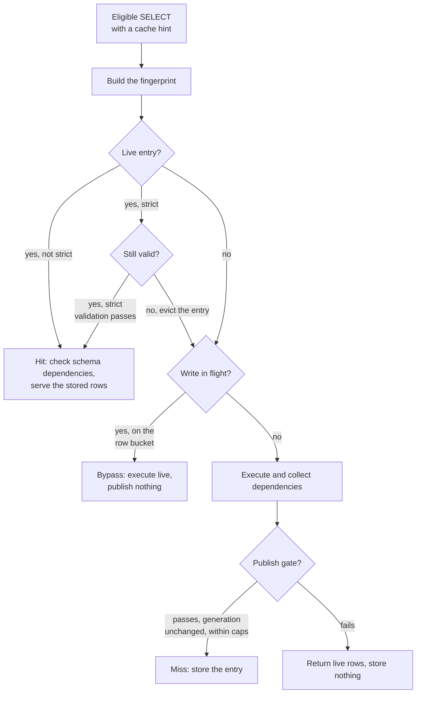
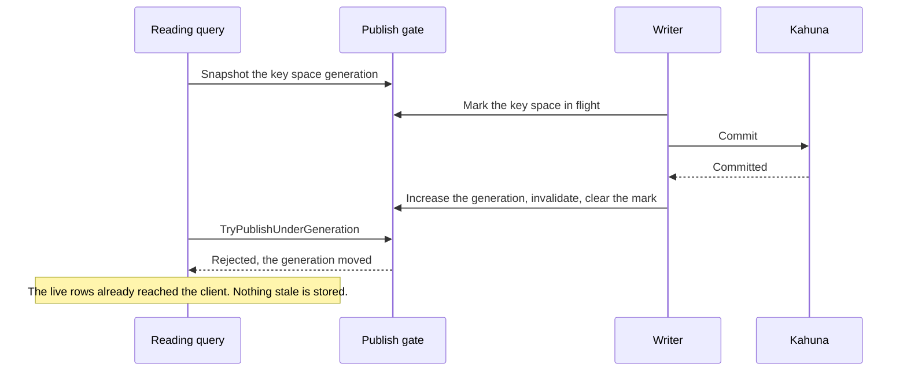

# Query result cache internals

This page is for engineers who maintain or extend the result cache, and for
readers who want to check how the cache avoids stale data on the node that
took a write. It covers the read path, dependency capture, invalidation at
commit, the publish gate, strict validation, and the fingerprint. To use or
tune the cache, read [Query result cache](/docs/query-result-cache). This page
uses the terms defined there: family, fingerprint, dependency set, and bucket.

The page also uses these terms:

- The publish gate makes commits and publishes safe when they happen at the
  same time. For each [key space](/docs/concepts#key-space) (the keys that share
  one prefix), it has a generation counter that only increases, and a count of
  writes in progress. See [The publish gate](#the-publish-gate).
- `T_cache` is the [HLC](/docs/concepts#hlc) snapshot timestamp at which
  CamusDB computed a strict entry. Strict validation compares the
  `LastModified` value of each dependency with it.

## The read path

For an eligible query, `QueryExecutor` follows these steps (see
`QueryWithCache`):

1. **Build the fingerprint.** The entry key comes from the plan shape ID, the
   bound parameters, the schema dependencies, and the cache options.
2. **Look up the fingerprint.** An entry that hasn't expired is a hit
   candidate.
   For a hit that isn't strict, CamusDB checks that the schema dependencies of
   the entry are current, then returns the stored rows.
   For a strict hit, CamusDB validates the entry against live storage (see
   [TTL and strict validation](#ttl-and-strict-validation)). If the entry is
   valid, it returns the stored rows. If not, it evicts the entry, records the
   revalidation, and executes the query. The final status is then
   `stale-revalidated`.
3. **Check for a snapshot.** A strict entry needs a real HLC snapshot as
   `T_cache`. Two kinds of read have one: an autocommit read under the
   serializable default without
   [key-range sharding](/docs/key-range-sharding), and an `AS OF SYSTEM TIME`
   read. For other reads, CamusDB returns live rows and doesn't publish an entry.
4. **Record the generation.** Before it executes the query, CamusDB records the
   current generation of the table's row bucket. If a write to that bucket is
   in progress, CamusDB returns live rows and doesn't publish, with the reason
   `in-flight-write`. The query can't race with a write that is about to
   commit.
5. **Execute and collect dependencies.** CamusDB executes the real plan through
   the dependency collector (see [Dependency capture](#dependency-capture)), and
   it materializes the rows as they stream to the client.
6. **Publish the entry.** After the client has read all rows, CamusDB tries to
   store the entry through the publish gate. The gate checks the generation
   again. It doesn't store the entry if a write to the bucket committed during the
   execution (see [The publish gate](#the-publish-gate)). The limits on rows,
   bytes, and dependencies also apply at this step.

A cancelled or failed enumeration doesn't publish. The runner marks the read as
complete only after the last row, and CamusDB skips the publish in all other
cases. An entry is either complete or not stored.

Between step 3 and step 4, concurrent requests for the same fingerprint share
one execution. The first caller becomes the owner and follows the steps above.
The other callers wait.

The wait slot carries a completion signal, and no rows. When the owner signals
that it published, each waiter repeats step 2. It returns the entry only if a
new lookup finds and validates the entry. If not, it executes the query.

A waiter looks up the entry again, because a write can commit and evict the
entry between the owner's publish and the moment the waiter wakes. That waiter
is a query that started after the invalidation. If it got the owner's rows, it
would return a state older than a committed write. It would also skip the
schema and strict checks that other readers do.

A waiter that times out, or whose owner failed, executes the query itself.

CamusDB records the generation of the table's row bucket only, also for an
index scan. Each `INSERT`, `UPDATE`, and `DELETE` on a table writes the row
key, and the generation of the row bucket increases with any write to the
table. The row bucket therefore also covers index scans.

A join can't use this path. It reads the buckets of more than one table, and
one bucket wouldn't cover the others.

## Dependency capture

Scan and join operators send what they read to a collector for the request, the
`QueryDependencyCollector`. CamusDB attaches the collector only on the cache
path, and each call that records a dependency checks for it. Queries that don't
use the cache have no extra cost.

The rules depend on the scan:

- A full table scan records three items: the row bucket as a range dependency,
  the schema version of the table as a schema dependency, and the key of each
  row it read as a point dependency.
- An index scan, a lookup, a range, and an `IN` list each record the index
  bucket as a range dependency, the schema version, and the key of each row
  they read as a point dependency. The index range detects inserted rows and
  changes of membership. The row point detects updates to selected columns that
  the index doesn't contain.
- CamusDB also records the rows that a filter removes later. A row that doesn't
  match now can match after an update, and it is a real dependency.

Two limits can cut the set:

- **Point dependencies per entry.** CamusDB drops the point dependencies above
  this limit and uses the range dependency to cover them. This is safe for an
  entry that isn't strict, because invalidation on the same node matches on the
  range.
- **Total dependencies.** When the set passes this limit, CamusDB marks the
  collector and doesn't publish the entry. An incomplete set could miss a
  change. A set that is too wide is safe, and it only evicts the entry more
  often.

## Same-node invalidation

CamusDB invalidates entries at the transaction boundary. Batch writes and
single-row writes get the same coverage.

For row and index writes, `KvTransactionsManager.CommitAsync` collects the
modified keys of the transaction and derives their key space buckets. After a
successful commit through [Kahuna](/docs/concepts#kahuna), the transactional
storage layer, it asks the cache to drop each entry whose dependency set
overlaps a modified key or a modified bucket.

A modified row key matches two kinds of dependency: a range dependency on the
row bucket (through its bucket), and a point dependency on the row (exactly).

This happens through the publish gate, and it is atomic with a concurrent
publish (see [The publish gate](#the-publish-gate)). A transaction that rolls
back doesn't invalidate any entry.

Schema and catalog changes use a separate mechanism, because a DDL statement
doesn't write row or index keys in the same way. After a DDL statement commits,
the executor evicts each entry with a schema dependency on the affected table,
through `InvalidateByTableId`. A dropped table evicts by table ID, and a
dropped database evicts by database.

The fingerprint includes the schema versions. A query after a schema change has
a different fingerprint, and it can't match an entry from before the change.

The dependency index, `DependencyIndex`, maps three kinds of key to the IDs of
the entries that depend on them: buckets, point keys, and schema keys of
databases and tables. The cost of an invalidation depends on the key spaces
that a write touched and the entries that overlap them. It doesn't depend on
the total number of cached entries.

## The publish gate

The race to prevent: a query misses, executes, and publishes an entry at the
same time that a write commits to the same key space. If the publish happened
after the write's invalidation, the stale entry would remain in the cache.

`CachePublishGate` prevents this. For each key space, it has:

- A generation counter. Each committed write increases it, and it doesn't
  decrease.
- A count of writes in progress. CamusDB increases the count before a commit
  and decreases it after the commit.

The protocol has two parts.

On the write path, in `CommitAsync`, CamusDB marks the modified key spaces as
in progress before it commits through Kahuna. Then it resolves the mark from the
finalize result. The gate fences each write that could be visible, including a
write whose commit result is unknown.

| Finalize result | Meaning | Gate action |
| --- | --- | --- |
| `Committed` | The commit succeeded. | Increases the generations, invalidates under the gate lock, and clears the marks. |
| `MustRetry` past the retry limit, `Errored`, or a cancellation or exception after a commit request left the node | The result is unknown. The coordinator can apply a commit and lose the response, and the rows can be readable on this node. | The same as `Committed`: increases, invalidates, and clears. |
| `Aborted`, a confirmed rollback, or a failure before the first commit request | The commit didn't happen. | Clears the marks only. |

A fence for a write that didn't happen costs one extra execution. A missing
fence for a write that did happen would return rows older than a committed
write. The
[invalidation rules](/docs/query-result-cache#how-entries-are-keyed-and-invalidated)
promise that this can't happen on this node.

CamusDB therefore treats an unknown result as a commit. If the caller later
retries the same handle and resolves it, the second fence has no effect: the
generations only increase, and the entries are already gone.

On the read path, CamusDB records the key space generations before it executes
the query. It bypasses the cache if a key space has a write in progress.

After the execution, CamusDB publishes only through
`TryPublishUnderGeneration`. That method takes the same lock as the commit
path, checks the generation again, and inserts the entry only if the
generation didn't change.

The publish happens completely before the write's invalidation, which then
removes it, or CamusDB doesn't store the entry because the generation increased.
These are the only two possible orders.

CamusDB takes the lock only for in-memory bookkeeping. It doesn't take it during a
Kahuna commit. The lock is therefore cheap.

The protocol can reject a publish that would have been safe. The query then
executes again because another row in the same bucket changed. A stale entry
can't remain after a committed write.

## TTL and strict validation

The guarantees above don't cover writes on other nodes. A commit on another
node doesn't change the in-memory index of this node. Two mechanisms limit the
staleness.

The first is the TTL. Each entry expires, after the `ttl` from its hint or the
configured default. CamusDB checks the expiry at each lookup, and an expired
entry is a miss and is removed. A background sweep also removes expired entries
at intervals, and they don't stay in memory.

The second is strict validation. CamusDB validates a `strict` entry against
live storage at each hit, before it returns the rows. The `StrictValidator`
does three steps, in this order:

1. **Schema dependencies.** The entry is stale if a table it depends on no
   longer exists, or has a different schema version.
2. **Point dependencies.** CamusDB reads the latest committed value of each row
   key. The entry is stale if a key is missing (a delete) or has a
   `LastModified` value newer than `T_cache` (an update).
3. **Range dependencies.** CamusDB scans each bucket. A key with a
   `LastModified` value newer than `T_cache` means an inserted row or a change
   that CamusDB didn't track.

The validation reads aren't part of a transaction. They read the latest
committed values.

A limit on the keys to read bounds the validation, and the validation fails
safe. If it would pass the limit, CamusDB treats the entry as stale and executes
the query.

A failed validation evicts the entry. The next lookup doesn't validate an entry
that is known to be stale.

Correctness also depends on these rules:

- **A delete needs a point dependency.** The key of a deleted row is gone, and
  a range scan can't see it. Only the point dependency of the row detects the
  delete. For this reason, CamusDB doesn't store a strict entry whose point
  dependencies the limit cut. With incomplete point dependencies, the entry
  couldn't detect a delete, and CamusDB bypasses the publish.
- **Strict mode needs a snapshot.** Only two kinds of read have an HLC
  snapshot: an autocommit read under the serializable default without
  key-range sharding, and an `AS OF SYSTEM TIME` read. For other reads,
  `T_cache` would have no meaning, and the `LastModified` comparisons would
  fail. CamusDB doesn't publish the strict entry, and it returns live rows.

Strict validation can cost as much as a range scan. Use it when you need
correct results across several nodes.

## The fingerprint

Two queries that differ in meaning must not share an entry.

The fingerprint is a 128-bit hash that isn't cryptographic: XxHash128 over an
injective canonical string. It isn't a security boundary. It must only prevent
accidental collisions, and a fast hash over an unambiguous encoding is enough.

The canonical form contains:

1. The database ID.
2. The family name.
3. The query shape ID.
4. Each bound parameter, ordered by name.
5. The schema dependencies with their versions, ordered by table name.
6. The cache options.

The encoding handles these cases:

- Each value includes its type. The integer `1`, the string `'1'`, `NULL`, and
  an object ID have different encodings.
- Each variable-length value has a length prefix. A value that contains a
  delimiter can't look like a different set of values. Floats use a format that
  doesn't depend on culture, and the locale of a node can't change a
  fingerprint.

The query shape ID is a separate 64-bit hash of the query's structure, with a
placeholder for each literal. The plan cache uses the same ID, which identifies
queries that differ only in their constants. The result fingerprint adds the
literal values back. The plan cache ignores them on purpose, but the result
cache must include them.

## Related pages

- [Query result cache](/docs/query-result-cache)
- [Transactions and isolation](/docs/serializable-transactions)
- [Time-travel reads](/docs/time-travel-reads)
