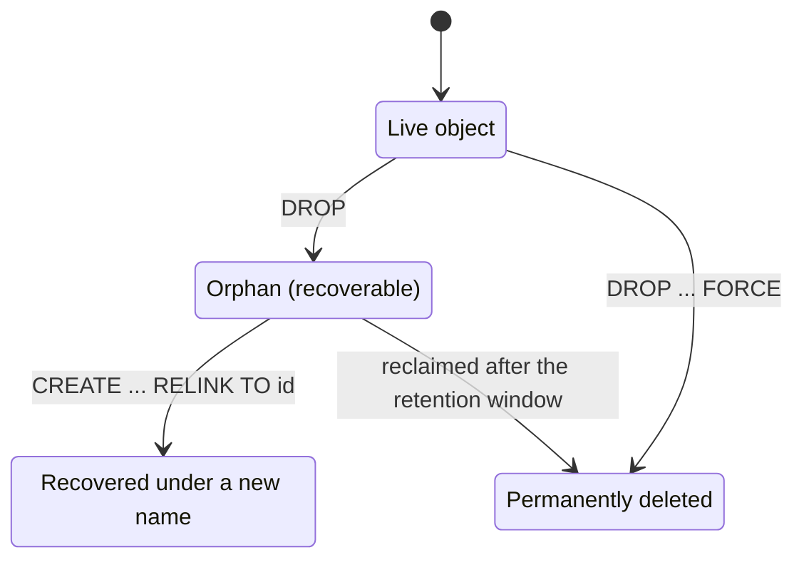

# Recover dropped objects

You can undo an accidental `DROP TABLE` or `DROP DATABASE` without a backup
restore. A dropped database or table can be recovered during a configurable
retention window, and a `RELINK` statement brings it back. This also helps after
a wrong cleanup script or a destructive migration. In PostgreSQL or MySQL, you
would restore a backup.

A regular `DROP DATABASE` or `DROP TABLE` removes the object from the catalog,
and you can use the name again immediately. The data of the object is retained
as a recoverable orphan until the retention window ends.

## Quick workflow

Drop a database, then list the recoverable orphans:

```camussql
DROP DATABASE test;
SHOW ORPHAN DATABASES;
```

```text
┌────┬─────────────┬──────────────────────────┬──────────────────────────┐
│ id │ former_name │ dropped_at               │ expires_at               │
├────┼─────────────┼──────────────────────────┼──────────────────────────┤
│ 2  │ test        │ 2026-11-19T02:37:58.896Z │ 2026-11-26T02:37:58.896Z │
└────┴─────────────┴──────────────────────────┴──────────────────────────┘
```

The times are in UTC. Recover the database under a name, then check its tables:

```camussql
CREATE DATABASE test RELINK TO '2';
USE test;
SHOW TABLES;
```

The same pattern works for a table in the current database:

```camussql
DROP TABLE orders;
SHOW ORPHAN TABLES;
```

```text
┌────┬───────────────┬─────────────┬──────────────────────────┬──────────────────────────┐
│ id │ kind          │ former_name │ dropped_at               │ expires_at               │
├────┼───────────────┼─────────────┼──────────────────────────┼──────────────────────────┤
│ 2  │ dropped table │ orders      │ 2026-11-19T02:37:39.320Z │ 2026-11-26T02:37:39.320Z │
└────┴───────────────┴─────────────┴──────────────────────────┴──────────────────────────┘
```

```camussql
CREATE TABLE orders RELINK TO '2';
```

`RELINK TO` takes the `id` from `SHOW ORPHAN TABLES` or `SHOW ORPHAN DATABASES`.
You should treat the ID as an opaque string.

## Orphan table kinds

The `kind` column of `SHOW ORPHAN TABLES` shows one of two kinds:

| `kind` | What it is | Is `former_name` a live table? |
| --- | --- | --- |
| `dropped table` | A table that was dropped. | No. The name is free. |
| `retired contents` | The previous rows of a table after a [`TRUNCATE`](/docs/truncate-table). | Yes. That table exists, and it's empty. |

When you recover `retired contents`, the rows become a separate new table. The
table in `former_name` doesn't change. For more information, see
[TRUNCATE TABLE](/docs/truncate-table#recovery-of-the-previous-contents).

All database orphans come from a dropped database. For this reason,
`SHOW ORPHAN DATABASES` doesn't have a `kind` column.

## What a regular DROP does

A regular drop is recoverable:

```camussql
DROP DATABASE sales;
DROP TABLE orders;
```

After the statement succeeds:

- You can use the database or table name again immediately.
- `SHOW DATABASES` and `SHOW TABLES` don't list the object.
- Queries against the dropped object return an error.
- The rows, indexes, constraints, and schema are retained as an orphan.
- You can recover the orphan under a new name with `RELINK TO`.



Object IDs aren't used again. If you drop `sales` and then create a new
database named `sales`, the new database gets a new ID. The old data can still
be recovered with its orphan ID:

```camussql
DROP DATABASE sales;
CREATE DATABASE sales;

SHOW ORPHAN DATABASES;
CREATE DATABASE sales_before_migration RELINK TO '7';
```

The new database stays online while you recover the previous data under a
different name.

## Recover a database

You can run `SHOW ORPHAN DATABASES` from any connection. It doesn't need a
current database.

To recover the database, create it under a new name with the orphan ID:

```camussql
CREATE DATABASE sales_recovered RELINK TO '7';
USE sales_recovered;
SHOW TABLES;
```

The recovered database has the tables and data that it had when it was
dropped.

## Recover a table

Table recovery applies to the current database. Select the database that had
the table, then list its orphan tables:

```camussql
USE sales;
SHOW ORPHAN TABLES;
```

Recover the table under a new name:

```camussql
CREATE TABLE orders_recovered RELINK TO 'A0';
SELECT * FROM orders_recovered LIMIT 10;
```

The recovered table has the rows, indexes, and constraints that it had when it
was dropped. However, its foreign keys aren't restored, because the parent table
might have changed while the child table was dropped. To add a foreign key
again, use `ALTER TABLE ... ADD CONSTRAINT`. That statement checks the
recovered rows before the constraint applies.

## Permanent drop with FORCE

`FORCE` deletes the object immediately and permanently:

```camussql
DROP DATABASE staging FORCE;
DROP TABLE scratch FORCE;
DROP DATABASE IF EXISTS old_test FORCE;
DROP TABLE IF EXISTS temp_rows FORCE;
```

A forced drop doesn't create an orphan. You can't recover the object.

## Retention settings

Two settings control how long recovery is possible:

| Setting | Default | Meaning |
| --- | --- | --- |
| `orphan_retention_ms` | `604800000` (seven days) | How long an orphan can be recovered before it can be deleted. A value of `0` or less retains orphans indefinitely. |
| `orphan_reclaim_interval_ms` | `300000` (five minutes) | How often the background task deletes expired orphans. A value of `0` or less turns off the task. |

Both are [runtime cluster settings](/docs/runtime-cluster-settings). You can
also set them in `config.yml`:

```yaml
# Keep dropped databases and tables recoverable for 30 days.
orphan_retention_ms: 2592000000
orphan_reclaim_interval_ms: 300000
```

The `expires_at` column shows when the orphan can be deleted. You can recover it
until the background task actually deletes it.

## Practical uses

- Recover from an accidental `DROP DATABASE` or `DROP TABLE`.
- Undo a migration script that dropped the wrong table.
- Bring back the previous database after a deployment created a new one with
  the same name.
- Recover a table under a temporary name for an audit or a comparison.
- Make cleanup safer: use a regular `DROP` first, and `FORCE` later, when you're
  sure that nobody needs the data.

Recoverable drops don't replace backups. You need
[backups](/docs/backup-and-restore) for disaster recovery, for long-term
retention, and for the loss of a cluster or a storage volume. A recoverable drop
is faster while the data is in the same cluster.

## Limits

Recoverable drops apply to root databases and to the tables of root databases.
They don't apply to:

- Dropped columns.
- Database branches. A dropped branch is deleted immediately.
- Tables dropped in a database branch.
- Objects dropped with `FORCE`.
- Orphans deleted after the retention window.

For more information about branches, see
[Database branching](/docs/database-branching).

## Errors

| Error | When it happens |
| --- | --- |
| `CADB0510` `OrphanNotFound` | `RELINK TO` names an orphan ID that doesn't exist or was deleted. |
| `CADB0012` `DatabaseAlreadyExists` | `CREATE DATABASE ... RELINK TO` names an existing database, or an orphan that was already recovered. |
| `CADB0013` `TableAlreadyExists` | `CREATE TABLE ... RELINK TO` names an existing table, or an orphan that was already recovered. |

## Related pages

- [Databases](/docs/databases)
- [Tables and columns](/docs/sql-schema)
- [Inspecting the database](/docs/sql-inspection)
- [Configuration](/docs/configuration)
- [Backup and restore](/docs/backup-and-restore)
- [Error codes](/docs/error-codes)
