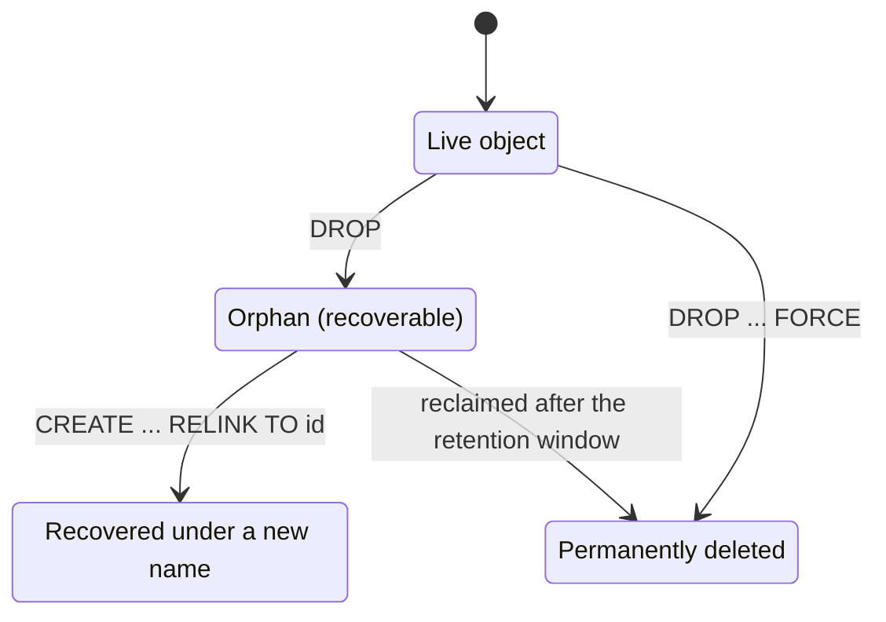

# Recover dropped objects

Running `DROP TABLE` against the wrong database is an easy mistake to make. In
PostgreSQL or MySQL, the data is gone and you restore a backup. CamusDB lets you
undo an accidental `DROP`: it keeps a dropped root database or table
recoverable during a configurable retention window, and a `RELINK` statement
brings it back. The same applies to a wrong cleanup script or a destructive
migration. As long as CamusDB still keeps the orphan, you recover without
restoring a full backup.

An ordinary `DROP DATABASE` or `DROP TABLE` removes the object from the catalog
and frees its name immediately. CamusDB still keeps the object's data as a
recoverable orphan until it reclaims that orphan.

## Quick workflow

This real `camus-cli` session recovers a dropped database. Drop the database,
then list the recoverable orphans:

```camussql
DROP DATABASE test;
SHOW ORPHAN DATABASES;
```

```text
┌────┬─────────────┬────────────────────────┬────────────────────────┐
│ id │ former_name │ dropped_at             │ expires_at             │
├────┼─────────────┼────────────────────────┼────────────────────────┤
│ I  │ test        │ HLC(1:1784427365296:2) │ HLC(1:1785032165296:2) │
└────┴─────────────┴────────────────────────┴────────────────────────┘
1 rows in set (00:00:00.0135411)
```

The `dropped_at` and `expires_at` values are cluster timestamps
([HLC](/docs/concepts#hlc)). The orphan stays recoverable until `expires_at`.
Recover it under a name, then check its tables:

```camussql
CREATE DATABASE test RELINK TO 'I';
USE test;
SHOW TABLES;
```

```text
┌─────────────────┐
│ tables          │
├─────────────────┤
│ orders_restored │
│ orders          │
└─────────────────┘
2 rows in set (00:00:00.0036480)
```

The same pattern works for a table in the current database:

```camussql
DROP TABLE orders;
SHOW ORPHAN TABLES;
```

```text
┌────┬─────────────┬────────────────────────┬────────────────────────┐
│ id │ former_name │ dropped_at             │ expires_at             │
├────┼─────────────┼────────────────────────┼────────────────────────┤
│ s6 │ orders      │ HLC(1:1784427567387:0) │ HLC(1:1785032367387:0) │
└────┴─────────────┴────────────────────────┴────────────────────────┘
1 rows in set (00:00:00.0068052)
```

```camussql
CREATE TABLE orders RELINK TO 's6';
DESC orders;
```

```text
┌───────┬────────────┬──────┬─────┬──────────┬───────┐
│ Field │ Type       │ Null │ Key │ Default  │ Extra │
├───────┼────────────┼──────┼─────┼──────────┼───────┤
│ id    │ OID        │ NO   │ PRI │ gen_id() │       │
│ name  │ STRING(20) │ YES  │     │ NULL     │       │
└───────┴────────────┴──────┴─────┴──────────┴───────┘
2 rows in set (00:00:00.0073021)
```

`RELINK TO` takes the orphan id that `SHOW ORPHAN TABLES` and `SHOW ORPHAN
DATABASES` show. Treat the id as an opaque string.

## Orphan table kinds

`SHOW ORPHAN TABLES` has one more column, `kind`. CamusDB retains two different
things that would look the same without it:

| `kind` | What it is | Is `former_name` a live table? |
| --- | --- | --- |
| `dropped table` | A table that somebody dropped. | No. CamusDB freed the name. |
| `retired contents` | Contents that a still-live table stopped reading after a [`TRUNCATE`](/docs/truncate-table). | Yes. That table still exists, and it is empty. |

Recovering `retired contents` publishes the retained rows as a separate new
table with a fresh relation id. It does not affect the table named in
`former_name`. See
[TRUNCATE TABLE](/docs/truncate-table#recovery-of-the-previous-contents).

`SHOW ORPHAN DATABASES` has no `kind` column. A dropped database is always a
dropped database.

## What a plain DROP does

A plain drop is deferred, and it is recoverable:

```camussql
DROP DATABASE sales;
DROP TABLE orders;
```

After the statement succeeds:

- You can reuse the database or table name immediately.
- `SHOW DATABASES` and `SHOW TABLES` no longer list the object.
- Queries against the dropped object fail, because the object is absent.
- CamusDB keeps the rows, indexes, constraints, and schema metadata as an
  orphan.
- You can recover the orphan under a new name with `RELINK TO`.



CamusDB never reuses object ids. If you drop `sales` and then create a new
database named `sales`, the new database gets a new id, and the old data stays
recoverable under its orphan id.

```camussql
DROP DATABASE sales;
CREATE DATABASE sales;

SHOW ORPHAN DATABASES;
CREATE DATABASE sales_before_migration RELINK TO '7';
```

The new database stays online while you recover the previous data under a
safe name for inspection.

## Recover a database

Run `SHOW ORPHAN DATABASES` from any connection. It needs no current database.

```camussql
SHOW ORPHAN DATABASES;
```

The result shows each orphan's id, former name, drop timestamp, and expiry
timestamp.

To recover the database, create a new name and link it to that id:

```camussql
CREATE DATABASE sales_recovered RELINK TO '7';
USE sales_recovered;
SHOW TABLES;
```

The recovered database holds the retained tables and data as they were at the
moment of the drop.

## Recover a table

Table recovery runs inside the current database. Select the database that
owned the table first, then inspect the orphan tables:

```camussql
USE sales;
SHOW ORPHAN TABLES;
```

Recover the table under a new table name:

```camussql
CREATE TABLE orders_recovered RELINK TO 'A0';
SELECT * FROM orders_recovered LIMIT 10;
```

The recovered table keeps its rows, indexes, primary key, unique constraints,
check constraints, and column definitions from the time of the drop.

Foreign keys are not restored with a recovered table. A parent table may have
been dropped, changed, or recovered under another name while the child was
absent. Add the foreign keys again with `ALTER TABLE ... ADD CONSTRAINT`; that
statement validates the recovered rows before the constraint becomes public.

## Permanent drop with FORCE

Use `FORCE` only when CamusDB must delete the object immediately and
permanently:

```camussql
DROP DATABASE staging FORCE;
DROP TABLE scratch FORCE;
DROP DATABASE IF EXISTS old_test FORCE;
DROP TABLE IF EXISTS temp_rows FORCE;
```

A forced drop creates no orphan record. The object appears in neither
`SHOW ORPHAN DATABASES` nor `SHOW ORPHAN TABLES`, and `RELINK TO` cannot
recover it.

## Retention settings

Two configuration values control how long recovery is possible:

| Setting | Default | Meaning |
| --- | --- | --- |
| `orphan_retention_ms` | `604800000` | How long an orphan stays eligible for recovery before CamusDB may reclaim it. The default is seven days. A value of `0` or below keeps orphans indefinitely. |
| `orphan_reclaim_interval_ms` | `300000` | How often the background reclaimer checks for expired orphans. The default is five minutes. A value of `0` or below disables the automatic sweep. |

For example:

```yaml
# Keep dropped databases and tables recoverable for 30 days.
orphan_retention_ms: 2592000000
orphan_reclaim_interval_ms: 300000
```

The expiry time that `SHOW ORPHAN DATABASES` and `SHOW ORPHAN TABLES` show is
when the object becomes eligible for reclamation. Recovery can still succeed
until CamusDB actually reclaims the object.

## Practical uses

- Recover from an accidental `DROP DATABASE` or `DROP TABLE`.
- Undo a migration script that dropped the wrong table.
- Bring back a previous database after a deployment created a new one with the
  same name.
- Restore a table under a temporary name for an audit, a comparison, or forensic
  analysis.
- Make operator cleanup safer: use a normal `DROP` first, and `FORCE` later only
  when you are certain nobody needs the data.

Recovery complements backups; it does not replace them. You still need backups
for disaster recovery, long-term retention, and losing a whole cluster or
storage volume. A recoverable drop is faster while the data is still present in
the same cluster.

## Limits

Recoverable drops apply to root databases and to tables in root databases.

They do not apply to:

- Dropped columns.
- Database branches.
- Tables dropped inside a database branch.
- Objects dropped with `FORCE`.
- Orphans that CamusDB reclaimed after the retention window.

Dropping a database branch removes it immediately. See
[Database Branching](/docs/database-branching) for details on the branch
lifecycle.

## Errors

| Error | When it happens |
| --- | --- |
| `CADB0510` `OrphanNotFound` | A `RELINK TO` references an orphan id that does not exist, was already recovered, or was reclaimed. |
| `CADB0012` `DatabaseAlreadyExists` | A `CREATE DATABASE ... RELINK TO` targets a database name that already exists. |
| `CADB0013` `TableAlreadyExists` | A `CREATE TABLE ... RELINK TO` targets a table name that already exists. |

## Related pages

- [Databases](/docs/databases)
- [Tables And Columns](/docs/sql-schema)
- [Inspecting The Database](/docs/sql-inspection)
- [Configuration](/docs/configuration)
- [Backup And Restore](/docs/backup-and-restore)
- [Error Codes](/docs/error-codes)
