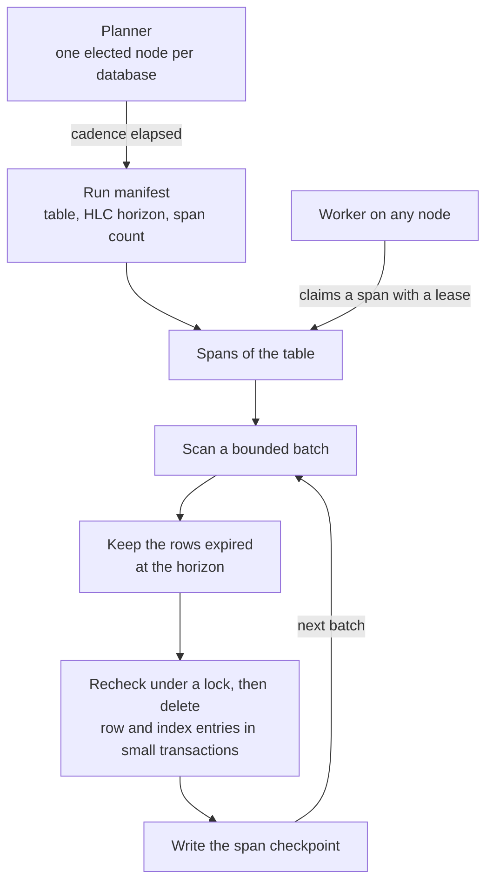

# Row-level TTL

CamusDB can delete expired rows for you. You name a column that contains the
expiry time of each row, and a background sweep deletes the rows whose time has
passed. No one has to run a `DELETE`.

The parameter names, values, and defaults follow a common SQL convention for
row-level TTL. Some parameters accept fewer values than that convention, and
some aren't supported. See [Parameter limits](#limits-of-the-parameters).

## Replace your cleanup jobs

TTL means time to live: how long a row remains in the table before it is removed.
Many tables contain data that is useful only for a limited time:

- Login sessions, access tokens, and password reset codes.
- Temporary carts, reservations, and application locks.
- Event logs, audit rows, and telemetry that a retention rule lets you keep for
  a fixed period only.
- Cached copies of data from another system.

Without TTL, you must write and schedule a cleanup job. It must delete rows in
small batches, so that it doesn't hold a large transaction or slow down the
application, and it must continue after a failure or a restart. Row-level TTL
does this work in the database. You name the expiry column once, and CamusDB
deletes the expired rows.

You don't need TTL for data that you keep forever, or for rows that the
application deletes as part of its normal work.

Expired rows aren't removed at the exact moment they expire. A query can see an
expired row until the sweep reaches it. Read
[Expired rows stay visible](#the-one-thing-to-know-an-expired-row-stays-visible)
before you rely on TTL for correctness.

## Turn it on

The node switch `ttl_enabled` is on by default. To use TTL on a table, name its
expiry column:

```camussql
ALTER TABLE sessions SET (ttl_expiration_expression = 'expires_at');
```

The column can be a `DATETIME`, a `DATE`, or an `INT64` with Unix epoch
milliseconds. A column of another type returns `CADB0400`. Until a table names
an expiry column, the sweep ignores it.

A row expires when its column value is in the past. A `NULL` value doesn't
expire. Use it to keep a row forever. You don't need a separate flag column.

`ttl_enabled: false` stops the sweep on the node, and no expired rows are
deleted on that node.

### Turn it off

```camussql
ALTER TABLE sessions SET (ttl_pause = 'true');   -- stop sweeping, keep the configuration
ALTER TABLE sessions RESET (ttl);                -- remove all TTL parameters
```

`RESET` can also take one parameter, as in `RESET (ttl_job_cron)`. This sets that
parameter back to its node default.

## Parameters

Set parameters with `ALTER TABLE t SET (key = value, ...)`, and clear them with
`RESET`.

In a cluster, you can send `ALTER TABLE ... SET` and `ALTER TABLE ... RESET`
to any node. See [Distributed schema](/docs/distributed-schema#how-a-schema-change-flows).

| Parameter | Type | Default | What it does |
|---|---|---|---|
| `ttl_expiration_expression` | column name | (none) | The column that contains the expiry time. Setting it turns on TTL for the table. |
| `ttl_pause` | boolean | `false` | Stops the sweep. The configuration doesn't change. |
| `ttl_job_cron` | cron macro | `'@daily'` | How often CamusDB sweeps the table. |
| `ttl_select_batch_size` | integer | `500` | Rows read per scan batch. |
| `ttl_delete_batch_size` | integer | `100` | Rows deleted per transaction. |
| `ttl_select_rate_limit` | integer | `0` | Maximum rows scanned per second. `0` means no limit. |
| `ttl_delete_rate_limit` | integer | `100` | Maximum rows deleted per second. `0` means no limit. |
| `ttl_grace_ms` | integer | `0` | Extra delay after the expiry time before a row can be deleted. |

The values of `ttl_job_cron` are `'@hourly'`, `'@daily'`, `'@weekly'`, and
`'@monthly'`.
`'@midnight'` is another spelling of `'@daily'`. The macro sets how often the
sweep starts, at no fixed time of day. For example, `@daily` means about once a
day.

You can also set the parameters in `CREATE TABLE ... WITH (...)`.
`SHOW CREATE TABLE` prints that form, and you can run its output to recreate
the table:

```camussql
SHOW CREATE TABLE sessions;
-- CREATE TABLE `sessions` (...) WITH (ttl_expiration_expression = 'expires_at', ttl_grace_ms = 5000);
```

### Node defaults

Each tuning parameter of a table has a node default. Set one policy for the
cluster, and override it only on the tables that need a different value.

| Config key | Default | Default for |
|---|---|---|
| `ttl_enabled` | `true` | The main switch |
| `ttl_default_job_cron` | `'@daily'` | `ttl_job_cron` |
| `ttl_default_select_batch_size` | `500` | `ttl_select_batch_size` |
| `ttl_default_delete_batch_size` | `100` | `ttl_delete_batch_size` |
| `ttl_default_select_rate_limit` | `0` | `ttl_select_rate_limit` |
| `ttl_default_delete_rate_limit` | `100` | `ttl_delete_rate_limit` |
| `ttl_spans_per_table` | `64` | How many [spans](/docs/concepts#ranges-and-spans) (ranges of the table's keys) a run divides the table into |
| `ttl_max_concurrent_spans_per_node` | `1` | How many spans one node processes at a time |
| `ttl_load_pause_threshold` | `16` | How many active foreground transactions pause the sweep |
| `ttl_span_lease_ms` | `30000` | The [lease](/docs/concepts#lease) (a claim that expires unless it is renewed) on a span |
| `ttl_span_lease_renew_interval_ms` | `10000` | How often a worker renews its claim |

## Expired rows stay visible until swept {#the-one-thing-to-know-an-expired-row-stays-visible}

An expired row is readable until the sweep deletes it. TTL deletes rows in the
background. It doesn't filter them out of reads. A `SELECT` returns an expired
row if the sweep hasn't reached it yet. A filter at read time would add a cost
to each query of a TTL table.

If your application needs exact expiry, filter explicitly:

```camussql
SELECT * FROM sessions WHERE expires_at > NOW();
```

`ttl_job_cron` sets the maximum time that an expired row is visible. For a
shorter maximum, sweep more often.

TTL can't be used on a table that a foreign key of another table references.
The sweep deletes rows in the background, and it doesn't check foreign keys. Both orders
return `CADB0533`: turning on TTL for a referenced table, and adding a foreign
key that references a TTL table.

## Tuning

Tune `ttl_delete_rate_limit` first. It controls the effect of the sweep on the
cluster. The batch sizes control the size of each transaction. The default of
100 rows per second is low on purpose.

Delete batches are small, because each row costs one mutation per index entry
plus one for the row. A table with four indexes uses five mutations per row.
Keep `ttl_delete_batch_size` well below the transaction limit of 20,000
mutations. Short delete transactions also keep foreground writers from waiting
for the sweep's locks.

Sweep transactions have `Background` priority. Priority applies when a
concurrency limit is configured, and it decides which transaction is admitted
first. After admission, a sweep transaction takes regular exclusive locks, and
it blocks foreground writers like any other transaction. Keep batches small and
transactions short to protect your latency.

Spans divide the work, and `ttl_max_concurrent_spans_per_node` sets how much of
it is processed at once. The limit applies to each node. A cluster of N nodes
can process N times that many spans at once. The rate limits also apply to each
node, and the concurrent spans of a table share them. More concurrency doesn't
multiply the rate.

A worker reads only its span, and more spans don't add scan work.

The spans currently divide the row ID space evenly, and most rows of an active
table fall into one span. A row ID contains a timestamp in seconds, and each of
64 spans covers about two years. This means that a higher
`ttl_spans_per_table` doesn't spread an append-heavy table across workers.

The distribution doesn't affect correctness. The sweep doesn't skip rows. It can
read a row more than once, for example when a worker continues a span from its
last checkpoint, but it deletes each row at most once.

Use `ttl_grace_ms` to allow for clock skew. It delays the deletion of a row
after its expiry time, which covers writers with slow clocks. To keep a row for
30 days, set the column to 30 days ahead. Don't use a 30-day grace period for
this.

## Monitoring

```camussql
SHOW ENGINE STATS LIKE 'ttl.%';
```

| Metric | Meaning |
|---|---|
| `ttl.rows_expired` | Rows that the sweep deleted on this node |
| `ttl.rows_skipped_recheck` | Rows that were expired at scan time but not at delete time |
| `ttl.rows_failed` | Rows whose delete failed, or whose result CamusDB couldn't determine |
| `ttl.spans_completed` | Spans that this node finished |
| `ttl.spans_reclaimed` | Spans that this node took over from a worker whose lease expired |
| `ttl.runs_planned` | Runs that this node created as the planner |
| `ttl.runs_completed` | Runs that this node closed as finished |
| `ttl.sweep_duration_ms` | Total time that this node spent on sweeps |

There are also rows for each table, with the tags `db=…` and `table=…`:

| Metric | Meaning |
|---|---|
| `ttl.table.state` | 0 idle, 1 paused, 2 progressing, 3 waiting, 4 failing, 5 stalled |
| `ttl.table.spans_done` and `ttl.table.span_count` | Progress of the open run |
| `ttl.table.rows_deleted` and `ttl.table.rows_failed` | Totals for this run |
| `ttl.table.horizon_ms` | The time that this run compares rows against |
| `ttl.table.last_observed_ms` | When the sweep last checked this table |

Read `ttl.table.state` before the totals. A total for the node shows only
whether TTL works. The numbers of healthy tables can hide a table that stopped.

These states look alike from the outside:

- `idle`: the table has no expired rows to delete.
- `waiting`: another node has the spans.
- `stalled`: an open run passed its interval and made no progress.
- `failing`: CamusDB tries to delete rows, and the deletes fail. Check
  `ttl.rows_failed`.

Each counter applies to one node and starts at zero when the node starts. Add
them across the nodes of a cluster. The counters need metric collection.

`ttl.rows_failed` must be zero. A higher value means that a delete transaction
failed, or that CamusDB couldn't determine its result. These rows stay before
the sweep's checkpoint, and the next attempt retries them. No data is lost.
However, a value that remains above zero means that each run makes less progress
than it seems to.

`ttl.rows_skipped_recheck` counts rows that changed after the scan. CamusDB
checks each row again under a lock at delete time. A row isn't deleted if its
expiry time moved later between the scan and the delete. On a sessions table, a
small steady count is normal: it counts sessions that were renewed before the
sweep reached them. A value close to `ttl.rows_expired` means that the sweep
competes with live traffic. Change its interval and batch sizes.

If `ttl.rows_expired` doesn't grow on a table that you expect to shrink, check
these items in order:

1. `ttl_enabled` on the node.
2. `ttl_pause` on the table.
3. Whether the `ttl_job_cron` interval has passed since the last run.
4. Whether the expiry column is `NULL` for the rows that you expected to
   disappear.

## Parameter limits {#limits-of-the-parameters}

CamusDB supports a subset of the common TTL parameters.

These parameters accept fewer values:

- `ttl_expiration_expression` takes a column name. An SQL expression, such as
  `created_at + INTERVAL '1 day'`, returns an error that says expressions
  aren't supported yet.
- `ttl_job_cron` takes only the `@` macros. Five-field CRON expressions return
  an error.

These parameters aren't available, and they return "Unknown table setting":

- `ttl_expire_after`. It would need a hidden expiry column. Use
  `ttl_expiration_expression` with your own column.
- `ttl_disable_changefeed_replication`. CamusDB has no changefeed.
- `ttl_row_stats_poll_interval` and `ttl_label_metrics`, which are specific to
  Prometheus. Use `SHOW ENGINE STATS`.

One parameter is a CamusDB extension:

- `ttl_grace_ms` adds a grace period after the expiry time. A column name alone
  can't express a grace period.

## How it works

A planner works on one elected node for each database. When the interval of a
table has passed, the planner creates a run. A run records the table, one expiry
time from the [hybrid logical clock](/docs/concepts#hlc), and a span count. All
workers compare their rows with that one time, and two nodes can't disagree
about a row at a span boundary.

Workers run on all nodes. A worker claims a span with a lease on the span's key.
If a worker stops, only its span waits, and another worker can claim it when the
lease expires.

A worker processes each span in these steps:

1. It scans a bounded batch.
2. It selects the expired rows.
3. It deletes them in small transactions.
4. It writes a checkpoint after the deletes commit.



The checkpoint is stored separately from the claim, and it doesn't expire. A
worker that takes over a span continues from the last checkpoint.

Deletes use the regular delete path, which removes a row and all its index
entries in one transaction.

CamusDB discards a run whose table ID doesn't match the current schema. A run
left over from a `DROP` can't delete rows from a new table with the same name.

A [`TRUNCATE`](/docs/truncate-table) stops a TTL run immediately. The run
doesn't delete rows from the old or the new contents. See
[TRUNCATE TABLE](/docs/truncate-table#row-level-ttl).
