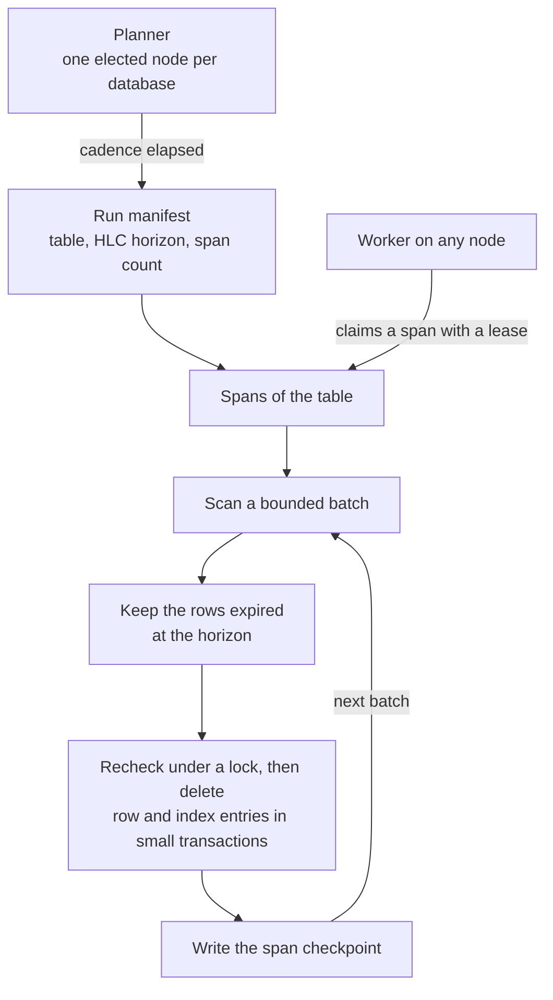

# Row-level TTL

CamusDB can expire rows automatically. You name a column on the table that
holds each row's expiry instant, and a background sweep deletes rows whose
instant has passed. Nobody has to issue a `DELETE`.

The parameter names, values, and defaults follow a common SQL convention for
row-level TTL. Some parameters accept narrower values than that convention
allows, and some are not supported. See
[Parameter limits](#limits-of-the-parameters).

## Why use row-level TTL

TTL means time to live: how long a row stays in the table before it is
removed. Many tables hold data that is only useful for a limited time:

- Login sessions, access tokens, and password reset codes.
- Temporary carts, reservations, and locks held by an application.
- Event logs, audit rows, and telemetry that a retention rule lets you keep
  only for a fixed period.
- Cached copies of data from another system.

Without TTL, you have to write and schedule your own cleanup job. It must delete
rows in small batches so it does not hold a large transaction or slow down the
application, and it must pick up again after a failure or restart. Row-level TTL
does that work inside the database: you name the expiry column once, and CamusDB
keeps the table small.

You do not need TTL for data you keep forever, or for rows the application
already deletes as part of its normal work.

Expired rows are not removed at the exact instant they expire, so a query can
still see an expired row until the sweep reaches it. Read
[Expired rows stay visible](#the-one-thing-to-know-an-expired-row-stays-visible)
before you depend on TTL for correctness.

## Turn it on

The node-level switch is `ttl_enabled` in `config.yml`, and it is on by default.
So the only task left is to name the expiry column on each table you want
CamusDB to sweep. Until a table names one, it is not a TTL table and the sweep
ignores it completely.

`ttl_enabled: false` stops the sweep loop on the whole node. The feature then
does nothing at all: CamusDB collects no expired rows, whatever the tables
say.

Name the column on the table:

```camussql
ALTER TABLE sessions SET (ttl_expiration_expression = 'expires_at');
```

The column may be a `DATETIME`, a `DATE`, or an `INT64` in Unix epoch
milliseconds. Setting this parameter is what enables TTL for the table.

A row expires when its column value is in the past. A `NULL` never expires,
which gives you an explicit way to say "keep this row forever" without a
separate flag column.

### Turn it off

```camussql
ALTER TABLE sessions SET (ttl_pause = 'true');   -- stop sweeping, keep the configuration
ALTER TABLE sessions RESET (ttl);                -- remove the configuration entirely
```

`RESET (ttl)` clears every TTL parameter at once, so you never leave a tuning
value behind that points at a cleared column.

`RESET` also accepts a single parameter, as in `RESET (ttl_job_cron)`, which
restores just that parameter to its node default.

## Parameters

Set parameters with `ALTER TABLE t SET (key = value, ...)` and clear them with
`RESET`.

| Parameter | Type | Default | What it does |
|---|---|---|---|
| `ttl_expiration_expression` | column name | (none) | The column that holds the expiry instant. Setting it enables TTL. |
| `ttl_pause` | boolean | `false` | Stops the sweep but keeps the configuration. |
| `ttl_job_cron` | cron macro | `'@daily'` | How often CamusDB sweeps the table. |
| `ttl_select_batch_size` | integer | `500` | Rows read per scan batch. |
| `ttl_delete_batch_size` | integer | `100` | Rows deleted per transaction. |
| `ttl_select_rate_limit` | integer | `0` | Scan cap in rows per second. `0` means no limit. |
| `ttl_delete_rate_limit` | integer | `100` | Delete cap in rows per second. `0` means no limit. |
| `ttl_grace_ms` | integer | `0` | Extra delay after expiry before a row becomes eligible. |

`ttl_job_cron` accepts `'@hourly'`, `'@daily'`, `'@weekly'`, and `'@monthly'`,
plus `'@midnight'` as another spelling of `'@daily'`.

The parameter sets a cadence, not a wall-clock schedule: `@daily` means about
once a day, not at midnight. CamusDB orders sweeps by the cluster's
[hybrid logical clock](/docs/concepts#hlc) (HLC), which orders events
consistently across nodes, and never by wall time.

You can also set these parameters inline with `CREATE TABLE ... WITH (...)`.
`SHOW CREATE TABLE` renders that form, so its output recreates the same table
rather than just describing it:

```camussql
SHOW CREATE TABLE sessions;
-- CREATE TABLE `sessions` (...) WITH (ttl_expiration_expression = 'expires_at', ttl_grace_ms = 5000);
```

### Node defaults

Every per-table tuning parameter falls back to a node default, so you can set
one policy for the fleet and override it only where a table needs something
different.

| Config key | Default | Supplies the default for |
|---|---|---|
| `ttl_enabled` | `true` | The main switch |
| `ttl_default_job_cron` | `'@daily'` | `ttl_job_cron` |
| `ttl_default_select_batch_size` | `500` | `ttl_select_batch_size` |
| `ttl_default_delete_batch_size` | `100` | `ttl_delete_batch_size` |
| `ttl_default_select_rate_limit` | `0` | `ttl_select_rate_limit` |
| `ttl_default_delete_rate_limit` | `100` | `ttl_delete_rate_limit` |
| `ttl_spans_per_table` | `64` | How many [spans](/docs/concepts#ranges-and-spans) (slices of the table's keys) a run divides the table into |
| `ttl_max_concurrent_spans_per_node` | `1` | How many spans one node works on at a time |
| `ttl_load_pause_threshold` | `16` | How many in-flight foreground transactions pause the sweep |
| `ttl_span_lease_ms` | `30000` | The [lease](/docs/concepts#lease) (a claim that expires unless renewed) on a span |
| `ttl_span_lease_renew_interval_ms` | `10000` | How often an owner renews its claim |

## Expired rows stay visible until swept {#the-one-thing-to-know-an-expired-row-stays-visible}

An expired row stays readable until the sweep deletes it. TTL is a background
collector, not a read-time filter, so a `SELECT` returns a row whose expiry has
passed if the sweep has not reached it yet.

This is by design. A read-time filter would add a predicate to every read of a
TTL table, and it would also change index-only scans: an index entry does not
carry the TTL column unless you added it as an `INCLUDE` column, so the engine
would have to fetch rows it never touches today. Every query would pay that
cost, forever, to hide a row for at most one sweep interval.

Filter explicitly if your application needs exact expiry semantics:

```camussql
SELECT * FROM sessions WHERE expires_at > NOW();
```

Treat TTL as what it is: it reclaims space, it does not enforce visibility.
`ttl_job_cron` bounds the lag, so a table that needs a tight bound must sweep
more often.

TTL cannot run on a table that another table references with a foreign key. The
sweep deletes rows in the background, outside the parent-side foreign-key check
path, so CamusDB refuses both orders: enabling TTL on a referenced parent table,
and adding a foreign key that references a TTL table.

## Tuning

Start with the delete rate, not the batch sizes. `ttl_delete_rate_limit` is the
throttle that governs the sweep's impact; the batch sizes govern the shape of
each transaction. The default of 100 rows per second is conservative by design.

Delete batches are small for a reason. Each row costs one mutation per index
entry plus one for the row itself, so a table with four indexes spends five
mutations per row. `ttl_delete_batch_size` must stay well below the transaction
limit of 20,000 mutations. Short delete transactions also keep foreground
writers from waiting behind the sweep's locks.

Priority orders admission (the moment a transaction is let in to run), not
execution. Sweep transactions run at `Background` priority, which decides who
waits at the door while a concurrency ceiling is configured. Once admitted, a
background delete takes ordinary exclusive locks and blocks foreground writers
exactly like any other transaction. Small batches and short transactions protect
your latency; the priority tag does not.

Spans divide the work, and `ttl_max_concurrent_spans_per_node` decides how much
of it runs at once. The limit is per node, so a cluster of N nodes can have N
times that many spans in flight.

The rate limits are also per node, and a table's concurrent spans share them, so
more concurrency does not multiply the configured rate.

A worker reads only its own span. Span bounds are seeks into the store, not a
filter over everything, so more spans add no scan work.

Today the spans divide the row id space uniformly, and that division is not
balanced. A row id contains a timestamp in seconds, so each of 64 spans is about
two years wide, and almost every row of an active table lands in one of them.

Correctness does not depend on that distribution. A sweep never skips a row. It
can examine a row more than once, for example when a worker resumes a span from
its last checkpoint, but it deletes each row at most once. Throughput does
depend on the distribution, so raising `ttl_spans_per_table` does not currently
spread an append-heavy table across workers.

Use `ttl_grace_ms` for clock skew, not as a business rule. It delays a row's
eligibility past its expiry instant, which absorbs writers with slow clocks. To
keep a row for 30 days, set the column 30 days ahead; do not set a 30-day grace
period.

## Monitoring

```camussql
SHOW ENGINE STATS LIKE 'ttl.%';
```

| Metric | Meaning |
|---|---|
| `ttl.rows_expired` | Rows the sweep deleted on this node |
| `ttl.rows_skipped_recheck` | Rows that looked expired at scan time but that CamusDB spared at delete time |
| `ttl.rows_failed` | Rows whose delete failed, or whose outcome CamusDB could not resolve |
| `ttl.spans_completed` | Spans this node finished |
| `ttl.spans_reclaimed` | Spans this node took over from a worker whose lease lapsed |
| `ttl.runs_planned` | Runs this node created as the planner |
| `ttl.runs_completed` | Runs this node retired as finished |
| `ttl.sweep_duration_ms` | Total time this node spent on sweeps |

There are also per-table rows, each tagged with `db=…` and `table=…`:

| Metric | Meaning |
|---|---|
| `ttl.table.state` | 0 idle, 1 paused, 2 progressing, 3 waiting, 4 failing, 5 stalled |
| `ttl.table.spans_done` and `ttl.table.span_count` | Progress of the open run |
| `ttl.table.rows_deleted` and `ttl.table.rows_failed` | Totals for this run |
| `ttl.table.horizon_ms` | The instant this run judges rows against |
| `ttl.table.last_observed_ms` | When a tick last looked at this table |

Read `ttl.table.state` before the totals. A cumulative counter only tells you
whether TTL works at all. It cannot tell you which table stopped, because a
healthy table's numbers hide a silent one.

These states matter most, because they look alike from the outside:

- `idle`: there is nothing to do.
- `waiting`: another node holds the spans.
- `stalled`: an open run passed its own cadence without making progress.
- `failing`: CamusDB is attempting deletes and they are not succeeding. Check
  `ttl.rows_failed`.

Each counter is per node and accumulates from node start, so sum them across the
nodes of a cluster. The counters require metric collection.

`ttl.rows_failed` must be zero. A nonzero value means a delete transaction
failed, or CamusDB could not resolve its outcome.

By design, CamusDB leaves those rows before the sweep's checkpoint, so the next
attempt retries them instead of stepping over them. No data is lost. But a value
that stays above zero means something is failing, and each run makes less
progress than it appears to.

That is exactly why failures are counted separately from skips. A skip is the
system working; a failure is not. One number for both would look healthy while
data piled up.

`ttl.rows_skipped_recheck` is the interesting one. CamusDB rechecks each row
under a lock at delete time, so a row survives if something extended its expiry
between the scan and the delete.

On a sessions table, a steady trickle here is normal and healthy: it is renewals
winning the race, as they should. A value close to `ttl.rows_expired` means the
sweep is mostly fighting live traffic, so revisit its cadence and batch sizes.

If `ttl.rows_expired` stays flat on a table you expect to shrink, check these in
order:

1. `ttl_enabled` on the node.
2. `ttl_pause` on the table.
3. Whether `ttl_job_cron` has elapsed since the last run.
4. Whether the expiry column is `NULL` for the rows you expected to disappear.

## Parameter limits {#limits-of-the-parameters}

CamusDB implements a subset of the common TTL parameters.

These parameters accept narrower values:

- `ttl_expiration_expression` takes a bare column name, not an SQL expression
  that returns a timestamp. CamusDB rejects an expression with a message saying
  expressions are not supported yet. The parameter name is correct; only the
  value grammar is narrower, so a wider grammar later will need no rename.
- `ttl_job_cron` takes only the `@macro` forms. CamusDB rejects five-field CRON
  expressions.

These parameters are not available:

- `ttl_expire_after` needs an `INTERVAL` type and `INTERVAL` literals, and
  CamusDB has neither. It also needs a hidden expiration column. Use
  `ttl_expiration_expression` with your own column instead.
- `ttl_disable_changefeed_replication` has no purpose here, because CamusDB has
  no changefeed.
- `ttl_row_stats_poll_interval` and `ttl_label_metrics` are Prometheus-specific.
  Use `SHOW ENGINE STATS` instead.

One parameter is a CamusDB extension:

- `ttl_grace_ms` adds a grace period after the expiry instant. An expiration
  expression could include a grace period, but a bare column name cannot.

## How it works

This section matters if you operate a cluster.

A planner runs on one elected node per database. When a table's cadence has
elapsed, it creates a run: a durable manifest that records the table, a single
expiry horizon from the hybrid logical clock, and a span count. Every worker in
the run tests its rows against that one horizon, so two nodes can never disagree
about a row on the boundary they share.

Workers run on every node. This is CamusDB's first background job whose work
spreads across the cluster; other background jobs run entirely on one elected
node.

Workers claim spans; CamusDB does not assign them. A worker takes a lease on the
span's key, so a worker that dies blocks only that span, not the whole run.
Claiming needs no knowledge of which nodes are alive, which is why CamusDB uses
claims instead of assignments.

CamusDB processes each span in these steps:

1. It scans a bounded batch.
2. It keeps the expired rows.
3. It deletes them in small transactions.
4. It writes a checkpoint after the deletes commit.



CamusDB stores the checkpoint separately from the claim, and the checkpoint does
not expire with it. A worker that takes over a dead worker's span continues from
where the other worker stopped instead of scanning from the start.

Deletes go through the normal delete path, so a row and all of its index entries
are removed in one transaction.

That is why TTL does not use the per-key expiry of the
[Kahuna](/docs/concepts#kahuna) storage layer. Expiring only the row key would
strand every secondary index entry permanently, and index-only scans would then
return rows that no longer exist.

CamusDB discards, rather than drives, a run whose table id no longer matches the
live schema. So a run left behind by a `DROP` can never delete rows from a new
table that reuses the name.

A [`TRUNCATE`](/docs/truncate-table) stops an in-progress TTL run at once, so it
never deletes rows from either the old or the new contents. See
[TRUNCATE TABLE](/docs/truncate-table#row-level-ttl).
