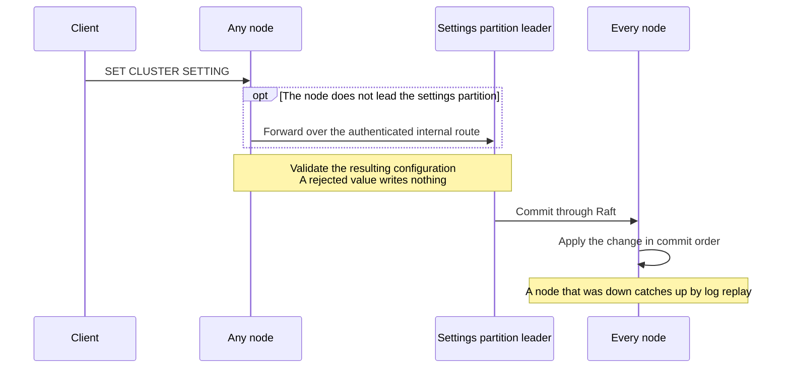

# Runtime cluster settings

You can change a defined subset of the CamusDB configuration from a SQL prompt
while the cluster runs. The change reaches every node, whichever node received
the statement.

```camussql
SET CLUSTER SETTING max_mutations_per_transaction = 40000;
SHOW CLUSTER SETTINGS;
RESET CLUSTER SETTING max_mutations_per_transaction;
```

## Why use cluster settings

You can still edit `config.yml` on each node and restart it, and for values that
define a node, that is the only way. For everything else, a cluster setting is
the better tool:

- No restart, so no period of reduced capacity. Settings such as a mutation
  cap, the TTL job's rate limit, or the default isolation level used to be
  rolled out node by node. Now the new value takes effect at the next statement
  boundary while the node keeps serving traffic.
- One change gives one value everywhere. CamusDB commits the change through
  [Raft](/docs/concepts#raft), the consensus protocol that replicates it to
  every node, so every node reaches the same value in the same order. There is
  no partial rollout to repair, and no node left on an old value because
  somebody forgot a file.
- The change survives restarts. CamusDB persists the overlay, so a node that
  reboots, or one that was down during the change, comes back with the
  cluster's value instead of its own stale YAML.
- One statement reverses the change. `RESET` drops the cluster entry, and each
  node falls back to its own local configuration. That is much quicker than
  editing the files again.
- The database tells you what you can change. Every row of `SHOW VARIABLES`
  shows the setting's mutability and scope, so there is no hand-written list to
  go stale.

## Mutability and scope

CamusDB classifies every setting on two independent axes, both visible in
[`SHOW VARIABLES`](/docs/show-variables).

Mutability says whether the setting can change without a restart:

| Value | Meaning |
| --- | --- |
| `runtime` | A new value takes effect at the next point where the reader picks it up: the next statement, the next transaction start, or the next pass of a background loop. Only these settings can change while the node runs. |
| `restart` | The value is baked into something CamusDB builds once per process, such as the data directory, the node identity, the internal cluster ports and peers, and the whole `kahuna.*` section (which configures the embedded [Kahuna](/docs/concepts#kahuna) storage layer). To change one, edit the configuration and restart the node. |

Scope says whether the fleet must agree on the value:

| Value | Meaning |
| --- | --- |
| `cluster` | If nodes disagree, a user transaction behaves differently depending on which node accepted it. Examples: the isolation defaults, the mutation caps, and the TTL and [lease](/docs/concepts#lease) policy. |
| `node` | The value may differ between nodes, through each node's `config.yml`. A cluster setting still applies to every node. Examples: the trace switches, local cache sizes, and whether this node runs materialized view refreshes. |

The two axes are independent:

- `data_dir` is `restart` and `node`.
- `max_mutations_per_transaction` is `runtime` and `cluster`.
- `query_tracing_enabled` is `runtime` and `node`. You can change it live, and
  `SET CLUSTER SETTING` applies the new value on every node, overriding each
  node's `config.yml`. Two nodes hold different values only through their own
  `config.yml` files, and only while no cluster override exists for the key.
- `authentication_enabled` is `restart` and `cluster`. The fleet must agree on
  it, but not through a live change.

Instead of keeping a hand-written list of changeable settings, ask the
database:

```camussql
SHOW VARIABLES;                     -- value, type, default, source, mutability, scope
SHOW VARIABLES LIKE 'ttl_%';        -- narrowed by name
```

## Change a setting

```camussql
SET CLUSTER SETTING max_mutations_per_transaction = 40000;
SET CLUSTER SETTING default_isolation_level = read_committed;
SET CLUSTER SETTING query_tracing_enabled = true;
```

Values use the same spelling as `config.yml`: lowercase booleans, plain
numbers, enum members with underscores, and durations as whole milliseconds.
Enum values need no quotes. Any value that `SHOW VARIABLES` prints can be pasted
back unchanged, so a file and a statement never mean two different things.

You can send the statement to any node. Cluster settings live in one settings
[partition](/docs/concepts#partition). If the node is not that partition's
[leader](/docs/concepts#leader) (the node that coordinates its writes), it
forwards the change to the leader over the authenticated internal route.
CamusDB then commits the change through Raft and applies it everywhere.

As a result, two conflicting `SET` statements resolve to the same winner on
every node. The commit order decides the winner, never a wall clock. A node
that is down during the change catches up by replaying the Raft log when it
returns.

CamusDB validates the change against the resulting configuration before
applying it anywhere. Validation includes invariants across two fields, such as
the rule that a lease-renew interval must stay below its lease. If a value
would break such a rule, CamusDB rejects it and writes nothing, and the
validator's message names both sides of the check.



## Undo a change

```camussql
RESET CLUSTER SETTING max_mutations_per_transaction;
```

`RESET` removes the cluster entry for that key. It does not write the built-in
default, because a written default would leave a cluster-wide override of every
file, with a value nobody chose.

Instead, each node resolves the key through its own local chain again: command
line, environment, file, and built-in default. A node whose `config.yml` names
that key returns to its file value.

## Precedence: the cluster layer wins

For a `runtime` key, the cluster value overrides the node's command line,
environment, and `config.yml`:

1. The cluster overlay.
2. The command-line flags.
3. The environment variables.
4. The selected YAML file.
5. The built-in defaults.

This order is intentional. A fleet-wide change must not silently do nothing on
the one node whose YAML names that key, because that kind of drift is the
hardest to diagnose. `restart`-class keys never accept a cluster override, so a
value that truly defines a node keeps its local origin.

When a node's behavior contradicts its own `config.yml`, it explains itself:
the `source` column of `SHOW VARIABLES` reads `cluster` for a key that the
cluster supplies, instead of `config`, `env`, `cli`, or `default`.

## See what the cluster carries

```camussql
SHOW CLUSTER SETTINGS;
SHOW CLUSTER SETTINGS LIKE 'ttl_%';
```

| Column | Meaning |
| --- | --- |
| `setting` | The configuration key. |
| `value` | The stored value as text, in the spelling that `SET` and `config.yml` accept. |

This statement lists the overlay itself: every key that a `SET` put in force
and no `RESET` has dropped. That answers a different question from
`SHOW VARIABLES`.

The overlay is what the fleet agreed on. The variables are what this node
actually runs, after merging that overlay over its local configuration. An
empty result means the cluster carries no overrides at all.

## Confirm that a change reached every node

`SHOW VARIABLES` is node-local by design: it describes the node that served the
statement. An answer from the leader would hide exactly the drift you are
looking for. To confirm a fleet-wide change, ask each node:

```camussql
-- run against every node:
SHOW VARIABLES LIKE 'max_mutations_per_transaction';
```

Every node should report the new value, with `source` equal to `cluster`.

A node that still shows its file value either has not applied the change yet
(replication lag, which clears if you retry) or cannot reach the cluster. If
the value stays wrong, check that node's connection to the settings partition
leader, and look in its logs for a warning about a failed apply.

## What CamusDB rejects

Each of these mistakes produces its own message. Three of them share the code
`CADB0400`, so read the message to tell them apart, because each points you
somewhere different:

| Statement | Error | Why |
| --- | --- | --- |
| `SET CLUSTER SETTING no_such_setting = 1` | `CADB0400`, unknown cluster setting | The key does not exist. Check the spelling. |
| `SET CLUSTER SETTING data_dir = '/elsewhere'` | `CADB0400`, restart-bound | The key exists but is `restart`-class. Edit the configuration, then restart the node. |
| `SET CLUSTER SETTING max_mutations_per_transaction = banana` | `CADB0400`, which names the key | The value does not convert to the setting's type. |
| `SET CLUSTER SETTING ttl_span_lease_renew_interval_ms = 999999999` | `CADB0600` `InvalidConfig` | The value is well formed but breaks an invariant across two fields. The message names both settings. |

CamusDB reports a `kahuna.*` key as restart-bound, not unknown. That section has
no per-key classification, and reporting the key as unknown would send you
looking for a spelling mistake that is not there.

A rejected change leaves nothing behind: no overlay entry, and no change to the
node's effective configuration.

## Standalone mode

The same three statements work in standalone mode, with identical validation,
apply, and persistence. Only replication is missing, because there is no fleet
to agree with. A single-node deployment therefore gets live configuration
changes without cluster mode.

## Boot behavior

A node boots on its file configuration and swaps to the merged cluster view as
soon as its store is readable, before the query engine serves traffic.

Any component that CamusDB builds before that point either reacts to the swap
or holds only `restart`-class settings. An ordinary restart therefore cannot
produce a node that permanently disagrees with the cluster.

## Permissions

While authentication is enabled, all three statements require a superuser.
Other users receive `CADB0517` `InsufficientPrivilege`.

Several of these settings bound memory, concurrency, and background work, so
the ability to change them across the fleet is a denial-of-service control.

Reading the overlay requires the same privilege as
[`SHOW VARIABLES`](/docs/show-variables), so the whole configuration surface
answers consistently.

While authentication is disabled, any caller may run the three statements.

## Related pages

- [Configuration](/docs/configuration) for the full setting reference and the
  startup model.
- [`SHOW VARIABLES`](/docs/show-variables) for a node's effective values.
- [Cluster Deployment](/docs/cluster) for how nodes find each other.
- [Error Codes](/docs/error-codes) for the codes above.
