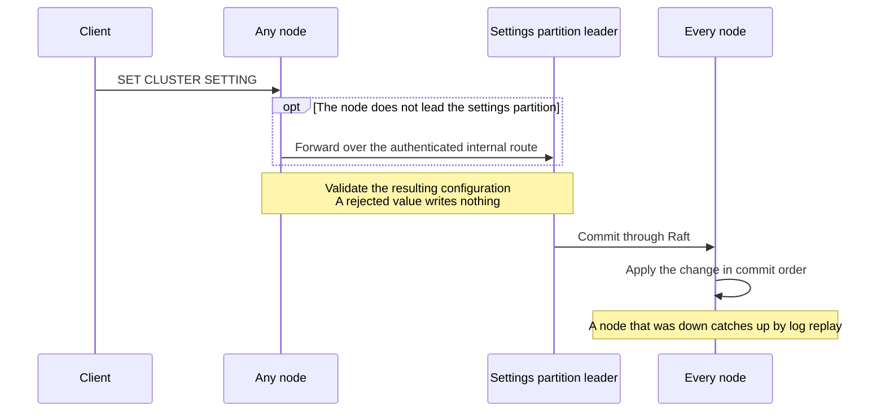

# Runtime cluster settings

You can change many CamusDB settings with SQL while the cluster serves
traffic. The change applies to all nodes, and you don't need to restart any of
them:

```camussql
SET CLUSTER SETTING max_mutations_per_transaction = 40000;
SHOW CLUSTER SETTINGS;
RESET CLUSTER SETTING max_mutations_per_transaction;
```

Compared with editing `config.yml` on each node and restarting it:

- The new value takes effect at the next statement, and the node continues to
  serve traffic.
- All nodes get the same value. The change is committed through
  [Raft](/docs/concepts#raft), the protocol that replicates it to all nodes in
  the same order.
- The change persists. A node that restarts, or that was down during the
  change, gets the cluster value when it comes back.
- `RESET` reverses the change in one statement.

Settings that define a node, such as its data directory, can only change in
`config.yml`, with a restart.

## Which settings you can change

Each setting has a mutability and a scope. Both appear in
[`SHOW VARIABLES`](/docs/show-variables).

The mutability shows whether a setting can change while the node is up:

| Mutability | Meaning |
| --- | --- |
| `runtime` | You can change it with `SET CLUSTER SETTING`. The new value takes effect at the next point where CamusDB reads it, such as the next statement or the next pass of a background job. |
| `restart` | CamusDB reads it once, when the node starts. Examples are the data directory, the node identity, the internal cluster ports and peers, and the `kahuna.*` section, which configures the embedded [Kahuna](/docs/concepts#kahuna) storage layer. To change it, edit the configuration and restart the node. |

The scope shows whether all nodes must agree on the value:

| Scope | Meaning |
| --- | --- |
| `cluster` | Nodes must agree. If they don't, a transaction can behave differently depending on the node that accepted it. Examples are the isolation defaults and the mutation caps. |
| `node` | The value can differ between nodes, through each node's `config.yml`. Examples are the trace switches and the local cache sizes. |

The two properties are independent:

| Setting | Mutability | Scope |
| --- | --- | --- |
| `data_dir` | `restart` | `node` |
| `max_mutations_per_transaction` | `runtime` | `cluster` |
| `query_tracing_enabled` | `runtime` | `node` |
| `authentication_enabled` | `restart` | `cluster` |

Note that `SET CLUSTER SETTING` applies to all nodes, also for a `node` setting.
It overrides the value in each node's `config.yml`. Nodes can have different
values only while no cluster setting exists for the key.

To list the settings and their properties:

```camussql
SHOW VARIABLES;                     -- value, type, default, source, mutability, scope
SHOW VARIABLES LIKE 'ttl_%';        -- filtered by name
```

## Change a setting

```camussql
SET CLUSTER SETTING max_mutations_per_transaction = 40000;
SET CLUSTER SETTING default_isolation_level = read_committed;
SET CLUSTER SETTING query_tracing_enabled = true;
```

Values use the same format as `config.yml`:

- Booleans in lowercase, such as `true`.
- Numbers as digits, such as `40000`.
- Enum values with underscores and no quotes, such as `read_committed`.
- Durations as an integer number of milliseconds.

You can paste any value that `SHOW VARIABLES` prints.

You can send the statement to any node. If two `SET` statements for the same
key conflict, the one that commits last wins on all nodes. The commit order
decides the winner, and the nodes' clocks play no part.

CamusDB validates the resulting configuration before it applies the change.
This includes rules that involve two settings, such as a lease renew interval
that must be shorter than its lease. An invalid value returns an error that
names both settings, and the change isn't written.



Cluster settings are stored in one [partition](/docs/concepts#partition). Its
[leader](/docs/concepts#leader), the node that coordinates its writes, commits
each change. A node that receives the statement forwards it to the leader.

## Undo a change

```camussql
RESET CLUSTER SETTING max_mutations_per_transaction;
```

`RESET` removes the cluster value for the key. Each node then uses its local
configuration again, in the order shown in [Precedence](#precedence). A node
whose `config.yml` sets the key goes back to that value.

## Precedence

For a `runtime` setting, a node uses the first value it finds in this list:

1. The cluster setting.
2. The command-line flags.
3. The environment variables.
4. The selected `config.yml` file.
5. The built-in default.

A `restart` setting doesn't accept a cluster value.

The `source` column of `SHOW VARIABLES` shows where a node's value comes from:
`cluster`, `cli`, `env`, `config`, or `default`. Use it to see why a node
doesn't use the value in its `config.yml`.

## List the cluster settings

```camussql
SHOW CLUSTER SETTINGS;
```

```text
┌───────────────────────────────┬────────────────┐
│ setting                       │ value          │
├───────────────────────────────┼────────────────┤
│ default_isolation_level       │ read_committed │
│ max_mutations_per_transaction │ 40000          │
│ query_tracing_enabled         │ true           │
└───────────────────────────────┴────────────────┘
3 rows in set (00:00:00.0220141)
```

```camussql
SHOW CLUSTER SETTINGS LIKE 'query%';
```

| Column | Meaning |
| --- | --- |
| `setting` | The configuration key. |
| `value` | The stored value as text, in the format that `SET` and `config.yml` accept. |

`SHOW CLUSTER SETTINGS` lists the keys that a `SET` changed and no `RESET` has
removed. An empty result means that no cluster settings exist.
`SHOW VARIABLES` shows the values that the current node uses, after it merges
the cluster settings with its local configuration.

## Confirm that a change reached all nodes

`SHOW VARIABLES` describes only the node that receives the statement. To check a
change, run it on each node:

```camussql
-- run against each node:
SHOW VARIABLES LIKE 'max_mutations_per_transaction';
```

Each node should show the new value, with `source` set to `cluster`.

A node that shows its file value hasn't applied the change yet, or it can't
reach the cluster. Replication delay clears if you retry after a moment. If
the value doesn't change, check the node's connection to the leader of the
settings partition. Then look in the node's logs for a warning about a failed
apply.

## Errors

Three of these errors use the code `CADB0400`. Read the message to tell them
apart:

| Statement | Error | Fix |
| --- | --- | --- |
| `SET CLUSTER SETTING no_such_setting = 1` | `CADB0400` Unknown cluster setting | Check the spelling of the key. |
| `SET CLUSTER SETTING data_dir = '/elsewhere'` | `CADB0400` Setting is restart-class | Edit the configuration and restart the node. |
| `SET CLUSTER SETTING max_mutations_per_transaction = banana` | `CADB0400` Invalid value for the setting | Use a value of the setting's type. |
| `SET CLUSTER SETTING ttl_span_lease_renew_interval_ms = 999999999` | `CADB0600` `InvalidConfig` | The message names both settings in the rule. Change one of them. |

A `kahuna.*` key also returns the restart-class error.

A rejected change isn't written. The cluster settings and the node's
configuration don't change.

## Standalone mode

The three statements also work on a single node, with the same validation and
persistence. A single-node deployment can change settings live with no cluster.

## Startup

A node starts with its file configuration. It switches to the cluster settings
before it serves queries. This means that a restarted node can't disagree with
the cluster.

## Permissions

With authentication enabled, the three statements require a superuser. Other
users get `CADB0517`
`InsufficientPrivilege`. `SHOW CLUSTER SETTINGS` requires the same privilege as
[`SHOW VARIABLES`](/docs/show-variables).

With authentication disabled, any caller can run the three statements.

## Related pages

- [Configuration](/docs/configuration) for the full list of settings and how a
  node reads its configuration at startup.
- [`SHOW VARIABLES`](/docs/show-variables) for a node's current values.
- [Cluster mode](/docs/cluster) for how nodes find each other.
- [Error codes](/docs/error-codes) for the codes on this page.
