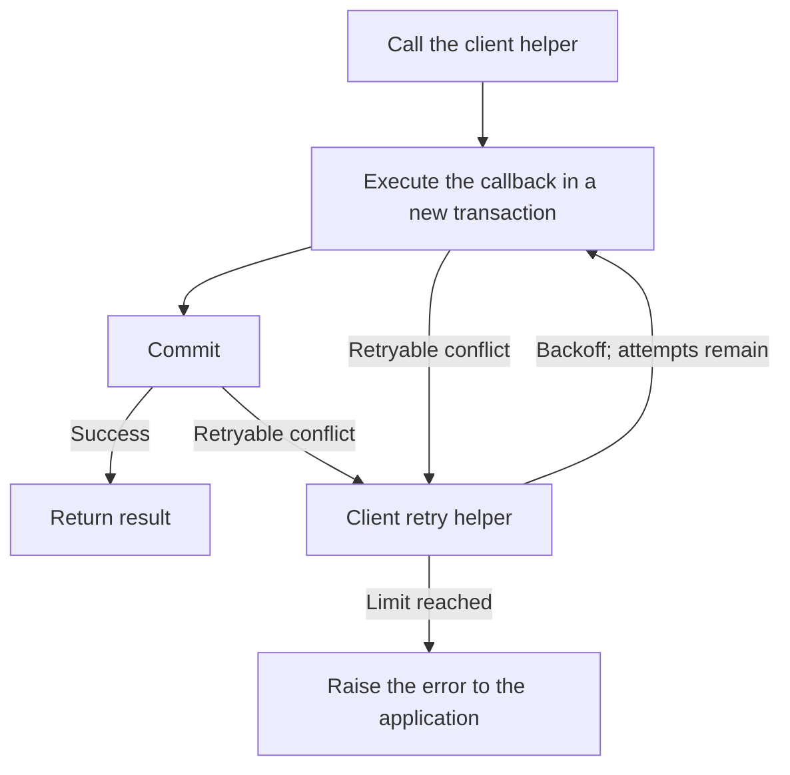

# Retries and conflicts

Under serializable isolation, two transactions that conflict can't both commit.
CamusDB aborts one of them, and the application must execute it again from the
start. Each driver has a retry helper for this. You put the database work in a
callback, and the helper executes the callback again after a retryable
conflict. You don't need to write the retry loop or the backoff.

## Use the client libraries

| Library | API | What it does |
| --- | --- | --- |
| [.NET](/docs/dotnet-driver#serializable-retries) | `SerializableRetryHelper.ExecuteAutocommitAsync(...)` | Executes the callback again after a retryable conflict. For an explicit transaction, begin and commit the transaction in the callback. |
| [TypeScript](/docs/typescript-connector#transactions-and-retries) | `client.transaction(...)` | Begins a transaction and commits it when the callback returns. After a retryable conflict, it executes the callback again in a new transaction. `withRetry(...)` retries a unit of work that you manage. |
| [Python](/docs/python-driver#transactions-and-retries) | `camusdb.run_transaction(...)` | Begins and commits the transaction, and executes the callback again after a retryable conflict. `camusdb.aio.run_transaction(...)` is the asyncio form. |

By default, the helpers make at most five attempts, including the first. The
delay between attempts starts at 20 ms and doubles up to 400 ms, with 25%
random jitter. When the attempts are used up, or the error isn't retryable, the helper
raises the error.

A statement or a transaction that you manage directly isn't replayed. Use a
helper around the full business operation.

### .NET

With an open `CamusConnection`, begin the transaction in the callback. Then
each attempt uses a new transaction. If the callback throws, disposal rolls
back the transaction:

```csharp
using CamusDB.Client;

await SerializableRetryHelper.ExecuteAutocommitAsync(async ct =>
{
    await using var tx = await connection.BeginTransactionAsync(ct);
    await using var command = connection.CreateCamusCommand("""
        UPDATE products SET stock = stock - 1 WHERE name = @name AND stock > 0
        """);
    command.Transaction = tx;
    command.Parameters.Add("@name", ColumnType.String, "kettle");
    await command.ExecuteNonQueryAsync(ct);
    await tx.CommitAsync(ct);
}, maxAttempts: 5);
```

For one autocommit statement, the callback can execute the command directly.

### TypeScript

`transaction()` manages the transaction and the retries. If the callback
throws, the transaction is rolled back:

```ts
await client.transaction(async (txn) => {
  await client.execute(
    'UPDATE products SET stock = stock - 1 WHERE name = @name AND stock > 0',
    { name: 'kettle' },
    { transaction: txn },
  );
}, { maxAttempts: 5 });
```

### Python

Call the helper when the connection doesn't have an open transaction.
Otherwise, it raises `ProgrammingError`. The helper begins and commits each
attempt. If the callback raises an error, the attempt is rolled back:

```python
import camusdb


def reserve_kettle(conn):
    return conn.execute(
        "UPDATE products SET stock = stock - 1 WHERE name = @name AND stock > 0",
        {"name": "kettle"},
    ).rowcount


with camusdb.connect(
    endpoint="http://localhost:5095", database="shop", autocommit=True,
) as conn:
    changed = camusdb.run_transaction(conn, reserve_kettle, max_attempts=5)
```

For asyncio, pass an async callback to
`await camusdb.aio.run_transaction(conn, callback, max_attempts=5)`.

### Write a repeatable callback

Put all the reads and writes of the operation in the callback. A conflict
aborts the transaction. This means that the next attempt must read the data
again. It can't use values from an earlier attempt.

Let errors reach the helper. Don't catch a conflict and continue with the
aborted transaction.

The callback can execute more than once. Put external side effects, such as
emails or payments, after the helper returns.

## What causes a retry

A retryable error means that the transaction didn't commit, and that the same
work can succeed on a new attempt. Common causes are:

- A concurrent transaction that read or wrote the same rows.
- A schema change to a table that the transaction uses. The next statement or
  the commit returns `CADB0502`. See
  [Distributed schema changes](/docs/distributed-schema).
- In a cluster, a leader change or a partition that is briefly unavailable. See
  [Distributed transactions](/docs/distributed-transactions).
- A serializable read-write transaction that was open longer than its lifetime
  limit.

## Which errors to retry, and how

The following table shows the recovery that the drivers use for each code. You
normally use the helpers, and you don't need to check these codes:

| Code | Error | Recovery |
| --- | --- | --- |
| `CADB0502` | `TransactionConflict` | The helper executes the callback again. |
| `CADB0504` | `TransactionMustRetry` | The helper executes the callback again. |
| `CADB0505` | `TransactionLifetimeExceeded` | The helper executes the callback again. |
| `CADB0503` | `SchemaCatchingUp` | The helpers don't retry it. Retry after the node catches up, or use another node. |
| `CADB0509` | `TransactionFinalizeUnresolved` | The commit or rollback method sends the same request again. The callback isn't executed again. See [Retry an unresolved finalize](#retry-an-unresolved-finalize). |
| `CADB0506` | `TransactionMutationLimitExceeded` | Split the work into smaller transactions. A retry of the same work fails again. |
| `CADB0555` | `LockNotAvailable` | Not retried. `FOR UPDATE NOWAIT` asked to fail at once on a locked row. |

The helpers also retry a few transient errors that don't have a code of their
own. Their message contains a marker, such as `MustRetry`. For the full list of
codes, see [Error codes](/docs/error-codes).

## Replay from BEGIN

A replay starts a new transaction and repeats all the reads and writes. It
doesn't retry the failed statement alone. The TypeScript and Python helpers
manage the transaction for you. The .NET helper repeats the callback that
contains your transaction.



If your application manages transactions directly, or uses the HTTP or gRPC
protocol, write a retry loop with the rules in the table above.

## Retry an unresolved finalize

`CADB0509 TransactionFinalizeUnresolved` means that the outcome of a `COMMIT`
or `ROLLBACK` isn't known yet. The server first retries the finalize for up to
`transaction_finalize_retry_budget_ms` (default 15 seconds).

The transaction can already be committed. For this reason, the drivers don't
replay the callback. They send the same `COMMIT` or `ROLLBACK` again on the
same transaction, a limited number of times. If your application gets the
error, retry the finalize on the same transaction handle. Don't start the
operation again. Protocol clients must follow the same rule.

After a finalize starts, a new statement on the transaction returns an error.

## Keep transactions short

Short transactions cause fewer conflicts and fewer retries. You should keep
network calls and long pauses out of a database transaction.

A serializable read-write transaction has a lifetime limit,
`max_serializable_transaction_lifetime_ms` (default one hour). Its range locks
are renewed while it is open. However, after the limit it returns
`CADB0505 TransactionLifetimeExceeded`.

An explicit transaction that is idle for `transaction_idle_timeout_ms` (default
five minutes) is rolled back. Its next statement returns `CADB0400` "Unknown
transaction". See [Transaction limits](/docs/transaction-limits#idle-timeout).

For reports and other multi-step reads that need a stable view, use a read-only
snapshot transaction. It doesn't conflict with writers.

## Related pages

- [Transactions and isolation](/docs/serializable-transactions)
- [.NET retries](/docs/dotnet-driver#serializable-retries)
- [TypeScript transactions](/docs/typescript-connector#transactions-and-retries)
- [Python transactions](/docs/python-driver#transactions-and-retries)
- [Transaction limits](/docs/transaction-limits)
- [Error codes](/docs/error-codes)
