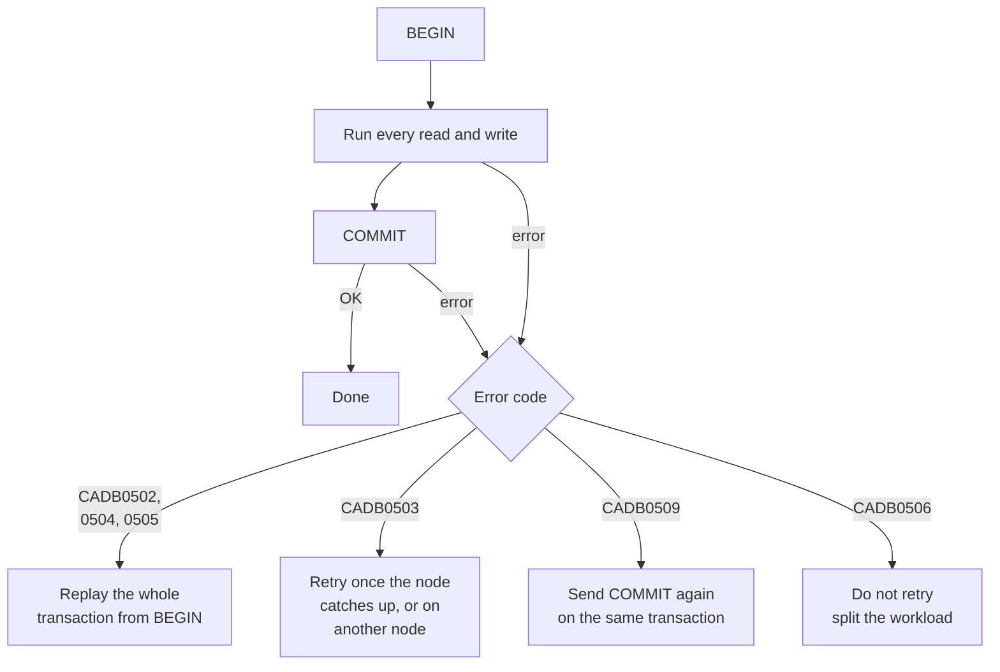

# Retries and conflicts

A serializable read-write transaction can fail by design. When CamusDB detects
a conflict that would break the serial order, it aborts the transaction instead
of committing a result that violates isolation.

The abort is correctness at work, not a defect. CamusDB commits no partial
work, and your application must replay the transaction.

## What causes a retry

You need to retry when:

- Another transaction wrote a key that conflicts.
- A read dependency changed before the commit.
- A concurrent write invalidated the serial order.
- A transient condition stopped the transaction before its write, at the start,
  during routing, at lock acquisition, or at the storage write.
- In a cluster, the transaction could not prepare or commit on every
  [partition](/docs/concepts#partition) that it touched. See
  [How a commit works](/docs/distributed-transactions#how-a-commit-works).
- In a cluster, a node could not reach the peer that owns a partition before the
  server-side retry budget expired.
- A read or scan reached a [range](/docs/concepts#ranges-and-spans) (a
  contiguous slice of keys) whose current state could not be served before the
  server-side retry budget expired.
- The node lags the cluster's committed schema by more than one version, so it
  rejects table work with `CADB0503` until it catches up. See
  [Distributed schema changes](/docs/distributed-schema#a-slow-node-and-bounded-progress-of-a-ddl-statement).
- The transaction wrote to a table that gained an index or a constraint before
  the transaction committed. The staged writes do not maintain the table's new
  write shape, so CamusDB aborts the transaction and asks the client to replay
  it.
- The transaction passed its lifetime deadline.

## Which errors to retry, and how

Each transaction error calls for its own recovery action:

| Code | Error | Action |
| --- | --- | --- |
| `CADB0502` | `TransactionConflict` | Replay from `BEGIN` |
| `CADB0504` | `TransactionMustRetry` | Replay from `BEGIN` |
| `CADB0505` | `TransactionLifetimeExceeded` | Replay from `BEGIN` |
| `CADB0503` | `SchemaCatchingUp` | Retry, usually after the node catches up, or against another node |
| `CADB0509` | `TransactionFinalizeUnresolved` | Send the same finalize again. See below. |
| `CADB0506` | `TransactionMutationLimitExceeded` | Do not retry. Split the workload. |

See [Error Codes](/docs/error-codes) for the full list.



## Replay from BEGIN

For `CADB0502`, `CADB0504`, and `CADB0505`, restart the whole unit of work:
begin again, run every read and write again, and commit again.

Do not resume from the middle of an aborted transaction. After an abort, the
only safe rule is to restart the whole transaction. Keep the transaction body
self-contained and free of side effects that you cannot repeat.

The .NET driver provides
`SerializableRetryHelper.ExecuteAutocommitAsync(...)` for single-statement work.
The TypeScript connector provides `transaction(...)` and `withRetry(...)` for a
repeatable unit of work. Python provides `camusdb.run_transaction(...)` and
`camusdb.aio.run_transaction(...)` for synchronous and asynchronous callbacks;
see [Python transactions and retries](/docs/python-driver#transactions-and-retries).
These helpers replay retryable work with backoff. If you manage an explicit
transaction by hand, retrying it is up to your application.

`CADB0555 LockNotAvailable` from `FOR UPDATE NOWAIT` is not in the automatic
retry set: retrying would contradict the request not to wait. A failed locking
read still ends its transaction. See [locking reads](/docs/sql-queries#for-update).

## Retry an unresolved finalize

`CADB0509 TransactionFinalizeUnresolved` is different from the other codes.
CamusDB does not know that the transaction aborted, and it may already have
committed. Replaying the business operation could apply the same work twice.

Send the same `COMMIT` or `ROLLBACK` again, for the same transaction id:

```camussql
COMMIT;
-- if CADB0509 is returned, send COMMIT again for the same transaction
```

Once the finalize starts, CamusDB accepts no more data statements on that
transaction. If the transaction is abandoned in the finalize state, the
server-side session timeout bounds it.

CamusDB retries the finalize for you first. A finalize can report that the
outcome is not known yet after:

1. A [leader](/docs/concepts#leader) change during the finalize.
2. A drain in progress.
3. A participant shedding a write under load.
4. A transport or unexpected fault after the commit request has already left
   the node.

CamusDB retries the finalize on the same handle with backoff, bounded by a
wall-clock budget: `transaction_finalize_retry_budget_ms`, 15 seconds by
default. You receive `CADB0509` when that budget runs out.

The bound is a duration, not an attempt count, because each of the conditions
above resolves on its own schedule. A saturated node makes each attempt slower
without needing more attempts, so an attempt cap would shrink the real budget
exactly when the node needs it most. Raise the setting on a node that runs hot.
Lower it if you would rather get the unresolved answer sooner and retry it
yourself.

## Keep transactions short

A read-write transaction holds locks. The transaction coordinator in
[Kahuna](/docs/concepts#kahuna) renews live range locks while the transaction
is alive, so the initial range-lock TTL does not limit how long it runs. A hard
backstop remains, about one hour by default, after which the transaction
aborts with `TransactionLifetimeExceeded`.

An explicit transaction that stays idle between statements for
`transaction_idle_timeout_ms` (default 5 minutes) is rolled back as abandoned,
and the next statement on it fails with `CADB0400` ("Unknown transaction").
Replay the work from `BEGIN`. See
[Transaction Limits](/docs/transaction-limits#idle-timeout).

Short transactions mean less contention, less risk of deadlock, fewer retries,
and no lifetime expiry.

When you need a stable view rather than a read-then-write invariant, use a
serializable read-only transaction. A snapshot read skips the lock-heavy
conflict path, which makes read-only transactions the right tool for reports,
multi-step reads, and inspecting a snapshot across partitions.

## Related pages

- [Transactions And Isolation](/docs/serializable-transactions)
- [Transaction Limits](/docs/transaction-limits)
- [Distributed Transactions And HLC](/docs/distributed-transactions)
- [Error Codes](/docs/error-codes)
