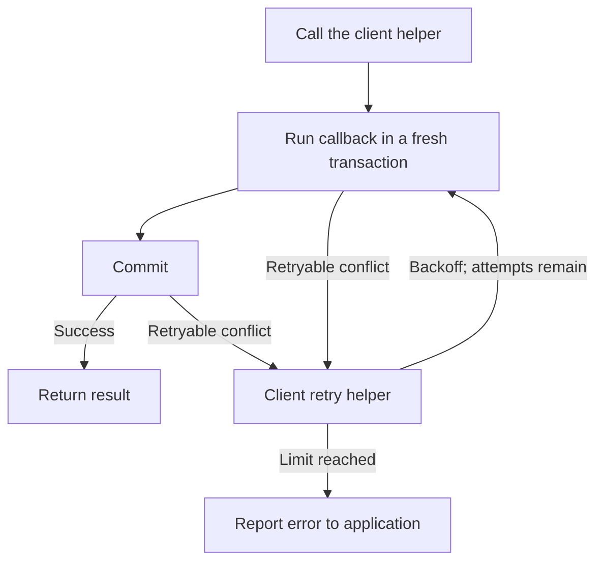

# Retries and conflicts

The .NET, TypeScript, and Python libraries provide retry helpers, so you do
not need to write a retry loop or implement backoff yourself. Put your database
work in a callback; the helper recognizes retryable conflicts and runs that
work again when needed.

Retries are part of serializable isolation: when concurrent transactions
conflict, CamusDB aborts one to preserve a correct result. The libraries handle
the replay mechanics. Your callback defines the work that belongs together.

## Use the client libraries

| Library | Recommended API | What it handles |
| --- | --- | --- |
| [.NET](/docs/dotnet-driver#serializable-retries) | `SerializableRetryHelper.ExecuteAutocommitAsync(...)` | Repeats your callback on retryable conflicts, with bounded backoff and jitter. For explicit transactions, begin and commit inside the callback. |
| [TypeScript](/docs/typescript-connector#transactions-and-retries) | `client.transaction(...)` | Begins, commits, rolls back on callback failure, and replays the entire callback in a fresh transaction after a retryable conflict. `withRetry(...)` also wraps your own repeatable unit of work. |
| [Python](/docs/python-driver#transactions-and-retries) | `camusdb.run_transaction(...)` | Manages the transaction and replays the callback with bounded backoff and jitter. `camusdb.aio.run_transaction(...)` does the same asynchronously. |

These helpers default to five total attempts. They report the error if attempts
are exhausted or the failure is not retryable. Plain commands and manually
managed transaction blocks do not automatically replay an entire business
operation; use the helper for that boundary.

### .NET

With an open `CamusConnection`, keep the transaction inside the callback so
each attempt starts fresh. Disposal rolls back unfinished work:

```csharp
using CamusDB.Client;

await SerializableRetryHelper.ExecuteAutocommitAsync(async ct =>
{
    await using var tx = await connection.BeginTransactionAsync(ct);
    await using var command = connection.CreateCamusCommand("""
        UPDATE products SET stock = stock - 1 WHERE name = @name AND stock > 0
        """);
    command.Transaction = tx;
    command.Parameters.Add("@name", ColumnType.String, "kettle");
    await command.ExecuteNonQueryAsync(ct);
    await tx.CommitAsync(ct);
}, maxAttempts: 5);
```

For a single autocommit statement, the callback can simply execute the command
without an explicit transaction.

### TypeScript

With a configured client, `transaction()` manages the transaction lifecycle
as well as retries:

```ts
await client.transaction(async (txn) => {
  await client.execute(
    'UPDATE products SET stock = stock - 1 WHERE name = @name AND stock > 0',
    { name: 'kettle' },
    { transaction: txn },
  );
}, { maxAttempts: 5 });
```

### Python

Start with no transaction already open. The helper begins and commits each
attempt, and rolls back on failure:

```python
import camusdb


def reserve_kettle(conn):
    return conn.execute(
        "UPDATE products SET stock = stock - 1 WHERE name = @name AND stock > 0",
        {"name": "kettle"},
    ).rowcount


with camusdb.connect(
    endpoint="http://localhost:5095", database="shop", autocommit=True,
) as conn:
    changed = camusdb.run_transaction(conn, reserve_kettle, max_attempts=5)
```

For asyncio, pass an async callback to
`await camusdb.aio.run_transaction(conn, callback, max_attempts=5)`.

### Write a repeatable callback

Include every read and write needed for the operation in the callback. Let
statement errors reach the helper; do not catch a conflict and continue an
aborted transaction. Keep emails, payments, and other external side effects
outside the callback, since it can run more than once.

## What causes a retry

The helpers handle conflicts caused by concurrent reads and writes, transient
routing or lock conditions, and transaction lifetime expiry. In a cluster,
leader changes, temporarily unavailable partitions, or a concurrent schema
change can also require replaying work. See
[distributed transactions](/docs/distributed-transactions) and
[distributed schema changes](/docs/distributed-schema).

## Which errors to retry, and how

The table below explains the recovery contract implemented by the clients.
You normally use the helpers above rather than dispatching on these codes:

| Code | Error | Recovery |
| --- | --- | --- |
| `CADB0502` | `TransactionConflict` | The retry helper replays the callback. |
| `CADB0504` | `TransactionMustRetry` | The retry helper replays the callback. |
| `CADB0505` | `TransactionLifetimeExceeded` | The retry helper replays the callback. |
| `CADB0503` | `SchemaCatchingUp` | Outside the helpers' automatic conflict retry set. Retry after the node catches up, or use another node. |
| `CADB0509` | `TransactionFinalizeUnresolved` | The transaction's commit/rollback method retries the same finalize, without replaying the callback. See below. |
| `CADB0506` | `TransactionMutationLimitExceeded` | Split the workload; retrying unchanged work cannot fix it. |
| `CADB0555` | `LockNotAvailable` | Not automatically retried: `FOR UPDATE NOWAIT` explicitly requested no wait. |

See [Error codes](/docs/error-codes) for the full list.

## Replay from BEGIN

Replaying means starting a fresh transaction and repeating every read and
write, not retrying only the failed statement. TypeScript and Python's
transaction runners do this for you; the .NET helper repeats the callback
that contains your transaction.



Custom retry loops are mainly for applications that manage transaction
lifecycles directly or use the HTTP/gRPC protocol without a client helper.

## Retry an unresolved finalize

The .NET, TypeScript, and Python transaction methods also handle
`CADB0509 TransactionFinalizeUnresolved`: they resend the same COMMIT or
ROLLBACK on the same transaction, with bounded retries. The server first
retries finalization within `transaction_finalize_retry_budget_ms` (15 seconds
by default), before an unresolved result reaches the client.

This differs from a conflict: the transaction may already have committed.
The libraries therefore do not replay its callback. If the unresolved error
still reaches your application after those retries, preserve that distinction:
retry the same finalize on the same transaction handle rather than starting
the business operation again. Direct protocol clients follow the same rule.

Once finalization starts, no more data statements are accepted on that
transaction. The server-side session timeout bounds an abandoned finalize.

## Keep transactions short

Short transactions reduce contention and the number of retries. Avoid network
calls and long pauses inside a database transaction. Live range locks are
renewed while it runs, but a hard lifetime cap remains, about one hour by
default; exceeding it raises `TransactionLifetimeExceeded`.

An explicit transaction idle for `transaction_idle_timeout_ms` (default five
minutes) is rolled back. Its next statement fails with CADB0400, "Unknown
transaction". See [transaction limits](/docs/transaction-limits#idle-timeout).

For reports and multi-step reads that need a stable view, use a read-only
snapshot transaction to avoid the read-write conflict path.

## Related pages

- [Transactions and isolation](/docs/serializable-transactions)
- [.NET retries](/docs/dotnet-driver#serializable-retries)
- [TypeScript transactions](/docs/typescript-connector#transactions-and-retries)
- [Python transactions](/docs/python-driver#transactions-and-retries)
- [Transaction limits](/docs/transaction-limits)
- [Error codes](/docs/error-codes)
