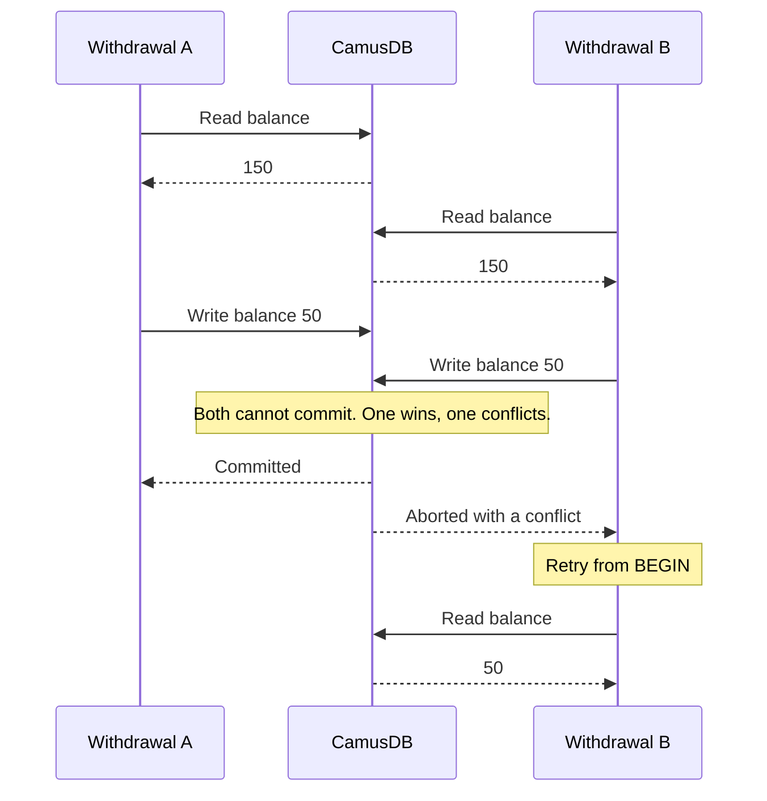

# Transactions and isolation

Two requests withdraw 100 from an account that holds 150, at the same moment.
Each one reads 150 and writes the new balance. If both succeed, the account pays
out 200 from 150. PostgreSQL defaults to Read Committed and MySQL to Repeatable
Read, and at those levels this can happen unless you add explicit locks.
CamusDB runs transactions as serializable by default, so one withdrawal commits
and the other gets a conflict that your application retries. You keep the data
correct without extra locks or version checks in your code.

Every statement that CamusDB runs is inside a transaction. If you do not open a
transaction, the server opens one around your statement. The server then commits
that transaction for you.

CamusDB gives these guarantees at all times:

- Writes are atomic.
- Commits are durable.
- There are no dirty reads. A dirty read is a read of data that another
  transaction has not committed yet.
- CamusDB detects write-write conflicts.
- Execution is serializable by default.
- A write across more than one [partition](/docs/concepts#partition) (a slice
  of the data that the cluster replicates as one unit) is atomic, through
  [two-phase commit](/docs/concepts#two-phase-commit).

This page describes the guarantees. For the SQL syntax, see
[Transactions In SQL](/docs/sql-transactions).

## What serializable protects you from

Many clients change the same data at the same time. Without strong isolation,
two correct transactions can produce a wrong result together. Here is an
example. Two requests withdraw 100 from an account that holds 150. Each request
reads the balance, sees 150, and writes the new balance. Both succeed, and the
account pays out 200 from 150.

Serializable isolation stops this class of error. The result is always the same
as a run of the transactions one after the other. In the example, CamusDB
commits one withdrawal. It aborts the other with a conflict. Your application
then retries it, and the retry sees the new balance of 50. See
[Retries and conflicts](/docs/serializable-retries).



You therefore do not need extra locks, version checks, or "check and then
write" logic in the application to keep the data correct. This matters most for
data where a wrong answer is expensive: money, inventory, reservations, and
ownership.

## Isolation levels

There are two levels. Serializable is the default.

| Level | Reads | Protects against |
| --- | --- | --- |
| `SERIALIZABLE` | Snapshot, or locking scans in read-write mode | Read skew, phantoms, write skew, lost updates |
| `READ COMMITTED` | Committed [MVCC](/docs/concepts#mvcc) versions, skipping [write intents](/docs/concepts#write-intent) | Dirty reads and write-write conflicts only |

Serializable means this: the result is the same as a run of the committed
transactions one at a time, in some order. Read Committed is an explicit
opt-out. Use it for a workload that must not pay the cost of Serializable.

Set the level in the first statement of a transaction:

```camussql
BEGIN;
SET TRANSACTION ISOLATION LEVEL READ COMMITTED;
```

The statement must come before any read and before any write. An earlier
statement would already have missed the locks and the snapshot setup that the
level needs. CamusDB therefore rejects a late change of level. It does not
pretend that the change applied.

### What Read Committed gives up

Read Committed keeps these properties:

- A read returns committed versions only. It skips an uncommitted write intent.
- A write still uses locks, write intents, and atomic commit.
- A reader blocks no reader, and it blocks no writer.

Read Committed gives up these properties:

- One snapshot shared by every sub-read of a query.
- Repeatable reads across a transaction of several statements.
- Protection against phantoms on a range scan. A phantom is a row that appears
  in a repeated scan because another transaction inserted it.
- Protection against write skew. Write skew is a fault in application code that
  reads a value, decides, and then writes.

Under pessimistic Read Committed, a point read can record the row revision it saw
when the same transaction later writes that key, but this is not a general
repeatable-read guarantee. A range scan does not pin every scanned row. It
returns each row's latest committed version as pages are read, which is the
non-repeatable behavior this isolation level permits.

One `UPDATE` or `DELETE` statement still protects itself from a lost update. The
statement first finds candidate rows, then it takes the exclusive row locks,
reads those rows again, evaluates the `WHERE` clause again, and computes the
write from that locked read. In practice, `UPDATE accounts SET balance = balance
+ 1 WHERE id = ...` adds to the latest committed balance. A row that a
concurrent commit moved out of the predicate is skipped, and a row that was
deleted is skipped. A read in one statement followed by a write in a later
statement is different; use Serializable, or express the change as one
`UPDATE`.

## Read-only and read-write modes

Serializable has two execution modes. Your choice between them matters more than
any other decision on this page.

A serializable read-only transaction fixes one snapshot timestamp at `BEGIN`.
Every statement reads from that snapshot. A later commit stays invisible, and a
repeated read is stable. None of this needs a lock. CamusDB can hold the
snapshot across several requests when the client resumes the same transaction
id. The mode therefore suits a report of several queries, not only one
statement.

```camussql
BEGIN;
SET TRANSACTION ISOLATION LEVEL SERIALIZABLE READ ONLY;
```

A serializable read-write transaction adds locks on top of MVCC. MVCC is
multi-version concurrency control, in which a write creates a new version
instead of an overwrite. A point read can hold a shared point lock. A scan can
hold a shared range lock. A write takes exclusive protection at key level. No
other transaction can change a key that this transaction read and still commit.
The cost is a possible retry for a transaction that conflicts.

Use read-write mode when correctness depends on a read-then-write invariant. Use
read-only mode for a report, and for a read that needs consistency but must not
block a writer.

## Locking

Two kinds of lock matter to you as a user.

Every write takes a per-key lock and places a write intent, for each key that it
modifies. A write intent is a provisional version that becomes final at commit.
These two mechanisms enforce three things:

1. Detection of a write-write conflict on a row.
2. Detection of a conflict on a unique index.
3. An atomic update of a row together with its index entries.

A point read lock and a range read lock protect what a serializable read-write
transaction reads. A shared point lock covers the exact key that the transaction
read. A concurrent writer cannot modify that key and still commit. CamusDB
promotes the lock to write protection if the same transaction later writes the
key. For a scan, a shared range lock covers the scanned span. Two overlapping
scans therefore still run at the same time. A conflicting write into the range
waits, or it retries.

When two serializable transactions conflict, CamusDB resolves the conflict by
age (the wait-die rule). An older requester waits for the younger holder. A
younger requester that already holds a lock or a staged write aborts at once and
must retry. CamusDB does not search for wait cycles: because only an older
transaction ever waits, a cycle cannot form. A transaction that has not yet
held a lock or staged a write can safely wait for a short in-flight writer,
because it is not itself blocking anyone.

CamusDB escalates the point locks when a transaction holds
`lock_escalation_threshold` (default `50`) shared point locks in one table
bucket or one index bucket. It replaces them with one shared lock over that
whole bucket. The bookkeeping stays bounded. The protected range becomes wider.

### Pessimistic and optimistic locking

The default strategy is pessimistic. CamusDB takes a lock before any conflicting
work continues.

Optimistic locking is an opt-in strategy. It skips the exclusive write lock. It
validates at commit instead. It aborts the transaction in two cases: another
transaction wrote a key that this transaction wrote, or a row that this
transaction read changed. The application then retries from the start.

```camussql
BEGIN;
SET TRANSACTION LOCKING OPTIMISTIC;
```

The locking strategy is a separate axis from the isolation level. The
combination of the two decides the guarantee:

| Combination | Behavior |
| --- | --- |
| `SERIALIZABLE` + pessimistic | Default. CamusDB takes the locks first. |
| `SERIALIZABLE` + optimistic | Hybrid. A write validates at commit, but a read and a scan still take shared locks, so phantoms remain excluded. |
| `READ COMMITTED` + optimistic | No locks at all. CamusDB validates the observed rows only. There is no protection against a phantom. |

`SET TRANSACTION LOCKING` must also run before any data statement. You can
combine it with `SET TRANSACTION ISOLATION LEVEL` in either order. An HTTP
client and a gRPC client select the strategy with the `locking` request field.
An operator changes the server-wide default with `default_transaction_locking`.

## How a write commits

Each `INSERT`, `UPDATE`, or `DELETE` places write intents and takes key-level
locks on the row keys and the index keys that it changes, then commits them
atomically. When another transaction already writes a conflicting key, one side
fails or retries. Neither side overwrites the other in silence. For the full
commit path, including two-phase commit across partitions, see
[How a commit works](/docs/distributed-transactions#how-a-commit-works).

## Transactions of several statements

Use an explicit `BEGIN` in these three cases:

1. Several writes must commit together.
2. A read-write sequence must be all-or-nothing.
3. Several queries need one stable serializable snapshot.

An abort is normal here. It is not an exceptional event. CamusDB does not replay
an aborted multi-statement transaction for you: the client restarts from
`BEGIN`. [Retries and conflicts](/docs/serializable-retries) lists the causes,
the error codes that are safe to retry, and the driver helpers that replay a
unit of work for you.

One failure is not a signal to retry. `TransactionMutationLimitExceeded` means
that the transaction is too large. A replay of the same batch fails again. See
[Transaction Limits](/docs/transaction-limits).

## Timestamps and schema safety

Every read-write transaction receives a timestamp from
[Kahuna](/docs/concepts#kahuna), the transactional storage layer. The timestamp
comes from a [hybrid logical clock](/docs/concepts#hlc), or HLC, which combines
physical time with a logical counter. A client never assigns its own timestamp. The timestamp identifies the
transaction, orders the committed versions, and coordinates the distributed
commit. The resulting order is logically consistent. It is not a real-time
wall-clock guarantee. See
[Distributed Transactions And HLC](/docs/distributed-transactions).

CamusDB also pins the schema version of each table that a transaction touches.
CamusDB rejects the transaction if a table changes incompatibly before the
commit. It does not commit a write that mixes an old layout with a new one.

## Single node and cluster

The model is the same in both cases: MVCC reads, locks and write intents on a
write, and detection of a conflict instead of silence about it. A cluster adds
routing to partitions and two-phase commit across them. See
[Distributed transactions](/docs/distributed-transactions).

Serializable is not a single-node feature. CamusDB exercises the anomaly
coverage on a single node and on a three-node cluster. That coverage includes a
read-write transaction across more than one partition.

## What is guaranteed today

Serializable is complete, acceptance-tested, and the default. It covers four
anomalies: read skew, phantoms, write skew, and lost updates.

A transaction that spans more than one partition runs in cluster mode, which is
still an alpha feature. Its APIs and behavior can change between versions. See
[Distributed Transactions](/docs/distributed-transactions).

The implementation includes these mechanisms:

- Wait-die deadlock fairness, so two transactions in contention have a
  determinate winner.
- Renewal of a range lock by the coordinator, for a long transaction.
- Lock escalation after `lock_escalation_threshold` (default `50`) shared
  point locks in one table or index bucket.
- Tight predicate-lock bounds for a bounded scan, for `UPDATE`, and for
  `DELETE`.

One gap remains. There is no externally consistent commit-wait guarantee. The
order is logically consistent. It is not tied to real time.

## Related pages

- [Transactions In SQL](/docs/sql-transactions)
- [Retries And Conflicts](/docs/serializable-retries)
- [Transaction Limits](/docs/transaction-limits)
- [Distributed Transactions And HLC](/docs/distributed-transactions)
- [Cluster Mode](/docs/cluster)
- [Distributed Schema Changes](/docs/distributed-schema)
- [Error Codes](/docs/error-codes)
