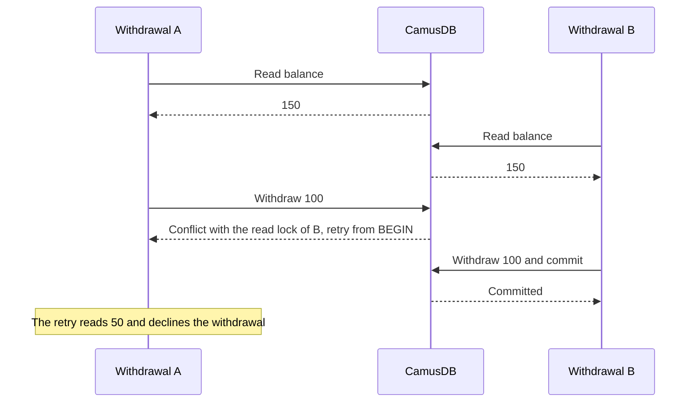

# Transactions and isolation

Transactions let you update related data together and keep concurrent requests
from breaking your application's rules. CamusDB uses Serializable isolation by
default: committed transactions have the same effect as running them one at a
time. This helps protect data such as account balances and stock levels when
several clients change it at the same time.

A statement outside `BEGIN` and `COMMIT` commits by itself. This is called
autocommit. Use an explicit transaction when several statements must succeed or
fail together. In this transfer, both updates commit, or neither does.

```camussql
BEGIN;
UPDATE accounts SET balance = balance - 100 WHERE id = @from;
UPDATE accounts SET balance = balance + 100 WHERE id = @to;
COMMIT;
```

Use `ROLLBACK` to discard the changes. For more syntax, see
[Transactions in SQL](/docs/sql-transactions).

## Isolation levels

Isolation controls what a transaction sees when other clients change data.

| Level | When to use it | Behavior |
| --- | --- | --- |
| `SERIALIZABLE` (default) | Decisions that must stay correct across several reads and writes | Prevents anomalies such as write skew and lost updates. A transaction that conflicts must be retried. |
| `READ COMMITTED` | Work that can tolerate changes between statements | Prevents dirty reads and detects conflicting writes. It doesn't protect a decision made by an earlier read. |

For example, two withdrawals both read a balance of 150 and decide to withdraw
100. In a serializable transaction, only one of them can commit. With the
default locking, each transaction holds a read lock on the balance. The first
one that writes gets a conflict (`CADB0502`), and it must retry from `BEGIN`,
including the funds check.



To use another level, run `SET TRANSACTION` as the first statement after
`BEGIN`.

```camussql
BEGIN;
SET TRANSACTION ISOLATION LEVEL READ COMMITTED;
```

After a read or a write, `SET TRANSACTION` returns `CADB0400`.

## Read-only and read-write modes

A **serializable read-only transaction** gives a report one consistent view of
the data across several queries.

```camussql
BEGIN;
SET TRANSACTION ISOLATION LEVEL SERIALIZABLE READ ONLY;
SELECT SUM(balance) FROM accounts;
SELECT COUNT(*) FROM accounts;
COMMIT;
```

All the queries read one snapshot, taken when `SET TRANSACTION` executes. A
transaction that you start read-only from the client takes it when it starts.
Commits after that point aren't visible to the transaction, and its reads take
no locks. You can keep that snapshot across requests by resuming the same
transaction ID.

A statement that changes data or schema in a read-only transaction returns
`CADB0849` (`ReadOnlyTransaction`).
For more information, see [Read-only transactions](/docs/sql-transactions#read-only-transactions).

Use a **serializable read-write transaction** when a later write depends on an
earlier read. The rows and the scanned ranges that you read are protected. This
includes protection against new rows that match your query (phantoms). Conflicting
work can wait, or it can return a retryable error.

An autocommit `SELECT` reads one snapshot at either isolation level. It doesn't
protect a write in a later request.

### Read Committed snapshots and limits

In an explicit pessimistic Read Committed transaction, each `SELECT` reads a
committed snapshot taken when that statement starts. It also sees the earlier
writes of the transaction. The snapshot covers the complete query, including
joins and reads across partitions. The next statement gets a new snapshot, and
it can see commits from other transactions.

These reads don't lock the scanned ranges, and they don't protect a later
decision that depends on them. Use Serializable when correctness depends on
several statements seeing compatible data.

Read Committed writes also use a snapshot to find their candidate rows. An
`UPDATE` or `DELETE` then locks each candidate row and reads its latest value.
It checks the `WHERE` condition again, and it skips a row that was deleted or
no longer matches. Uniqueness and foreign-key checks also use the latest
values.

For example, `UPDATE accounts SET balance = balance + 1 WHERE id = @id` adds to
the latest locked balance. If you read the balance first and write a computed
value in a separate statement, you don't get the same protection.

In an optimistic transaction, reads use the latest committed values, and they
are validated at commit. See [Locking strategy](#pessimistic-and-optimistic-locking).

## Handle conflicts and limits

A conflict can abort a transaction even when its SQL is valid. Retry the unit of
work from `BEGIN`, including its reads and application checks. CamusDB doesn't
replay an explicit multi-statement transaction automatically.

A failed statement [aborts its explicit transaction](/docs/sql-transactions#failed-statements).
You can't commit its earlier writes. Roll back, and begin again.

Use the retryable error codes and driver helpers described in
[Retries and conflicts](/docs/serializable-retries). Keep transactions short to
reduce contention. A transaction that exceeds its
[mutation limit](/docs/transaction-limits) needs a smaller batch. If you retry
the same batch, it will fail again.

A snapshot read can wait a short time for a commit that is in progress. If that
wait doesn't finish within its budget, the statement returns the retryable
`CADB0504`.

## Explicit row-locking reads

Use [SELECT FOR UPDATE](/docs/sql-queries#for-update) to lock rows before you
change them in the same explicit transaction. The locks last until commit or
rollback. `FOR UPDATE` needs pessimistic locking. In an optimistic or a
read-only transaction, it returns `CADB0400`.

- `NOWAIT` makes the statement fail when another transaction holds a lock on
  the row.
- `SKIP LOCKED` leaves out the locked rows. It is useful for workers that claim
  jobs from a queue. It works at Read Committed only, and at Serializable it
  returns `CADB0533`.

An autocommit `FOR UPDATE` releases its locks when the statement commits. This
means that it can't protect a later request.

### Row-lock waits

At either isolation level, a pessimistic write or a plain `FOR UPDATE` can
wait for a held row lock. A transaction can wait if it started before the
holder or has yet to acquire a lock or stage a write. A younger transaction
that already has a lock or a staged write returns `CADB0502` immediately.
A lock from an earlier `FOR UPDATE` counts even if the row hasn't changed.

If the holder commits or rolls back in time, the waiting statement can acquire
the lock and continue. If the wait reaches `lock_wait_deadline_ms` (500 ms by
default), the statement returns `CADB0502`. Retry an explicit transaction
from `BEGIN`.

The server can retry an autocommit write up to five attempts in total.
Each attempt has its own lock-wait budget.

## Locking strategy {#pessimistic-and-optimistic-locking}

Pessimistic locking is the default. It takes locks before it changes data.
Optimistic locking checks for conflicts at commit.

```camussql
BEGIN;
SET TRANSACTION LOCKING OPTIMISTIC;
```

`SET TRANSACTION LOCKING` must also be the first statement. The strategy and
the isolation level are separate choices, and each combination protects
different reads.

| Combination | Conflict protection |
| --- | --- |
| Serializable + pessimistic | Locks protect the rows and the ranges that the transaction reads or writes. |
| Serializable + optimistic | Single-key reads are validated at commit. Scans take range locks. |
| Read Committed + optimistic | The rows that the transaction read are validated at commit. It takes no locks, and it doesn't protect against phantoms. |

Keep the default unless you have a reason to change it. For more information,
see [Transactions and locking internals](/docs/transactions-locking-internals).

In a Serializable optimistic transaction, a read that conflicts can also fail
before commit. To take shared locks for single-key reads, set
`serializable_optimistic_point_locks` to `true`. It is `false` by default.

An optimistic row read waits up to `optimistic_intent_wait_ms` (default `100`)
for the uncommitted write of another transaction. This lets a read-modify-write
use the newly committed value. After the wait, the read uses the last committed
value, and the transaction can get a conflict later. `0` turns off the wait,
and the longest wait is `1000` ms. For more information, see the
[settings reference](/docs/settings-reference).

## Guarantees across nodes

A committed transaction is atomic and durable, and no transaction reads
uncommitted data. Writes to several [partitions](/docs/concepts#partition), or
slices of the database, also commit atomically. The isolation levels work the
same on one node and across a cluster. For more information, see
[Distributed transactions](/docs/distributed-transactions).

For read-your-writes across nodes, use the session behavior of your driver.
Over gRPC, the .NET driver and the TypeScript connector send the causal tokens
for you. Your queries don't need to copy token fields. The Python driver doesn't
track causal tokens. See its [current limits](/docs/python-driver#current-limits).

To pass causal tokens from your own client, see the
[HTTP](/docs/http-api#explicit-transactions) and
[gRPC](/docs/grpc-api#causal-tokens) references.

Transaction timestamps order work logically. They don't guarantee an order
against wall-clock time. For more information, see
[Distributed transactions](/docs/distributed-transactions#how-hlc-timestamps-fit-in).

A schema change that conflicts with an open transaction can make the
transaction fail. This prevents writes that use an outdated table layout. See
[Distributed schema changes](/docs/distributed-schema).
