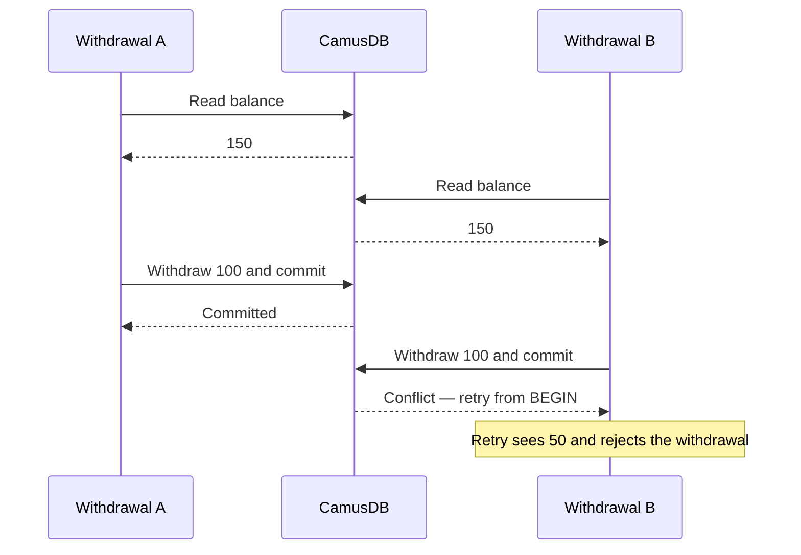

# Transactions and isolation

Transactions let you update related data together and keep concurrent requests
from breaking your application's rules. CamusDB uses Serializable isolation by
default: committed transactions have the same effect as running them one at a
time. This helps protect balances, inventory, and reservations when several
clients act on the same data.

Every statement runs in a transaction. Use an explicit transaction when several
statements must succeed or fail together:

```camussql
BEGIN;
UPDATE accounts SET balance = balance - 100 WHERE id = @from;
UPDATE accounts SET balance = balance + 100 WHERE id = @to;
COMMIT;
```

Both updates commit together. Use `ROLLBACK` to discard them. Without `BEGIN`,
each statement commits separately (autocommit). For more syntax, see
[Transactions in SQL](/docs/sql-transactions).

## Isolation levels

Isolation controls what a transaction sees when other clients change data.

| Level | When to use it | Behavior |
| --- | --- | --- |
| `SERIALIZABLE` (default) | Decisions that must stay correct across several reads and writes | Prevents read skew, phantoms, write skew, and lost updates. Conflicting transactions may need a retry. |
| `READ COMMITTED` | Work that can tolerate changes between statements | Prevents dirty reads and detects conflicting writes, but does not protect a decision made by an earlier read. |

For example, two withdrawals might both read a balance of 150 and decide to
withdraw 100. In a serializable transaction, both cannot commit based on that
balance. One gets a conflict and must retry the entire transaction, including
the funds check.



Select a different level immediately after `BEGIN`, before any read or write:

```camussql
BEGIN;
SET TRANSACTION ISOLATION LEVEL READ COMMITTED;
```

CamusDB rejects isolation changes after a data statement has run.

## Read-only and read-write modes

Use a **serializable read-only transaction** for reports that need several
queries to see the same data:

```camussql
BEGIN;
SET TRANSACTION ISOLATION LEVEL SERIALIZABLE READ ONLY;
SELECT SUM(balance) FROM accounts;
SELECT COUNT(*) FROM accounts;
COMMIT;
```

All queries use one snapshot fixed at `BEGIN`. Later commits stay invisible,
and the reads take no locks. You can keep that snapshot across requests by
resuming the same transaction ID.

Use a **serializable read-write transaction** when a later write depends on an
earlier read. CamusDB protects the rows and scanned ranges you read, including
against new matching rows appearing (phantoms). Conflicting work may wait or
fail with a retryable error.

An ordinary autocommit `SELECT` uses one snapshot for the whole statement under
either isolation level. It does not protect a write in a later request.

### Read Committed snapshots and limits

In an explicit pessimistic Read Committed transaction, each ordinary `SELECT`
uses a committed snapshot taken when that statement starts, plus the
transaction's own writes. The snapshot covers the entire query, including
joins and reads across partitions. The next statement gets a new snapshot and
may see intervening commits.

These reads do not lock scanned ranges or protect later read-then-write
decisions. Use Serializable when correctness depends on several statements
seeing compatible data.

Read Committed write statements also use a snapshot to find candidate rows or
read their source data. An `UPDATE` or `DELETE` then locks each candidate,
reads its latest value, and checks `WHERE` again. Deleted rows and rows that
no longer match are skipped. Uniqueness and foreign-key checks use latest
values too.

For example, `UPDATE accounts SET balance = balance + 1 WHERE id = @id` adds to
the latest locked balance. Reading the balance first and writing a computed
value in a separate statement does not have the same protection.

Optimistic transactions and transactions with read validation use latest-value
reads with commit-time validation instead of statement snapshots. See
[Locking strategy](#pessimistic-and-optimistic-locking).

## Explicit row-locking reads

Use [SELECT FOR UPDATE](/docs/sql-queries#for-update) to lock rows before
changing them in the same explicit transaction. It requires pessimistic
read-write mode.

- `NOWAIT` reports a held lock without an automatic retry.
- `SKIP LOCKED` omits held rows and is available only at Read Committed,
  making it useful for workers claiming jobs from a queue.

Locks last until commit or rollback. An autocommit `FOR UPDATE` releases its
locks when the statement commits, so it cannot protect a later request.

## Locking strategy {#pessimistic-and-optimistic-locking}

Pessimistic locking is the default. It acquires locks before changing data.
Optimistic locking checks for conflicts at commit instead:

```camussql
BEGIN;
SET TRANSACTION LOCKING OPTIMISTIC;
```

Choose the strategy before any data statement. It is separate from isolation:

| Combination | Conflict protection |
| --- | --- |
| Serializable + pessimistic | Locks protect reads, scanned ranges, and writes. |
| Serializable + optimistic | Reads and scans still take shared locks; writes validate at commit. |
| Read Committed + optimistic | Validates observed rows at commit, without locks or phantom protection. |

Keep the default unless you have a reason to change it. For lock escalation,
conflict resolution, and configuration, see
[Transactions and locking internals](/docs/transactions-locking-internals).

## Handle conflicts and limits

A conflict can abort a transaction even when its SQL is valid. Retry the whole
unit of work from `BEGIN`, including reads and application checks. CamusDB does
not automatically replay an explicit multi-statement transaction.

Use the retryable error codes and driver helpers described in
[Retries and conflicts](/docs/serializable-retries). Keep transactions short to
reduce contention. A transaction that exceeds its
[mutation limit](/docs/transaction-limits) needs a smaller batch; retrying the
same oversized batch will fail again.

Snapshot reads can briefly wait for a commit already in progress. If that
wait cannot finish within its budget, the statement can return retryable
`CADB0504`. A read without locks does not guarantee an immediate response.

## Guarantees across nodes

Transactions provide atomic writes, durable commits, and no dirty reads.
Writes spanning several [partitions](/docs/concepts#partition), or slices of
the database, also commit atomically. The isolation
choices apply on a single node and across a cluster, but distributed
transaction support is still an alpha feature; its APIs and behavior may change.
See [Distributed transactions](/docs/distributed-transactions).

To read your previous write when requests can reach different nodes, carry the
last commit's **causal token** into the next autocommit query or transaction's
`BEGIN`. The token sets a minimum snapshot timestamp. Pass the complete token;
changing it after a transaction starts does not advance that transaction's
snapshot floor. See the [HTTP API](/docs/http-api#explicit-transactions) and
[gRPC causal tokens](/docs/grpc-api#causal-tokens).

Transaction timestamps order work logically; they do not guarantee ordering
against wall-clock time. See
[Distributed transactions](/docs/distributed-transactions#how-hlc-timestamps-fit-in)
for details.

Incompatible schema changes can cause a transaction to fail rather than commit
writes using an outdated table layout. See
[Distributed schema changes](/docs/distributed-schema).
