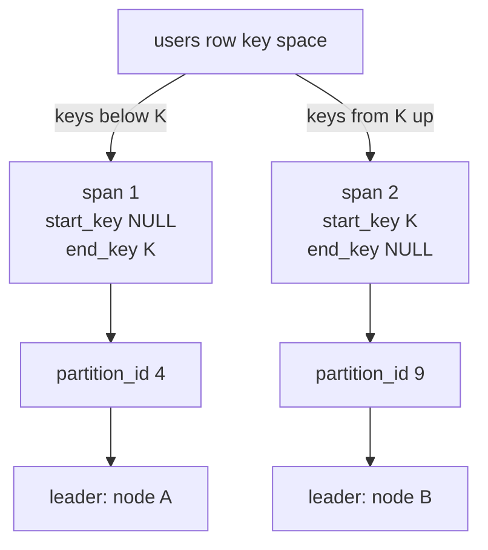

# SHOW RANGES

`SHOW RANGES` shows how CamusDB currently routes a table or index
[key space](/docs/concepts#key-space), the storage keys that hold its rows or
index entries. Use it to see whether a relation is
[hash-routed or key-range-routed](/docs/concepts#hash-and-key-range-routing),
whether a [range](/docs/concepts#ranges-and-spans) split happened, and which
[partition](/docs/concepts#partition) owns a key.

```camussql
SHOW RANGES FROM TABLE users;
SHOW RANGES FROM INDEX users@users_pkey;
SHOW RANGE FROM TABLE users FOR ROW (1500);
SHOW RANGE FROM INDEX users@by_email FOR ROW ('a@example.com');
```

It answers operator questions that table statistics and engine metrics cannot:

- Has this table or index split, or is it still one whole-space range?
- Which partition serves each range?
- Which range holds a hot row or index key?
- Does this node believe a range [leader](/docs/concepts#leader), the node that
  coordinates its writes, is local or remote?
- Is a plan's network cost high because the data is actually remote?

For the cost a query paid, use [EXPLAIN](/docs/explain). For process-level
metrics, use [SHOW ENGINE STATS](/docs/engine-stats).

## How a key space maps to nodes

The diagram shows a key-range-routed table after one split at key `K`. Each
span covers part of the key space, one partition serves it, and that partition
has a leader node. `SHOW RANGES` returns one row per span.



A hash-routed key space has no split keys, so it has a single span. A table's
row key space and its index key spaces all hash to the same partition.

## Result columns

| Column | Type | Meaning |
| --- | --- | --- |
| `relation` | `STRING` | Table name, or `table@index` for an index. |
| `key_space` | `STRING` | Internal key-space prefix, such as `{databaseId}:{tableId}\|r` for table rows or `{databaseId}:{tableId}\|i:{indexId}` for an index. |
| `routing` | `STRING` | `key_range` or `hash`, as this node routes it. |
| `span` | `INT64` | 1-based position of this range inside the key space. It is not a stable range id. |
| `start_key` | `STRING` | Decoded lower bound. `NULL` means unbounded. |
| `end_key` | `STRING` | Decoded upper bound. `NULL` means unbounded. |
| `raw_start_key` | `STRING` | Encoded lower bound. |
| `raw_end_key` | `STRING` | Encoded upper bound. |
| `partition_id` | `INT64` | Partition currently serving the span. |
| `generation` | `INT64` | Version of the range's routing. It advances when the range changes, for example after a split. Hash routing reports `0`. |
| `leader` | `STRING` | Leader endpoint hint. `NULL` means unknown. |
| `leader_is_local` | `BOOL` | Whether this node believes it leads the span. |
| `hosted_locally` | `BOOL` | Whether this node hosts the partition. |
| `replicas` | `STRING` | Comma-separated endpoints of the nodes that hold a copy ([replica](/docs/concepts#replica-and-replication-factor)) of the partition. Empty means full replication: every node holds it. |
| `probe_key` | `STRING` | Exact key located by `FOR ROW`; `NULL` in plural forms. |

Read `partition_id`, not `span`, when comparing two runs. A split can renumber
spans, while the partition identity stays meaningful.

## FOR ROW

`SHOW RANGE ... FOR ROW` locates one key.

For an index, CamusDB computes the index key from the values you provide. The
row does not need to exist. You may provide a prefix of the index columns.

For a table, CamusDB first resolves the primary key to the row id, then locates
the row-key range. If no row has that primary key, the statement raises an
error instead of returning an empty result.

The lookup is lock-free and non-tracking. Running it inside a serializable
transaction does not add to the transaction's read set.

## Targets

- `FROM TABLE t` reports the table's row space.
- `FROM INDEX t@i` reports a secondary index key space.
- `t@~pk`, `t@t_pkey`, and `t@primary` can name the primary index when no real
  index has that exact name.
- A plain view has no key space. Ask for the base tables. A materialized view is
  a physical relation and reports ranges normally.

## Node-local output

The answer is this node's applied view of routing. A node that is behind may
report an older generation than a peer. Leadership is a hint, not a correctness
gate; execution re-resolves through the storage locator.

A hash-routed key space reports one span with unbounded start and end keys,
generation `0`, and `routing = 'hash'`.

## Permissions

`SHOW RANGES` requires `SELECT` on the target table. It is not restricted to
superusers.

Decoded range bounds can contain real data values, so CamusDB gates the
statement with the same privilege needed to read the relation.

## Related

- [Key-range sharding](/docs/key-range-sharding)
- [EXPLAIN](/docs/explain)
- [Engine stats](/docs/engine-stats)
