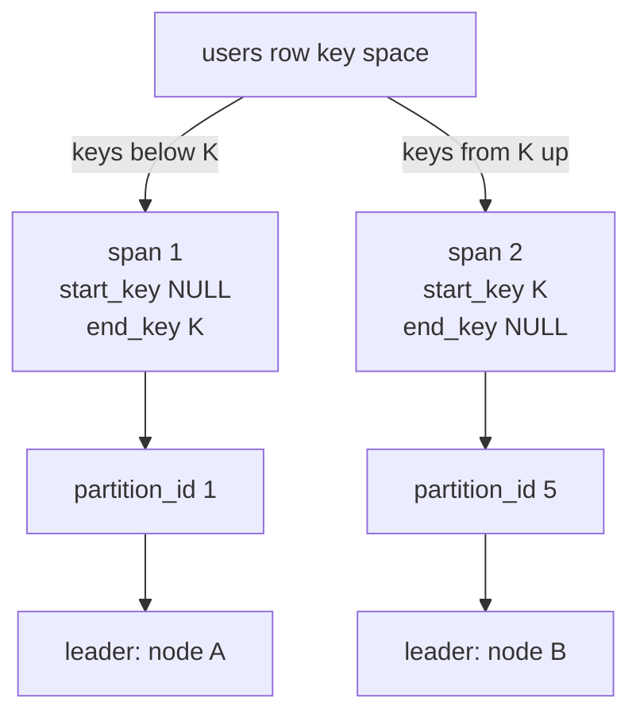

# SHOW RANGES

`SHOW RANGES` shows how the [key space](/docs/concepts#key-space) of a table or
an index is divided and placed. The key space is the set of storage keys that
hold the rows or the index entries. Use the statement to answer the following
questions:

- Is the table [hash-routed or key-range-routed](/docs/concepts#hash-and-key-range-routing)?
- Did a [range](/docs/concepts#ranges-and-spans) split?
- Which [partition](/docs/concepts#partition) serves a hot row or index key?
- Is the [leader](/docs/concepts#leader) of a range on this node? The leader is
  the node that coordinates the writes of the range.

For the cost of one query, use [EXPLAIN](/docs/explain). For metrics of the
node, use [SHOW ENGINE STATS](/docs/engine-stats). To list partition leaders and
replicas from a node, use [SHOW PARTITIONS](/docs/sql-inspection#raft-partitions).

The examples on this page use the following data:

<details>
<summary>Sample data for the examples on this page</summary>

```camussql
CREATE TABLE users (
  id INT64 PRIMARY KEY NOT NULL,
  email STRING NOT NULL,
  name STRING NOT NULL
);
CREATE INDEX by_email ON users (email);
INSERT INTO users (id, email, name) VALUES
  (1000, 'ana@example.com', 'Ana'),
  (1500, 'a@example.com', 'Alex'),
  (2000, 'bo@example.com', 'Bo');
```

</details>

## Examples

```camussql
SHOW RANGES FROM TABLE users;
```

```text
┌──────────┬───────────┬─────────┬──────┬───────────┬─────────┬───────────────┬─────────────┬──────────────┬────────────┬─────────────┬─────────────────┬────────────────┬──────────┬───────────┐
│ relation │ key_space │ routing │ span │ start_key │ end_key │ raw_start_key │ raw_end_key │ partition_id │ generation │ leader      │ leader_is_local │ hosted_locally │ replicas │ probe_key │
├──────────┼───────────┼─────────┼──────┼───────────┼─────────┼───────────────┼─────────────┼──────────────┼────────────┼─────────────┼─────────────────┼────────────────┼──────────┼───────────┤
│ users    │ 1Il:1ZI|r │ hash    │ 1    │ null      │ null    │ null          │ null        │ 1            │ 0          │ localhost:0 │ True            │ True           │          │ null      │
└──────────┴───────────┴─────────┴──────┴───────────┴─────────┴───────────────┴─────────────┴──────────────┴────────────┴─────────────┴─────────────────┴────────────────┴──────────┴───────────┘
1 rows in set (00:00:00.0039400)
```

This node uses hash routing, the default. The key space has one span on one
partition.

```camussql
SHOW RANGES FROM INDEX users@users_pkey;
SHOW RANGE FROM TABLE users FOR ROW (1500);
SHOW RANGE FROM INDEX users@by_email FOR ROW ('a@example.com');
```

## How a key space maps to nodes

With [key-range sharding](/docs/key-range-sharding), a key space can split into
several spans. Each span is a range of keys that one partition serves. Each
partition has a leader node. `SHOW RANGES` returns one row for each span.



For example, after a split of the `users` row key space, the result has two
rows. The following table shows some of their columns:

| `span` | `start_key` | `end_key` | `partition_id` | `generation` |
| --- | --- | --- | --- | --- |
| 1 | `NULL` | `6afef0a2d6062834bd492622` | 1 | 2 |
| 2 | `6afef0a2d6062834bd492622` | `NULL` | 5 | 2 |

A row key is based on the internal row ID, so the bounds of a table span are
row IDs. Index spans have bounds made from the index values.

A hash-routed key space can't split. It has one span, both bounds are `NULL`,
and its `generation` is `0`. With hash routing, the rows and the indexes of a table are
on the same partition.

## Result columns

| Column | Type | Meaning |
| --- | --- | --- |
| `relation` | `STRING` | The table name, or `table@index` for an index. |
| `key_space` | `STRING` | The internal key-space prefix, such as `{databaseId}:{tableId}\|r` for table rows or `{databaseId}:{tableId}\|i:{indexId}` for an index. |
| `routing` | `STRING` | `key_range` or `hash`. |
| `span` | `INT64` | The position of the span in the key space, from 1. It isn't a stable range ID. |
| `start_key` | `STRING` | The decoded lower bound. `NULL` means no bound. |
| `end_key` | `STRING` | The decoded upper bound. `NULL` means no bound. |
| `raw_start_key` | `STRING` | The encoded lower bound. |
| `raw_end_key` | `STRING` | The encoded upper bound. |
| `partition_id` | `INT64` | The partition that serves the span. |
| `generation` | `INT64` | The version of the routing of the range. It increases when the range changes, for example after a split. It's `0` for hash routing. |
| `leader` | `STRING` | The endpoint of the leader, as known to this node. `NULL` means unknown. |
| `leader_is_local` | `BOOL` | Whether this node is the leader of the span, as far as this node knows. |
| `hosted_locally` | `BOOL` | Whether this node has a copy of the partition. |
| `replicas` | `STRING` | The endpoints of the nodes that have a copy ([replica](/docs/concepts#replica-and-replication-factor)) of the partition, separated by commas. An empty value means full replication: all nodes have a copy. |
| `probe_key` | `STRING` | The key found by `FOR ROW`. `NULL` in the other forms. |

To compare two results, use `partition_id`. A split can change the `span` numbers.

## FOR ROW

`SHOW RANGE ... FOR ROW` finds the span of one key.

For an index, the index key is computed from the values that you give. The row
doesn't need to exist. You can give only the first columns of the index.

For a table, the row must exist. The primary key is first resolved to the
internal row ID, and the row key is made from that ID. If no row has that
primary key, the statement returns `CADB0405`:

```camussql
SHOW RANGE FROM TABLE users FOR ROW (9999);
```

```text
CamusException (CADB0405): No row in 'users' has that primary key. A table's row key is derived from the stored row id rather than from the primary key, so the row must exist before its span can be named. Ask SHOW RANGE FROM INDEX instead for a key-space question about a key that need not exist.
```

The lookup doesn't take locks. In a serializable transaction, it isn't added to
the read set of the transaction.

## Targets

- `FROM TABLE t` shows the row key space of the table.
- `FROM INDEX t@i` shows the key space of a secondary index.
- `t@~pk` names the primary index. The aliases `t@t_pkey` and `t@primary` also
  work, if no real index has that name.
- A view doesn't store rows, and returns `CADB0523`. Use the tables that the view
  reads. A materialized view stores rows, and it has ranges like a table.

## Node-local output

The result shows the routing as this node knows it. A node that is behind can
show an older `generation` than another node. The leader is only a hint. A query
finds the current leader when it executes.

## Permissions

`SHOW RANGES` needs `SELECT` on the table. A superuser isn't required. The
decoded bounds can contain data values. For this reason, the statement needs the
same privilege as a read of the table.

## Related pages

- [Key-range sharding](/docs/key-range-sharding)
- [EXPLAIN](/docs/explain)
- [Engine stats](/docs/engine-stats)
