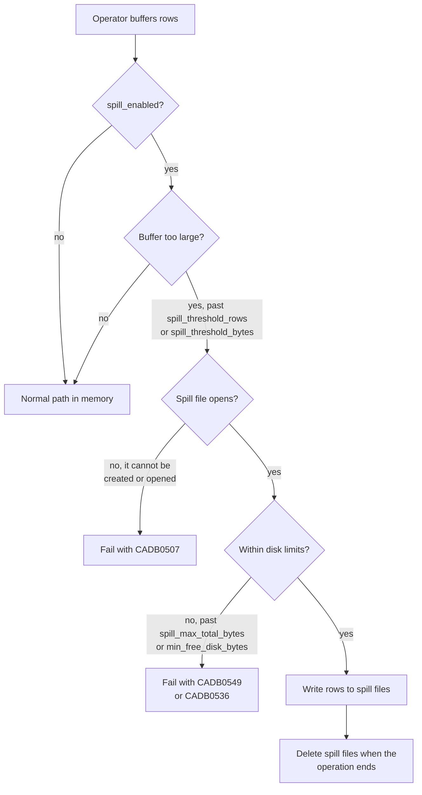

# Spill to disk

CamusDB streams query results to the client, but some query operators must
still hold intermediate rows before they can produce output.

Spill to disk lets such an operator move a large intermediate buffer into a
temporary file, so process memory does not grow without bound.

Spill is off by default. While it is off, operators use their normal in-memory
path. While it is on, each operator stays in memory until its own buffer passes
the spill threshold.

## Why use spill to disk

Without spill, an operator keeps all of its intermediate rows in memory. A sort,
a join, or a `GROUP BY` over millions of rows can use a large share of the
node's memory, and several such queries at once can use all of it. The node
can then slow down for every client, or the process can stop.

Turn spill on when:

- Your workload runs large reports, exports, or batch jobs with a large
  `ORDER BY`, `GROUP BY`, `DISTINCT`, or hash join.
- You run bulk `UPDATE` or `DELETE` statements that match many rows.
- The node has limited memory, for example a small container or a
  memory-limited virtual machine.

The cost is speed. A query that spills reads and writes temporary files, so it
runs longer than the same query in memory. Queries that stay below the
threshold are unaffected.

You can leave spill off when your queries read and return small row sets, such
as key lookups and short result pages.

## What can spill

Spill applies to blocking work and to work that materializes rows:

| Operator | Why it buffers | Spill behavior |
| --- | --- | --- |
| `ORDER BY` sort | It needs all the rows before it can emit sorted output. | An external merge sort. |
| Hash join | It builds a hash table from one side of the join (the build side), then streams the other side (the probe side) past it. | A grace or hybrid hash join, which divides the rows into spill files when the build side is too large. |
| `GROUP BY` | It keeps one accumulator per group. | It hashes rows by group key into spill partitions (groups of rows on disk, not cluster partitions), then aggregates one partition at a time. |
| `SELECT DISTINCT` | It records which result tuples it has already seen. | It hash-partitions the rows into spill files, then deduplicates one partition at a time. |
| `UNION` | It removes duplicates from both inputs. | The same partitioned deduplication as `DISTINCT`. |
| `INTERSECT`, `EXCEPT`, including `ALL` | It counts distinct right-side rows; distinct `EXCEPT` also tracks emitted left rows. | Hash-partitions both inputs and combines each partition pair in memory. |
| Derived tables and subqueries | It materializes the rows so the outer query can scan them. | A spill buffer that CamusDB can enumerate again. |
| `DELETE` and `UPDATE` match sets | It must collect the matching rows before the mutation. | A spill buffer that CamusDB can enumerate again. |

Streaming operators do not spill, because they need no large intermediate
buffer. For example:

- A simple scan.
- `UNION ALL`, which concatenates inputs without deduplication.
- A global aggregate, such as `COUNT(*)` without a `GROUP BY`.
- A streaming `DISTINCT` over an ordered index.
- A merge join, which walks two inputs already sorted on the join key and
  buffers only the current run of equal keys.

## DELETE and UPDATE

`DELETE` and `UPDATE` collect every matching row before they apply any
mutation, because they cannot safely change rows during the scan. Changing a
row can also change the index under the scan, so rows would be skipped or
visited twice.

With spill enabled, the collected match set can overflow into a temporary file.
The mutation phase then reads the sealed match set back and applies the same
row changes it would apply from memory.

## Temporary files

Spill files live under `data_dir`:

```text
{data_dir}/tmp/spill/{instanceId}/{scopeId}/
```

Each process owns one `{instanceId}` directory for its whole life, and each
operator that spills gets its own `{scopeId}` directory.

CamusDB deletes the spill files when the operation completes, is cancelled, or
fails with an exception.

Files can remain if the process is killed during a query. At startup, CamusDB
makes a best-effort sweep of the spill root. Each instance holds its own lock
file, so the sweep can tell a stale directory from spill files that another
live process owns.

## Row format

Spill files use a schema-free binary row codec. This matters because
intermediate rows can be synthetic: a join row, a derived-table row, or a
projected row may not match any single table schema.

Each spilled row stores its row id, the column count, the column names, each
value's type tag, and the values. The row id matters for `DELETE` and `UPDATE`,
because the mutation phase must still target the original row.

## Configuration

You configure spill in `config.yml`. Every setting below is `runtime` class
and `node` scope, so you can also change it without a restart using
[`SET CLUSTER SETTING`](/docs/runtime-cluster-settings).

| Setting | Default | Meaning |
| --- | --- | --- |
| `spill_enabled` | `false` | The main switch. While it is `false`, no query operator spills. |
| `spill_threshold_rows` | `500000` | The maximum number of rows one operator holds in memory before it starts to spill. |
| `spill_threshold_bytes` | `268435456` | The maximum estimated bytes one operator holds in memory before it starts to spill (256 MiB). An operator spills when it reaches either cap. A value of `0` or below removes the byte cap, leaving only the row cap. |
| `spill_merge_fan_in` | `16` | The maximum number of spill runs (sorted spill files) that CamusDB reads at once during a merge pass. |
| `spill_max_total_bytes` | `8589934592` | The maximum live spill bytes on one node. A value of `0` or below removes this limit. |
| `spill_max_frame_bytes` | `268435456` | The largest record CamusDB accepts when it reads a spill file back (256 MiB). A larger length means the file is corrupt, and the query fails with `CADB0507`. |

For example:

```yaml
spill_enabled: true
spill_threshold_rows: 500000
spill_threshold_bytes: 268435456
spill_merge_fan_in: 16
spill_max_total_bytes: 8589934592
```

See [Configuration](/docs/configuration) for the full startup configuration
reference.

## Disk limits

Spill files share a volume with the storage engine, so CamusDB limits spill
before it can consume disk space that ordinary writes need.

Every spill write must pass both of these checks:

- `spill_max_total_bytes` limits the total size of all live spill files on the
  node, shared by all concurrent spilling queries. A write that would exceed it
  fails the statement with `CADB0549` `SpillLimitExceeded`.
- `min_free_disk_bytes` is the free-space floor for the data directory. A spill
  write that would take the volume below that floor fails with `CADB0536`
  `InsufficientDiskSpace`.

In both cases, the statement fails, CamusDB deletes that operation's spill
files, and a spilling `DELETE` or `UPDATE` changes no rows.

## Behavior after a failure

If an operator needs to spill but CamusDB cannot create or open a spill file,
the query fails with `CADB0507` (`SpillStorageUnavailable`). CamusDB never
silently falls back to unbounded memory when spill storage is unavailable.



Typical causes:

- The CamusDB process cannot write to `data_dir`.
- The disk that holds `data_dir` is full.
- Somebody removed the temporary spill directories or gave them the wrong
  permissions.

Fix the storage problem, then run the query again.

## Operational notes

- Spill applies to one operator instance. It is not a memory budget for a
  whole query.
- An operator that stays below both thresholds creates no spill file.
- `spill_max_total_bytes` is a node-wide budget for live spill files, not a
  per-query reservation.
- Spill trades memory pressure for disk I/O. Large sorts, grouped queries,
  distinct queries, hash joins, and bulk updates can run longer, but none of
  them makes the heap grow without bound.
- While spill is off, a hash join whose build side passes
  `hash_join_max_build_rows` (default `1000000`) falls back to a nested-loop
  join. The result stays correct, but the join runs slower.
