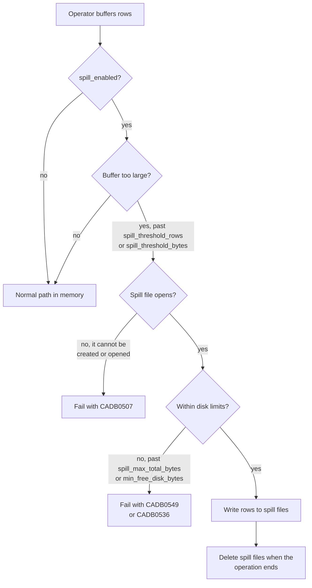

# Spill to disk

CamusDB streams the result of a query to the client. Some query operators must
nevertheless hold intermediate rows before they produce output.

Spill to disk lets such an operator move a large intermediate buffer into a
temporary file. The memory of the process therefore does not grow without a
bound.

Spill is off by default. While it is off, an operator uses its normal path in
memory. While it is on, an operator stays in memory until its own buffer passes
the spill threshold.

## Why use spill to disk

Without spill, an operator keeps all of its intermediate rows in memory. A sort,
a join, or a `GROUP BY` over millions of rows can therefore use a large part of
the memory of the node. Several such queries at the same time can use all of it.
The node can then become slow for every client, or the process can stop.

Turn spill on in these cases:

- Your workload runs large reports, exports, or batch jobs, with a large
  `ORDER BY`, `GROUP BY`, `DISTINCT`, or hash join.
- You run a bulk `UPDATE` or `DELETE` that matches many rows.
- The node has limited memory, for example a small container or a virtual
  machine with a memory limit.

The cost is speed. A query that spills reads and writes temporary files, so it
runs longer than the same query in memory. A query that stays below the
threshold does not change.

You can leave spill off when your queries read and return small sets of rows,
for example lookups by key and short pages of results.

## What can spill

Spill applies to work that blocks, and to work that materializes rows:

| Operator | Why it buffers | Spill behavior |
| --- | --- | --- |
| The sort of an `ORDER BY` | It needs the rows before it emits a sorted output. | An external merge sort. |
| A hash join | It builds a hash table from one side of the join, the build side. It then streams the other side, the probe side, past that table. | A grace hash join or a hybrid hash join. It divides the rows into spill files when the build side is too large. |
| A `GROUP BY` | It keeps one accumulator for each group. | It hashes the rows by the key of the group into spill partitions, which are groups of rows on disk and not cluster partitions. It then aggregates one partition at a time. |
| A `SELECT DISTINCT` | It records which result tuples appeared already. | It hash-partitions the rows into spill files, then deduplicates one partition at a time. |
| A derived table and a subquery | It materializes the rows, so the outer query can scan them. | A spill buffer that CamusDB can enumerate again. |
| The match set of a `DELETE` and of an `UPDATE` | It must collect the matching rows before the mutation. | A spill buffer that CamusDB can enumerate again. |

A streaming operator does not spill, because it needs no large intermediate
buffer. There are four examples:

- A simple scan.
- A global aggregate, such as `COUNT(*)` without a `GROUP BY`.
- A streaming `DISTINCT` over an ordered index.
- A merge join, which walks two inputs that are already sorted on the join key.
  It buffers only the current run of equal keys.

## DELETE and UPDATE

`DELETE` and `UPDATE` collect every matching row before they apply the
mutations. They cannot mutate a row safely during the scan. A change to a row
can also change the index under the scan. Rows would then be skipped, or visited
twice.

While spill is enabled, the collected match set can overflow into a temporary
file. The mutation phase then reads the sealed match set back. It applies the
same row changes that it would apply from memory.

## Temporary files

A spill file lives under `data_dir`:

```text
{data_dir}/tmp/spill/{instanceId}/{scopeId}/
```

Each process owns one `{instanceId}` directory for its whole life. Each operator
that spills receives one `{scopeId}` directory.

CamusDB deletes the spill files in three cases: the operation completes, the
operation is cancelled, or the operation fails with an exception.

A file can remain if something kills the process during a query. At startup,
CamusDB sweeps the spill root as well as it can. It uses one lock file for each
instance. It therefore separates a stale directory from a spill file that
another live process owns.

## The row format

A spill file uses a binary codec for a row, and that codec needs no schema. This
property matters, because an intermediate row can be synthetic. A row of a join,
a row of a derived table, and a projected row can match no single table schema.

Each spilled row stores five parts: its row id, the column count, the column
names, the type tag of each value, and the values. The row id matters for
`DELETE` and for `UPDATE`. The mutation phase must still target the original
row.

## Configuration

You configure spill in `config.yml`. Every setting below is `runtime` class
and `node` scope, so you can also change it without a restart, with
[`SET CLUSTER SETTING`](/docs/runtime-cluster-settings).

| Setting | Default | Meaning |
| --- | --- | --- |
| `spill_enabled` | `false` | The main switch. While it is `false`, no query operator spills. |
| `spill_threshold_rows` | `500000` | The cap on the rows that one operator holds in memory, before the spill starts. |
| `spill_threshold_bytes` | `268435456` | The cap on the estimated bytes that one operator holds in memory, before the spill starts. It is 256 MiB. An operator spills when it reaches either cap. A value of `0` or below removes the byte cap and leaves only the row cap. |
| `spill_merge_fan_in` | `16` | The maximum number of spill runs (sorted spill files) that CamusDB reads at one time, during a merge pass. |
| `spill_max_total_bytes` | `8589934592` | The maximum live spill bytes on one node. A value of `0` or below removes this limit. |
| `spill_max_frame_bytes` | `268435456` | The largest record that CamusDB accepts when it reads a spill file back. It is 256 MiB. A larger length means a corrupt file, and the query fails with `CADB0507`. |

Here is an example:

```yaml
spill_enabled: true
spill_threshold_rows: 500000
spill_threshold_bytes: 268435456
spill_merge_fan_in: 16
spill_max_total_bytes: 8589934592
```

See [Configuration](/docs/configuration) for the full reference of the startup
configuration.

## Disk limits

Spill files share the same volume as the storage engine. CamusDB therefore
limits spill before it can consume the disk that ordinary writes need.

Two checks apply to every spill write:

- `spill_max_total_bytes` limits the total bytes of all live spill files on the
  node. The limit is shared by all concurrent spilling queries. A write that
  would exceed it fails the statement with `CADB0549`
  `SpillLimitExceeded`.
- `min_free_disk_bytes` is the free-space floor for the data directory. A spill
  write that would take the volume below that floor fails with `CADB0536`
  `InsufficientDiskSpace`.

In both cases, the statement fails, CamusDB deletes the spill files for that
operation, and a spilling `DELETE` or `UPDATE` changes no row.

## Behavior after a failure

An operator can need a spill while CamusDB cannot create or open a spill file.
The query then fails with `CADB0507`, which is `SpillStorageUnavailable`.
CamusDB does not fall back to unbounded memory in silence when the spill storage
is unavailable.



Three causes are typical:

- The CamusDB process cannot write to `data_dir`.
- The disk that holds `data_dir` is full.
- Somebody removed the temporary spill directories, or gave them the wrong
  permissions.

Correct the problem in the storage. Then run the query again.

## Operational notes

- Spill applies to one instance of an operator. It is not a memory budget for a
  whole query.
- An operator that stays below both thresholds creates no spill file.
- `spill_max_total_bytes` is a node-wide budget for live spill files. It is not
  reserved per query.
- Spill exchanges pressure on the memory for I/O on the disk. A large sort, a
  grouped query, a distinct query, a hash join, and a bulk update can therefore
  run longer. None of them makes the heap grow without a bound.
- While spill is off, a hash join whose build side passes
  `hash_join_max_build_rows` (default `1000000`) falls back to a nested-loop
  join. The result stays correct, but the join runs slower.
