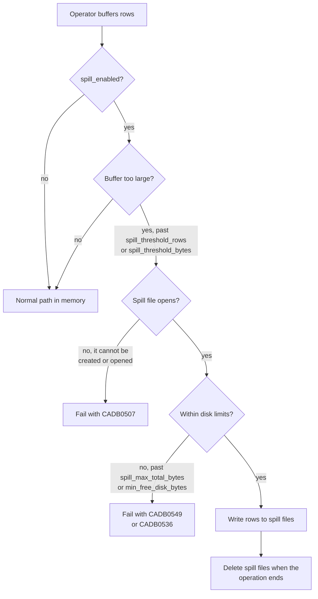

# Spill to disk

Spill to disk lets a query operator move a large intermediate buffer into a
temporary file. Large sorts, joins, and groupings then need less memory.
CamusDB streams query results to the client, but some operators must collect
intermediate rows before they can produce output. Some operators also keep
other state in memory, as described below.

Spill is on by default on the server. An operator works in memory until its
buffer passes a row or byte threshold. Then it writes temporary files under
`data_dir`. Spill is off in the browser playground, because its file system is
also in memory.

## Keep large queries from using all memory

With spill off, an operator stores all its intermediate rows in memory. A sort,
a join, or a `GROUP BY` over millions of rows can use a large share of the
node's memory, and several such queries at once can use all of it. The node
can then slow down for all clients, or the process can stop.

Keep spill on when:

- Your workload has large reports, exports, or batch jobs with a large
  `ORDER BY`, `GROUP BY`, `DISTINCT`, or hash join.
- You run bulk `UPDATE` or `DELETE` statements that match many rows.
- The node has limited memory, for example a small container or a virtual
  machine with a memory limit.

The cost is speed. A query that spills reads and writes temporary files, and it
takes longer than the same query in memory. Queries below the thresholds don't
create spill files and aren't affected. To measure the in-memory path, set
`spill_enabled: false`.

## What can spill

Spill applies to operators that must collect rows before they produce output:

| Operator | Why it buffers | Spill behavior |
| --- | --- | --- |
| `ORDER BY` sort | It needs all the rows before it can return sorted output. | An external merge sort. |
| Hash join | It builds a hash table from one side of the join (the build side), then reads the other side (the probe side). | A grace or hybrid hash join, which divides the rows into spill files when the build side is too large. |
| `GROUP BY` | It has one accumulator per group. | It hashes rows by group key into spill partitions (groups of rows on disk, unrelated to cluster partitions), then aggregates one partition at a time. |
| `SELECT DISTINCT` | It records the result rows that it has seen. | It hash-partitions the rows into spill files, then removes duplicates one partition at a time. |
| `UNION` | It removes duplicates from both inputs. | The same partitioned deduplication as `DISTINCT`. |
| `INTERSECT`, `EXCEPT`, including `ALL` | It counts distinct rows of the right side. A distinct `EXCEPT` also tracks the left rows that it returned. | It hash-partitions both inputs and combines each pair of partitions in memory. |
| Window functions | It sorts the input and collects the current window partition. | External sorts and partition buffers that can spill. Arguments, sort values, and results of the current partition stay in memory. |
| Derived tables and subqueries | It stores the rows for the outer query to scan. | A spill buffer that CamusDB can read again. |
| `DELETE` and `UPDATE` match sets | It must collect the matching rows before the change. | A spill buffer that CamusDB can read again. |

Streaming operators don't spill, because they don't need a large buffer. For
example:

- A simple scan.
- `UNION ALL`, which concatenates its inputs.
- A global aggregate, such as `COUNT(*)` with no `GROUP BY`.
- A streaming `DISTINCT` over an ordered index.
- A merge join, which reads two inputs sorted on the join key and buffers only
  the current group of equal keys.

Other notes on what spills:

- A [window function](/docs/sql-queries#window-functions) processes one SQL
  partition at a time. Spill doesn't bound all of its memory: the input values
  and results of the window grow with the row count of the partition.
  `EXPLAIN (ANALYZE)` shows spilled partition buffers in the
  [`window` node](/docs/explain#window-functions).
- JSONB aggregate states (`jsonb_agg` and `jsonb_object_agg`) count their bytes
  as they grow in a group. A spill by bytes can occur with few groups. The
  size limit for one document applies as usual.
- GIN scans use the row and byte thresholds to limit how many candidates they
  collect, also with spill off. Above the limit, they change to a table scan.
  See [JSONB indexes](/docs/json#how-a-gin-scan-works).
- For an eligible `GROUP BY ... ORDER BY COUNT(...) DESC LIMIT n` query,
  CamusDB tracks the highest possible group count in each spill partition. It
  can skip a partition that can't beat the current n-th result. Look for
  `top_k` in the [aggregate plan](/docs/explain#top-k-grouped-results). The
  scan of the input isn't skipped.

### Bounded sorts

An `ORDER BY` with `LIMIT` collects only `LIMIT + OFFSET` candidates when that
number is within the spill row threshold. If the collected bytes pass the byte
threshold, it changes to an external sort. A larger bound uses the regular sort,
which can spill, from the start.

## DELETE and UPDATE

`DELETE` and `UPDATE` collect all matching rows before they change any row. A
change during the scan could change the index under the scan, and the scan
could then skip rows or read them twice.

With spill on, the collected rows can overflow into a temporary file. The
change phase then reads the rows back from the file and applies the same
changes as from memory.

## Temporary files

Spill files are under `data_dir`:

```text
{data_dir}/tmp/spill/{instanceId}/{scopeId}/
```

Each process has one `{instanceId}` directory, and each operator that spills
gets a separate `{scopeId}` directory.

CamusDB deletes the spill files when the operation ends, when it is cancelled,
and when it fails. Files can remain if the process is killed during a query.
At startup, CamusDB removes the spill directories of processes that are no
longer running.

## Configuration

Set spill in `config.yml`. All the settings below are `runtime` settings with
`node` scope. You can also change them with no restart, with
[`SET CLUSTER SETTING`](/docs/runtime-cluster-settings).

| Setting | Default | Meaning |
| --- | --- | --- |
| `spill_enabled` | `true` | The main switch. When it is `false`, no operator spills. |
| `spill_threshold_rows` | `500000` | The maximum number of rows that one operator stores in memory before it spills. |
| `spill_threshold_bytes` | `268435456` | The maximum estimated bytes that one operator stores in memory before it spills (256 MiB). An operator spills when it reaches either limit. `0` or less removes the byte limit, and only the row limit applies. |
| `spill_merge_fan_in` | `16` | The maximum number of spill runs (sorted spill files) that CamusDB reads at once in a merge pass. |
| `spill_max_total_bytes` | `8589934592` | The maximum size of the spill files on one node. `0` or less removes this limit. |
| `spill_max_frame_bytes` | `268435456` | The largest record that CamusDB reads from a spill file (256 MiB). A larger length means that the file is corrupt, and the query returns `CADB0507`. |

For example:

```yaml
spill_enabled: true
spill_threshold_rows: 500000
spill_threshold_bytes: 268435456
spill_merge_fan_in: 16
spill_max_total_bytes: 8589934592
```

See [Configuration](/docs/configuration) for all startup settings.

### Hash-join limits with spill disabled

With `spill_enabled: false`, `hash_join_max_build_rows` (default `1000000`)
and `hash_join_max_build_bytes` (default `1073741824`, 1 GiB estimated bytes)
limit the build buffer of a hash join. Above either limit, the join changes to
a nested-loop join. A byte limit of `0` or less removes that limit. Nested
loops use these limits for the right side too, and they read larger inputs
again for each left row. Such a join can become much slower as both inputs
grow.

Each fallback increments `join.nested_loop_fallbacks` in
[SHOW ENGINE STATS](/docs/engine-stats#join-fallbacks), and it can log a server
warning, at most once per minute. `EXPLAIN (ANALYZE)` shows
`ran=nested-loop-fallback`. With spill on, a large build uses a partitioned
hash join.

## Disk limits

Spill files share a volume with the storage engine. CamusDB limits spill before
it can use disk space that regular writes need.

Each spill write must pass both of these checks:

- `spill_max_total_bytes` limits the total size of the spill files on the node,
  for all spilling queries together. A write above this limit fails the
  statement with `CADB0549` `SpillLimitExceeded`.
- `min_free_disk_bytes` is the minimum free space for the data directory. A
  spill write that would go below it returns `CADB0536`
  `InsufficientDiskSpace`.

In both cases, the statement fails, CamusDB deletes the spill files of that
operation, and a spilling `DELETE` or `UPDATE` changes no rows.

## Behavior after a failure

If an operator must spill but CamusDB can't create or open a spill file, the
query returns `CADB0507` (`SpillStorageUnavailable`). CamusDB doesn't change
to unbounded memory use when spill storage isn't available.



Typical causes:

- The CamusDB process can't write to `data_dir`.
- The disk of `data_dir` is full.
- Someone removed the temporary spill directories or changed their
  permissions.

Fix the storage problem, then run the query again.

## Operational notes

- Spill applies to one operator. It isn't a memory budget for a full query.
- An operator below both thresholds creates no spill file.
- `spill_max_total_bytes` is a budget for all spill files on the node. It isn't
  reserved for each query.
- Spill reduces memory pressure and adds disk I/O. Large queries and bulk
  writes can take longer. Operator state in memory needs capacity too.
