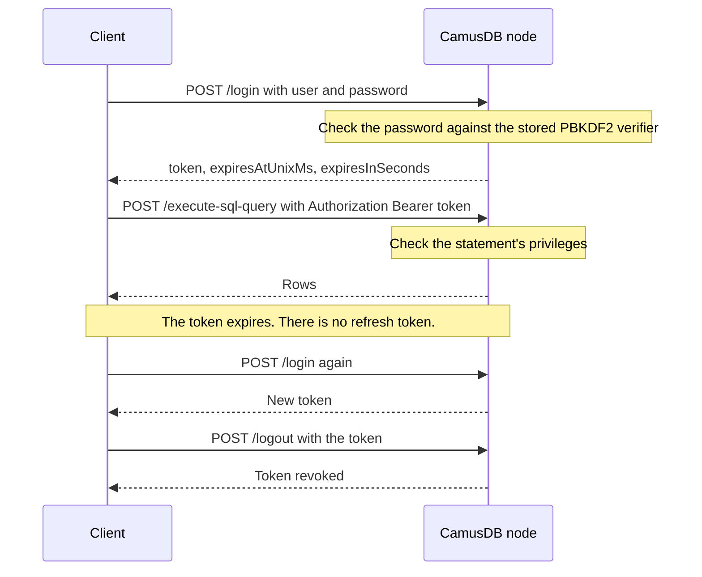

# Authentication and authorization

Authentication checks who a client is. Authorization checks what that client can
do. With both enabled, each client connects as a named user, and each user can read
or change only the databases and tables that you grant to it.

## When to enable authentication

Authentication is off by default, which makes a local node easy to start. With
authentication off, any client that can reach the node's network port has full
access to all databases on that node.

Enable authentication when:

- The node is reachable from a network that you don't fully control, such as a
  cloud network or the internet.
- More than one application or team uses the same server, and each one must see
  only its data.
- You want least privilege. For example, a reporting service gets read access
  only, and only an administrator can run DDL.
- A security review or a compliance rule requires named users and passwords.

You can leave it off for local development and for a test node on a private
machine. An existing development deployment continues to work until an operator
enables authentication.

## What changes when you enable it

With authentication enabled, CamusDB fails closed:

- The server doesn't start with an empty user catalog. You must supply
  bootstrap credentials for an administrator.
- Each request must include a valid bearer token.
- CamusDB checks each statement against the privileges that its tables and
  databases require.
- A request with a credential over a plaintext connection returns an error.
  For the exceptions, see [TLS](#tls).

CamusDB stores a password only as a salted PBKDF2-HMAC-SHA256 verifier. Regular
client requests send a short-lived bearer token, and the password isn't sent
again.

## Enable authentication

Set the authentication switch and the secrets with environment variables or a
secret provider. Don't put a token key or a bootstrap password in `config.yml`.
The TLS setting isn't a secret, and [TLS](#tls) covers it.

| Environment variable | Required | Meaning |
| --- | --- | --- |
| `CAMUSDB_AUTH_ENABLED` | yes | Set it to `true` to enable authentication and authorization. Other values leave them disabled. |
| `CAMUSDB_AUTH_TOKEN_KEY` | yes, with auth enabled | The server key for the HMAC of access-token secrets at rest. It must be at least 32 bytes. Use a random value, such as the output of `openssl rand -hex 32`. All nodes in the cluster must use the same value. |
| `CAMUSDB_BOOTSTRAP_USER` | at the first start with auth only | The name of the first superuser, used when the auth catalog is empty. |
| `CAMUSDB_BOOTSTRAP_PASSWORD` | at the first start with auth only | The initial password of the bootstrap superuser. |
| `CAMUSDB_NODE_SECRET` | in a cluster with auth | The shared secret for internal routes between nodes. If you set it, it must be at least 32 bytes. All nodes in the cluster must use the same value. |

For example:

```bash
export CAMUSDB_AUTH_ENABLED=true
export CAMUSDB_AUTH_TOKEN_KEY="$(openssl rand -hex 32)"
export CAMUSDB_BOOTSTRAP_USER=admin
export CAMUSDB_BOOTSTRAP_PASSWORD="$(openssl rand -base64 24)"
export CAMUSDB_NODE_SECRET="$(openssl rand -hex 32)"
```

At startup, these rules apply:

1. If the auth catalog is empty, CamusDB creates one bootstrap superuser from
   the supplied values.
2. If the auth catalog is empty and the bootstrap values are missing, the
   startup fails.
3. When at least one user exists, CamusDB ignores the bootstrap values.

The startup also fails when `CAMUSDB_AUTH_TOKEN_KEY`, or a configured
`CAMUSDB_NODE_SECRET`, is shorter than 32 bytes. On a single node, the node secret is
optional. If it isn't set, routes from peers return an error.

There is no default user and no default password.

## Login and logout

For application code, set the user and password in your
[.NET](/docs/dotnet-driver#authentication),
[TypeScript](/docs/typescript-connector#authentication), or
[Python](/docs/python-driver#authentication) driver. The driver handles login and
token renewal. A token from your own token
service has a separate lifecycle. See the options of the driver.

An operator creates the users and grants. After they connect, applications use
their regular query and transaction methods.

<details>
<summary>Login and token protocol for custom clients</summary>

Use `/login` to exchange a user name and password for a bearer token:

```http
POST /login
Content-Type: application/json

{ "user": "admin", "password": "secret" }
```

A successful response looks like this:

```json
{
  "status": "ok",
  "token": "camus_<id>.<secret>",
  "expiresAtUnixMs": 1785270000000,
  "expiresInSeconds": 900
}
```

Send the token with each later HTTP request:

```http
POST /execute-sql-query
Authorization: Bearer camus_<id>.<secret>
Content-Type: application/json

{
  "databaseName": "app",
  "sql": "SELECT * FROM orders"
}
```

To revoke the current token, send `/logout` with the same `Authorization`
header:

```http
POST /logout
Authorization: Bearer camus_<id>.<secret>
```

By default, a token has an absolute lifetime of 15 minutes. There is no refresh
token, and a client logs in again after its token expires.



The login response shows the token's deadline in two forms:

- `expiresAtUnixMs` is the absolute UTC Unix time, in milliseconds, at which
  CamusDB stops accepting the token.
- `expiresInSeconds` is the same deadline, as a duration measured by the
  server.

Use these fields to decide when to renew. Don't assume a fixed lifetime, because
an operator can change `access_token_ttl` (milliseconds, default `900000`).
Renew before the deadline.

A password change, a `DROP USER`, or a call to `/logout` makes the user's tokens
invalid.

## gRPC tokens

A gRPC client sends the same bearer token in the request metadata:

```text
authorization: Bearer camus_<id>.<secret>
```

Use the `CamusAuth` gRPC service to get and revoke tokens:

| RPC | Purpose |
| --- | --- |
| `Login(LoginRequest)` | Exchanges `user` and `password` for `token`, `expires_at_unix_ms`, and `expires_in_seconds`. |
| `Logout(LogoutRequest)` | Revokes the token in the `authorization` metadata. A second logout is harmless. |

A deployment that uses only gRPC doesn't need the HTTP API or `/login`.

Authentication and authorization errors map to regular gRPC status codes:

| Condition | gRPC status |
| --- | --- |
| A token is missing, invalid, or expired | `UNAUTHENTICATED` |
| An authenticated caller doesn't have a privilege | `PERMISSION_DENIED` |
| The login rate limit or the KDF limit is reached | `RESOURCE_EXHAUSTED` |

See [gRPC API](/docs/grpc-api) for the service reference.

</details>

## TLS

With auth enabled, a request that has a credential over a plaintext connection
returns an error by default. Requests from loopback are allowed, and
you don't need a certificate for development on one host.

Use HTTPS in production, or terminate TLS in front of the HTTP API. Use TLS for
gRPC too.

TLS can terminate in front of the node, for example at an ingress or a service
mesh. The CamusDB process then sees only the trusted plaintext connection. In
that setup, turn off the transport check, and keep authentication and grants
enabled:

```yaml
require_tls_when_auth_enabled: false
```

You can also use the command-line flag:

```bash
camusdb --require-tls-when-auth-enabled false
```

This setting isn't a secret, and it belongs in the regular configuration. Don't
turn it off for a node that clients can reach directly.

## Manage users

User management statements are server-level statements. They don't need a
database, but they require a superuser.

```camussql
CREATE USER myapp IDENTIFIED WITH sha256_password BY 'app-password';
CREATE USER myapp IDENTIFIED BY 'app-password';
CREATE USER IF NOT EXISTS myapp IDENTIFIED BY 'app-password';
CREATE USER grant_target;

ALTER USER admin IDENTIFIED BY 'new-password' REPLACE 'current-password';
ALTER USER admin IDENTIFIED WITH sha256_password BY 'new-password' REPLACE 'current-password';
ALTER USER myapp IDENTIFIED BY 'new-password';

DROP USER myapp;
DROP USER IF EXISTS myapp;
```

CamusDB supports only `sha256_password`, and it uses it by default when you omit
`IDENTIFIED WITH`.

`CREATE USER grant_target` creates a passwordless user that can receive
grants. That user can't log in until you set a password with `ALTER USER`.

Use a bound parameter for passwords:

```camussql
CREATE USER myapp IDENTIFIED BY @password;
ALTER USER admin IDENTIFIED BY @new_password REPLACE @current_password;
```

With a parameter, the cleartext password doesn't appear in shell history or
query logs. A password can be at most 1 KiB long. The server logs don't show the
password literals of an `ALTER USER ... REPLACE ...` statement.

When users change their password, the statement must include `REPLACE` with the
current password. This also applies to a superuser who changes their own
password. A superuser doesn't need the current password to reset the password of another
user. A password change makes the user's existing tokens invalid, including
the token of the request.

### List accounts

Use `SHOW USERS` to list the user catalog:

```camussql
SHOW USERS;
SHOW USERS LIKE 'app_%';
```

The result has one row per account, ordered by user name:

| Column | Meaning |
| --- | --- |
| `user` | The account name, in the case used at creation. |
| `id` | The immutable account ID, or `NULL` for older accounts created before IDs existed. |
| `superuser` | Whether the account bypasses privilege checks. |
| `has_password` | Whether the account can log in. |
| `grants` | The number of grant records of the account. |
| `created_at` | The UTC creation time. |

The output doesn't include password hashes or other password material. `SHOW USERS` requires a superuser, because it shows all accounts
on the server.

## Grant privileges

Use `GRANT` and `REVOKE` to manage privileges on objects:

```camussql
GRANT SELECT, INSERT ON app.* TO myapp;
GRANT SELECT ON app.orders TO reader;
GRANT ALTER, INDEX ON app.orders TO migrator;
GRANT ALL PRIVILEGES ON app.* TO poweruser;
GRANT MONITOR ON *.* TO monitoring;

REVOKE INSERT ON app.* FROM myapp;

SHOW GRANTS FOR myapp;
SHOW GRANTS FOR *;
SHOW GRANTS;
```

`SHOW GRANTS FOR <user>` returns the grants of that user. `SHOW GRANTS` returns
the grants of the authenticated user.

`SHOW GRANTS FOR *` returns the grants of all accounts, ordered by account name
and object. Accounts that don't have grants don't appear. To list all
accounts, use `SHOW USERS`. The statement requires a superuser.

With authentication enabled, the grants of another user are visible only to a
superuser. Other users can see their own grants. The error for
`SHOW GRANTS FOR <other>` doesn't show whether that user exists.

CamusDB supports these privileges:

| Privilege | Allows |
| --- | --- |
| `SELECT` | Read the data of a table, and its metadata with `SHOW COLUMNS` and `SHOW CREATE TABLE`. |
| `INSERT` | Insert a row. |
| `UPDATE` | Update a row. |
| `DELETE` | Delete a row. |
| `CREATE TABLE` | Create a table, a view, a materialized view, or a sequence in the scope. |
| `DROP` | Drop a table in the scope. Dropping a database needs a superuser. |
| `ALTER` | Alter table or database metadata in the scope. |
| `INDEX` | Create, alter, or drop an index in the scope. |
| `CREATE` | Create an inline C# function in the scope. Creating a database needs a superuser. |
| `MONITOR` | Read node resource statistics. It is valid on `*.*` only, and it gives no access to application data. |
| `ALL PRIVILEGES` | All the concrete privileges above, except `MONITOR`. |

To create a foreign key, you also need `SELECT` on the referenced parent table.
There is no separate `REFERENCES` privilege.

A grant has one of three scopes, from the broadest to the narrowest:

| Scope | Example | Meaning |
| --- | --- | --- |
| Global | `*.*` | All databases and all tables. |
| Database | `app.*` | All tables in one database. |
| Table | `app.orders` | One table. |

Grants add together. A grant of a privilege that the user already has has no
effect. `REVOKE` removes a privilege from the matching scope.

A grant applies to the immutable identity of a database or table. After a
rename, the grant applies as before. A table that you drop and create again doesn't
get the grants of the old table.

`GRANT` doesn't create users, and it can't make a user a superuser. Only the
bootstrap sets the superuser attribute.

## Apply authorization changes

Most privilege changes don't need a manual flush:

```camussql
FLUSH PRIVILEGES;
FLUSH SESSIONS;
```

Both statements require a superuser and return no rows.

Each node caches authorization decisions for at most the authorization cache
TTL, which is 1 second by default. A `GRANT`, `REVOKE`, `DROP USER`, or password
change applies to the next request on the node where it was made. Other nodes
see the change when their cached decision expires and they read the catalog
again. With a TTL of `0`, changes apply on all nodes immediately, and each
request does a catalog lookup. Long-lived gRPC batch streams resolve
authorization again on the same schedule.

### gRPC batch streams and token expiry

A `BatchExecute` stream sends its bearer token once, when the stream opens. The
token lifetime limits how long the token can open a new stream or make a unary
call. It doesn't end a batch stream that opened while the token was valid.

After the token expires, the stream resolves authorization from the account that
it authenticated as, with the same authorization cache TTL. Grant and revoke
changes reach the next operation within that time.

An early revocation of the session ends the stream. `/logout`, `FLUSH SESSIONS`,
a password change, and `DROP USER` all make the session invalid. A stream that
ends this way returns `UNAUTHENTICATED` with `CADB0516`. The client must log in
again and open a new stream.

The server retains expired session records for a short time, and an open stream
can tell regular expiry from revocation. A new stream needs a valid token.
Renew before `expiresAtUnixMs`.

`FLUSH PRIVILEGES` makes this node drop cached authorization decisions and read
the user and grant catalog again. It also increases a cluster-wide version
counter for the authorization cache. Other nodes then discard decisions from the
older catalog within the same TTL. It doesn't revoke sessions, and clients don't
need to log in again.

`FLUSH SESSIONS` deletes all stored sessions, and all clients on all nodes must
log in again. Use it to make credentials outside the server invalid. Regular
grant changes don't need it.

## Enforcement rules

With auth enabled, CamusDB checks each statement before it is executed.

To read a table, a statement needs `SELECT` on each table that it references in
any part of the statement, for example in a join or a subquery. `EXPLAIN` of a
query needs the same privileges as the query.

`SELECT ... FOR UPDATE` also requires `UPDATE` on its table, also in a regular
`EXPLAIN`. See [row-locking reads](/docs/sql-queries#for-update).

A write needs the matching write privilege:

- `INSERT` for an insert.
- `UPDATE` for an update.
- `DELETE` for a delete.

`INSERT ... ON CONFLICT DO UPDATE` and `UPSERT` require `INSERT` and `UPDATE`.
CamusDB checks both before execution, also if no row conflicts. `DO NOTHING`
requires `INSERT` only. See [conflict handling](/docs/sql-writes#on-conflict).

A write with `RETURNING` also needs `SELECT` on the target table. The count-only
request flag (`discard_returning_rows` in gRPC, `discardReturningRows` over HTTP
and in the TypeScript connector) doesn't remove that check. The
`ExecuteNonQueryAsync()` method of the .NET driver sets that flag.

[`TRUNCATE`](/docs/truncate-table) needs `DELETE` and `DROP` on the target table.
CamusDB checks the two privileges separately, and they can come from separate
grants.

DDL needs the related DDL privilege, or a superuser. Two areas need a superuser:
user and grant administration, and DDL for the database lifecycle. The HTTP
routes `/create-db`, `/drop-db`, and `/close-db` also require a superuser.

The typed gRPC rows API checks the table of the request. `InsertRow` needs
`INSERT`, `Query` and `QueryById` need `SELECT`, `UpdateRows` and `UpdateById`
need `UPDATE`, and `DeleteRows` and `DeleteById` need `DELETE`.

Cluster routes that show the topology or change the cluster state require a
superuser. `/v1/cluster/health` answers without a credential, and an
orchestrator can use it to check the node. Only a superuser sees the detailed
fields: the role of the node, the [partitions](/docs/concepts#partition) that it
hosts, and the partitions whose replication has stalled. With authentication
off, the leave and
[replication-factor](/docs/concepts#replica-and-replication-factor) routes
accept requests from loopback only.

A user who has no grant in a database can't see its name. A statement in that
database returns `CADB0010` `DatabaseDoesntExist`, the same error as for an
unknown name. This applies to all client APIs. A global grant, a `db.*` grant, or a grant on one table in the
database makes the database visible. Each statement needs its table privilege as
usual.

Catalog statements follow the same rule:

- `SHOW DATABASES` lists only the databases that the caller can reach.
- `SHOW TABLES` and `SHOW TABLES FROM db` list only the tables on which the
  caller has a privilege. An invisible target of `SHOW TABLES FROM db` returns
  `DatabaseDoesntExist`.
- `SHOW BRANCHES`, `SHOW ANCESTORS`, and `SHOW ORPHAN DATABASES` omit the
  databases that the caller can't see.

Some statements don't open a table, such as `SHOW TABLES` and a `SELECT` with no
`FROM` clause. An authenticated user can run them when the current database is
visible to that user.

Database-level inspection, such as `SHOW DATABASE` and `SHOW ORPHAN TABLES`,
needs `SELECT` at database scope: a `db.*` or `*.*` grant, or a superuser. A
grant on one table makes the database visible, but it doesn't allow these
reads.

Inspection of one table needs `SELECT` on that table, for example
`SHOW CREATE TABLE` or [`SHOW STATISTICS`](/docs/show-statistics).

[`SHOW PARTITIONS`](/docs/sql-inspection#raft-partitions) requires a superuser
and can run before selecting a database.

`SHOW ENGINE STATS` shows the internal operation of one node. It needs a
superuser, and database or table grants don't apply to it.

The REST and gRPC [node resource stats](/docs/node-stats) calls accept a
superuser or an account with `MONITOR`. `MONITOR` isn't part of
`ALL PRIVILEGES`, and it is narrower than superuser access on purpose.

The configuration statements also need a superuser: `SHOW VARIABLES`,
`SHOW CLUSTER SETTINGS`, and
[`SET` and `RESET CLUSTER SETTING`](/docs/runtime-cluster-settings).

One rule is stricter than necessary. An `UPDATE` or `DELETE` with a subquery
that reads another table needs the write privilege on that second table. `SELECT`
would be enough.

## Runtime defaults

These defaults are process-level security settings:

| Setting | Key | Default | Meaning |
| --- | --- | --- | --- |
| Access token lifetime | `access_token_ttl` | 900000 ms (15 minutes) | The absolute lifetime of a bearer token. |
| Authorization cache TTL | `authentication_cache_ttl` | 1000 ms (1 second) | The maximum age of a cached token or privilege decision on another node. A change made on this node applies to the next request. With `0`, each request does a catalog lookup. |
| Expired session retention | `expired_session_retention_ms` | 300000 ms (5 minutes) | How long the server retains an expired session record, so that a live gRPC batch stream can tell regular token expiry from revocation. |
| Password hash iterations | `password_hash_iterations` | 600,000 | The PBKDF2-HMAC-SHA256 work factor, stored with each credential. |
| Login KDF concurrency | `login_kdf_max_concurrency` | 8 | The maximum number of concurrent password checks on one node. |
| Login attempts per minute | `login_max_attempts_per_minute` | 20 | The login rate limit for one account from one source address. |
| Login attempts per source per minute | `login_max_attempts_per_source_per_minute` | 200 | The login rate limit for all accounts from one source address. |
| Login rate limiter entries | `login_rate_limit_max_entries` | 100,000 | The maximum number of keys that each login rate-limit counter tracks. |
| Session reaper interval | `session_reaper_interval_ms` | 300000 ms (5 minutes) | How often expired dashboard and bearer-token sessions are deleted. `0` or less turns the sweep off. |
| Principal cache max entries | `authentication_cache_max_entries` | 10,000 | The maximum size of the cache of authenticated principals on one node. |
| TLS requirement | `require_tls_when_auth_enabled` | `true` | Reject a plaintext request with a credential, except from loopback. The command-line form is `--require-tls-when-auth-enabled true\|false`. |

All these settings need a restart, except `require_tls_when_auth_enabled`.

## Errors

An authentication error doesn't show which credential was wrong.

| Code | Meaning |
| --- | --- |
| `CADB0512 UserAlreadyExists` | `CREATE USER` targets an existing user, and the statement has no `IF NOT EXISTS`. |
| `CADB0513 UserDoesNotExist` | `ALTER USER`, `DROP USER`, `GRANT`, or `REVOKE` targets an unknown user. |
| `CADB0514 UnsupportedAuthPlugin` | `IDENTIFIED WITH` names an auth plugin that CamusDB doesn't support. |
| `CADB0515 InvalidPrivilege` | `GRANT` or `REVOKE` uses an unknown or invalid privilege. |
| `CADB0516 AuthenticationFailed` | The credentials are missing, invalid, expired, or revoked, or the user name or password is wrong. |
| `CADB0517 InsufficientPrivilege` | The authenticated caller doesn't have the privilege that the statement needs. |
| `CADB0518 TooManyAuthAttempts` | The caller passed the login rate limit, or the limit on concurrent password checks. |
| `CADB0519 InsecureTransport` | A request with a credential arrived over plaintext while TLS is required. |

See [Error codes](/docs/error-codes) for the HTTP status codes.
