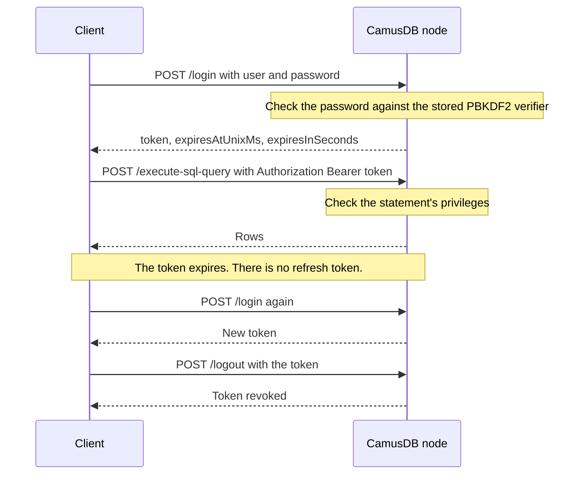

# Authentication and authorization

Authentication checks who a client is. Authorization checks what that client can
do. With both enabled, each application, service, and person connects as a
named user, and each user can read or change only the databases and tables that
you grant to it.

## Why enable authentication

Authentication is off by default, so a local node is easy to start. Without it,
any client that can reach a node's network port can read, change, and drop
every database on that node.

Enable authentication when:

- The node is reachable from a network that you do not fully control, such as
  a shared office network, a cloud network, or the internet.
- More than one application or team uses the same server, and each one must see
  only its own data.
- You want least privilege. For example, a reporting service gets read access
  only, and only an administrator can run DDL.
- A security review or a compliance rule requires named users and passwords.

You can leave it off for local development and for a test node on a private
machine. An existing development deployment keeps working until an operator
enables authentication.

## What changes when you enable it

While authentication is enabled, CamusDB fails closed:

- The server refuses to start with an empty user catalog. It starts only when
  you supply bootstrap credentials for an administrator.
- Every request must include a valid bearer token.
- CamusDB checks every statement against the privileges its tables and
  databases require.
- CamusDB refuses a request that carries a credential over a plaintext
  connection, except for requests from loopback and deployments where you
  disabled the TLS requirement.

CamusDB stores a password only as a salted PBKDF2-HMAC-SHA256 verifier.
Ordinary client requests use a short-lived, opaque bearer token instead of
sending the password again.

## Enable authentication

Configure the authentication switch and the secrets through environment
variables or a secret provider, not in `config.yml`. Do not put a token key or
a bootstrap password in YAML. The TLS topology setting is not a secret, and
[TLS](#tls) covers it.

| Environment variable | Required | Meaning |
| --- | --- | --- |
| `CAMUSDB_AUTH_ENABLED` | yes | Set it to `true` to enable authentication and authorization. Any other value keeps them disabled. |
| `CAMUSDB_AUTH_TOKEN_KEY` | yes, while auth is enabled | The server-side key that applies an HMAC to access-token secrets at rest. It must be at least 32 bytes. Use a random value such as `openssl rand -hex 32`. Every node in the cluster must use the same value. |
| `CAMUSDB_BOOTSTRAP_USER` | at the first start with auth only | The name of the first superuser, used when the auth catalog is empty. |
| `CAMUSDB_BOOTSTRAP_PASSWORD` | at the first start with auth only | The bootstrap superuser's initial password. |
| `CAMUSDB_NODE_SECRET` | in a cluster deployment with auth | The shared secret for internal routes between nodes, used while auth is enabled. When set, it must be at least 32 bytes. Every node in the cluster must use the same value. |

For example:

```bash
export CAMUSDB_AUTH_ENABLED=true
export CAMUSDB_AUTH_TOKEN_KEY="$(openssl rand -hex 32)"
export CAMUSDB_BOOTSTRAP_USER=admin
export CAMUSDB_BOOTSTRAP_PASSWORD="$(openssl rand -base64 24)"
export CAMUSDB_NODE_SECRET="$(openssl rand -hex 32)"
```

At startup, these rules apply:

1. If the auth catalog is empty, CamusDB creates one bootstrap superuser from
   the supplied values.
2. Startup fails if the auth catalog is empty and the bootstrap values are
   absent.
3. CamusDB ignores the bootstrap values as soon as one user exists.

Startup also fails when `CAMUSDB_AUTH_TOKEN_KEY`, or a configured
`CAMUSDB_NODE_SECRET`, is shorter than 32 bytes. An unset node secret is still
a valid single-node configuration: peer routes are refused instead of guarded
by a weak shared secret.

There is no default user and no default password.

## Login and logout

Use `/login` to exchange a user name and password for a bearer token:

```http
POST /login
Content-Type: application/json

{ "user": "admin", "password": "secret" }
```

A successful response looks like this:

```json
{
  "status": "ok",
  "token": "camus_<id>.<secret>",
  "expiresAtUnixMs": 1785270000000,
  "expiresInSeconds": 900
}
```

Send the token on each later HTTP request:

```http
POST /execute-sql-query
Authorization: Bearer camus_<id>.<secret>
Content-Type: application/json

{
  "databaseName": "app",
  "sql": "SELECT * FROM orders"
}
```

Use `/logout` with the same `Authorization` header to revoke the current token:

```http
POST /logout
Authorization: Bearer camus_<id>.<secret>
```

By default, a token has an absolute lifetime of 15 minutes. There is no refresh
token, so a client logs in again after its token expires.



The login response reports the token's deadline in two forms:

- `expiresAtUnixMs` is the absolute UTC Unix epoch millisecond at which CamusDB
  stops accepting the token.
- `expiresInSeconds` is the same deadline, as a duration measured by the
  server.

Renew based on those fields rather than assuming a fixed lifetime, because an
operator can change `access_token_ttl` (milliseconds, default `900000`). A
client must renew before the reported deadline.

A password change, a `DROP USER`, or a call to `/logout` invalidates an
outstanding token.

## gRPC tokens

A gRPC client sends the same bearer token in the request metadata:

```text
authorization: Bearer camus_<id>.<secret>
```

Use the `CamusAuth` gRPC service to obtain and revoke tokens:

| RPC | Purpose |
| --- | --- |
| `Login(LoginRequest)` | Exchanges `user` and `password` for `token`, `expires_at_unix_ms`, and `expires_in_seconds`. |
| `Logout(LogoutRequest)` | Revokes the token in the `authorization` metadata. A second logout has no further effect. |

So a gRPC-only deployment does not need the HTTP API, and its clients never
need to call `/login`.

Authentication and authorization errors map to ordinary gRPC status codes:

| Condition | gRPC status |
| --- | --- |
| A token is absent, invalid, or expired | `UNAUTHENTICATED` |
| An authenticated caller lacks a privilege | `PERMISSION_DENIED` |
| The login rate limit or the KDF limit is reached | `RESOURCE_EXHAUSTED` |

See [gRPC API](/docs/grpc-api) for the service reference.

## TLS

While auth is enabled, CamusDB by default refuses a request that carries a
credential over a plaintext connection. Requests from loopback are exempt, so
development on one host works without a certificate.

Use HTTPS in production, or terminate TLS in front of the HTTP API. Deploy gRPC
over TLS as well.

TLS can terminate in front of the node: at an ingress, a sidecar, or a service
mesh. The CamusDB process then sees only the trusted plaintext hop. In that
topology, disable the transport check, but keep authentication and grants
enabled:

```yaml
require_tls_when_auth_enabled: false
```

You can also use the command-line flag:

```bash
camusdb --require-tls-when-auth-enabled false
```

This setting is not a secret, so it belongs in the ordinary configuration. Do
not turn it off for a node that clients can reach directly.

## Manage users

User management statements are server-level statements. They need no database
context, but they require the superuser attribute.

```camussql
CREATE USER myapp IDENTIFIED WITH sha256_password BY 'app-password';
CREATE USER myapp IDENTIFIED BY 'app-password';
CREATE USER IF NOT EXISTS myapp IDENTIFIED BY 'app-password';
CREATE USER grant_target;

ALTER USER admin IDENTIFIED BY 'new-password' REPLACE 'current-password';
ALTER USER admin IDENTIFIED WITH sha256_password BY 'new-password' REPLACE 'current-password';
ALTER USER myapp IDENTIFIED BY 'new-password';

DROP USER myapp;
DROP USER IF EXISTS myapp;
```

CamusDB supports only `sha256_password`, and uses it by default when you omit
`IDENTIFIED WITH`.

`CREATE USER grant_target` creates a grant target without a password. That
user cannot log in until you set a password with `ALTER USER`.

Use a bound parameter for passwords:

```camussql
CREATE USER myapp IDENTIFIED BY @password;
ALTER USER admin IDENTIFIED BY @new_password REPLACE @current_password;
```

A parameter keeps the cleartext secret out of shell history, traces, and query
logs. A password can be at most 1 KiB long. Both password literals in an
`ALTER USER ... REPLACE ...` statement are redacted from server logs.

When users change their own password, the statement must include `REPLACE`
with the current password. That rule applies to a superuser changing their own
password too. A superuser can reset another user's password without knowing the
old password. Any password change invalidates that user's existing tokens,
including the token that made the request.

### List accounts

Use `SHOW USERS` to inventory the user catalog:

```camussql
SHOW USERS;
SHOW USERS LIKE 'app_%';
```

The result has one row per account, ordered by user name:

| Column | Meaning |
| --- | --- |
| `user` | Account name, in the case used at creation. |
| `id` | Immutable account id, or `NULL` for older accounts created before ids existed. |
| `superuser` | Whether the account bypasses privilege checks. |
| `has_password` | Whether the account can log in. |
| `grants` | Count of grant records held by the account. |
| `created_at` | UTC creation time. |

The output never includes password material: no hash, salt, iteration count, or
algorithm. `SHOW USERS` requires a superuser because it names every account on
the server.

## Grant privileges

Use `GRANT` and `REVOKE` to manage privileges on objects:

```camussql
GRANT SELECT, INSERT ON app.* TO myapp;
GRANT SELECT ON app.orders TO reader;
GRANT ALTER, INDEX ON app.orders TO migrator;
GRANT ALL PRIVILEGES ON app.* TO poweruser;
GRANT MONITOR ON *.* TO monitoring;

REVOKE INSERT ON app.* FROM myapp;

SHOW GRANTS FOR myapp;
SHOW GRANTS FOR *;
SHOW GRANTS;
```

`SHOW GRANTS FOR <user>` returns the named user's grants. `SHOW GRANTS` without
`FOR` returns the authenticated user's grants.

`SHOW GRANTS FOR *` returns all grants for all accounts, ordered by account name
and object. An account with no grants produces no row, so use `SHOW USERS` to
list the accounts themselves. The statement requires a superuser.

With authentication enabled, reading another user's grants requires a
superuser. A non-superuser can always inspect their own grants. A refused
`SHOW GRANTS FOR <other>` does not reveal whether that user exists.

CamusDB supports these privileges:

| Privilege | Allows |
| --- | --- |
| `SELECT` | Read a table's data, and inspect its metadata with `SHOW COLUMNS` and `SHOW CREATE TABLE`. |
| `INSERT` | Insert a row. |
| `UPDATE` | Update a row. |
| `DELETE` | Delete a row. |
| `CREATE TABLE` | Create a table in the target database scope. |
| `DROP` | Drop a database or a table in the scope. |
| `ALTER` | Alter table or database metadata in the scope. |
| `INDEX` | Create, alter, or drop an index in the scope. |
| `CREATE` | Create a database, or another object with a create scope where that applies. |
| `MONITOR` | Read node resource statistics. It is valid on `*.*` only and grants no access to application data. |
| `ALL PRIVILEGES` | The union of the concrete privileges that CamusDB knows today. |

Creating a foreign key also requires `SELECT` on the referenced parent table.
A child write can reveal whether a parent key exists, so CamusDB checks that
privilege when the constraint is created. There is no separate `REFERENCES`
privilege.

A grant has one of three scopes, from broadest to narrowest:

| Scope | Example | Meaning |
| --- | --- | --- |
| Global | `*.*` | Every database and every table. |
| Database | `app.*` | Every table in one database. |
| Table | `app.orders` | One table. |

Grants add together, and repeating a grant is harmless: granting a privilege
that the user already holds does nothing. `REVOKE` subtracts a privilege from
the matching scope.

A grant binds to the immutable identity of a database or table, so a rename
keeps the grant. A table that you drop and create again does not inherit the
old table's grants.

`GRANT` never creates a user, and it cannot make a user a superuser. Only the
bootstrap sets the superuser attribute.

## Apply authorization changes

Most privilege changes need no manual flush:

```camussql
FLUSH PRIVILEGES;
FLUSH SESSIONS;
```

Both statements require a superuser and return no rows.

Each node caches authorization decisions for at most the authorization cache
TTL, which is 1 second by default. A `GRANT`, `REVOKE`, `DROP USER`, or
password change applies to the next request on the node where it was made.
Other nodes observe the change when their cached decision expires and they read
the catalog again. Setting the TTL to `0` makes cross-node changes immediate,
at the cost of a catalog lookup on every request. Long-lived gRPC batch streams
re-resolve authorization on the same schedule.

### gRPC batch streams and token expiry

A `BatchExecute` stream presents its bearer token once, when the stream opens.
The token lifetime controls how long that token can be presented to open a new
stream or make a unary call. It does not by itself end an already-open batch
stream that authenticated while the token was valid.

After ordinary token expiry, the stream keeps resolving authorization from the
account it authenticated as, using the same authorization cache TTL described
above. Grant and revoke changes still reach the next operation within that
bound.

Early session revocation still ends the stream. `/logout`, `FLUSH SESSIONS`, a
password change, and `DROP USER` all invalidate the session. A stream that ends
this way returns `UNAUTHENTICATED` with `CADB0516`. The client should discard
the token, log in again, and open a new stream.

The server keeps expired session records briefly so an open stream can tell
ordinary expiry apart from revocation. A new stream still needs a token that
resolves, so clients should renew before `expiresAtUnixMs`.

`FLUSH PRIVILEGES` makes this node drop cached authorization decisions and
re-read the user and grant catalog. It also bumps a cluster-wide version
counter for the authorization cache, so other nodes discard decisions derived
from the older catalog within the same TTL bound. It does not revoke sessions
or force clients to log in again.

`FLUSH SESSIONS` deletes all stored sessions, so every client on every node
must log in again. Use it when you need to invalidate credentials held outside
the server, not after ordinary grant changes.

## Enforcement rules

While auth is enabled, CamusDB checks every statement before running it.

Reading a table needs `SELECT` on every table that the statement references.
That covers joins, derived tables, subqueries, semi-joins (filters that keep a
row when a match exists in another table), `EXISTS`, `IN`, and `EXPLAIN` for a
query that reads a table.

`SELECT ... FOR UPDATE` also requires `UPDATE` on its table, including when
wrapped in plain EXPLAIN. See [row-locking reads](/docs/sql-queries#for-update).

A write needs the matching write privilege:

- `INSERT` for an insert.
- `UPDATE` for an update.
- `DELETE` for a delete.

`INSERT ... ON CONFLICT DO UPDATE` and `UPSERT` require both `INSERT` and
`UPDATE`, checked before execution even if nothing conflicts. `DO NOTHING`
requires `INSERT` only. See [conflict handling](/docs/sql-writes#on-conflict).

A write with `RETURNING` also needs `SELECT` on the target table, because the
`RETURNING` list reads stored row values. The count-only request flag
(`discard_returning_rows` in gRPC, `discardReturningRows` over HTTP and in the
TypeScript connector) does not remove that privilege check. The .NET driver's
`ExecuteNonQueryAsync()` sets that flag.

[`TRUNCATE`](/docs/truncate-table) needs both `DELETE` and `DROP` on the target
table. It removes every row, as a `DELETE` does, and it retires the table's
whole [key space](/docs/concepts#key-space) (the stored keys that hold its rows
and indexes), as a `DROP` does.

CamusDB checks the two privileges separately, so they can come from two
separate grants.

DDL needs the relevant DDL privilege, or superuser status. Two areas need a
superuser: user and grant administration, and database lifecycle DDL. The HTTP
routes `/create-db`, `/drop-db`, and `/close-db` also require a superuser.

The typed gRPC rows API checks the table named by the request. `InsertRow` needs
`INSERT`, `Query` and `QueryById` need `SELECT`, `UpdateRows` and `UpdateById`
need `UPDATE`, and `DeleteRows` and `DeleteById` need `DELETE`.

Cluster routes that expose topology or change cluster state require a superuser.
`/v1/cluster/health` answers without a credential so an orchestrator can probe
the node, but only a superuser sees the detailed fields: the node's role, the
[partitions](/docs/concepts#partition) it hosts, and the partitions whose
replication has stalled. Membership, placement, backfill, snapshot, leave, and
[replication-factor](/docs/concepts#replica-and-replication-factor)
routes are superuser-only. Leave and replication-factor routes are
loopback-only when authentication is off.

Database names are hidden from users who hold no grant that reaches into that
database. A statement that runs in such a database fails with `CADB0010`
`DatabaseDoesntExist`, the same error returned for an unknown name. This applies
to SQL over HTTP and gRPC, the typed rows API, and batch streams. A global grant,
a `db.*` grant, or any grant on one table in the database is enough to make the
database visible, but the statement still needs its normal table privilege.

Catalog statements follow the same visibility rule. `SHOW DATABASES` lists only
databases the caller can reach. `SHOW TABLES` and `SHOW TABLES FROM db` list
only tables on which the caller has any privilege. An invisible target of
`SHOW TABLES FROM db` is reported as `DatabaseDoesntExist`. `SHOW BRANCHES`,
`SHOW ANCESTORS`, and `SHOW ORPHAN DATABASES` omit databases the caller cannot
see.

Some statements open no table, such as `SHOW TABLES` and a `SELECT` without a
`FROM` clause. An authenticated user may run them when the current database is
visible to that user.

Database-level inspection, such as `SHOW DATABASE` and `SHOW ORPHAN TABLES`,
needs `SELECT` at database scope: a `db.*` or `*.*` grant, or superuser status.
A grant on one table makes the database visible, but it does not authorize these
database-level reads.

Inspecting a single table needs `SELECT` on that table, for example
`SHOW COLUMNS`, `SHOW CREATE TABLE`, and
[`SHOW STATISTICS`](/docs/show-statistics). `SHOW STATISTICS` reports bounds
taken from real column values, so CamusDB holds it to the same requirement as
reading those columns, and nothing higher.

`SHOW ENGINE STATS` inspects how one node operates. It needs a superuser and is
not scoped to a database or table grant.

The REST and gRPC [node resource stats](/docs/node-stats) calls accept either a
superuser or an account with `MONITOR`. `MONITOR` is outside `ALL PRIVILEGES`
and is intentionally narrower than superuser access.

The configuration surface has the same requirement. `SHOW VARIABLES`,
`SHOW CLUSTER SETTINGS`, and
[`SET` and `RESET CLUSTER SETTING`](/docs/runtime-cluster-settings) all need a
superuser. The last two also change the behavior of every node, and several of
the settings they reach bound memory, concurrency, and background work.

One behavior is conservative today. An `UPDATE` or `DELETE` with a subquery
that reads another table needs the write privilege on that second table, even
though `SELECT` would be enough. The rule is too restrictive, not too
permissive.

## Runtime defaults

These defaults are process-level security settings:

| Setting | Key | Default | Meaning |
| --- | --- | --- | --- |
| Access token lifetime | `access_token_ttl` | 900000 ms (15 minutes) | The absolute lifetime of a bearer token. |
| Authorization cache TTL | `authentication_cache_ttl` | 1000 ms (1 second) | The maximum staleness of a cached token or privilege decision on another node. A change made on this node applies to the next request. `0` forces a catalog lookup on every request. |
| Expired session retention | `expired_session_retention_ms` | 300000 ms (5 minutes) | How long an expired session record is kept so a live gRPC batch stream can tell ordinary token expiry apart from revocation. |
| Password hash iterations | `password_hash_iterations` | 600,000 | The PBKDF2-HMAC-SHA256 work factor, stored with each credential. |
| Login KDF concurrency | `login_kdf_max_concurrency` | 8 | The maximum number of concurrent password verifications on one node. |
| Login attempts per minute | `login_max_attempts_per_minute` | 20 | The login rate limit for one account from one source address. |
| Login attempts per source per minute | `login_max_attempts_per_source_per_minute` | 200 | The login rate limit across all accounts from one source address. |
| Login rate limiter entries | `login_rate_limit_max_entries` | 100,000 | The maximum number of keys that each login rate-limit counter tracks. |
| Session reaper interval | `session_reaper_interval_ms` | 300000 ms (5 minutes) | How often expired dashboard and bearer-token sessions are deleted. `0` or less turns the sweep off. |
| Principal cache max entries | `authentication_cache_max_entries` | 10,000 | The maximum size of the authenticated principal cache on one node. |
| TLS requirement | `require_tls_when_auth_enabled` | `true` | Refuse a plaintext request that carries a credential, except from loopback. The command-line form is `--require-tls-when-auth-enabled true\|false`. |

## Errors

Authentication errors intentionally do not tell the caller which part was
wrong: the user, the password, or the token.

| Code | Meaning |
| --- | --- |
| `CADB0512 UserAlreadyExists` | `CREATE USER` targets an existing user, and the statement has no `IF NOT EXISTS`. |
| `CADB0513 UserDoesNotExist` | `ALTER USER`, `DROP USER`, `GRANT`, or `REVOKE` targets an unknown user. |
| `CADB0514 UnsupportedAuthPlugin` | `IDENTIFIED WITH` names an auth plugin that CamusDB does not support. |
| `CADB0515 InvalidPrivilege` | `GRANT` or `REVOKE` uses an unknown or invalid privilege. |
| `CADB0516 AuthenticationFailed` | The credentials are absent, invalid, expired, or revoked, or the user name or password is wrong. |
| `CADB0517 InsufficientPrivilege` | The authenticated caller lacks the privilege that the statement needs. |
| `CADB0518 TooManyAuthAttempts` | The caller passed the login rate limit, or the limit on concurrent password verifications. |
| `CADB0519 InsecureTransport` | A request with a credential arrived over plaintext while TLS is required. |

See [Error Codes](/docs/error-codes) for the HTTP status code mapping.
