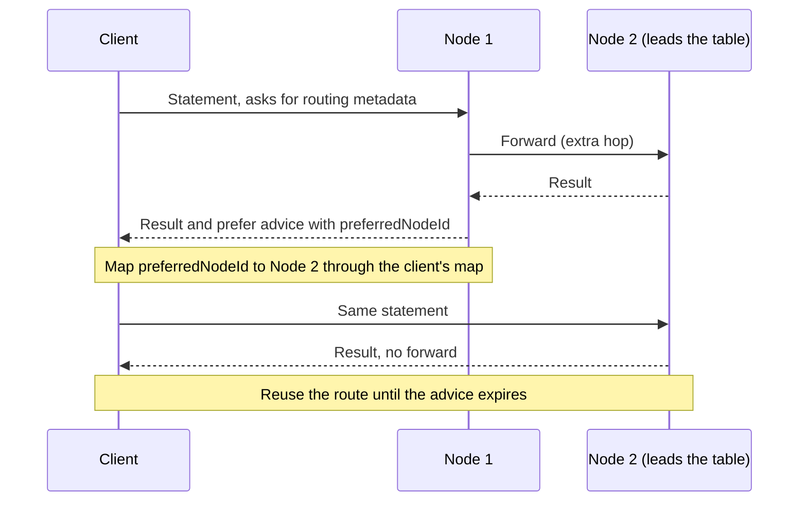

# SQL routing advice

In a cluster, a node that receives a statement for data that another node
[leads](/docs/concepts#leader) forwards the statement to that node. This adds
one network hop to the request. With routing advice, the response tells the
client which node leads the data of the statement. The client can then send
later executions of the same statement directly to that node. Advice changes
only where the client sends a request. The results and the transaction rules
are the same.



The [.NET driver](/docs/dotnet-driver#learned-routing) and the
[TypeScript connector](/docs/typescript-connector) use routing advice for
learned routing. You need the rest of this page if you write your own client,
or if you want to know why a response has no advice.

## When advice appears

A successful response has advice if all the following are true:

- The node is in cluster mode. A standalone node doesn't send advice.
- `sql_routing_advice_enabled` is `true`, the default.
- The request asks for version 1 of the metadata. In gRPC, set
  `SqlRequest.routing_accept_version = 1`. In the HTTP API, set
  `routingAcceptVersion: 1` on `/execute-sql-query` or
  `/execute-sql-non-query`.
- The statement uses a table, and the node knows the leader of its data.

A request that doesn't ask for advice gets the usual response. For example,
the following request asks for advice:

```json
{
  "databaseName": "shop",
  "sql": "SELECT name FROM robots WHERE id = 1",
  "routingAcceptVersion": 1
}
```

The response has a `routing` object next to the rows:

```json
{
  "status": "ok",
  "routing": {
    "version": 1,
    "disposition": "prefer",
    "preferredNodeId": "localhost:7072",
    "reuseScope": "statementParametersIndependent",
    "dependencyToken": "C6F927DE2F723127A4C6F201",
    "maxAgeMs": 5000,
    "provenance": "placementHint",
    "reason": "singleTableHash"
  }
}
```

In gRPC, the advice is the `routing` field of the response. A streamed query
sends one `RoutingAdvice` message after the rows.

## Eligible statements

A response names a node if the statement uses one base table, and all the key
spaces of that table are on one partition. With
[hash routing](/docs/concepts#hash-and-key-range-routing), the default, this is
true for each table. A table with key-range sharding is eligible until the
first split of one of its key spaces.

The main case is a simple read or write of one table. The route is a property of the table. This means that a lookup that
finds no row, or a write that changes no row, also gets advice. The server
decides eligibility after it resolves the names in the statement.

Other statements get a `clear` advice, or no advice:

| Statement | Advice |
| --- | --- |
| Joins, subqueries, and derived tables | `clear`, reason `ineligible` |
| Views and materialized views | `clear`, reason `ineligible` |
| Time-travel reads, such as `AS OF SYSTEM TIME '-1s'` | `clear`, reason `ineligible` |
| Statements in a branch database | `clear`, reason `ineligible` |
| A key-range table after a split | `clear`, reason `ineligible` |
| Queries with a [cache hint](/docs/query-result-cache), such as `{cache=name}` | `clear`, reason `cacheAffinity` |
| Statements without a table, such as `SHOW TABLES` and `SELECT 1` | No `routing` object |

## Metadata

| Field | Meaning |
| --- | --- |
| `version` | Always `1`. Ignore advice with a version that you don't know. |
| `disposition` | `prefer`: send later executions of this statement to `preferredNodeId`. `clear`: forget the route that you learned for this statement. |
| `preferredNodeId` | An opaque node identity. It isn't an address to connect to. Map it to an endpoint in your client configuration, and ignore it if your map doesn't have it. In the current release, the identity is the Raft host and port of the node. |
| `reuseScope` | `statementParametersIndependent`: the route is valid for all parameter values of the statement. |
| `dependencyToken` | An opaque value that changes when the dependencies of the statement change, for example after a schema change or a `TRUNCATE`. It isn't sortable. |
| `maxAgeMs` | The longest time to reuse the route, measured from when you receive it. A `clear` advice has `0`. |
| `provenance` | `placementHint`: the advice comes from what this node knows about placement. It doesn't prove which node executed the statement. |
| `reason` | `singleTableHash`, `singleRangeTable`, `ineligible`, `placementUnknown`, or `cacheAffinity`. |

Advice can be out of date, for example after a leader change. A request to the
old leader is forwarded, and the result is correct. If the server can't build
the advice after a statement succeeds, the response doesn't have advice. The
statement result is the same.

## Transactions

Statements in an explicit transaction can also get advice. However, advice
doesn't move a running transaction. The transaction executes on the endpoint
where it started, until it ends. Advice that you learn in a transaction is
useful for a later transaction or an autocommit statement.

When learned routing is on, the .NET driver and the TypeScript connector can
defer `BEGIN` until the first statement. The transaction then starts on the
node that leads the data of that statement. For more information, see
[.NET driver](/docs/dotnet-driver#learned-routing) and
[TypeScript connector](/docs/typescript-connector#transport-and-routing).

With key-range routing, the coordinator of a deferred transaction is pinned to
the partition of the first table's rows, while those rows are one range. A
split during the transaction can add forwarding, but the results are correct.
A table whose rows are already split gets a coordinator that isn't pinned.
Autocommit statements aren't pinned.

## Configuration

```yaml
sql_routing_advice_enabled: true
sql_routing_advice_ttl_ms: 5000
```

| Setting | Default | Meaning |
| --- | --- | --- |
| `sql_routing_advice_enabled` | `true` | Send routing advice. Set it to `false` to turn off advice on the node. |
| `sql_routing_advice_ttl_ms` | `5000` | The `maxAgeMs` value in advice. The valid range is `1` to `600000`. |

Both settings are node settings, and a change needs a restart.
