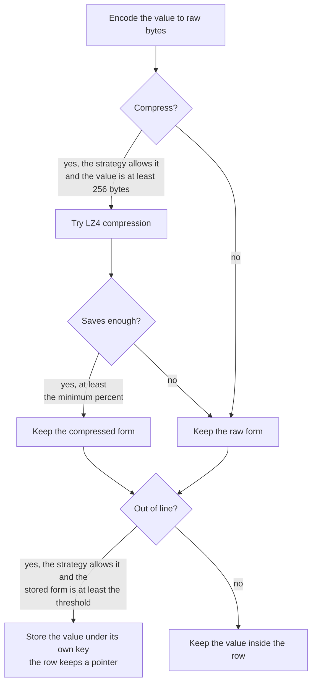

# Large Values

CamusDB can store large `STRING`, `BYTES`/`BLOB`, and `ARRAY` values in a
TOAST-style physical form: compressed, stored outside the row, or both. The
query result is unchanged. The feature changes the physical bytes CamusDB keeps,
the I/O a query performs, and the size of each stored row version.

Use it for document bodies, JSON text, images, archives, and other large cells
that do not belong in every row read. Avoid it for values that a query must read
for every row, such as embeddings scanned by an exact vector search.

## Why It Exists

CamusDB stores each row as a key/value entry. A row is also the unit of
multi-version storage. When one row carries a large value, two costs show up:

- A query that reads only small columns still pulls the large value from storage.
- An update to a small column rewrites the whole row and stores another large
  version of the value.

Out-of-line storage moves the large value under its own key. The row keeps a
small pointer. A query that does not read the large column does not fetch the
value, and an update that does not change the large column does not rewrite it.
Compression reduces the stored size when the value compresses enough to be worth
the CPU.

## Storage Strategies

Each `STRING`, `BYTES`/`BLOB`, and `ARRAY` column has a storage strategy.

| Strategy | Compresses | Stores out of line | Use it for |
| --- | --- | --- | --- |
| `EXTENDED` | Yes, when it saves enough | Yes, at or above the threshold | Default. Text, JSON, documents, and most large columns. |
| `MAIN` | Yes, when it saves enough | Never | Compressible values that most queries read. |
| `EXTERNAL` | Never | Yes, at or above the threshold | Images, archives, and incompressible large values that most queries skip. |
| `PLAIN` | Never | Never | Values every query reads, such as embeddings for nearest-neighbor (KNN) search. |

Set a strategy when you create the column:

```camussql
CREATE TABLE docs (
  id OID PRIMARY KEY,
  title STRING,
  body STRING STORAGE EXTENDED,
  thumbnail BYTES STORAGE EXTERNAL,
  embedding BYTES(3072) STORAGE PLAIN
);
```

Change it later:

```camussql
ALTER TABLE docs ALTER COLUMN thumbnail SET STORAGE PLAIN;
```

`SHOW CREATE TABLE` shows strategies that were set explicitly. A strategy on a
column without a variable-length value is rejected with `CADB0414`
`ColumnStorageNotApplicable`.

## How Values Are Stored

When CamusDB writes a non-null `STRING`, `BYTES`/`BLOB`, or `ARRAY` value, it
applies these steps:

1. Encode the value to raw bytes.
2. If the strategy allows compression and the encoded value is at least 256
   bytes, try LZ4 compression.
3. Keep the compressed form only when it saves at least
   `large_value_compression_min_saving_percent`, 12 percent by default.
4. If the strategy allows out-of-line storage, compare the stored form with
   `large_value_threshold_bytes`, 2048 bytes by default.
5. Store the value outside the row when it is at or above the threshold. Store a
   pointer in the row. Otherwise keep the value inside the row.



Compression runs before the out-of-line decision. A text value that compresses
below the threshold stays inside the row, so reading that column costs no second
key lookup.

Reads do not consult the current setting values or the current column strategy.
Each stored row records whether its variable-length cells are compressed or
out-of-line. Changing settings or a column strategy therefore cannot make
existing rows unreadable.

## Query And Write Cost

- A query that does not name an out-of-line column does not fetch its value.
- `SELECT *` names every column, so it fetches every out-of-line value.
- A query that reads an out-of-line column fetches values in batches, not one
  key at a time per row.
- A compressed value is decompressed only when the query reads that column.
- An update that does not assign a large column, and does not use it in an index
  or a `CHECK` constraint, does not fetch or rewrite that value.

The first update of an old row may rewrite the row into the current layout. For
example, a row written before an `ADD COLUMN`, `DROP COLUMN`, or storage-strategy
change can be decoded and written once in the new physical form.

## Transaction Limits

Each out-of-line value is one extra key and therefore one extra mutation. An
insert or delete of a row with `k` out-of-line values costs `k` more mutations
than the same row stored inline.

For a table with a primary key, no secondary index, and four large columns stored
out of line, each inserted row costs:

```text
row + primary-key entry + 4 large values = 6 mutations
```

With the default `max_mutations_per_transaction` of 20,000, one statement can
insert 3,333 such rows. See [Transaction Limits](/docs/transaction-limits).

## Settings

These settings control the default physical form of newly written rows and the
batching of reads and rewrites.

| Setting | Default | Meaning |
| --- | --- | --- |
| `large_value_threshold_bytes` | `2048` | Stored size at or above which a value moves out of the row. `<= 0` keeps new values inline. |
| `large_value_compression_enabled` | `true` | Whether new writes may compress values. Reads ignore this setting. |
| `large_value_compression_min_saving_percent` | `12` | Minimum saving required to keep a compressed value. |
| `large_value_rewrite_batch_rows` | `200` | Rows per transaction for `ALTER TABLE ... REWRITE STORAGE`. At most half of `max_mutations_per_transaction`. |
| `large_value_resolve_batch_bytes` | `67108864` | Decoded bytes of compressed and out-of-line values one read or rewrite batch resolves at a time. `<= 0` removes the bound. |

A setting change does not rewrite existing data. It applies to rows written
after the change.

`large_value_resolve_batch_bytes` changes memory use and the number of batched
fetches. It does not change query results. A single row larger than the bound is
read alone.

## Existing Data

Rows written before this feature are inline and uncompressed. They stay readable
without operator action. Migration is an optimization, not a requirement.

Existing data reaches the new physical form in three ways:

- New inserts and updates write rows under the current rules.
- `ALTER TABLE ... ALTER COLUMN ... SET STORAGE` changes future writes only.
- `ALTER TABLE ... REWRITE STORAGE` converts existing rows explicitly.

Run a rewrite when a table receives few writes and you want its existing rows in
the current form:

```camussql
ALTER TABLE docs REWRITE STORAGE;
```

The rewrite:

- Processes rows in transactions of `large_value_rewrite_batch_rows`.
- Preserves row ids, schema versions, values, and index entries.
- Is idempotent. A row already in the target form is not rewritten.
- Is resumable. If the statement stops, run it again and it continues after the
  last committed batch.
- Never overwrites a concurrent user write. A conflicting row is retried at the
  end, and a row that keeps changing is left for a later user write to convert.
- Can make a concurrent user write retry with `CADB0502`
  `TransactionConflict` while a rewrite batch commits.

Run rewrites during a quieter period for the table. Use a smaller
`large_value_rewrite_batch_rows` on a busy table.

To convert every value back to the old inline, uncompressed form, use:

```camussql
ALTER TABLE docs REWRITE STORAGE INLINE;
```

## Downgrades And Rolling Upgrades

A binary that predates this feature cannot read a row that is compressed or has
an out-of-line value. If you must downgrade to an older binary:

1. Set `large_value_threshold_bytes` to `0`.
2. Set `large_value_compression_enabled` to `false`.
3. Run `ALTER TABLE <table> REWRITE STORAGE INLINE` on every table.
4. Confirm the rewrite completed without deferred rows.

During a rolling upgrade, avoid storing large values until every node runs a
version that understands the new row form. An older node cannot read a new-form
row, including a row sent to it by a distributed query.

## Interaction With Other Features

- **Branches.** A branch reads inherited out-of-line values from its ancestor at
  the fork timestamp. A branch write stores new values in the branch only.
- **Time-travel reads.** An out-of-line value is read at the same timestamp as
  its row. A rewrite writes new row versions and does not modify old ones.
- **Backups.** A physical backup captures the whole store, including
  out-of-line values.
- **Logical dump and reimport.** A dump writes the full value into SQL. A
  reimport writes rows under the current storage rules.
- **Indexes.** An index entry stores the indexed value itself, not a pointer.
  Out-of-line storage changes the row only.
- **Distributed queries.** A node that scans rows for another node resolves the
  values required by the query before sending the rows.
- **`TRUNCATE TABLE` and `DROP TABLE`.** Retired or dropped contents include the
  out-of-line values. Reclamation removes them with the table contents.

## Error Codes

| Code | Name | Meaning |
| --- | --- | --- |
| `CADB0414` | `ColumnStorageNotApplicable` | A storage strategy was given for a column type with no variable-length value. |
| `CADB0540` | `LargeValueCorrupt` | A stored large value failed to decompress or did not match the checksum recorded in its row. |
| `CADB0541` | `LargeValueNotResolved` | An internal read path decoded a cell whose large value was not resolved. Report it. |

A read without a fixed snapshot can see a row and its out-of-line value across a
concurrent update. CamusDB detects this with a checksum in the pointer and reads
the row again. If the row keeps changing, the read fails with retryable
`CADB0504` `TransactionMustRetry`.
