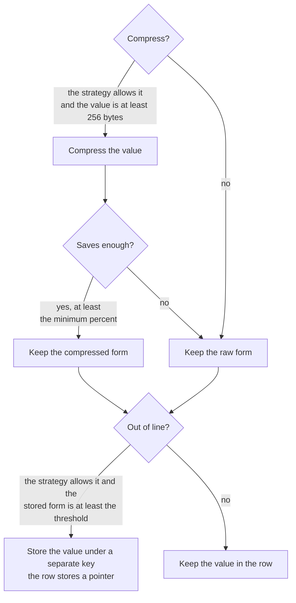

# Large values

CamusDB can compress large `STRING`, `BYTES`, `JSONB`, and `ARRAY` values, and
store them outside the row, similar to TOAST in PostgreSQL. Query results don't
change. The stored size, the I/O of a query, and the size of each row version
get smaller.

Use it for document bodies, JSON, images, archives, and other large values that
most queries don't read. Don't use it for values that most queries read, such
as embeddings for an exact vector search.

## Why out-of-line storage helps

Each row is stored as one key/value entry, and each update writes a new version
of the row. When a row contains a large value, you pay two costs:

- A query that reads only small columns also reads the large value from storage.
- An update to a small column writes the full row again, with another copy of
  the large value.

Out-of-line storage moves the large value under a separate key, and the row
stores a small pointer to it. A query that doesn't read the large column doesn't
fetch the value. An update that doesn't change the large column doesn't write it
again. Compression makes the stored value smaller when it saves enough space.

## Storage strategies

Each `STRING`, `BYTES`, `JSONB`, and `ARRAY` column has a storage strategy:

| Strategy | Compresses | Stores out of line | Use it for |
| --- | --- | --- | --- |
| `EXTENDED` | Yes, when it saves enough | Yes, at or above the threshold | The default. Text, JSON, documents, and most large columns. |
| `MAIN` | Yes, when it saves enough | No | Compressible values that most queries read. |
| `EXTERNAL` | No | Yes, at or above the threshold | Images, archives, and other incompressible values that most queries skip. |
| `PLAIN` | No | No | Values that all queries read, such as embeddings for nearest-neighbor (KNN) search. |

Set a strategy when you create the column:

```camussql
CREATE TABLE docs (
  id OID PRIMARY KEY,
  title STRING,
  body STRING STORAGE EXTENDED,
  thumbnail BYTES STORAGE EXTERNAL,
  embedding BYTES(3072) STORAGE PLAIN
);
```

To change it later, use `ALTER COLUMN ... SET STORAGE`:

```camussql
ALTER TABLE docs ALTER COLUMN thumbnail SET STORAGE PLAIN;
```

`SHOW CREATE TABLE` shows the strategies that you set. A strategy on a
fixed-size column, such as `INT64` or `FLOAT64`, returns `CADB0414`
`ColumnStorageNotApplicable`.

## How values are stored

When a non-null value is written, the following steps apply:

1. If the strategy allows compression and the value is at least 256 bytes, the
   value is compressed.
2. The compressed form is kept only if it saves at least
   `large_value_compression_min_saving_percent` (12 percent by default).
3. If the strategy allows out-of-line storage and the stored form is at least
   `large_value_threshold_bytes` (2048 bytes by default), the value is stored
   under a separate key. Otherwise, it is stored in the row.



Compression comes first. This means that a text value that compresses to less
than the threshold is stored in the row, and a read of that column doesn't need a
second key lookup.

Each row records how its values are stored. If you change a setting or a
strategy, existing rows stay readable.

## Query and write cost

- A query that doesn't name an out-of-line column doesn't fetch its value.
  `SELECT *` names all columns, and it fetches all out-of-line values.
- A query that reads an out-of-line column fetches the values in batches.
- A query decompresses a value when it reads that column.
- An update that doesn't assign a large column doesn't fetch or write that
  value again. However, the value is fetched if an index or a `CHECK`
  constraint uses the column.

## Transaction limits

Each out-of-line value is one more key, and one more mutation. An insert or a
delete of a row with `k` out-of-line values costs `k` more mutations than the
same row stored inline.

For example, a table with a primary key, no secondary index, and four large
columns stored out of line costs the following for each inserted row:

```text
row + primary-key entry + 4 large values = 6 mutations
```

With the default `max_mutations_per_transaction` of 20,000, one statement can
insert 3,333 of these rows. For more information, see
[Transaction limits](/docs/transaction-limits).

## Settings

These [runtime cluster settings](/docs/runtime-cluster-settings) control how
new rows are stored, and the size of read and rewrite batches:

| Setting | Default | Meaning |
| --- | --- | --- |
| `large_value_threshold_bytes` | `2048` | The stored size at or above which a value moves out of the row. With `0` or less, new values are stored in the row. |
| `large_value_compression_enabled` | `true` | Whether new writes can compress values. Reads ignore this setting. |
| `large_value_compression_min_saving_percent` | `12` | The minimum saving to keep a compressed value. |
| `large_value_rewrite_batch_rows` | `200` | The rows in each transaction of `ALTER TABLE ... REWRITE STORAGE`. At most half of `max_mutations_per_transaction`. |
| `large_value_resolve_batch_bytes` | `67108864` | The decoded bytes of large values that one read or rewrite batch fetches. A value of `0` or less removes the limit. |

A setting change applies to rows written after the change. Existing rows don't
change.

`large_value_resolve_batch_bytes` changes the memory use and the number of
fetches. It doesn't change query results. A row that is larger than the limit is
read alone.

## Existing data

Rows written before this feature are stored inline and uncompressed. They stay
readable, and you don't have to convert them.

- New inserts and updates use the current rules.
- `ALTER TABLE ... ALTER COLUMN ... SET STORAGE` changes future writes only.
- `ALTER TABLE ... REWRITE STORAGE` converts the existing rows.

Run a rewrite when you want the existing rows in the current form, ideally when
the table gets few writes:

```camussql
ALTER TABLE docs REWRITE STORAGE;
```

The rewrite has these properties:

- It converts `large_value_rewrite_batch_rows` rows in each transaction. On a
  busy table, you should use a smaller value.
- The row IDs, the values, and the index entries don't change.
- A row that is already in the target form isn't written again.
- If the statement stops, run it again. It continues after the last committed
  batch.
- It doesn't overwrite a concurrent user write. A row that a user changes is
  retried at the end. A row that continues to change is converted by a later
  user write.
- A concurrent user write can get the retryable error `CADB0502`
  `TransactionConflict` while a rewrite batch commits.

To convert all values back to the inline, uncompressed form, use:

```camussql
ALTER TABLE docs REWRITE STORAGE INLINE;
```

## Downgrades and rolling upgrades

A binary from before this feature can't read a compressed row or a row with an
out-of-line value. To downgrade to an older binary:

1. Set `large_value_threshold_bytes` to `0`.
2. Set `large_value_compression_enabled` to `false`.
3. Run `ALTER TABLE <table> REWRITE STORAGE INLINE` on each table.
4. Confirm that the rewrite completed without deferred rows.

During a rolling upgrade, don't store large values until all nodes run a version
that can read them. An older node can't read these rows, also when a distributed
query sends them to it.

## Interaction with other features

- **Branches.** A branch reads inherited out-of-line values from its parent at
  the fork timestamp. A write in the branch stores new values in the branch only.
- **Time-travel reads.** An out-of-line value is read at the same timestamp as
  its row. A rewrite writes new row versions, and old versions don't change.
- **Backups.** A physical backup contains the out-of-line values.
- **Logical dump and reimport.** A dump writes the full value as SQL. A reimport
  stores the rows with the current rules.
- **Indexes.** An index entry stores the indexed value, not a pointer.
- **`TRUNCATE TABLE` and `DROP TABLE`.** The retired or dropped contents include
  the out-of-line values. They're deleted with the contents.

## Error codes

| Code | Name | Meaning |
| --- | --- | --- |
| `CADB0414` | `ColumnStorageNotApplicable` | A storage strategy was set for a fixed-size column type. |
| `CADB0540` | `LargeValueCorrupt` | A stored large value couldn't be decompressed, or didn't match the checksum in its row. |
| `CADB0541` | `LargeValueNotResolved` | An internal error. Report it. |

A read without a fixed snapshot can see a row and its out-of-line value from
two versions, during a concurrent update. A checksum in the pointer detects
this, and the row is read again. If the row continues to change, the read
returns the retryable error `CADB0504` `TransactionMustRetry`.
