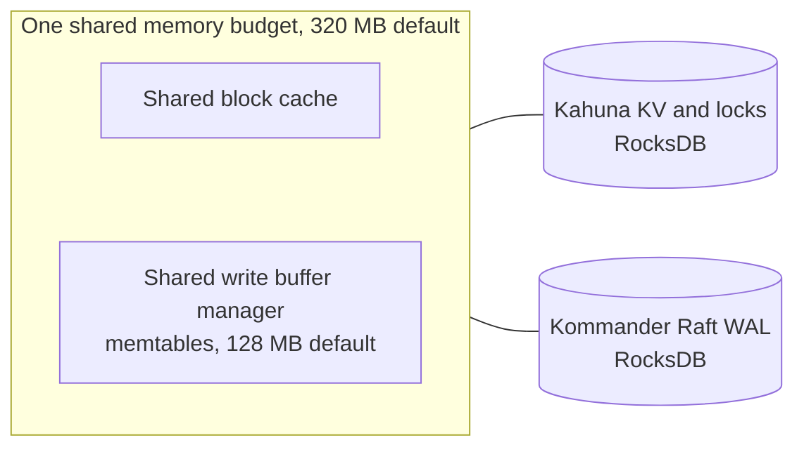
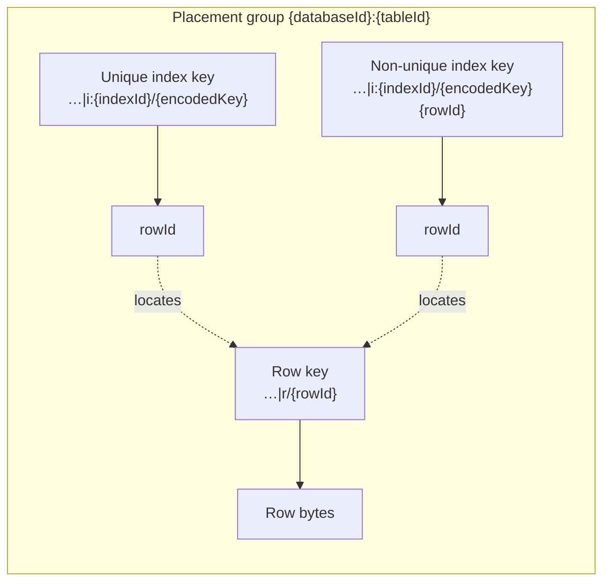

# Storage

CamusDB stores relational data on a distributed key/value layer.
[Kahuna](/docs/concepts#kahuna), the transactional key/value layer embedded in
each node, provides it. CamusDB maps six
kinds of object to persistent key/value entries: a table, a row, an index, the
schema metadata, a lock, and the transaction state.

You do not need this page to use CamusDB. Read it when you want to know how a
table becomes key/value entries. That knowledge helps you understand the cost of
an index, the size of a row, and the ranges in [`SHOW RANGES`](/docs/show-ranges).

The design keeps SQL as the model that a user sees. It uses a storage layout
that the distributed KV layer can route, replicate, lock, and commit.

For the user-facing row format controls for large `STRING`, `BYTES`/`BLOB`, and
`ARRAY` values, see [Large Values](/docs/storage-layout). That page covers
TOAST-style compression, out-of-line storage, and `ALTER TABLE ... REWRITE
STORAGE`.

## The storage stack

The SQL engine decides which rows and indexes a statement touches. The CamusDB
KV mapping encodes them as key/value entries.
Kahuna stores those entries with transactions and locks,
[Kommander](/docs/concepts#kommander) replicates them through the
[Raft](/docs/concepts#raft) log in cluster mode, and
[RocksDB](/docs/concepts#rocksdb) writes both to disk. See
[Architecture: storage components](/docs/architecture#storage-components) for
what each component does. For the recovery path, see
[WAL And Recovery](/docs/wal-recovery).

## The RocksDB backend

RocksDB is the default backend, in standalone and in cluster mode, both for the
key/value state and for the Raft log. SQLite is an optional embedded backend for
both. The in-memory backend serves development and tests only.

RocksDB is an embedded ordered key/value database built as a log-structured
merge-tree (LSM-tree). A write goes to a durable log file and to an in-memory
buffer called a memtable. RocksDB later flushes the memtable to sorted files on
disk, called SST files. A
background compaction merges those files over time so reads stay efficient.

These are the relevant storage settings:

```yaml
kahuna:
  storage: rocksdb
  wal_storage: rocksdb
  wal_sync_writes: true
  rocksdb_shared_memory: true
  rocksdb_shared_memory_budget_mb: 320
  rocksdb_shared_memtable_budget_mb: 128
```

`storage` controls the backend of the materialized KV state. `wal_storage`
controls the backend of the Raft write-ahead log.

`wal_sync_writes: true` keeps an acknowledged durable WAL write on the safer
path. A value of `false` helps in a benchmark or a test only, where you do not
evaluate the durability across a crash.

## Shared RocksDB memory

RocksDB can serve both the materialized KV backend and the WAL backend. The
CamusDB process then holds two separate embedded RocksDB databases:

- The KV and locks backend of Kahuna. It holds the SQL rows, the indexes, the
  metadata, the locks, and the transaction state.
- The Raft WAL backend of Kommander. It holds the log entries of the consensus.

The two databases stay separate on disk. That separation protects the Raft log
from the lifecycle of the data store. It also keeps four things under
independent management: the WAL recovery, the checkpoints, the compaction, and
the data files.

Two separate RocksDB databases can otherwise allocate two separate budgets of
memory. Two structures dominate the memory of RocksDB:

- The block cache, which holds the data blocks that RocksDB read from the SST
  files.
- The memtables.

The RocksDB baselines of CamusDB enable shared memory by default. Kahuna creates
one shared block cache, and one shared manager of the write buffers. It passes
both to the two RocksDB databases:

```yaml
kahuna:
  rocksdb_shared_memory: true
  rocksdb_shared_memory_budget_mb: 320
  rocksdb_shared_memtable_budget_mb: 128
```

The total budget bounds the shared block cache. CamusDB charges the memtable
sub-budget inside that same budget. One target of memory at process level
therefore governs the reads and the writes of both RocksDB databases. Two
independent budgets do not govern them.



Note these operational points:

- The sharing is active only when `storage` and `wal_storage` are both
  `rocksdb`.
- The setting does nothing if either backend is `sqlite` or `memory`.
- `rocksdb_shared_memory_budget_mb` defaults to `320`.
- `rocksdb_shared_memtable_budget_mb` defaults to `128`. It must not exceed the
  total budget.
- Set `rocksdb_shared_memory: false` to return to independent memory resources
  for each RocksDB database.
- The feature changes no persisted data format. It changes no SQL behavior, no
  transaction behavior, no WAL semantics, and no order during a recovery.

Use a larger total budget for a node with a hot working set of reads, or with
heavy bursts of writes. RocksDB can flush more often if the memtable sub-budget
is too small for the workload. The deployment saves less memory if that
sub-budget is too large.

## Databases in the shared key space

See [Databases](/docs/databases) for creating, renaming, dropping, and
recovering a database. At the storage level, every database in a process shares
one Kahuna node. Creating a database creates no separate storage engine, RocksDB
instance, WAL, or directory: its database id isolates it inside the shared
[key space](/docs/concepts#key-space).

Opening a database is a metadata operation. CamusDB resolves the name through
the registry, loads the schema metadata from the shared KV store, registers the
callbacks that apply later DDL changes after their Raft commit, and opens each
table lazily, when a statement first touches it. At startup this happens only
after the [WAL recovery](/docs/wal-recovery#the-recovery-path) finishes. A drop
of a database does not rewrite the Raft schema log, which only accepts new
entries.

## Key layout

CamusDB stores five kinds of record as key/value entries in the shared
[Kahuna](https://kahunakv.github.io/) key space: a row, an index, the schema
metadata, the statistics, and a registry record.

A key of user data starts with the opaque database id. Two databases can
therefore use the same table names without shared storage keys.

A new table receives a short table id in base62. The id comes from a persistent
monotonic sequence in the shared system key space. The id contains none of the
separators of a KV key, which are `/`, `:`, and `~`. CamusDB does not reuse an
id after a drop of the table. An id is usually much shorter than the previous
table id, which had the 24-character form of an ObjectId. An existing database
can still hold an older table id of 24 hexadecimal characters. Both formats
coexist safely, because CamusDB treats the id as an opaque segment of the key.

| Object | Key shape | Value |
| --- | --- | --- |
| Database registry entry | `_system/dbregistry/db:{databaseName}` | The database id, the normalized name, and the time of creation. |
| Database id sequence | `_system/dbregistry/seq` | The monotonic sequence that allocates a database id. |
| Table id sequence | `_system/tableseq` | The monotonic sequence that allocates a new short table id in base62. |
| System metadata | `{databaseId}/meta/system` | The internal metadata of the database. |
| Schema version | `{databaseId}/meta/version` | The schema version that CamusDB applied. |
| Table schema | `{databaseId}/meta/table:{tableId}` | The serialized schema of one table. |
| Table schema history | `{databaseId}/meta/history:{tableId}:{version}` | An earlier schema version of the table. CamusDB uses it to decode an older row. |
| DDL coordinator state | `{databaseId}/meta/coordinator:{tableId}~{element}` | The state of a schema change of several steps, such as the backfill of an index. |
| Table statistics | `{databaseId}:stats:{tableId}` | The persisted statistics of the planner, for that table. |
| Row | `{databaseId}:{tableId}\|r/{rowId}` | The serialized bytes of the row. |
| Unique index entry | `{databaseId}:{tableId}\|i:{indexId}/{encodedKey}` | The row id, as UTF-8 text. |
| Non-unique index entry | `{databaseId}:{tableId}\|i:{indexId}/{encodedKey}{rowId}` | The row id, as UTF-8 text. |
| Large value | `{databaseId}:{tableId}\|v/{rowId}{ordinal}` | The bytes of one variable-length cell that the row stores out of line. `{ordinal}` is four hex digits. |

A transaction can also use a routing key, `{databaseId}:{tableId}|tx/{transactionId}`,
to place its coordinator on the [partition](/docs/concepts#partition) that holds
the table. CamusDB never stores that key, and a transaction does not always use
one.

The position of the slash and the `|` separator is intentional. The row keys
share the bucket `{databaseId}:{tableId}|r`. The index keys share the bucket
`{databaseId}:{tableId}|i:{indexId}`. The large values share the bucket
`{databaseId}:{tableId}|v`. The part before the first `|` is the placement
group. Under [hash routing](/docs/concepts#hash-and-key-range-routing), the
default, a table's rows, large values, and indexes share that
group and therefore stay on the same partition.



This key shape is part of the storage revision. Move data across storage
revisions with a [logical dump and reimport](/docs/logical-dump-and-reimport).

A metadata key uses the single bucket `{databaseId}/meta`. CamusDB can therefore
load and purge the metadata of a database as one coherent group.

A non-unique index key holds the row id directly after the encoded key. The row
id has a fixed form of 24 characters. CamusDB can therefore separate it again,
and the index keys stay sortable.

An index uses a stable id in the storage key space. It keeps the index name that
the schema shows as metadata. A table and a column also have a stable id.

CamusDB allocates a new table id in base62 before it commits the schema change.
Every node therefore applies the same identity for that table. A rename of a
table, of a column, or of an index needs no rewrite of the existing row data or
index data.

## Row values

CamusDB stores each row as one compact binary value. The payload of a row holds
three parts:

1. The schema version.
2. The object id of the row.
3. One encoded value for each column, in the order of the schema.

The schema version lets CamusDB deserialize an older payload of a row. It uses
the schema history that belongs to the table.

CamusDB compiles the row layout of each visible schema version. A scan and a
point read can therefore decode only the values that the query needs. Neither
one rebuilds the whole row through a generic path. The storage format stays
stable. The cost in CPU and in allocations falls for a query with many reads,
for an index lookup, for an update, and for a backfill.

CamusDB encodes a column value by its type:

| Column type | Stored representation |
| --- | --- |
| `OID` | A 12-byte object id. |
| `UUID` | A 16-byte UUID. |
| `INT64` | An 8-byte signed integer. |
| `NUMERIC` | An exact fixed-point decimal value with the fixed `NUMERIC` precision and scale. |
| `FLOAT64` | An 8-byte double. |
| `FLOAT32` | A 4-byte value with single precision. CamusDB exposes it through the common path for a numeric value. |
| `STRING` | A UTF-16 string, with a length prefix. |
| `BOOL` | One marker byte for the boolean. |
| `DATE` | UTC ticks, truncated to midnight. |
| `DATETIME` | UTC ticks. |
| `BYTES` | A byte payload, with a length prefix. |
| `ARRAY(T)` | The element type, and then an ordered sequence of the encoded element values. |
| `NULL` | One marker byte for the null. |

## Index encoding

An index key must sort in the same order as a SQL value. CamusDB uses an encoder
that preserves the order of a composite index value:

- A `NULL` sorts before a value that is present.
- An `INT64` inverts the sign bit. CamusDB stores the result as hexadecimal text
  of a fixed width.
- A `NUMERIC` value uses an order-preserving decimal encoding, so exact decimal
  values can participate in primary keys and secondary indexes without going
  through a floating-point representation.
- A `FLOAT64` and a `FLOAT32` receive a transform of their IEEE-754 bits. The
  transform preserves the order.
- A `BOOL` stores `0` or `1`.
- A `DATE` and a `DATETIME` sort by their value in UTC ticks.
- A `UUID` stores its 128-bit value in an encoding of a fixed width. The
  encoding preserves the order.
- A `BYTES` value uses a byte encoding that preserves the order.
- A `STRING` and an `OID` value use a terminator and an escape. A prefix
  therefore sorts correctly.

CamusDB can therefore scan the index keys in the lexicographic order of the KV
layer. The result follows the SQL order of the indexed columns.

Every scalar column type accepts an index. CamusDB stores an `ARRAY(T)` column
in a row. You cannot use such a column in a primary key, and you cannot use it
in a secondary index.

For a UUID identifier, prefer a `UUID` column to a `STRING` column. A `UUID`
column stores 16 bytes in a row, and it uses compact index keys of a fixed
width. A UUID saved as text carries the larger string form through the memory,
the disk, and the index entries.

## Writes and locks

A write path uses persistent KV entries, and a transaction coordinator that the
server owns:

1. Start a transaction.
2. Acquire an exclusive lock for each row key, index key, and metadata key that
   the transaction will write.
3. Write the affected keys, or delete them.
4. Register the confirmed writes and the locks with the transaction coordinator
   of Kahuna.
5. Commit the transaction handle through the transaction API of
   [Kahuna](https://kahunakv.github.io/). You can also roll the handle back.

A write across partitions uses [two-phase commit](/docs/concepts#two-phase-commit).
CamusDB uses Serializable transactions by default. It adds reads of committed
row versions ([MVCC](/docs/concepts#mvcc)), conflict detection, and
[write intents](/docs/concepts#write-intent), the provisional values that a
transaction stages until its atomic commit.

## Scans

A full table scan reads the prefix of the row bucket:

```text
{databaseId}:{tableId}|r
```

An index scan reads the prefix of the index bucket:

```text
{databaseId}:{tableId}|i:{indexId}
```

A row id and an encoded index key both preserve the sort order. CamusDB can
therefore stream a row or an index entry from the KV storage in a determinate
order. It applies the filters, the projection, the sort, the limits, and the
aggregation after that.

## Standalone mode and cluster mode

Standalone mode creates one embedded Kahuna node for the CamusDB process, shared
by every database. This is the simplest setup for a tutorial and for local
development.

Cluster mode also creates one shared storage node for the process. It connects
that node to the other nodes, through static discovery. CamusDB divides the data
across the Raft partitions. Each partition elects its own
[leader](/docs/concepts#leader), through Kommander.

See [Cluster Mode](/docs/cluster) for the startup commands and the
configuration.
