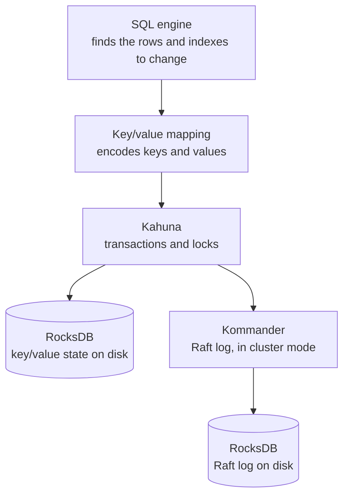
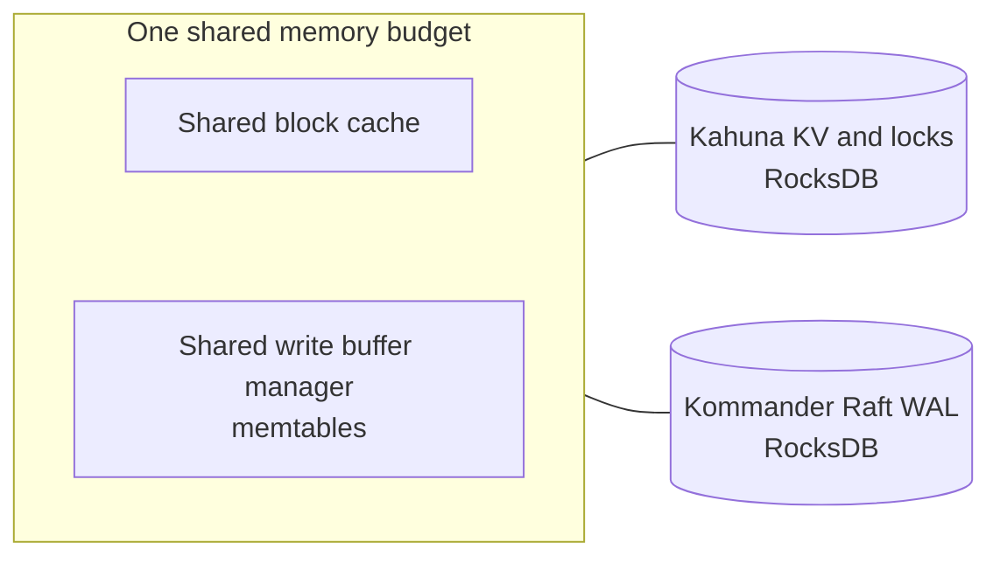
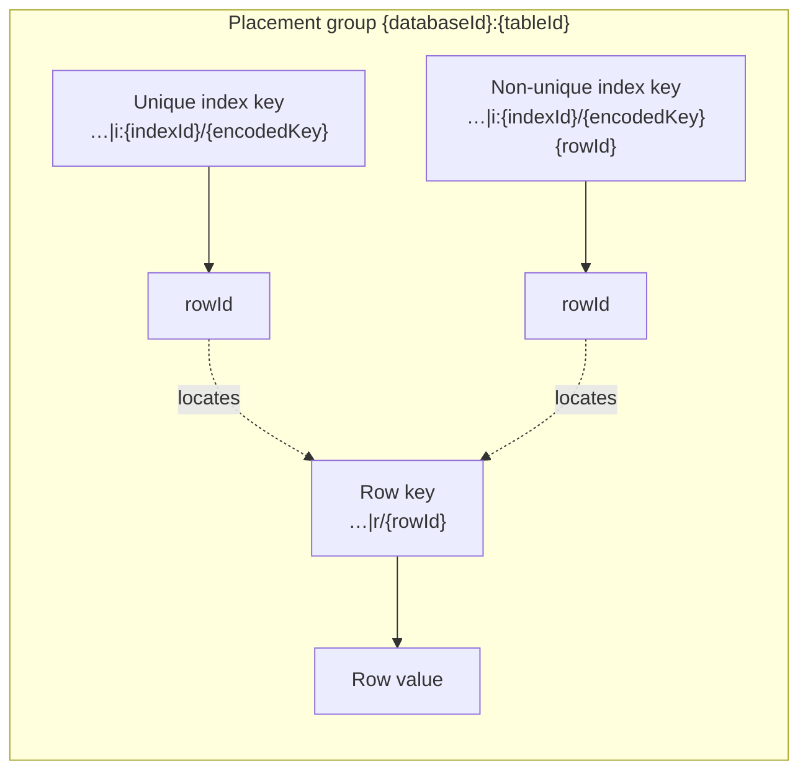

# Storage

This page shows how CamusDB stores tables as key/value entries. It helps you
estimate the cost of an index and the size of a row, and read the ranges in
[`SHOW RANGES`](/docs/show-ranges). You don't need it to use CamusDB.

CamusDB stores relational data in [Kahuna](/docs/concepts#kahuna), the
transactional key/value store in each node. Each row is a key/value entry.
Index entries and schema metadata are also key/value entries. Kahuna routes
and replicates these entries, and commits them in transactions.

For the controls of large values, such as compression and out-of-line storage,
see [Large values](/docs/storage-layout).

## The storage stack

The following diagram shows the layers that a write goes through:



[Kommander](/docs/concepts#kommander) replicates the entries through the
[Raft](/docs/concepts#raft) log. [RocksDB](/docs/concepts#rocksdb), or another
configured backend, writes them to disk. For more information about each
component, see [Architecture: storage components](/docs/architecture#storage-components).
For the recovery path, see [WAL and recovery](/docs/wal-recovery).

## RocksDB backend {#the-rocksdb-backend}

RocksDB is the default backend for the key/value state and for the Raft log, in
standalone and cluster mode. You can select one of the following backends for
each layer:

| Backend | Use |
| --- | --- |
| `rocksdb` | The default. |
| `sqlite` | An embedded alternative. Note that SQLite doesn't have page checksums. |
| `solarium` | A managed engine with no native library. See [Solarium backend](#solarium-backend). |
| `memory` | Development and tests only. The data is lost when the node stops. |

RocksDB is an embedded, ordered key/value database. It is a log-structured
merge-tree (LSM tree). Each write goes to a durable log file and to a buffer in
memory, called a memtable. RocksDB later writes the memtable to sorted files on
disk, called SST files. Background compaction merges these files. This makes
reads faster.

These are the main storage settings:

```yaml
kahuna:
  storage: rocksdb
  wal_storage: rocksdb
  wal_sync_writes: true
```

`storage` selects the backend for the key/value state. `wal_storage` selects
the backend for the Raft write-ahead log (WAL). With `wal_sync_writes: true`,
the default, the WAL is synced to disk on each write. You should use `false`
only for benchmarks and tests that don't need durability after a crash.

## Solarium backend

[Solarium](https://solariumdb.github.io/) is a managed storage engine. To use
it, set `kahuna.storage` to `solarium`. You can also use it for the Raft log,
with `kahuna.wal_storage`. You don't need a native RocksDB library. CamusDB
includes the engine integration.

The two engines can't read each other's files. To move data from one engine to
the other, use a [logical dump and reimport](/docs/logical-dump-and-reimport).
PITR bootstrap needs RocksDB for both layers. For the Solarium settings and
memory budgets, see
[Solarium storage engine](/docs/configuration#solarium-storage-engine).

## Shared RocksDB memory

When RocksDB is the backend for both layers, the CamusDB process has two
RocksDB databases:

- The key/value database of Kahuna. It has the SQL data and the transaction
  state.
- The Raft WAL database of Kommander. It has the consensus log entries.

The two databases are separate on disk. This means that WAL recovery and
compaction don't depend on the data files.

Two structures use most of the memory of RocksDB:

- The block cache, which has the data blocks that RocksDB read from SST files.
- The memtables.

By default, Kahuna creates one block cache and one write buffer manager, and
gives both to the two RocksDB databases. You can set the budgets explicitly:

```yaml
kahuna:
  rocksdb_shared_memory: true
  rocksdb_shared_memory_budget_mb: 320
  rocksdb_shared_memtable_budget_mb: 128
```

The total budget limits the shared block cache. The memtable budget is part of
the total budget. This means that one memory target covers the reads and the
writes of both databases.



Note the following:

- Sharing is on if `storage` and `wal_storage` are both `rocksdb`.
- If you don't set the budgets, they are computed from the memory of the
  machine or container. For the rules, see
  [Cache sizing](/docs/configuration#cache-defaults-proportional-to-memory).
- The memtable budget must not be larger than the total budget.
- With `rocksdb_shared_memory: false`, each RocksDB database has separate
  memory budgets.
- Sharing doesn't change the data format or the recovery.

At startup, the node logs the budgets that it uses:

```text
RocksDB shared memory: block cache 64 MiB, memtable budget 16 MiB; Raft-log flush unit plus headroom 192 MiB (NOT covered: Raft-log flushes will be budget-forced).
```

`NOT covered` means that the memtable budget is smaller than one flush unit of
the Raft log. The Raft log then flushes when the budget is full, and some log
entries are written to disk that would otherwise be removed in memory. Use a
larger total budget for nodes with a large set of hot data or with bursts of
writes. If the memtable budget is too small, RocksDB flushes more often.

## Databases in the shared key space

All the databases of a process use one Kahuna node. A new database doesn't get
a separate storage engine or directory. Its database id isolates it in
the shared [key space](/docs/concepts#key-space). For more information about
databases, see [Databases](/docs/databases).

To open a database, CamusDB reads its schema metadata from the key/value store.
Each table is opened when a statement first uses it. At startup, databases open
after [WAL recovery](/docs/wal-recovery#the-recovery-path) finishes.

## Key layout

Each key of user data starts with the database id. This means that two
databases can have tables with the same names, and their keys don't collide.

| Object | Key shape | Value |
| --- | --- | --- |
| Database registry entry | `_system/dbregistry/db:{databaseName}` | The database id and its metadata, such as the creation time. |
| Database id sequence | `_system/dbregistry/seq` | The sequence that allocates database ids. |
| Table id sequence | `_system/tableseq` | The sequence that allocates table ids. |
| System metadata | `{databaseId}/meta/system` | The internal metadata of the database. |
| Schema version | `{databaseId}/meta/version` | The schema version that CamusDB applied. |
| Table schema | `{databaseId}/meta/table:{tableId}` | The serialized schema of one table. |
| Table schema history | `{databaseId}/meta/history:{tableId}:{version}` | An earlier schema version of the table, used to decode older rows. |
| DDL coordinator state | `{databaseId}/meta/coordinator:{tableId}~{element}` | The state of a multi-step schema change, such as an index backfill. |
| Table statistics | `{databaseId}:stats:{tableId}` | The planner statistics of the table. |
| Row | `{databaseId}:{tableId}\|r/{rowId}` | The row value. |
| Unique index entry | `{databaseId}:{tableId}\|i:{indexId}/{encodedKey}` | The row id as UTF-8 text. |
| Non-unique index entry | `{databaseId}:{tableId}\|i:{indexId}/{encodedKey}{rowId}` | The row id as UTF-8 text. |
| Large value | `{databaseId}:{tableId}\|v/{rowId}{ordinal}` | The bytes of one variable-length cell stored out of line. `{ordinal}` is four hex digits. |

Other metadata, such as views and functions, uses keys of the form
`{databaseId}/meta/{kind}:{id}`. All the metadata keys of a database are in the
bucket `{databaseId}/meta`. This means that CamusDB can load and purge them as
one group.

A new table gets a short base62 id from the persistent sequence
`_system/tableseq`, such as `1` or `A0`. An id isn't used again after its table
is dropped. Tables created by older versions can have 24-character hex ids.
Both forms can be in the same database.

The row id is 24 lowercase hex characters. A non-unique index key has the row
id directly after the encoded key, with no separator. The fixed length lets
CamusDB split the row id off again.

A transaction can also use a routing key,
`{databaseId}:{tableId}|tx/{transactionId}`, to place its coordinator on the
[partition](/docs/concepts#partition) that has the table. This key isn't
stored, and a transaction doesn't always use one.

### Placement groups

The `|` and `/` positions in a key matter. The part before the first `|` is
the placement group, `{databaseId}:{tableId}`. The part before the last `/` is
the bucket that a scan reads, such as `{databaseId}:{tableId}|r` for rows or
`{databaseId}:{tableId}|i:{indexId}` for one index. With
[hash routing](/docs/concepts#hash-and-key-range-routing), the default, all the
buckets of a table are in one placement group. This means that all the keys of
a table are on the same partition. A transaction
that reads an index entry and writes its row can then commit on one partition.



Schema objects have stable ids, and their names are metadata. This means that
a rename doesn't rewrite the rows or the index entries.

This key layout is part of the storage revision. To move data from one storage
revision to the next, use a [logical dump and reimport](/docs/logical-dump-and-reimport).

## Row values

CamusDB stores each row as one binary value. The row id isn't in the value,
because it is already in the key. The value has the following parts:

1. The schema version of the row, in 4 bytes.
2. A null bitmap, with one bit for each column.
3. A bool bitmap, with one bit for each `BOOL` column.
4. The fixed-width cells, at fixed offsets.
5. The end offset of each variable-length cell, in 4 bytes.
6. The variable-length cells.

CamusDB uses the schema version and the
[schema history](#key-layout) to decode rows that were written before an
`ALTER TABLE`. A row that has compressed or out-of-line cells also has a
trailer. For more information, see [Large values](/docs/storage-layout).

| Column type | Stored as |
| --- | --- |
| `OID` | 12 bytes, fixed. |
| `UUID` | 16 bytes, fixed. |
| `NUMERIC` | 16 bytes, fixed: a 128-bit integer with a scale of 9 fractional digits. |
| `INT64`, `FLOAT64` | 8 bytes, fixed. |
| `FLOAT32` | 4 bytes, fixed. |
| `DATE`, `DATETIME` | 8 bytes, fixed: UTC ticks. A `DATE` is at midnight. |
| `BOOL` | One bit in the bool bitmap. |
| `STRING` | UTF-8 bytes, variable length. |
| `BYTES`, `JSONB` | The bytes of the value, variable length. |
| `ARRAY(T)` | The encoded elements, variable length. |
| `NULL` | One bit in the null bitmap. A `NULL` fixed-width cell uses its bytes too. |

A `NULL` string and an empty string differ only in the null bitmap. The
reader decodes only the cells that a query needs, at offsets that are computed
from the schema version.

## Index encoding

Index keys must sort in the same order as the SQL values in them. Each value in
a composite index key starts with `0` for `NULL` or `1` for a value. This means
that `NULL` sorts before all values. The value is encoded as follows:

| Type | Key encoding |
| --- | --- |
| `INT64`, `DATE`, `DATETIME` | 16 hex characters of the 64-bit value, with the sign bit inverted. |
| `FLOAT64`, `FLOAT32` | 16 or 8 hex characters of an order-preserving transform of the IEEE 754 bits. `-0` is stored as `0`. |
| `NUMERIC` | 19 characters, fixed width, of the 128-bit value with the sign bit inverted. |
| `UUID` | 19 characters, fixed width. |
| `OID` | 14 characters, fixed width. |
| `BOOL` | `0` or `1`. |
| `STRING` | An ASCII code of the UTF-16 code units, with a terminator. |
| `BYTES` | 2 hex characters for each byte, with a terminator. |

The key/value layer scans keys in lexicographic order. This order is the SQL
order of the indexed columns. `STRING` keys sort by ordinal UTF-16 order, and
they ignore locale rules.

You can't use `ARRAY` or `JSONB` columns in a primary key or an ordered index.
For `JSONB`, use a [GIN index](/docs/sql-indexes). A descending key column
must be a fixed-width type. For more information, see
[Indexes](/docs/sql-indexes).

For UUID identifiers, you should use a `UUID` column, and not `STRING`. A
`UUID` uses 16 bytes in the row and 19 characters in an index key. The text
form uses 36 bytes in the row and more in each index key.

## Writes and locks

A write is executed as follows:

1. Start a transaction.
2. Lock each key that the transaction will write. With the default
   pessimistic locking, the lock is exclusive and is taken
   before the write. With optimistic locking, conflicts are found at commit.
3. Write or delete the keys.
4. Register the writes and locks with the transaction coordinator of Kahuna.
5. Commit the transaction, or roll it back.

A write across partitions uses [two-phase commit](/docs/concepts#two-phase-commit).
Transactions are Serializable by default. A Serializable transaction reads
committed row versions ([MVCC](/docs/concepts#mvcc)), and it checks for
conflicts. Until the commit, its writes are
[write intents](/docs/concepts#write-intent). For more information, see
[Locking strategy](/docs/sql-transactions#locking-strategy).

## Scans

A full table scan reads the row bucket:

```text
{databaseId}:{tableId}|r
```

An index scan reads the bucket of the index:

```text
{databaseId}:{tableId}|i:{indexId}
```

Row ids and encoded index keys are sorted. This means that CamusDB reads rows
and index entries from storage in a known order. Then it applies the rest of
the query, such as filters and sorts.

## Standalone mode and cluster mode

In standalone mode, the CamusDB process has one embedded Kahuna node, which all
the databases use. This is the simplest setup for tutorials and local
development.

In cluster mode, each process also has one Kahuna node, connected to the other
nodes through static discovery. CamusDB divides the data into Raft partitions,
and each partition elects a [leader](/docs/concepts#leader) through Kommander.
For the startup commands and configuration, see [Cluster mode](/docs/cluster).
